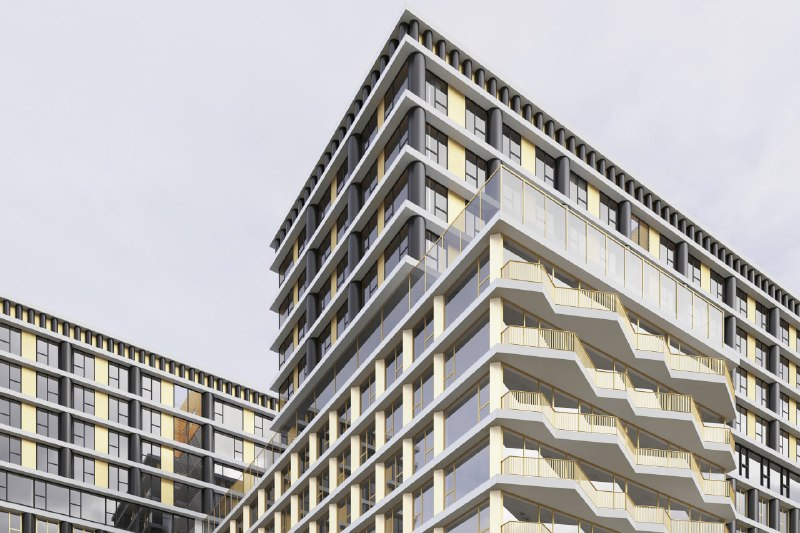
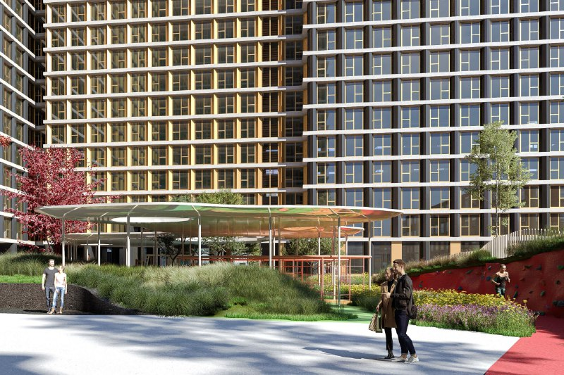
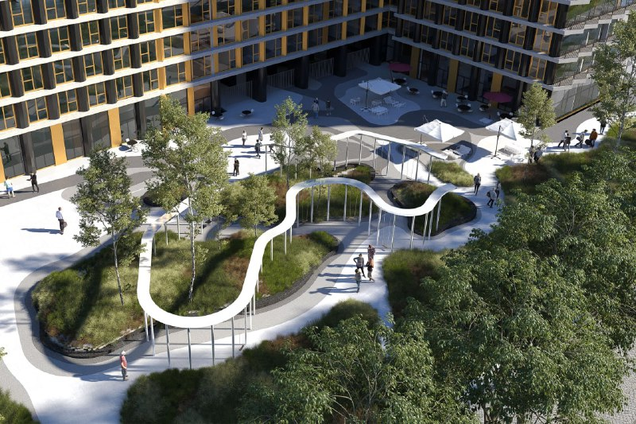
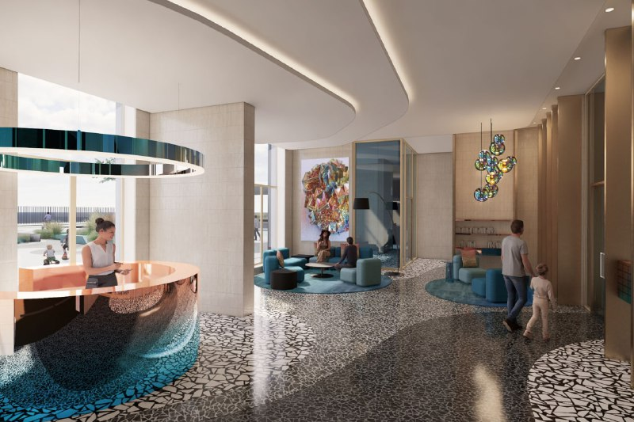

# Nametkin Tower от Основы на Наметкина, 10: апартаменты подорожали, сдача уехала

Апарткомплекс Nametkin Tower группы «Основа» на улице Наметкина, 10 вышел в продажу весной 2022 года: четыре секции в 24–29 этажей, нидерландское бюро Mecanoo на архитектуре и вход от 7,4 млн ₽. К октябрю 2026 года картина знакомая: минимальный лот стоит около 12,5 млн ₽, а сдача сдвинулась с 2025 года на IV квартал 2026 года.

## Коротко

- Проект [Основы](/zastroyshchiki/osnova/) в Черёмушках (ЮЗАО): четыре секции переменной этажности, от 24 до 29 этажей.
- Апартаменты от 21 до 111 м², архитектура и благоустройство — Mecanoo (Нидерланды).
- Вход подорожал с 7,4 млн ₽ (апрель 2022 года) до примерно 12,5 млн ₽ (октябрь 2026 года, агрегатор).
- Сдача: обещали 2025 год, теперь — IV квартал 2026 года.

## Голландская архитектура на Наметкина

Nametkin Tower — комплекс апартаментов на улице Наметкина, вл. 10. В апреле 2022 года, по данным РБК Недвижимости, продажи вела компания «БЕСТ-Новострой» как официальный представитель застройщика — ООО «Специализированный застройщик «Гартея» из ГК «Основа». Четыре секции высотой от 24 до 29 этажей, апартаменты от 21 до 111 м².

Концепцию и благоустройство рисовало нидерландское бюро Mecanoo — имя, которое в Черёмушках встречается не каждый день. По рендерам — террасы, золотистые акценты и двор под извилистым навесом. Сейчас, по данным агрегатора novostroy.ru, строится 29-этажный монолитный дом.

*(1) Фрагмент фасада с террасами. Визуализация: Основа*

*(2) Двор с навесом и озеленением. Визуализация: Основа*

*(3) Двор, вид сверху. Визуализация: Основа*

*(4) Холл с ресепшеном. Визуализация: Основа*

## Откуда взялся проект

Вся история площадки и согласований, включая архитектуру и фасад, — в [досье «Nametkin Tower»](/obekty/nametkin-tower/). Дату разрешения на строительство застройщик публично не называл, поэтому здесь её нет.

## Дороже и позже

Положение дел на 15 октября 2026 года — по странице проекта на novostroy.ru (дату актуальности цен агрегатор не указывает):

- **Срок.** В апреле 2022 года ввод обещали в 2025 году, теперь в графике IV квартал 2026 года. Плюс примерно год.
- **Цена.** На старте, в апреле 2022 года, — от 7,4 млн ₽. Сейчас самые доступные лоты — около 12,5 млн ₽ за 23,5 м², а метр в видимых объявлениях гуляет от 432 до 564 тыс. ₽.
- **Метро.** «Воронцовская» — около 0,6 км, «Новые Черёмушки» — около 0,93 км, «Калужская» — около 0,98 км, «Севастопольский проспект» — около 1,44 км.

Сама страница агрегатора путается в показаниях: число квартир и планировок там указано по-разному. Так что цифры — ориентир, а не прайс; сверяйте их с проектной декларацией и отделом продаж.

## Что это значит для покупателя и инвестора

Вход за четыре с лишним года подорожал примерно на две трети: с 7,4 до 12,5 млн ₽. Но сравнение условное: в 2022 году продавали первые лоты, а сейчас в открытых объявлениях почти одни студии.

Срок уже съехал с 2025 года на IV квартал 2026 года — значит, обещания «в срок» стоит проверять по стройке, а не по рендерам. Если покупаете по [ДДУ](/slovar/ddu/) (договору долевого участия), сверьте дату с [проектной декларацией](/slovar/proektnaya-deklaratsiya/). И помните, что апартаменты — нежилые помещения: у них свои правила регистрации и налогов.

Вот где, на наш взгляд, главный вопрос для инвестора: откуда разброс от 432 до 564 тыс. ₽ за метр в видимых объявлениях. Пока ответа нет, считать доходность рано. Общий фон — в разделе [«Цены»](/temy/ceny/), альтернативы — в подборке [новостроек Москвы](/novostroyki/moskva/).

## Карточка объекта

- Названия: Nametkin Tower, Наметкин Тауэр.
- Адрес ЗУ: Наметкина, вл. 10, район Черёмушки, ЮЗАО, Москва.
- Застройщик: ГК «Основа» (ООО СЗ «Гартея»).
- Архитектор: Mecanoo.
- Здание: 4 секции, 24–29 этажей.
- Площади апартаментов: от 21 до 111 м².
- Стадия: строительство.
- Ввод: IV квартал 2026 года (по данным агрегатора).
- Цена: от 12,5 млн ₽ за лот (октябрь 2026 года, агрегатор).

## Вопросы и ответы

**Кто застройщик Nametkin Tower?**
Проект ведёт группа компаний «Основа»; в 2022 году продажи апартаментов шли через её структуру — «Специализированный застройщик «Гартея».

**Где находится Nametkin Tower?**
На улице Наметкина, вл. 10, в районе Черёмушки (ЮЗАО). До метро «Воронцовская» — около 0,6 км, до «Новых Черёмушек» — около 0,9 км.

**Когда сдадут Nametkin Tower?**
В апреле 2022 года обещали 2025 год, на октябрь 2026 года агрегатор указывает IV квартал 2026 года. Точный срок сверяйте с проектной декларацией на наш.дом.рф.

**Сколько стоят апартаменты в Nametkin Tower?**
На старте, в апреле 2022 года, — от 7,4 млн ₽. На октябрь 2026 года, по странице агрегатора, — примерно от 12,5 млн ₽, метр в видимых объявлениях — от 432 до 564 тыс. ₽.

## Источники

1. РБК Недвижимость, апрель 2022 года: https://realty.rbc.ru/news/6245aba59a7947e236ec3722
2. novostroy.ru, страница проекта «Nametkin Tower», цены и планировки: https://www.novostroy.ru/buildings/nametkina-10/prices

Материал не является инвестиционной рекомендацией.
