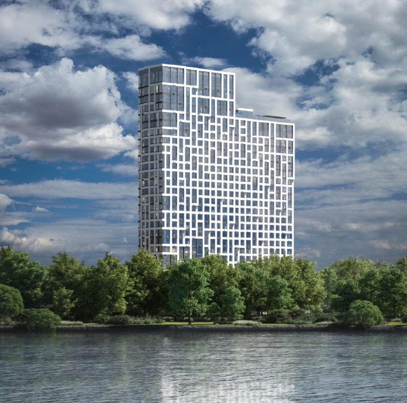
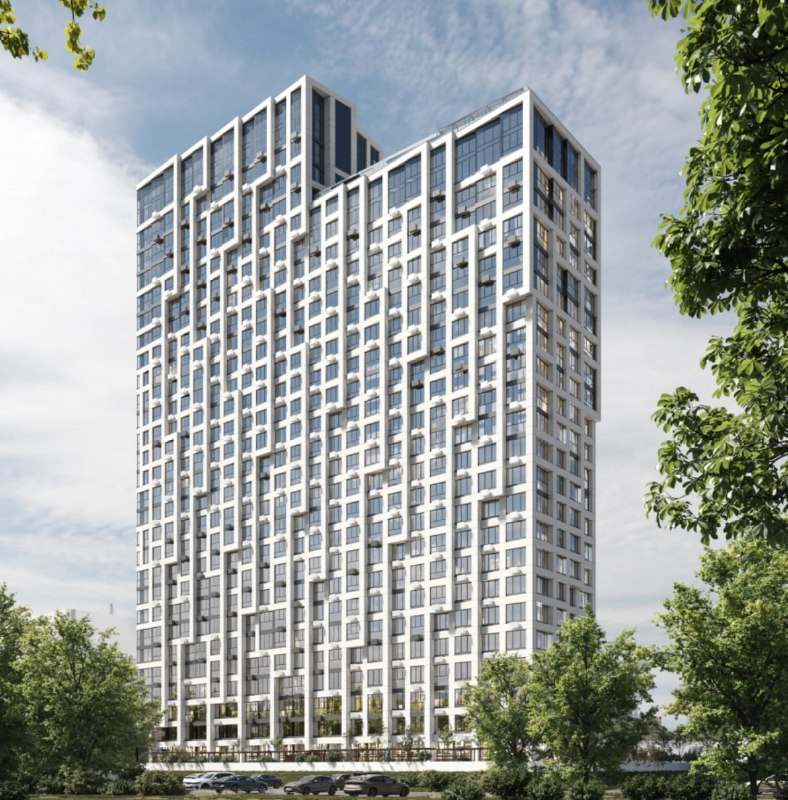

# UNO.Головинские пруды от «Основы»: от студий за 7,6 млн ₽ до выдачи ключей

В апреле 2022 года ГК «Основа» открыла продажи ЖК «UNO. Головинские пруды» на Михалковской улице, 50 в Головинском районе (САО): 455 квартир, студии 21 кв. м от 7,6 млн ₽. Четыре с половиной года спустя история, судя по карточке проекта, дописана: на 15 октября 2026 года корпус 1 сдан, ключи выдают, лоты у застройщика закончились.

## Коротко

- **Что:** бизнес-класс, одна двухсекционная башня в 23–28 этажей, 455 квартир — от студий до 4-комнатных евроформата.
- **Почём на старте:** от 7,5–7,6 млн ₽ за студию 21 кв. м — около 360 тыс. ₽/м² по нашему расчёту для минимального лота.
- **Срок:** в апреле 2022 года обещали 4 квартал 2024 года, в начале мая — уже 4 квартал 2025 года.
- **Сейчас:** по карточке на novostroy-m.ru корпус 1 сдан, лоты распроданы.

## «Основа» вышла к прудам

21 апреля 2022 года ГК «Основа» объявила старт продаж ЖК «UNO. Головинские пруды». Головинский район, рядом МЦК «Коптево» и метро «Водный стадион». В доме — подземный паркинг и детский сад на 50 мест. Адрес по карточке проекта: Михалковская улица, д. 50.

Со сроком с самого начала вышла путаница. В сообщении от 21 апреля значился 4 квартал 2024 года, а в обзоре стартов апреля от 2 мая 2022 года — 4 квартал 2025 года. Цена студии там же — 7,6 и 7,5 млн ₽. Меньше двух недель — и плюс год к сдаче.

*(1) ЖК «UNO. Головинские пруды»: фасад в проекте. Визуализация: ГК «Основа»*

*(2) ЖК «UNO. Головинские пруды»: вид на две секции. Визуализация: ГК «Основа»*

## Дом сдан, витрина пуста

По карточке проекта на novostroy-m.ru на октябрь 2026 года корпус 1 сдан, идут выдача ключей и заселение, все лоты распроданы. Даты у карточки нет, последняя [проектная декларация](/slovar/proektnaya-deklaratsiya/) в ней — от 5 марта 2025 года.

Карточка и сама себе противоречит: в экспертном тексте за апрель 2025 года квартиры ещё продают, а в характеристиках продано всё. Так что дату ввода и остатки лучше сверять по официальным данным, а не по агрегатору.

Уложилась ли «Основа» в обещанный на старте срок — 4 квартал 2024 или 2025 года, — из этих источников не понять: дату ввода в них не называют.

## Сосед через забор: «Михалковский» от РГ

Рядом, на Михалковской, 48, строится ЖК «Михалковский» застройщика РГ (РГ-Девелопмент). По объявлению на novostroy-m.ru, корпус 2 сдадут в 4 квартале 2027 года, а 4-комнатная квартира на 1 июня 2026 года стоила 41,3 млн ₽ (503,9 тыс. ₽/м²). Вся хронология цен — в [досье «Михалковский»](/obekty/mikhalkovskiy/), другие проекты застройщика — на странице [«РГ»](/zastroyshchiki/rg/).

## Что это значит для покупателя и инвестора

У «Основы» здесь, судя по карточке, квартиры от застройщика закончились. Если район нравится, ориентиры теперь два: соседние новостройки и вторичка в уже сданном доме.

Сравнить обещанные в 2022 году сроки с реальными пока нельзя — официальную дату ввода застройщик публично не показывал. Если покупаете на вторичке, попросите у продавца документы о вводе дома: это быстрее любой аналитики. Другие проекты района — в разделе [«Новостройки Головинского района»](/novostroyki/golovinskiy/), свежие старты — в подборке [«Старты продаж»](/novostroyki/start-prodazh/).

## Карточка объекта

- Название: ЖК «UNO. Головинские пруды».
- Адрес: ул. Михалковская, д. 50, Головинский район, САО, Москва.
- Застройщик: ГК «Основа».
- Класс: бизнес.
- Этажность: 23–28, две секции; квартир 455.
- Стадия: корпус 1 сдан, выдача ключей (по карточке проекта, без даты).

## Вопросы и ответы

**Где находится ЖК «UNO. Головинские пруды»?**
В Головинском районе (САО), на улице Михалковской, д. 50, рядом с МЦК «Коптево» и метро «Водный стадион».

**Сколько стоили квартиры на старте продаж UNO.Головинские пруды?**
По публикациям апреля и мая 2022 года — от 7,5–7,6 млн ₽ за студию 21 кв. м.

**Когда сдали UNO.Головинские пруды?**
В апреле 2022 года называли то 4 квартал 2024 года, то 4 квартал 2025 года. На октябрь 2026 года, по карточке проекта на novostroy-m.ru, корпус 1 сдан и идёт выдача ключей.

**Кто застройщик соседнего ЖК «Михалковский»?**
РГ-Девелопмент; по объявлению на novostroy-m.ru, срок сдачи — 4 квартал 2027 года.

## Источники

1. novostroy-m.ru, 21 апреля 2022 года, старт продаж UNO.Головинские пруды: https://www.novostroy-m.ru/novosti/unogolovinskie_prudy_tseny_na
2. novostroy-m.ru, 2 мая 2022 года, старты апреля 2022 года: https://www.novostroy-m.ru/analitika/starty_aprelya_2022
3. novostroy-m.ru, карточка ЖК «UNO. Головинские пруды»: https://www.novostroy-m.ru/baza/jk_na_mihalkovskoy
4. novostroy-m.ru, объявление в ЖК «Михалковский»: https://www.novostroy-m.ru/kvartiry/chetirehkomnatnaya-kvartira-v-zhk-mihalkovskii-24262c2b9c23895ca75b32e6db77fe

Материал не является инвестиционной рекомендацией.
