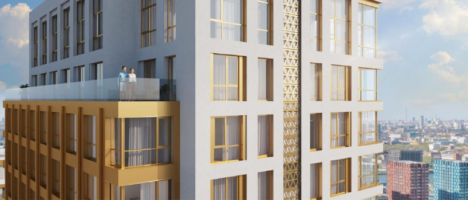

# ЖК WOW в Нагатино от Страны Девелопмент: старт с 13,4 млн ₽ и сдача с опозданием

В апреле 2022 года «Страна Девелопмент» начала продавать ЖК WOW на полуострове в Нагатино: восемь корпусов от 6 до 20 этажей и 668 квартир. К октябрю 2026 года первый корпус введён в эксплуатацию — но не в конце 2023 года, как обещали на старте, а почти годом позже.

*Визуализация верхней части корпуса ЖК WOW с террасой и золотистыми рамами окон. Визуализация: Страна Девелопмент*

## Коротко

- **Старт:** к 25 апреля 2022 года продажи и стройка уже шли; концепция — бюро APEX.
- **Масштаб:** восемь корпусов от 6 до 20 этажей, 668 квартир, детский сад на 100 мест, подземная стоянка на 338 машино-мест.
- **Цены:** минимальный лот на старте — 13,4 млн ₽, в июле 2022 года студии — от 14,2 млн ₽.
- **Сейчас:** первый корпус введён (разрешение от 2 ноября 2024 года), у застройщика квартир в продаже нет.

## Башни у «Острова мечты»

Проект стоит на полуострове в Нагатино, по соседству с парком «Остров мечты». Рядом метро «Технопарк» и «Автозаводская», а также МЦК «ЗИЛ». Строит ГК «Страна Девелопмент» — о других её проектах в [карточке застройщика](/zastroyshchiki/strana/). Дома нарисовало бюро APEX: классика с башнями.

Продажи стартовали без большого шума. По данным РБК Недвижимости, в апреле 2022 года они уже шли, а на следующий день, 26 апреля 2022 года, Новострой-М сообщил о старте с минимальным лотом за 13,4 млн ₽. Через три месяца, 25 июля 2022 года, студии (от 29 м²) стоили от 14,2 млн ₽, однокомнатные (от 40 м²) — от 17,9 млн ₽.

Вся история проекта — в [досье «WOW»](/obekty/wow/).

## Обещали 2023-й, ввели 2024-й

В июле 2022 года застройщик называл срок сдачи — IV квартал 2023 года.

На 15 октября 2026 года, по странице Новострой-М, первый корпус сдан, идут выдача ключей и заселение. Разрешение на ввод датировано 2 ноября 2024 года. По остальным корпусам страница сроков не называет, а прогноз «I квартал 2024 года» сама же помечает как устаревший. Там же: квартир от застройщика в продаже нет, отделка включена в цену, дизайнерскую можно заказать отдельно.

## Что это значит для покупателя и инвестора

Если вы смотрите на WOW сейчас, стартовые цены 2022 года — уже история. Важнее другое: есть ли вообще квартиры и когда реально сдадут нужный корпус. Сверяйте это по [проектной декларации](/slovar/proektnaya-deklaratsiya/) — там срок указан для каждого корпуса отдельно.

На наш взгляд, сдвиг примерно на год — хорошее напоминание: срок из рекламы — ориентир, а не гарантия. Проверяйте его по стройке, а не по рендерам. Альтернативы рядом — в подборке [новостроек Нагатино-Садовников](/novostroyki/nagatino-sadovniki/), по классу — в разделе [бизнес-класса](/novostroyki/biznes-klass/).

## Карточка объекта

- Название: WOW (Вау)
- Адрес: проспект Андропова, Нагатино, Москва (по данным агрегатора)
- Застройщик: ГК «Страна Девелопмент»
- Архитектор: APEX
- Корпуса: 8, от 6 до 20 этажей
- Квартиры: 668 по данным 2022 года
- Паркинг: 338 машино-мест
- Стадия: первый корпус введён, выдача ключей

## Вопросы и ответы

**Когда начались продажи в ЖК WOW в Нагатино?**
К 25 апреля 2022 года «Страна Девелопмент» уже продавала квартиры и строила; официально старт анонсировали 26 апреля 2022 года.

**Сколько стоили квартиры в WOW на старте?**
Минимальный лот в апреле 2022 года — 13,4 млн ₽. В июле 2022 года студии предлагали от 14,2 млн ₽, однокомнатные — от 17,9 млн ₽.

**Когда сдали ЖК WOW?**
Застройщик обещал IV квартал 2023 года. Разрешение на ввод первого корпуса получено 2 ноября 2024 года; сроки по остальным корпусам агрегатор не называет.

**Кто застройщик и архитектор WOW?**
Строит ГК «Страна Девелопмент», архитектурную концепцию придумало бюро APEX.

## Источники

1. РБК Недвижимость, 25 апреля 2022 года: https://realty.rbc.ru/news/625ffd5e9a794719fa408c19
2. Новострой-М, анонс старта продаж, 26 апреля 2022 года: https://www.novostroy-m.ru/kompanii/strana_development/news/stranadevelopment_anonsirovala_start_prodaj
3. Новострой-М, 25 июля 2022 года: https://www.novostroy-m.ru/kompanii/strana_development/news/jk_wow_predlagaet_tselyy
4. Новострой-М, страница ЖК WOW (данные на октябрь 2026 года): https://www.novostroy-m.ru/baza/jk_na_prospekte_andropova

Материал не является инвестиционной рекомендацией.
