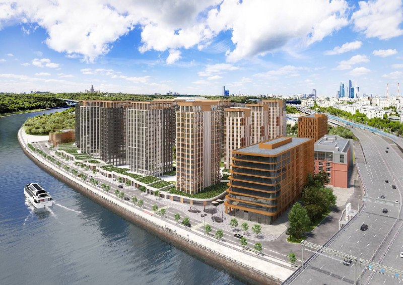
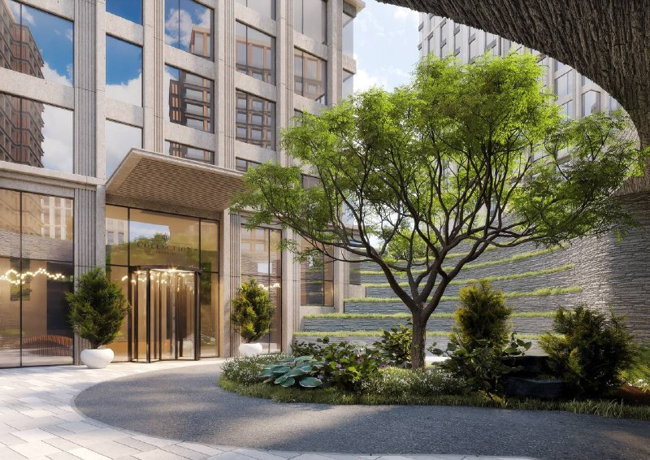
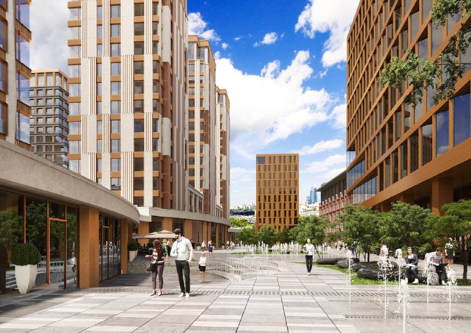
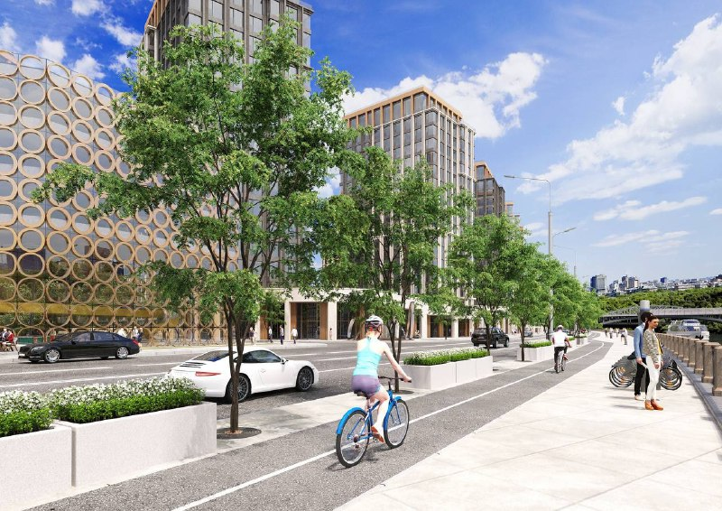

# Luzhniki Collection от Абсолюта: семь бюро, цены и сдача в 2027 году

Проект [Абсолюта](/zastroyshchiki/absolyut/) на Лужнецкой набережной, 2/4 в 2022 году показали как работу сразу семи бюро, большинство из них иностранные. К октябрю 2026 года Luzhniki Collection строится, а средняя цена метра в декабре 2025 года, по данным «Метриума», составляла 1,98 млн ₽.

## Коротко

- Участок на месте завода «Союз» в [Хамовниках](/novostroyki/khamovniki/); проект согласован Москомархитектурой летом 2022 года, рендеры публично показали к сентябрю 2022 года.
- Над концепцией работали бюро MVRDV, Aukett Swanke, Simpson Haugh, Dyer, «Апекс» и ODA.
- 12 жилых корпусов, свыше 324 тыс. кв. м; ввод запланирован на 2027 год.
- Средняя цена на декабрь 2025 года: 1,98 млн ₽/м²; на 2022 год называли цены от 525 тыс. ₽/м².

## Кто спроектировал Luzhniki Collection

По данным публикации РБК Недвижимости (январь 2024 года; материал помечен как рекламный), роли распределились так: MVRDV (Нидерланды) выступило идеологом и координатором концепции, Aukett Swanke (Великобритания) финализировало мастер-план, Simpson Haugh (Великобритания) предложило размещение зданий, Dyer придумало подиумы у каждого дома, «Апекс» адаптировал концепцию к российским нормам, ODA (Нью-Йорк) оформило корпуса и инфраструктуру. В карточке проекта на «Яндекс Недвижимости» архитекторами названы Dyer и MVRDV, а интерьеры общественных зон — ODA.

Издание «Москвич» в сентябре 2022 года писало, что над проектом трудились семь бюро, большинство иностранные, а согласовала его Москомархитектура ещё летом. Фасады, по описанию издания, из натурального камня, металла и стекла.

*(1) Общий вид комплекса со стороны реки. Визуализация: Абсолют*

*(2) Входная группа одного из домов. Визуализация: Абсолют*

*(3) Пешеходная улица между корпусами. Визуализация: Абсолют*

*(4) Фасады вдоль Лужнецкой набережной. Визуализация: Абсолют*

## Контекст: что построено по проекту

Участок находится на месте бывшего завода «Союз» на Лужнецкой набережной, 2/4; площадь комплекса составляет 8,4 га. По данным на март 2023 года, проект включал 12 жилых корпусов на 1 106 квартир высотой от 4 до 18 этажей, два офисных здания почти на 40 тыс. кв. м и двухуровневый подземный паркинг на 1 932 машины. Общая площадь — свыше 324 тыс. кв. м, из них около 50 тыс. кв. м отведено под коммерческую и общественную инфраструктуру.

Девелопер — группа «Абсолют»; застройщиком в проектной декларации указано ООО СЗ «Грандсоюзинвест». Полная история проекта — в [досье «Luzhniki Collection»](/obekty/luzhniki-collection/).

## Что с проектом сейчас

По состоянию на 15 октября 2026 года:

- **Стадия.** Идёт строительство; разрешение на строительство выдано 20 октября 2022 года. Продажи открыты в 11 из 12 корпусов.
- **Срок.** По сообщению Москвы 24 от 21 октября 2025 года, ввод запланирован на 2027 год; «Яндекс Недвижимость» называет IV квартал 2027 года. К октябрю 2025 года Мосгосстройнадзор провёл 13 проверок площадки.
- **Спрос.** В 2023 году, по данным bnMAP.pro, продали 274 квартиры. В 2025 году проект второй год подряд стал первым в элитном сегменте: 15 533 кв. м, около 15% сегмента (данные «Метриума»). Подробнее — в нашем материале о [лидерах продаж премиума 2025 года](/novosti/premium-lidery-prodazh-2025-luzhniki-collection/).
- **Цена.** Средняя цена метра в декабре 2025 года — 1,98 млн ₽. В сентябре 2022 года, при неофициальном старте, называли цены от 525 тыс. ₽/м² и до 1,5 млн ₽/м² для квартир с видом на воду. Квартиры на «Яндекс Недвижимости» стоят от 76,65 до 824,46 млн ₽ (площади от 49,7 до 206,8 м²).

## Что это значит для покупателя и инвестора

По найденным данным, цена метра выросла примерно в 3,8 раза: от 525 тыс. ₽ в 2022 году до 1,98 млн ₽ в декабре 2025 года. Сравнение условное: на старте шли первые лоты, сейчас продаются другие корпуса и этажи.

На наш взгляд, проект интересен масштабом команды и лидерством в продажах, но стоит помнить: срок 2027 года ещё не наступил, а источники расходятся в деталях (квартал ввода, срок выдачи ключей). Проверяйте проектную декларацию на наш.дом.рф. Покупка в строящемся доме идёт по [ДДУ](/slovar/ddu/) (договору долевого участия); подробнее о сегменте — в подборке [премиальных новостроек Москвы](/novostroyki/premium-klass/).

## Карточка объекта

- Названия: Luzhniki Collection, «Коллекция Лужники».
- Адрес ЗУ: Лужнецкая набережная, 2/4, Хамовники, Москва.
- Застройщик: группа «Абсолют» (ООО СЗ «Грандсоюзинвест»).
- Корпуса: 12 жилых (4–18 этажей), два офисных здания.
- Площадь: свыше 324 тыс. кв. м, участок 8,4 га.
- Квартиры: 1 106 по данным на март 2023 года.
- Стадия: строительство.
- Ввод: 2027 год.
- Цена: в среднем 1,98 млн ₽/м² (декабрь 2025 года).

## Вопросы и ответы

**Кто архитекторы Luzhniki Collection?**
Над проектом работали семь бюро. По данным публикации РБК Недвижимости, MVRDV координировало концепцию, Aukett Swanke дорабатывало мастер-план, Simpson Haugh предложило размещение зданий, Dyer — подиумы у домов, «Апекс» адаптировал проект к российским нормам, ODA отвечало за интерьеры.

**Где находится Luzhniki Collection?**
На Лужнецкой набережной, 2/4 в районе Хамовники, на месте бывшего завода «Союз», напротив Воробьёвых гор.

**Когда сдадут Luzhniki Collection?**
Ввод запланирован на 2027 год (Москва 24, октябрь 2025 года); агрегатор «Яндекс Недвижимость» называет IV квартал 2027 года. Проект строится, разрешение на строительство выдано 20 октября 2022 года.

**Сколько стоят квартиры в Luzhniki Collection?**
По данным «Метриума», средняя цена метра в декабре 2025 года составила 1,98 млн ₽. На сентябрь 2022 года называли цены от 525 тыс. ₽/м².

## Источники

1. РБК Недвижимость, 26 января 2024 года (рекламный материал): https://realty.rbc.ru/news/65b267079a7947cb50b3349c
2. «Москвич Mag», 20 сентября 2022 года: https://moskvichmag.ru/?p=255548
3. Rambler, 26 марта 2023 года: https://finance.rambler.ru/realty/50435614-raboty-po-ustroystvu-kotlovana-nachalis-pri-stroitelstve-zhilogo-kompleksa-v-rayone-hamovniki/
4. Москва 24, 21 октября 2025 года: https://www.m24.ru/news/21102025/839939
5. «Яндекс Недвижимость», карточка ЖК: https://realty.yandex.ru/moskva_i_moskovskaya_oblast/kupit/novostrojka/kollekciya-luzhniki-3172663/
6. «Мир квартир», 3 февраля 2026 года (данные «Метриума»): https://www.mirkvartir.ru/journal/news/2026/02/03/elite-klass/

Материал не является инвестиционной рекомендацией.
