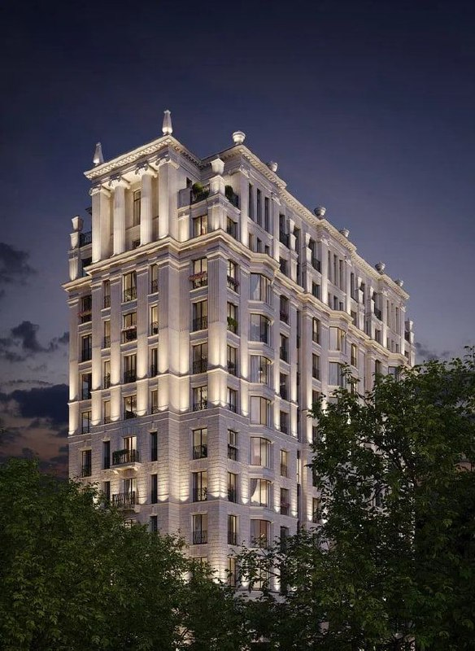

# «Хамовники 12» от Coldy: неоклассика Герасимова на 1-м Тружеников, 12

Участок на 1-м Тружеников переулке в Хамовниках достался неоклассике Евгения Герасимова. Девелопер Coldy построил там клубный дом «Хамовники 12» на 51 квартиру — штучный, с мрамором и барельефами. К октябрю 2026 года каталоги уже пишут о выдаче ключей и о том, что свободных лотов от застройщика нет.

## Коротко

- **Что:** клубный дом deluxe-класса, 14 этажей, общая площадь 16 137 м², жилая — 7 939 м².
- **Сколько квартир:** 51 (49 квартир и два пентхауса), от 100 до 336 м².
- **Архитектура:** неоклассика Евгения Герасимова, лобби — Олег Клодт.
- **Цена:** в мае 2023 года квартира 102 м² стоила от 160,2 млн ₽, это около 1,57 млн ₽/м².
- **Сейчас:** по данным каталога, корпус сдан, лоты от застройщика распроданы.

*Клубный дом Coldy на 1-м Тружеников переулке, 12. Визуализация: Coldy*

## Что за дом построила Coldy на 1-м Тружеников переулке

Осенью 2022 года о доме писали городские издания: 14 надземных этажей, четыре уровня подземной парковки, 51 квартира, два пентхауса с панорамными окнами, каминами и бассейнами. Стиль — «близкий к неоклассицизму».

Архитектурный набор для клубного дома в центре собрали по классике жанра. Фасады-неоклассику нарисовал Евгений Герасимов, лобби отдали архитектору Олегу Клодту, а юрский мрамор и барельефы сделал скульптор Нельсон Афиан. Всё это, по версии девелопера, должно оправдывать цену — ниже о ней.

Масштаб скромный: на весь дом 7,9 тыс. м² жилья. Это не квартал, а один дом на полсотни семей. Квартиры — от 100 до 336 м², так что «евродвушек» тут не бывает.

## Сколько стоят квартиры в «Хамовники 12»

В 2022 году эксперты ждали на старте около 2 млн ₽ за метр. В мае 2023 года в рекламном материале девелопера значилась квартира 102 м² от 160,2 млн ₽, то есть около 1,57 млн ₽ за м². Дешевле ожиданий, но это цена «от» за квартиру у нижней границы метража, а не средняя по дому.

Инвестиции в строительство Coldy оценивала в 7,34 млрд ₽.

## Что с проектом сейчас

В марте 2023 года девелопер объявил, что приступил к активной стадии строительства: завёз технику и начал котлован. Ввод тогда планировали на IV квартал 2025 года.

По состоянию на 15 октября 2026 года каталог Novostroy-M показывает стадию «выдача ключей и заселение», корпус 1 сдан, а все лоты от застройщика реализованы. Последняя проектная декларация в каталоге датирована 5 марта 2025 года. Цен на первичные квартиры там нет.

Полная история проекта — в [досье «1-й Тружеников, 12»](/obekty/1-y-truzhenikov-12/). Другие проекты [Coldy](/zastroyshchiki/coldy/) и соседей — на странице района [Хамовники](/novostroyki/khamovniki/).

## Что это значит для покупателя

Первичных квартир в доме больше нет, так что вопрос теперь не «брать ли на старте», а «что считать эталоном». Эталон такой: около 1,57 млн ₽/м² в 2023-м за небольшой лот в мае 2023-го. Если увидите в этом доме вторичку, сравнивайте её не с листингами, а с этой цифрой и с закрытыми сделками.

Риск у штучных домов один — ликвидность. На 51 квартиру рынок крошечный, цену задают одна-две сделки, и покупатель в дорогом лоте торгуется с продавцом, а не с таблицей. Другие проекты класса — в подборке [премиальных новостроек Москвы](/novostroyki/premium-klass/).

## Карточка объекта

- Названия: «Хамовники 12», 1-й Тружеников, 12.
- Адрес ЗУ: 1-й Тружеников переулок, 12, Хамовники, ЦАО, Москва.
- Девелопер: Coldy; застройщик по документам — ООО «Специализированный застройщик «Тружеников».
- Класс: deluxe.
- Площадь: общая 16 137 м², жилая 7 939 м².
- Квартиры: 51 (49 квартир и 2 пентхауса), 100–336 м².
- Паркинг: четыре подземных уровня.
- Стадия: корпус 1 сдан, выдача ключей (по данным каталога).

## Вопросы и ответы

**Кто застройщик «Хамовники 12» на 1-м Тружеников переулке?**
Девелопер Coldy; генподрядчик — COLDY Construction, застройщик по документам — ООО «Специализированный застройщик «Тружеников».

**Кто архитектор клубного дома на 1-м Тружеников, 12?**
Неоклассические фасады спроектировал Евгений Герасимов, лобби — Олег Клодт.

**Сколько квартир в «Хамовники 12» и какой они площади?**
51: 49 квартир и два пентхауса площадью от 100 до 336 м². Общая площадь дома — 16 137 м², жилая — 7 939 м².

**Сколько стоят квартиры в «Хамовники 12»?**
В 2023 году квартира 102 м² предлагалась от 160,2 млн ₽, это около 1,57 млн ₽ за м². К октябрю 2026 года каталоги пишут, что лоты от застройщика распроданы.

**Когда сдали «Хамовники 12»?**
Ввод планировали на IV квартал 2025 года; по данным каталога, корпус 1 сдан и идёт выдача ключей.

## Источники

1. РБК Недвижимость, 1 марта 2023 года, материал девелопера о «Хамовники 12»: https://realty.rbc.ru/news/63ff1b529a794757cebc7b7c
2. РБК Недвижимость, 5 мая 2023 года, материал девелопера о цене и архитекторах: https://realty.rbc.ru/news/6453e0179a7947ae8a3f9f32
3. Журнал «Москвич Mag», 19 октября 2022 года, о клубном доме в Хамовниках: https://moskvichmag.ru/?p=260744
4. Novostroy-M, карточка ЖК «Хамовники 12»: https://www.novostroy-m.ru/baza/jk_v_1m_per

Материал не является инвестиционной рекомендацией.
