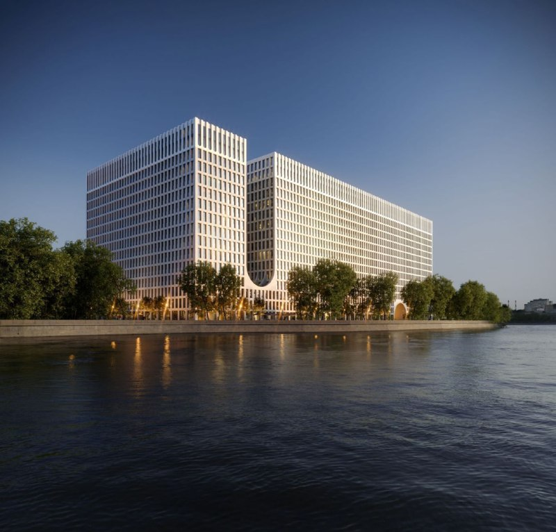
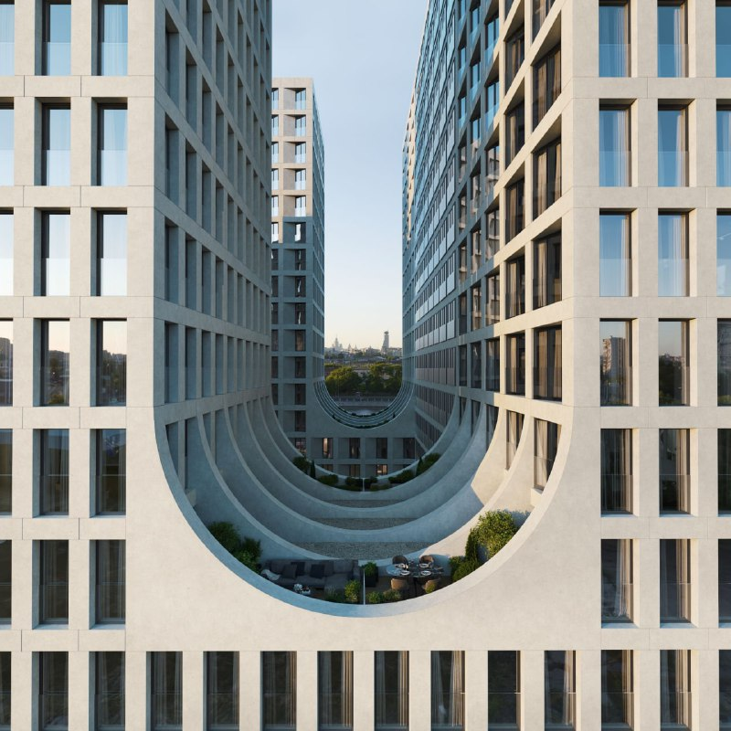
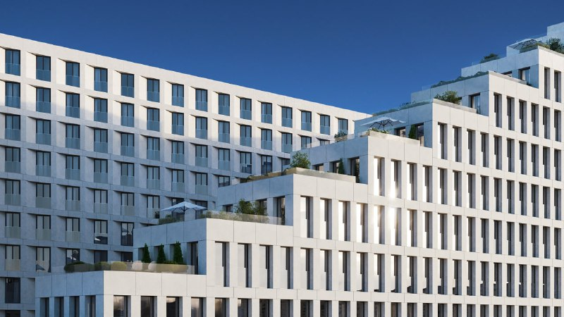

# «Инсайдер» на Автозаводской, 24: РКС вышла в Москву апартаментами

Региональный девелопер РКС в 2022 году зашёл в столицу с апарт-комплексом «Инсайдер» на Автозаводской, 24 в Даниловском районе. Для компании это первый московский проект, а для рынка — проверка на прочность: в 2022-м апартаменты продавались тяжело, а ключи обещали на июль 2026-го. К октябрю 2026 года комплекс дошёл до отделки фасадов, и сроки сместились на IV квартал.

## Коротко

- **Застройщик:** «РКС Девелопмент», для него «Инсайдер» — первый проект в Москве.
- **Масштаб:** 909 лотов в трёх зданиях от 7 до 16 этажей, подземный паркинг на 228 машино-мест.
- **Архитектура:** бюро «Цимайло, Ляшенко и партнёры» (ЦЛП).
- **Сроки:** ориентир 2022 года — июль 2026-го; каталог на октябрь 2026-го называет IV квартал 2026-го.
- **Цены на 13 октября 2026 года:** от 17,8 до 78,5 млн ₽.

## Кто застройщик «Инсайдера» и что он построил на Автозаводской

[РКС](/zastroyshchiki/rks/) — региональная компания, и в Москве она до «Инсайдера» не строила: по оценке эксперта каталога «Новострой-М», это её первый проект в столице. Участок — Автозаводская, 24, [Даниловский район](/novostroyki/danilovskiy/), ЮАО, на набережной Москвы-реки. Ближайшая станция метро, по каталогу, «Тульская» — около 15 минут пешком, до «Автозаводской» — около 20.

Архитектуру нарисовало бюро ЦЛП. Визуализации сразу выдают почерк: стройная сетка окон, белёсый фасад и арка-подкова между корпусами. Московскому рынку знакомая арка, надо признать, как знакомый плащ: хорошо сидит, но видели.

*Визуализация (1): корпуса «Инсайдера» со стороны Москвы-реки. Визуализация: РКС Девелопмент*

*Визуализация (2): арка между корпусами. Визуализация: РКС Девелопмент*

*Визуализация (3): уступы с террасами. Визуализация: РКС Девелопмент*

## Когда сдадут «Инсайдер» и что с проектом сейчас

В 2022 году рынок говорил о ключах в июле 2026-го. По состоянию на 15 октября 2026 года каталог «Новострой-М» показывает срок сдачи в IV квартале 2026 года и стадию «отделка фасадов»; последний отчёт о стройке датирован 26 сентября 2026 года. Правда, в описании той же карточки фигурирует и I квартал 2026-го — каталог сам себе противоречит. Верить нужно [проектной декларации](/slovar/proektnaya-deklaratsiya/), а не карточке: в ней срок и состояние стройки записаны официально.

Продажи идут. Каталог показывает на 13 октября 2026 года цены от 17,8 до 78,5 млн ₽, а в каталоге отмечены акции застройщика: дополнительная скидка 25% до 15 октября и рассрочка с взносом 5% до 31 октября. Двухкомнатный лот площадью 60,46 м² на 12 этаже стоит около 31,5 млн ₽ — примерно 520 тыс. ₽/м².

Полная история проекта — в [досье «Инсайдер»](/obekty/insayder/).

## Что это значит для покупателя апартаментов

Вот где подвох: апартаменты — не квартиры. Статус нежилого помещения влияет на налоги, регистрацию и ипотечные условия, а ликвидность на вторичном рынке у таких лотов обычно хуже. Если вы присматриваетесь к «Инсайдеру», считайте не только цену за метр, но и то, по какой ставке и на каких условиях вы будете его покупать, и сколько заплатите налогов.

Плюс комплекса — набережная, минус — метро не под окном: до «Тульской» около 15 минут пешком. Акции с датой окончания читайте внимательно: скидка до 15 октября — инструмент продаж, а не подарок. Следите за проектной декларацией и за реальной стройкой: срок сдачи уже менялся, и, как показывает 2026 год, фасады важнее рендеров.

Подробнее о ценах на новостройки — в разделе [«Цены»](/temy/ceny/).

## Карточка объекта

- **Название:** «Инсайдер» (апарт-комплекс).
- **Адрес ЗУ:** Автозаводская, 24 (корп. 1.3), Даниловский район, ЮАО, Москва.
- **Застройщик:** РКС («РКС Девелопмент»).
- **Архитектор:** ЦЛП.
- **Класс:** бизнес.
- **Лоты:** 909; здания от 7 до 16 этажей; паркинг на 228 машино-мест.
- **Стадия:** отделка фасадов (отчёт от 26 сентября 2026 года).
- **Ввод:** IV квартал 2026 года по каталогу (первоначальный ориентир — июль 2026-го).
- **Цена:** от 17,8 до 78,5 млн ₽ (13 октября 2026 года).

## Вопросы и ответы

**Кто застройщик «Инсайдера» на Автозаводской, 24?**
Проект ведёт «РКС Девелопмент» — это его первый проект в Москве. Компания пришла из регионов.

**Сколько апартаментов в «Инсайдере»?**
По каталогу «Новострой-М», в комплексе 909 лотов в трёх зданиях от 7 до 16 этажей, плюс подземный паркинг на 228 машино-мест.

**Когда сдадут «Инсайдер»?**
На октябрь 2026 года каталог называет IV квартал 2026 года, на объекте идёт отделка фасадов. Первоначальный ориентир — июль 2026 года.

**Сколько стоят апартаменты в «Инсайдере»?**
На 13 октября 2026 года цены — от 17,8 до 78,5 млн ₽. Двухкомнатный лот 60,46 м² на 12 этаже — около 31,5 млн ₽, то есть примерно 520 тыс. ₽/м².

## Источники

1. [ЖК «Инсайдер», каталог «Новострой-М», данные на 13 октября 2026](https://www.novostroy-m.ru/baza/jk_avtozavodskaya_24)
2. [Апартаменты в «Инсайдере», лот 60,46 м², «Новострой-М»](https://www.novostroy-m.ru/kvartiry/apartamenti-v-insaider-e7ee3573542534776cd7496527081f)

Материал не является инвестиционной рекомендацией.
