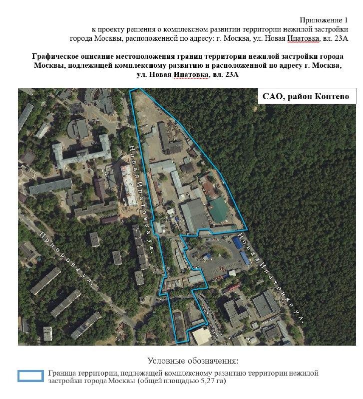

# КРТ на Новой Ипатовке, 23А в Коптеве: 67 тыс. кв. м жилья вместо гаражей

На улице Новая Ипатовка, вл. 23А в Коптеве (САО) 5,27 га у самого Тимирязевского парка заняты складами и гаражами. Город решил, что так больше нельзя, и включил участок в программу комплексного развития. Решение объявили 26 августа 2022 года, постановление подписали 9 декабря 2022 года. Дальше — тишина: кто и когда здесь построит, официально пока не сообщали.

## Коротко

- **Где:** 5,27 га на Новой Ипатовке, вл. 23А — рядом Тимирязевский парк, стадион «Красный Балтиец» и станция МЦД-2 «Красный Балтиец».
- **Сколько жилья:** почти 67 тыс. кв. м из 117 тыс. кв. м всей недвижимости, часть квартир — под переселение по реновации.
- **Деньги:** более 11,6 млрд ₽ в августе 2022 года, 11,05 млрд ₽ — в постановлении от 9 декабря.
- **Кто строит:** неизвестно; о торгах и инвесторе на октябрь 2026 года город не сообщал.

## Гаражам — на выход

[КРТ](/slovar/krt/) (комплексное развитие территории) позволяет городу перекроить неэффективную территорию целиком, а не латать по участку. 26 августа 2022 года заммэра Владимир Ефимов объявил: такой подход применят к почти 5,3 га в Коптеве, где сейчас склады и гаражи.

9 декабря 2022 года Сергей Собянин подписал постановление. Территория — 5,27 га. На ней должен появиться жилой квартал, в том числе для переселения по реновации, а к нему — детсад на 75 мест, школа на 150 учеников, детский центр развития, физкультурно-оздоровительный комплекс, травмпункты и общественно-деловые объекты. Рабочих мест — около 1,5 тыс.

*(1) Границы территории КРТ (5,27 га) на Новой Ипатовке, вл. 23А: приложение 1 к проекту решения о комплексном развитии территории. Источник: Правительство Москвы*

## Жильё — больше половины

В августе 2022 года город называл около 67 тыс. кв. м жилья из 117 тыс. кв. м недвижимости, а под общественную застройку отвели более 50 тыс. кв. м земли. То есть квартал задуман прежде всего жилым — с социалкой в нагрузку.

К декабрю смета похудела: в постановлении инвестиции — 11,05 млрд ₽ вместо прежних более 11,6 млрд ₽. Разница небольшая, но показательная: цифры в таких проектах до последнего документа живые.

## Решение есть, застройщика нет

На 15 октября 2026 года город не сообщал ни о выборе инвестора, ни о торгах, ни о начале работ на участке. В августе 2022 года застройщика тоже не назвали: проект могли взять правообладатели, город или инвестор по итогам торгов. Главный сигнал, которого стоит ждать, — объявление городского аукциона на право заключить договор о КРТ.

## Что это значит для покупателя и инвестора

Купить здесь пока нечего: нет ни продаж, ни цен. Между решением о КРТ и стартом продаж лежат торги или переговоры с правообладателями, проектирование и разрешение на строительство — путь неблизкий.

На наш взгляд, парк под боком — сильный козырь будущего квартала. Но гадать о цене до появления застройщика бессмысленно: от его имени она будет зависеть больше, чем от деревьев за окном. Общий контекст — в разделе [«КРТ»](/temy/krt/), история участка — в [карточке «Новая Ипатовка, 23А»](/obekty/novaya-ipatovka-23a/).

## По соседству: Soul на Часовой, 28

В 2022 году проект на Часовой, 28 в районе Аэропорт связывали с [ПИК](/zastroyshchiki/pik/). Сейчас, по карточке лота на novostroy-m.ru, Soul ведёт FORMA (ООО СЗ «Часовая»), а срок сдачи указан — 1 квартал 2029 года. Девелопер сменился, адрес остался. Подробности — в [досье «Soul»](/obekty/soul/), другие проекты района — в разделе [«Новостройки района Аэропорт»](/novostroyki/aeroport/).

## Карточка объекта

- Адрес ЗУ: Новая Ипатовка, вл. 23А, район Коптево, САО, Москва.
- Территория КРТ: 5,27 га.
- Жильё: почти 67 тыс. кв. м (по сведениям города, август 2022 года).
- Застройщик: не назван.
- Стадия: решение о КРТ (постановление от 9 декабря 2022 года).

## Вопросы и ответы

**Что построят на Новой Ипатовке, 23А?**
По данным города, жилой квартал (почти 67 тыс. кв. м жилья, в том числе для переселения по реновации), школу, детский сад, детский центр, физкультурно-оздоровительный комплекс, травмпункты и общественно-деловые объекты.

**Какая площадь территории КРТ?**
5,27 га в Коптеве (САО), рядом с Тимирязевским парком.

**Когда принято решение о КРТ?**
Решение объявили 26 августа 2022 года, постановление подписали 9 декабря 2022 года.

**Кто будет застройщиком?**
В 2022 году застройщика не называли: инвестора могли выбрать и на торгах. Кто получил проект, город на октябрь 2026 года не сообщал.

## Источники

1. «Вечерняя Москва», 26 августа 2022 года, решение о КРТ в Коптеве: https://vm.ru/news/991413-efimov-uchastok-v-kopteve-preobrazuyut-po-programme-kompleksnogo-razvitiya-territorij
2. М24, 9 декабря 2022 года, постановление о КРТ: https://www.m24.ru/news/09122022/529867
3. novostroy-m.ru, 31 августа 2022 года, что построят в районе: https://www.novostroy-m.ru/novosti/chto_postroyat_v_rayone
4. novostroy-m.ru, карточка лота ЖК «Соул»: https://www.novostroy-m.ru/kvartiry/studiya-v-zhk-soul-a3764654d471afc06f0dfe5df0c99c

Материал не является инвестиционной рекомендацией.
