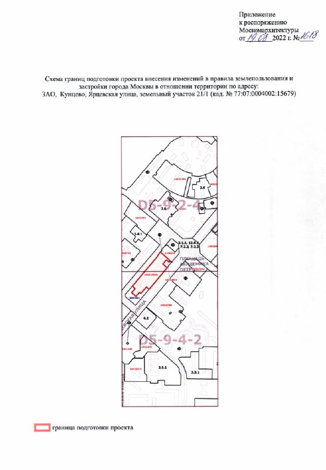

# Ярцевская, 21: офисы у «Молодёжной» сменили на жильё, строит Аквилон

Офисный центр на 90 тыс. м² у метро «Молодёжная» не пережил 2022 год: Capital Group передумала и выбрала жильё. В августе Москомархитектура запустила смену правил застройки участка на Ярцевской, 21. К октябрю 2026-го на месте бывшего кинотеатра «Брест» котлован, а квартиры продаёт Аквилон.

## Коротко

- **Что решили:** в августе 2022 года Москомархитектура выпустила распоряжение о подготовке изменений в правила землепользования и застройки (ПЗЗ): на участке 1,2 га, кроме общественно-делового центра, разрешили жильё.
- **Масштаб (оценка консультантов):** около 90 тыс. м², половина — жильё; инвестиции 6,5–10 млрд ₽.
- **Сейчас:** ЖК «Нексус» от Аквилона, стадия — котлован, сдача — III квартал 2029 года.
- **Цена:** двухкомнатная квартира 71 м² — 38,5 млн ₽, около 542 тыс. ₽/м².

## Что решила Москомархитектура по Ярцевской, 21

Участок в Кунцеве — часть [транспортно-пересадочного узла (ТПУ)](/slovar/tpu/) «Молодёжная»: здесь стоит бывший кинотеатр «Брест». Проект вела Capital Group, и до августа 2022 года на участке планировали общественно-деловой центр, то есть офисы.

Распоряжение Москомархитектуры запустило подготовку изменений в [правила землепользования и застройки](/slovar/pzz/): теперь здесь можно и жильё. О решении 1 сентября 2022 года сообщили «Ведомости» со ссылкой на консультантов, материал опубликовал РИА Недвижимость. Консультанты оценивали общую площадь комплекса в 90 тыс. м², из которых половина — жильё, инвестиции — в 6,5–10 млрд ₽, а выручку от жилой части — в 15 млрд ₽.

*Схема границ подготовки изменений в ПЗЗ — приложение к распоряжению Москомархитектуры, август 2022 года. Участок на Ярцевской улице, 21/1, кадастровый номер 77:07:0004002:15679.*

Итог простой: при одном и том же участке жильё оказалось для девелопера понятнее офисов.

## Что с проектом сейчас

По состоянию на 15 октября 2026 года каталог Novostroy-M называет проект ЖК «Нексус» от Аквилон по адресу Ярцевская, 21/1. Застройщик — Группа «Аквилон», сдача — III квартал 2029 года, стадия — котлован и фундамент. До метро «Молодёжная» — около 5 минут пешком.

Двухкомнатная квартира 71 м² в первом корпусе стоит 38,5 млн ₽, это около 542 тыс. ₽ за м². Условий, на которых проект перешёл от Capital Group к Аквилону, никто не раскрывал, зато застройщик на сегодня назван.

Полная история проекта и участка — в [досье «ТПУ Молодёжная»](/obekty/tpu-molodezhnaya/). Вокруг — другие новостройки [Кунцева](/novostroyki/kuntsevo/), а продаёт квартиры [Аквилон](/zastroyshchiki/akvilon/).

## Что это значит для покупателя

Дом строится в узле, где метро в пяти минутах пешком: плюс очевидный. Цена около 542 тыс. ₽/м² — это деньги за транспорт и локацию; про уникальную архитектуру речи нет.

Сдача в 2029 году — это три года ожидания, а пока на площадке котлован. Если смотрите на этот проект, просите актуальную проектную декларацию и сверяйте темпы стройки с графиком: между обещанием 2022 года «жильё вместо офисов» и ключами пройдёт семь лет. Как рынок в целом решает судьбу «лишних» офисов — в теме [рынок](/temy/rynok/).

## Карточка объекта

- Названия: ТПУ «Молодёжная», ЖК «Нексус», Ярцевская, 21, бывший кинотеатр «Брест».
- Адрес ЗУ: Ярцевская улица, 21/1, Кунцево, ЗАО, Москва; кадастровый номер 77:07:0004002:15679.
- Площадь участка: 1,2 га.
- Застройщик: Группа «Аквилон» (прежде проект вела Capital Group).
- Стадия: котлован/фундамент.
- Сдача: III квартал 2029 года (по данным каталога).
- Цена: 38,5 млн ₽ за 71 м², около 542 тыс. ₽/м².

## Вопросы и ответы

**Что строят на Ярцевской, 21 у метро «Молодёжная»?**
ЖК «Нексус» от Аквилона: стадия — котлован, сдача — III квартал 2029 года. Раньше на участке планировали офисный центр.

**Что решила Москомархитектура по участку на Ярцевской, 21?**
В августе 2022 года она выпустила распоряжение о подготовке изменений в правила землепользования и застройки, чтобы на участке 1,2 га можно было строить жильё, а не только общественно-деловой центр.

**Сколько стоят квартиры на Ярцевской, 21?**
По каталогу Novostroy-M на 15 октября 2026 года, двухкомнатная квартира 71 м² стоит 38,5 млн ₽, это около 542 тыс. ₽ за м².

**Кто строит жильё на месте кинотеатра «Брест»?**
Застройщик — Группа «Аквилон»; в 2022 году проектом занималась Capital Group.

## Источники

1. РИА Недвижимость (через Рамблер), 1 сентября 2022 года, о смене ПЗЗ на Ярцевской: https://finance.rambler.ru/realty/49266998-capital-group-smozhet-postroit-zhile-na-meste-kinoteatra-brest-v-moskve/
2. Novostroy-M, карточка ЖК «Нексус» от Аквилон: https://www.novostroy-m.ru/kvartiry/dvuhkomnatnaya-kvartira-v-zhk-neksus-ot-akvilon-c9689cdeca5aa673084ccb4dc2441b

Материал не является инвестиционной рекомендацией.
