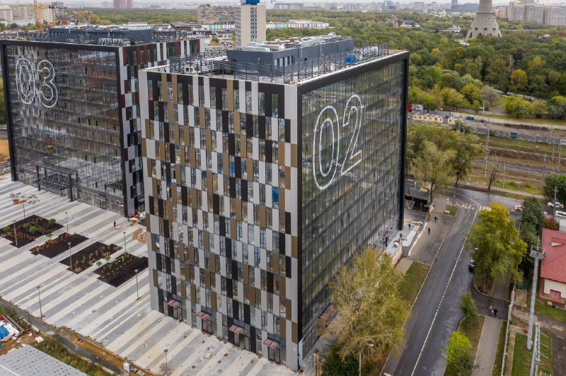

# Ostankino Business Park: «Пионер» ввёл корпуса 2 и 3 — и парк заработал

Про программу мест приложения труда обычно рассказывают цифрами соглашений. Ostankino Business Park — редкий случай, когда её можно потрогать. В октябре 2022 года «Пионер» получил разрешение на ввод корпусов 2 и 3 в Бутырском районе: около 45 тыс. кв. м и около 3 тыс. рабочих мест. К декабрю 2024 года работали пять корпусов из шести, последний достраивали.

## Коротко

- **Ввод:** корпуса 2 и 3 первой очереди на Огородном проезде, 16/1 — октябрь 2022 года, около 45 тыс. кв. м: 35,5 тыс. кв. м офисов и более 2,6 тыс. кв. м ритейла.
- **Продажи:** по словам застройщика, офисы в этих корпусах разошлись полностью, ритейл — почти.
- **Программа:** [МПТ](/slovar/mpt/) (места приложения труда); «Пионер» вошёл в неё первым, в 2020 году.
- **Сейчас:** к декабрю 2024 года работали пять корпусов, шестой (13 этажей, более 22 тыс. кв. м) достраивали.

## Два корпуса за 5 млрд ₽

6 октября 2022 года abnews сообщил: «Пионер» получил разрешение Мосгосстройнадзора на ввод корпусов 2 и 3 первой очереди Ostankino Business Park. Вместе — 45 тыс. кв. м и около 3 тыс. рабочих мест. Стройка двух корпусов обошлась примерно в 5 млрд ₽, а всего в проект вложили 17,8 млрд ₽.

Детали застройщик раскрыл в рекламном материале на РБК Недвижимости 11 октября 2022 года: офисы — 35,5 тыс. кв. м, ритейл на первых этажах — более 2,6 тыс. кв. м, наземная парковка — 126 машино-мест. В продаже к тому моменту оставались офисы в корпусах 4 и 5 и ритейл в корпусе 4. Важная оговорка: всё это — слова самого «Пионера».

*Корпуса 2 и 3 Ostankino Business Park. Фото: Пионер*

## МПТ: первым пришёл — первым сдал

Программа мест приложения труда (МПТ) — способ города создавать рабочие места прямо в районах Москвы. По данным правительства Москвы, с 2020 года по ней заключено более 130 соглашений с инвесторами. Ostankino Business Park — один из первых проектов, которые до программы дошли не на бумаге, а в бетоне: на сайте «Пионера» он назван первым проектом, сданным по городской программе создания рабочих мест.

Полная история — в [досье «Ostankino Business Park»](/obekty/ostankino-business-park/), о районе — на странице [Бутырский район](/novostroyki/butyrskiy/).

## Пять из шести

- **Корпуса.** В парке шесть корпусов. 19 декабря 2024 года министр правительства Москвы Анатолий Гарбузов сообщил: пять работают, это почти 10 тыс. рабочих мест. Арендаторы — торгово-производственные, строительные, логистические и IT-компании.
- **Шестой корпус.** 13 этажей, более 22 тыс. кв. м, офисы, магазины и переговорные, около 2 тыс. рабочих мест; стройку планировали закончить в 2025 году. На сайте «Пионера» — III квартал 2025 года, а всего в парке — 135,5 тыс. кв. м и около 12 тыс. рабочих мест. Об открытии шестого корпуса к 15 октября 2026 года официально пока не сообщали.

## Что это значит для покупателя и инвестора

Главный вывод простой: программа МПТ здесь сработала — корпуса стоят, арендаторы сидят. Для покупателя офиса это аргумент в пользу застройщика, который доводит такие проекты до конца.

На наш взгляд, теперь всё решит шестой корпус: как быстро он заполнится и как рынок аренды района переварит ещё 22 тыс. кв. м. Ставки аренды и цены продаж «Пионер» публично не называл, поэтому и мы цифр не приводим. Другие готовые проекты — в подборке [сданных новостроек](/novostroyki/sdannye/); о застройщике — на странице [«Пионера»](/zastroyshchiki/pioner/).

## Карточка объекта

- Название: Ostankino Business Park.
- Адрес: Огородный проезд, 16/1, Бутырский район, Москва (адрес ЗУ в досье не указан).
- Застройщик: «Пионер».
- Корпуса: шесть; корпуса 2 и 3 введены в октябре 2022 года (около 45 тыс. кв. м).
- Программа: МПТ (места приложения труда).
- Стадия: введены пять корпусов, шестой достраивался в 2025 году.

## Вопросы и ответы

**Кто строит Ostankino Business Park?**
«Пионер». Бизнес-парк в Бутырском районе строят по городской программе мест приложения труда.

**Сколько корпусов в Ostankino Business Park?**
Шесть. К декабрю 2024 года работали пять, а шестой — 13 этажей, более 22 тыс. кв. м — достраивали с планом завершить в 2025 году.

**Какая площадь корпусов 2 и 3?**
Около 45 тыс. кв. м: 35,5 тыс. кв. м офисов и более 2,6 тыс. кв. м ритейла. Корпуса ввели в октябре 2022 года.

**Сколько рабочих мест создаёт бизнес-парк?**
По данным 2022 года, корпуса 2 и 3 дают около 3 тыс. мест; весь парк рассчитан на 10–12 тыс.

## Источники

1. abnews, 6 октября 2022 года, «Компания «Пионер» запустила два корпуса «Останкино» в Москве»: https://abnews.ru/2022/10/6/kompaniya-pioner-zapustila-dva-korpusa-ostankino-v-moskve
2. РБК Недвижимость, 11 октября 2022 года (рекламный материал застройщика): https://realty.rbc.ru/amp/news/634547849a794710e49b7025
3. РИАМО, 19 декабря 2024 года, «Последний корпус в составе бизнес-парка «Останкино» строят по городской программе»: https://riamo.ru/news/nedvizhimost/poslednij-korpus-v-sostave-biznes-parka-ostankino-strojat-po-gorodskoj-programme/
4. 360.ru, 19 декабря 2024 года, «В бизнес-парке «Останкино» появится ещё один корпус»: https://360.ru/news/moskva/v-biznes-parke-ostankino-pojavitsja-esche-odin-korpus/
5. Пионер, страница проекта Ostankino Business Park: https://pioneer.ru/en/project/ostankino-bp

Материал не является инвестиционной рекомендацией.
