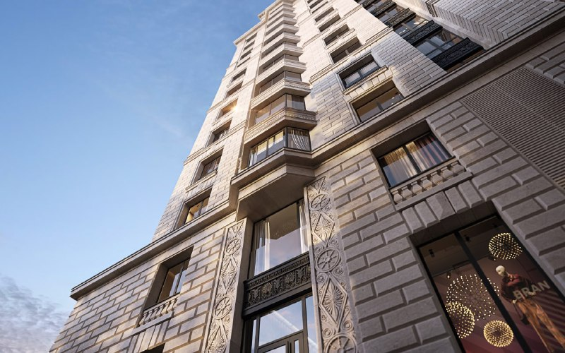
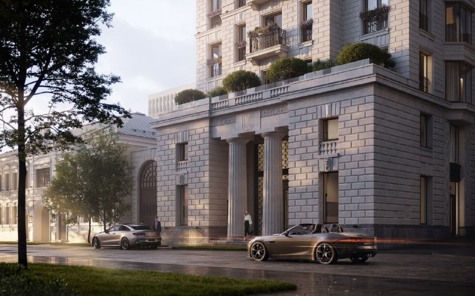

# Хамовники 12 от Coldy: 51 квартира делюкс-класса, дом сдан

Девелопер Coldy строит клубный дом «Хамовники 12» в 1-м переулке Тружеников в Хамовниках: 51 объект по проекту Евгения Герасимова. Продажи открылись в 2023 году от 160,2 млн ₽, а к осени 2026 года, по данным каталога новостроек, дом сдан и лотов от застройщика не осталось.

## Коротко

- 14 этажей, 49 квартир от 100 до 336 м² и два пентхауса площадью 273 и 304 м² (данные застройщика, март 2023 года).
- Цена в мае 2023 года: от 160,2 млн ₽ за 102 м², около 1,57 млн ₽/м² по нашему расчёту. Заметка 2022 года говорила о «2 млн ₽ за метр»: такой цифры в открытых источниках нет.
- Каталог новостроек сообщает, что корпус 1 сдан, а квартир от застройщика в продаже нет (по состоянию на 15 октября 2026 года).

## Что строит Coldy в Хамовниках

В заметке 18 октября 2022 года сообщалось, что Coldy получила разрешение на строительство. Подтвердить дату разрешения по открытым источникам мы не смогли, но старт стройки подтверждён: 1 марта 2023 года застройщик объявил о начале строительства и продаж, на площадке шло устройство котлована.

Общая площадь дома — 16 137 м², из них 7 939 м² жилых. Инвестиции застройщик оценил в 7,34 млрд ₽, генподрядчик — Coldy Construction. Концепцию разработал Евгений Герасимов, дизайн одного из пентхаусов — Олег Клодт. Фасады заявлены из юрского мрамора.

*(1) Фасад клубного дома «Хамовники 12»: проект Евгения Герасимова. Визуализация: Coldy*

*(2) Входная группа клубного дома «Хамовники 12». Визуализация: Coldy*

## Пентхаусы и паркинг

Оба пентхауса получили отдельный лифт, дровяные камины и террасы. Собственный бассейн застройщик назвал только у одного из них; в заметке 2022 года речь шла о бассейнах у обоих, это не подтвердилось. В подземной части заявлены паркинг на 87 машино-мест и 7 мото-мест, кладовые и депозитарий, на первом этаже — спа и ресторан. Число подземных этажей паркинга в источниках не названо.

## Сколько стоили квартиры

5 мая 2023 года застройщик предлагал квартиры от 160,2 млн ₽: за эту сумму — 102 м² с одной спальней, потолками 3,55 м и несколькими гардеробными. Разделив цену на площадь, получаем около 1,57 млн ₽/м². На наш взгляд, сравнивать такой уровень цен с массовым рынком новостроек не имеет смысла.

## Что с проектом сейчас

Застройщик планировал ввод в IV квартале 2025 года. По каталогу novostroy-m.ru, корпус 1 сдан, идёт выдача ключей, лоты застройщика реализованы; в последний раз проектные декларации там датированы 5 марта 2025 года. Точную дату ввода и номер разрешения мы по открытым страницам не нашли. Полная история проекта — в [досье «Хамовники XII»](/obekty/khamovniki-xii/).

## Что это значит для покупателя и инвестора

Первичных лотов у [Coldy](/zastroyshchiki/coldy/) в этом доме, по данным каталога, не осталось: сделки возможны только на вторичном рынке, где цены определяет продавец. Риски строительства и согласований для дома уже сняты. Остаётся оценивать, насколько Хамовники и метро «Киевская» (около 12 минут пешком по каталогу) оправдывают цену. Другие проекты района — в разделе [«Новостройки Хамовников»](/novostroyki/khamovniki/).

## Карточка объекта

- Адрес ЗУ: Тружеников, 12 (1-й переулок Тружеников; в каталоге указан дом 12А), Хамовники, ЦАО, Москва.
- Названия: Хамовники 12, Хамовники XII.
- Застройщик: Coldy; генподрядчик Coldy Construction.
- Архитектор: Евгений Герасимов.
- Класс: делюкс.
- Площадь: 16 137 м², в том числе жилая 7 939 м².
- Квартиры: 49 квартир и 2 пентхауса.
- Этажность: 14.
- Ввод: планировался на IV квартал 2025 года; по каталогу корпус сдан.
- Цена: от 160,2 млн ₽ за 102 м² (май 2023 года).

## Вопросы и ответы

**Сколько квартир в клубном доме «Хамовники 12»?**
По данным застройщика, 51 объект: 49 квартир площадью от 100 до 336 м² и два пентхауса площадью 273 и 304 м².

**Сколько стоили квартиры в «Хамовниках 12»?**
В мае 2023 года квартиры предлагали от 160,2 млн ₽ (102 м², около 1,57 млн ₽/м² по расчёту редакции). Сейчас по каталогу лотов от застройщика в продаже нет.

**Кто застройщик и архитектор «Хамовников 12»?**
Застройщик — Coldy, генподрядчик — Coldy Construction. Концепцию разработал Евгений Герасимов, дизайн одного из пентхаусов — Олег Клодт.

**Сдан ли дом «Хамовники 12»?**
По каталогу novostroy-m.ru корпус 1 сдан и идёт выдача ключей. Ввод планировали на IV квартал 2025 года; точную дату разрешения на ввод мы не нашли.

## Источники

1. РБК Недвижимость, «Новости компаний», 1 марта 2023 года (сообщение застройщика): https://realty.rbc.ru/news/63ff1b529a794757cebc7b7c
2. РБК Недвижимость, «Новости компаний», 5 мая 2023 года (сообщение застройщика, цены): https://realty.rbc.ru/news/6453e0179a7947ae8a3f9f32
3. novostroy-m.ru, карточка ЖК «Хамовники 12»: https://www.novostroy-m.ru/baza/jk_v_1m_per

Материал не является инвестиционной рекомендацией.
