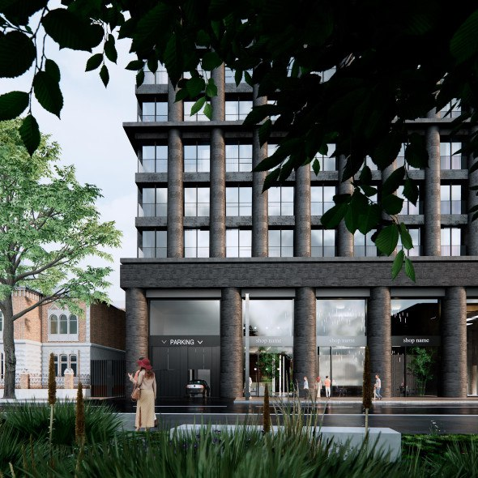
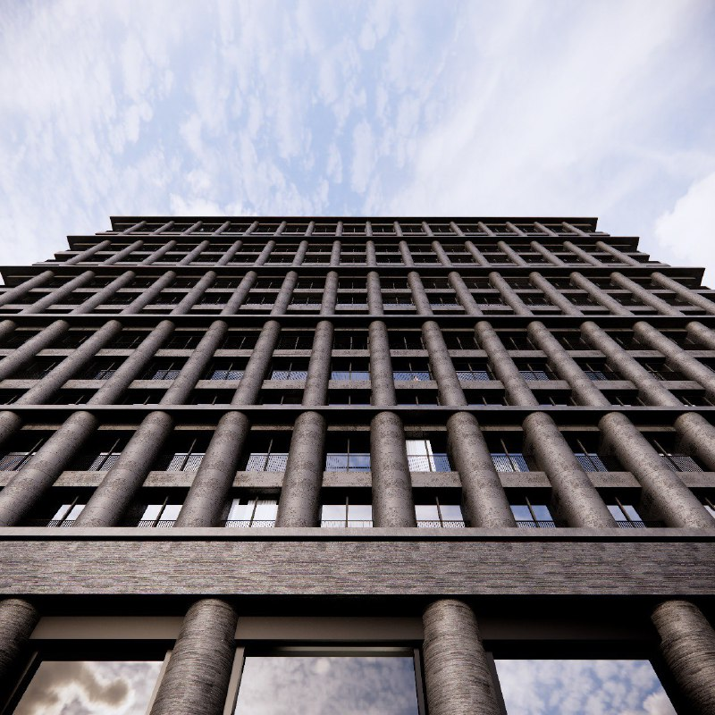
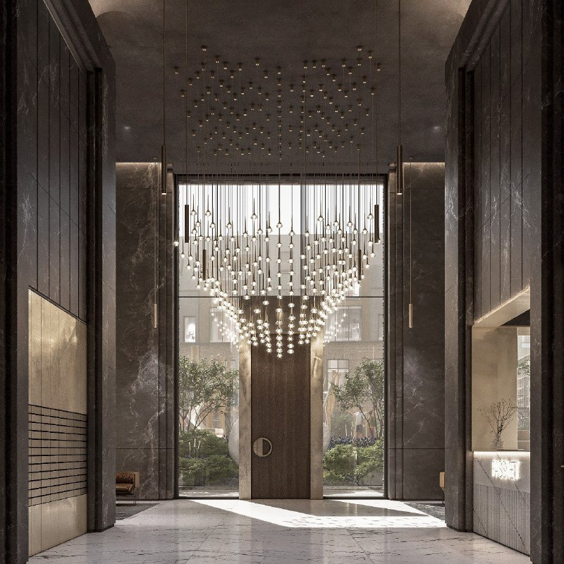

# Клубный дом KR Properties на Столярном, 3к6: 92 квартиры и 6 пентхаусов

KR Properties строит клубный дом «Мюр и Мерилиз» на Столярном переулке, 3к6 в Пресненском районе: 92 квартиры и 6 пентхаусов в 15 этажах по проекту Kleinewelt Architekten. Фасады тёмные, а разрешение на строительство дом получил в конце 2022 года.

*(1) Визуализация: нижние этажи дома с колоннами из тёмного камня. Визуализация: KR Properties*

## Коротко

- Дом расположен в Столярном переулке рядом с кварталом «Рассвет» в Пресненском районе; застройщик — [KR Properties](/zastroyshchiki/kr-properties/), архитектор — Kleinewelt Architekten.
- 15 этажей, 92 квартиры и 6 пентхаусов; площади — от чуть менее 49 до 168 м².
- Фасады тёмные, с полукруглыми колоннами; у всех квартир французские балконы.
- Цены в проверенных источниках не названы, данных о вводе на октябрь 2026 года мы не нашли.

## Что за дом и что в нём предусмотрено

По данным РБК Недвижимость, клубный дом строят на пересечении Малой Грузинской улицы и Столярного переулка у квартала «Рассвет», который тоже ведёт KR Properties. Проект разработало бюро Kleinewelt Architekten под руководством Николая Переслегина.

В доме предусмотрены два этажа с приватными сервисами, три уровня подземной парковки и 23 зарядные станции для электромобилей. По данным «Москвич Mag», на первых этажах планируются кафе и магазины. На месте дома стояло трёхэтажное здание, где больше десяти лет работал магазин «Перекрёсток».

*(3) Визуализация: фасад с рядами полукруглых колонн. Визуализация: KR Properties*

Фасад решён в тёмном камне, по высоте здания идут полукруглые колонны: внизу массивные, выше легче. «Москвич Mag» видит здесь отсылку к Роману Клейну, автору ЦУМа; это мнение издания.

*(4) Визуализация: лобби дома со светильниками и выходом в сад. Визуализация: KR Properties*

## Разрешение на строительство и контекст

«Москвич Mag» 31 декабря 2022 года сообщил о получении разрешения на строительство со ссылкой на пресс-релиз Мосгосстройнадзора: в доме 98 квартир, что совпадает с 92 квартирами и 6 пентхаусами. Заседание Москомархитектуры, на котором, по данным заметки, согласовали проект, мы прямого подтверждения не нашли и в основу не кладём. Полная история проекта — в [досье «Мюр и Мерилиз»](/obekty/myur-i-meriliz/).

## Что с проектом сейчас

На 15 октября 2026 года мы не нашли открытых данных о стадии строительства, сроке ввода и ценах в этом доме. РБК Недвижимость на момент публикации описывал дом как строящийся; страница статьи не содержит ни сроков, ни цен. Эти сведения нужно сверять по [проектной декларации](/slovar/proektnaya-deklaratsiya/) и у застройщика.

## Что это значит для покупателя и инвестора

Это небольшой дом в центре, в верхнем сегменте: подборка проектов района — на странице [Пресненского района](/novostroyki/presnenskiy/), по классу — в разделе [премиальных новостроек](/novostroyki/premium-klass/). Малое число квартир означает ограниченное предложение, но без цен и сроков сравнивать его с соседями нельзя. На наш взгляд, это главный пробел: что спрашивать у застройщика в первую очередь — цену за м², срок ввода и условия отделки.

## Карточка объекта

- Адрес участка: Столярный переулок, 3к6, Пресненский район, Москва
- Названия: «Мюр и Мерилиз» (по досье), клубный дом на Столярном
- Застройщик: KR Properties
- Архитектор: Kleinewelt Architekten
- Этажность: 15
- Квартиры: 92 и 6 пентхаусов (по разрешению — 98)
- Площади: от чуть менее 49 до 168 м²
- Паркинг: три подземных уровня
- Цены и срок ввода: не подтверждены

## Вопросы и ответы

**Сколько квартир в клубном доме на Столярном, 3к6?**
По данным РБК Недвижимость, 92 квартиры и 6 пентхаусов; площади от чуть менее 49 до 168 м². «Москвич Mag» со ссылкой на разрешение на строительство пишет о 98 квартирах.

**Кто застройщик и архитектор клубного дома на Столярном, 3к6?**
Застройщик — KR Properties, архитектор — бюро Kleinewelt Architekten.

**Сколько этажей в доме на Столярном, 3к6?**
15 этажей, с тёмными фасадами и полукруглыми колоннами; на первых этажах планируются кафе и магазины.

**Сколько стоят квартиры в «Мюр и Мерилиз»?**
Цены в открытых источниках, которые мы смогли проверить, не названы. Актуальные цены нужно уточнять у застройщика.

## Источники

1. РБК Недвижимость, о клубном доме KR Properties на Малой Грузинской и Столярном: https://realty.rbc.ru/news/63fca9039a79477c1cc84328
2. «Москвич Mag», 31 декабря 2022 года: https://moskvichmag.ru/?p=273594

Материал не является инвестиционной рекомендацией.
