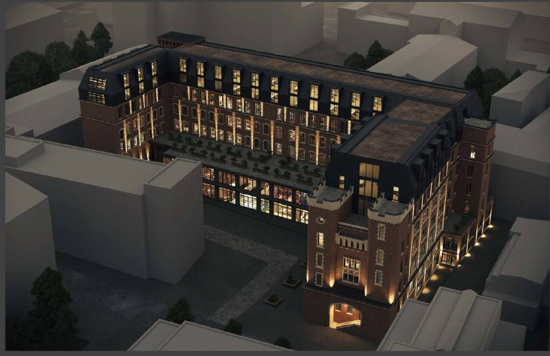
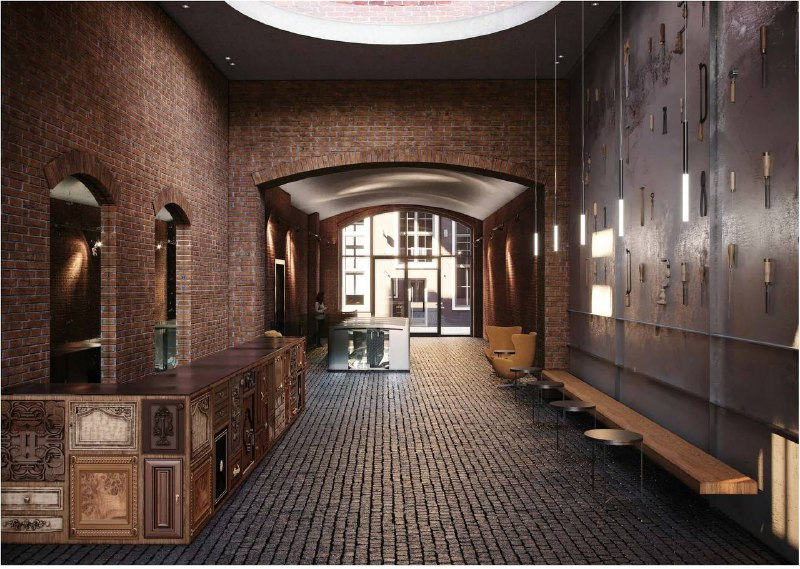
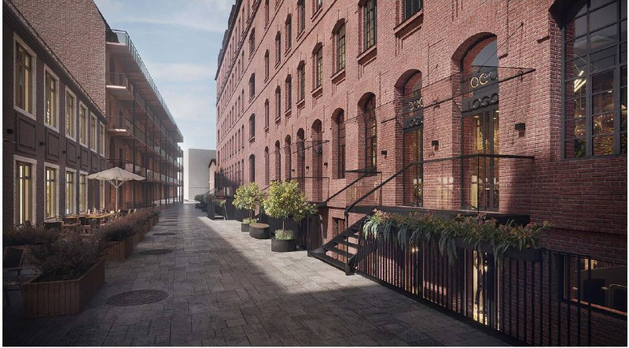

# БЦ «Королёв» в квартале Рассвет: офисы в здании 1912 года

KR Properties готовит реставрацию здания мебельной фабрики 1912 года в квартале «Рассвет» на Пресне и превращает его в бизнес-центр «Королёв». К марту 2023 года офисы были в продаже по 450–500 тыс. ₽ за кв. м с НДС.

## Коротко

- Здание построено в 1912 году по проекту Романа Клейна; реконструкцию делает [KR Properties](/zastroyshchiki/kr-properties/), концепцию разработали немецкое бюро UP+ и российское DNK ag.
- Офисы на этажах 2–7 рассчитаны на премиальных покупателей и объединение блоков: средний офис 330 кв. м, крупнейший лот 514,6 кв. м.
- Цена продажи по оценке CORE.XP в марте 2023 года: 450–500 тыс. ₽ за кв. м с НДС (рекламный материал).
- Проект изначально готовили под долгосрочную аренду одной крупной международной компанией.

## Что это за проект и кто его делает

Бизнес-центр «Королёв» получил название в честь Сергея Королёва, который работал в этом здании. Он входит в квартал «Рассвет» в [Пресненском районе](/novostroyki/presnenskiy/): по данным РБК Недвижимости, там уже работают гастрокластер и офисный кластер, а после реконструкции планируют соединить бизнес-кластер пешеходной зоной с улицей Красная Пресня.

По данным «Москвич Mag» от 30 ноября 2022 года, представитель Nikoliers рассказал, что проект изначально предназначался для долгосрочной аренды одной крупной международной компанией; после её ухода из России помещения выставили на рынок.

*(1) Реставрируемое здание с мансардными этажами и двором. Визуализация: KR Properties*

*(2) Кирпичный холл с мощёным полом. Визуализация: KR Properties*

*(3) Пешеходная улица вдоль фасада. Визуализация: KR Properties*

## Сколько стоят офисы в «Королёве»

В рекламном материале на РБК Недвижимости от 14 марта 2023 года аналитики CORE.XP оценивали продажу в 450–500 тыс. ₽ за кв. м с НДС. Небольшие офисные блоки предлагали от 25 кв. м, ритейл на первом и цокольном этажах — от 95 до 403,4 кв. м; условия продажи или аренды ритейла в материале не названы. Окупаемость офисов в материале оценивали примерно в 10 лет.

Особенность проекта — возможность купить: ранние кварталы KR Properties, «Красная Роза» и «Даниловская мануфактура», в аренду сдаются, без продажи. Данные приводит рекламный материал, мы их независимо не проверяли.

## Реставрация здания

По данным «Москвич Mag» от 7 февраля 2023 года, фасады здания не реставрировались никогда, а прошлый ремонт исказил замысел архитектора. По данным Архсовета, проект предусматривает снос поздних пристроек, восстановление фасада и надстройку мансардного и антресольного этажей. Сроки начала и окончания работ издание не называет.

## Что с проектом сейчас

Актуальных данных на октябрь 2026 года — о ходе реставрации, вводе, продажах и ценах — в открытых источниках мы не нашли. Последние подтверждённые данные относятся к началу 2023 года. Полная история проекта — в [досье «Рассвет»](/obekty/rassvet/).

## Что это значит для покупателя и инвестора

Для инвестора ключевые риски — срок завершения реставрации здания, которое относится к выявленным объектам культурного наследия, и то, что цены 2023 года — оценка консультантов в рекламном материале, а не результат сделок. На наш взгляд, перед покупкой стоит запросить у застройщика график работ, разрешительные документы и итоговый договор. Общий фон по ценам — в разделе [«Цены»](/temy/ceny/).

## Карточка объекта

- Названия: Рассвет, БЦ «Королёв».
- Адрес ЗУ по досье: Столярный, 3 корп. 12.
- Застройщик: KR Properties.
- Район: Пресненский, Москва.
- Здание: 1912 год, архитектор Роман Клейн; концепция реконструкции — UP+ и DNK ag.
- Офисы: этажи 2–7, средний лот 330 кв. м, крупнейший 514,6 кв. м.
- Цена продажи офисов (март 2023 года, оценка консультантов): 450–500 тыс. ₽ за кв. м с НДС.

## Вопросы и ответы

**Кто застройщик БЦ «Королёв» в квартале Рассвет?**
Проект реконструкции здания 1912 года развивает KR Properties в составе квартала «Рассвет» на Пресне.

**Сколько стоили офисы в БЦ «Королёв»?**
По оценке CORE.XP в материале на РБК Недвижимости от 14 марта 2023 года, продажа — 450–500 тыс. ₽ за кв. м с НДС. Это рекламный материал.

**Какие площади офисов в БЦ «Королёв»?**
Этажи 2–7 рассчитаны на премиальные офисы с возможностью объединения: средний офис — 330 кв. м, крупнейший лот — 514,6 кв. м.

**Кто автор здания и концепции реконструкции?**
Здание построено в 1912 году по проекту Романа Клейна. Концепцию реконструкции разработали немецкое бюро UP+ и российское DNK ag.

## Источники

1. «Москвич Mag», 30 ноября 2022 года, «Корпус завода «Рассвет» на Пресне превратят вот в такой офисный центр»: https://moskvichmag.ru/gorod/korpus-fabriki-rassvet-na-presne-prevratyat-vot-v-takoj-ofisnyj-tsentr/
2. «Москвич Mag», 7 февраля 2023 года, «Здание «Рассвета» в стиле английской готики отреставрируют и откроют там бизнес-центр и фудкорт»: https://moskvichmag.ru/?p=279384
3. РБК Недвижимость, 14 марта 2023 года (рекламный материал): https://realty.rbc.ru/news/63ff66459a79477dd2d67f94

Материал не является инвестиционной рекомендацией.
