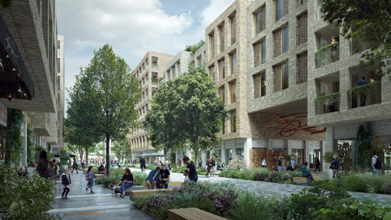
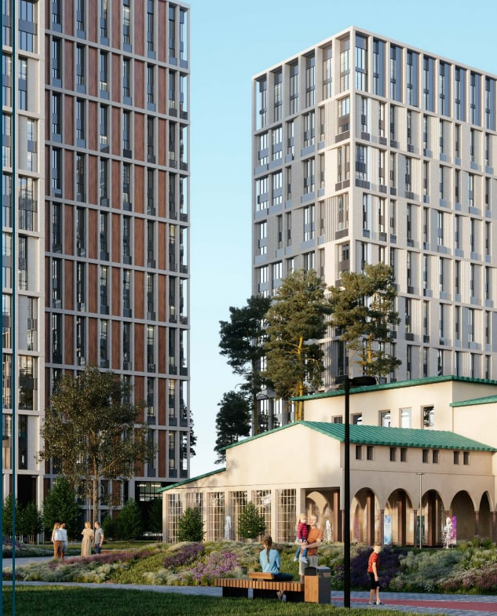

# Soul от Forma на Часовой, 28: изофабрика Гольца, цены и сроки сдачи до 2029 года

В декабре 2022 года Forma, бренд группы [ПИК](/zastroyshchiki/pik/), представила квартал Soul на Часовой улице в [районе Аэропорт](/novostroyki/aeroport/): 9,4 га, около 220 тыс. м² жилья и историческая изофабрика в сердце проекта. К октябрю 2026 года первая очередь почти построена, а последние корпуса обещают сдать к 2029 году.

## Коротко

- **Старт:** презентация — 18 декабря 2022 года; к 16 февраля 2023 года метр стоил от 311,8 тыс. ₽, студии — от 11,6 млн ₽, однокомнатные — от 14,6 млн ₽.
- **Масштаб:** 10 башен высотой 17–35 этажей, 3 793 квартиры, два детских сада; изофабрику Георгия Гольца обещали отреставрировать.
- **Сроки:** первую очередь планировали на 2025 год — в декабре 2025 года Forma сообщила, что она почти достроена.
- **Сейчас:** в объявлениях октября 2026 года сдача — от 2 квартала 2027 до 1 квартала 2029 года.

## Башни, дома и изофабрика

Forma представила квартал бизнес-класса Soul на участке 9,4 га: 220 тыс. м² жилья, 3 793 квартиры — от студий до четырёхкомнатных и пентхаусов. В плане — 10 башен по 17–35 этажей и среднеэтажные дома в 6–9 этажей, два детских сада на 100 и 200 мест. Корпуса первой очереди обещали ввести в 2025 году.

Главный герой проекта, впрочем, не башни. Это здание изофабрики 1933–1934 годов по проекту Георгия Гольца, около 4,5 тыс. м², — [объект культурного наследия (ОКН)](/slovar/okn/). Девелопер пообещал его отреставрировать и поселить внутри школу искусств, изомастерские и детский клуб. Редкий случай, когда старое здание в проекте не мешает, а продаёт.

*Визуализация пешеходной улицы квартала Soul (из презентации проекта). Визуализация: Forma*

## Так начинали: студия от 11,6 млн ₽

По «Новостройкам-М», на 16 февраля 2023 года метр стоил от 311,8 тыс. ₽. Студии — от 11,6 млн ₽, однокомнатные — от 14,6 млн ₽, двухкомнатные — от 23,4 млн ₽, трёхкомнатные — от 29,7 млн ₽. Первая очередь продавалась с отделкой white box — то есть с чистовой подготовкой помещений, но без внутренней отделки. Рядом — метро «Сокол».

## Первая очередь — почти, последние корпуса — с котлована

8 декабря 2025 года «РБК Недвижимость» писал: Forma почти завершила первую очередь, дома готовятся к заселению, а скоро стартует третья — две башни 18–24 этажа и дома Unique до 8 этажей, 110,4 тыс. м² и 886 квартир. Первую очередь изначально планировали на 2025 год, так что в целом срок выдержан.

В октябре 2026 года в объявлениях на «Новостройках-М» застройщиком значится ООО СЗ «Часовая». Студия 30,4 м² в корпусе 4 со сдачей во 2 квартале 2027 года стоила 27,58 млн ₽ (907,4 тыс. ₽/м²), стадия на странице — отделка фасада. Однокомнатная квартира 41,3 м² в корпусе со сдачей в 1 квартале 2029 года — 29,07 млн ₽ (703,8 тыс. ₽/м²), стадия — котлован. Это цены конкретных лотов, а не минимумы по проекту.

Полная история участка — в [досье «Soul»](/obekty/soul/).

## Что это значит для покупателя

Проект сильный по масштабу и локации, но сроки у него растянуты: первая очередь готовится к заселению, а покупатели третьей ждут ввода до 2029 года.

Два лота октября 2026 года дают разброс от 703,8 до 907,4 тыс. ₽ за м². Значит, «средняя цена по Soul» мало что говорит — очереди и корпуса надо сравнивать по отдельности. На наш взгляд, до сделки стоит открыть проектную декларацию на наш.дом.рф и проверить срок и стадию именно вашего корпуса, а не квартала в целом. Для сравнения — [подборка бизнес-класса](/novostroyki/biznes-klass/) и тема [«Цены»](/temy/ceny/).

*Визуализация башен и здания с аркадой на площади квартала Soul. Визуализация: Forma*

## Карточка объекта

- Название: Soul (SOUL)
- Адрес участка: Часовая, 28, район Аэропорт, САО Москвы
- Застройщик: Forma (бренд группы ПИК); в объявлениях ООО СЗ «Часовая»
- Класс: бизнес
- Участок: 9,4 га; жильё — около 220 тыс. м²
- Квартиры: 3 793 (заявлено в 2022 году)
- Корпуса: 10 башен 17–35 этажей и дома 6–9 этажей
- Сдача: от 2 квартала 2027 до 1 квартала 2029 года (по объявлениям октября 2026 года)

## Вопросы и ответы

**Кто застройщик ЖК Soul на Часовой, 28?**
Проект ведёт Forma, бренд группы ПИК; в объявлениях застройщиком указано ООО СЗ «Часовая».

**Сколько стоили квартиры в Soul в начале продаж?**
На 16 февраля 2023 года студии стоили от 11,6 млн ₽, однокомнатные — от 14,6 млн ₽, метр — от 311,8 тыс. ₽.

**Когда сдадут Soul?**
Первую очередь планировали ввести в 2025 году; в декабре 2025 года Forma сообщила, что она почти достроена. В объявлениях октября 2026 года сроки — от 2 квартала 2027 до 1 квартала 2029 года.

**Что будет с изофабрикой на Часовой?**
Здание 1933–1934 годов по проекту Георгия Гольца — объект культурного наследия. Forma пообещала его отреставрировать и разместить там школу искусств, изомастерские и детский клуб.

## Источники

1. «Новостройки-М», 18 декабря 2022 года, презентация Forma: https://www.novostroy-m.ru/novosti/forma_postroit_jiloy_kvartal
2. «Новостройки-М», 16 февраля 2023 года, цены Soul: https://www.novostroy-m.ru/novosti/prodaji_kvartir_v_kvartale
3. «Новостройки-М», 14 сентября 2021 года, о бренде Forma: https://www.novostroy-m.ru/statyi/na_pike_formy_krupneyshiy
4. «РБК Недвижимость», 8 декабря 2025 года: https://realty.rbc.ru/news/69303b809a79472ac55da0f8
5. «Новостройки-М», объявление о студии в Soul (октябрь 2026 года): https://www.novostroy-m.ru/kvartiry/studiya-v-zhk-soul-3fa26cbd01ba9b41d2c0720b749526
6. «Новостройки-М», объявление об однокомнатной квартире в Soul: https://www.novostroy-m.ru/kvartiry/odnokomnatnaya-kvartira-v-zhk-soul-dccabad961df49118d23b72aee23e0

Материал не является инвестиционной рекомендацией.
