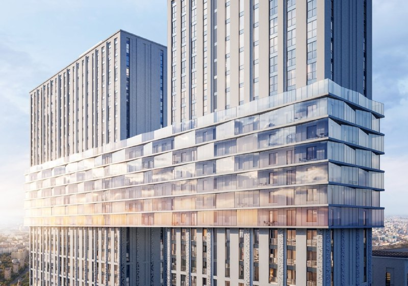

# Селигер Сити: MR Group получила разрешение на последние три башни

В конце декабря 2022 года MR Group получила разрешение на строительство последней очереди «Селигер Сити» — трёх корпусов на 1071 квартиру на Дмитровском шоссе. Четыре года спустя финал растянутого проекта у метро «Селигерская» всё ещё достраивают: сдача заявлена на IV квартал 2026-го.

*Визуализация: MR Group*

## Коротко

- **Событие:** разрешение Мосгосстройнадзора на финальную очередь — «Башни Лисицкого», «Левенгук» и «Ломоносов», 1071 квартира.
- **Застройщик:** [MR Group](/zastroyshchiki/mr-group/), проект на 10 га в Западном Дегунине.
- **Сроки:** завершение заявлено на 2026 год; по состоянию на октябрь 2026-го эти три корпуса — IV квартал.
- **Цены сейчас:** от 19,8 млн ₽ за студию около 31 м², скидка 17% до 31 октября.

## Что получила MR Group в декабре 2022 года

Разрешение выдал Мосгосстройнадзор в конце декабря 2022-го. РБК Недвижимость сообщил об этом 9 февраля 2023 года: речь о четвёртой и финальной очереди «Селигер Сити» — трёх корпусах и благоустройстве. Это «Башни Лисицкого», «Левенгук» и «Ломоносов», вместе 1071 квартира. Квартиры уже были в продаже, завершить стройку обещали в 2026-м.

Номера очередей тут лучше не считать: по данным РБК, это четвёртая и последняя очередь, хотя на рынке её называли и третьей. Надёжнее считать корпуса: три башни, 1071 квартира. Площадь очереди в квадратных метрах официально не называли.

## Кто строит и где

Застройщик — MR Group, юридически проект ведёт специализированный застройщик «Селигер Парк». Участок — Дмитровское шоссе, влд. 87, район [Западное Дегунино](/novostroyki/zapadnoe-degunino/) на севере Москвы. До метро «Селигерская» около двух минут пешком.

«Селигер Сити» — не один дом, а целый городок: 11 корпусов от 7 до 45 этажей на территории в 10 га. Полная история проекта — в [досье «Селигер Сити»](/obekty/seliger-siti/).

## Когда сдадут «Селигер Сити»: что с проектом сейчас

На 15 октября 2026 года картина такая. Восемь корпусов — «Баренц», «Беринг», «Брюллов», «Ван Гог», «Кандинский», «Рембрандт», «Репин» и «Рубенс» — сданы или уже заселены. Три последних, ради которых и выдавали то разрешение, — «Башни Лисицкого», «Левенгук» и «Ломоносов» — значатся на IV квартал 2026 года. То есть срок «2026» из 2022 года пока держится, а вот будет ли он выполнен до конца декабря, станет понятно только по разрешению на ввод.

## Сколько стоят квартиры в «Селигер Сити»

Каталог на 14 октября 2026 года показывает вилку от 19,8 млн ₽ за студию около 31 м² до 42 млн ₽ за трёшку около 92 м². По нашей прикидке, студия выходит порядка 640 тыс. ₽/м². До 31 октября действует скидка 17%, условия, как всегда, уточняйте у продавца. Покупать можно по [ДДУ](/slovar/ddu/) (договору долевого участия), в рассрочку или с ипотекой.

Отделка бывает трёх видов: без неё, предчистовая и под ключ — оформление под ключ делал бюро BLANK ARCHITECTS.

Динамику цен по другим проектам смотрите в [разделе о ценах](/temy/ceny/).

## Что это значит для покупателя

Дом, который уже стоит, и дом, который ещё растёт, — разные покупки. Три корпуса финальной очереди — как раз второй случай, пусть и на стадии отделки: здесь главный риск — не «построят ли», а «когда выдадут ключи и что будет с отделкой». Мы бы следили за двумя вещами: за разрешением на ввод в конце года и за тем, сколько скидка 17% на самом деле снижает итоговую цену.

Корпус выбирайте по этажу и виду из окна, а не по громкому названию: «Башни Лисицкого» звучат красиво, но решает планировка и то, что за окном.

## Карточка объекта

- Названия: Селигер Сити, Дмитровское, 87.
- Адрес ЗУ: Дмитровское шоссе, влд. 87, Западное Дегунино, Москва.
- Застройщик: MR Group (СЗ «Селигер Парк»).
- Территория: 10 га, 11 корпусов от 7 до 45 этажей.
- Финальная очередь: «Башни Лисицкого», «Левенгук», «Ломоносов», 1071 квартира.
- Стадия: продажи, IV квартал 2026 года — сдача финальных корпусов.
- Цена: от 19,8 млн ₽ (студия около 31 м²) по данным на 14 октября 2026 года.

## Вопросы и ответы

**Кто строит «Селигер Сити» и где он находится?**
Проект ведёт MR Group, адрес участка — Дмитровское шоссе, влд. 87, район Западное Дегунино. До метро «Селигерская» около двух минут пешком.

**Когда сдадут последние корпуса «Селигер Сити»?**
«Башни Лисицкого», «Левенгук» и «Ломоносов» заявлены на IV квартал 2026 года. Разрешение на их строительство выдали в конце декабря 2022-го.

**Сколько квартир в финальной очереди?**
1071 квартира в трёх корпусах: «Башни Лисицкого», «Левенгук» и «Ломоносов».

**Сколько стоят квартиры в «Селигер Сити» сейчас?**
По каталогу на 14 октября 2026 года — от 19,8 млн ₽ за студию около 31 м² до 42 млн ₽ за трёшку около 92 м²; до 31 октября действует скидка 17%.

## Источники

1. РБК Недвижимость, 9 февраля 2023 года, о финальной очереди «Селигер Сити»: https://realty.rbc.ru/news/63e34a889a7947840cad7bd7
2. Novostroy-M, карточка ЖК «Селигер Сити», данные на 14–15 октября 2026 года: https://www.novostroy-m.ru/baza/mfk_seliger_siti

Материал не является инвестиционной рекомендацией.
