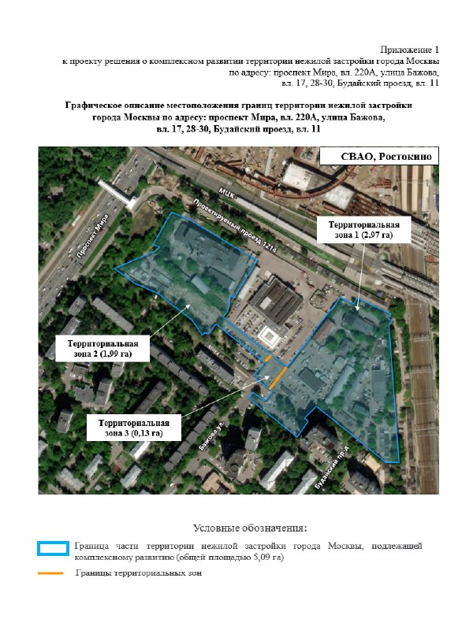

# КРТ в Ростокине на проспекте Мира, 220А: гостиница на 72 тыс. м² вместо квартир

24 апреля 2023 года власти Москвы утвердили проект комплексного развития территории (КРТ) на проспекте Мира, улице Бажова и в Будайском проезде в Ростокине. Поворот в том, что город обошёлся без жилья. Вместо квартир — около 190 тыс. м² общественно-деловой недвижимости, и почти 72 тыс. м² из них займёт гостиница.

## Коротко

- **Решение:** проект [КРТ](/slovar/krt/) объявил заммэра Владимир Ефимов 24 апреля 2023 года — около 190 тыс. кв. м общественно-деловой недвижимости, инвестиции больше 20 млрд ₽.
- **Состав:** гостиница около 72 тыс. кв. м, административно-деловое здание со спортивным объектом больше 75 тыс. кв. м, технопарк, офисы, магазины. Жилья нет.
- **Инвестор:** 14 марта 2024 года город назвал АО «Интел-Групп» — единственного участника аукциона; инвестиции к тому моменту выросли до 41,9 млрд ₽.
- **Сейчас:** о договоре и стадии проекта на октябрь 2026 года публично не сообщалось.

## Склады уступают место отелю

Город описал участки на проспекте Мира, улице Бажова и в Будайском проезде без сантиментов: используются неэффективно, склады и неэксплуатируемые объекты. При этом соседство завидное — станция МЦК «Ростокино», одноимённая станция Ярославского направления и национальный парк «Лосиный остров».

В приложении к проекту решения для проспекта Мира, 220А (так участок значится в досье) указана территория 5,09 га в районе [Ростокино](/novostroyki/rostokino/). Её разрезали на три зоны: 2,97, 1,99 и 0,13 га. Самая интересная — вторая: там допустимо до 72 120 кв. м, включая гостиницу на 1000 номеров.

*(1) Приложение 1 к проекту решения о КРТ: границы территории 5,09 га, три территориальные зоны (2,97, 1,99 и 0,13 га). Источник: проект решения, Правительство Москвы.*

## Один участник — и смета вдвое

14 марта 2024 года Москва объявила инвестора КРТ в Ростокине — АО «Интел-Групп». Конкуренции не случилось: компания была единственным участником аукциона, и город собирался предложить ей договор о редевелопменте.

Параметры почти не изменились: те же около 190 тыс. кв. м общественно-деловой недвижимости, гостиничный комплекс больше чем на 1000 номеров площадью до 72 тыс. кв. м. А вот деньги — другие. Инвестиции оценили примерно в 41,9 млрд ₽, бюджетный эффект — больше 1,2 млрд ₽ в год.

Годом раньше, в апреле 2023-го, город говорил о сумме больше 20 млрд ₽ и эффекте свыше 1 млрд ₽ в год. Почему оценка выросла примерно вдвое, в сообщении не объяснили — это цифры самого города.

Полная история площадки — в [досье «Яуза-хлеб»](/obekty/yauza-khleb/). Ещё один городской проект на той же магистрали — [КРТ на проспекте Мира, 82–92](/novosti/krt-prospekt-mira-82-92-aukcion/).

## После аукциона — тишина

На 15 октября 2026 года ни город, ни инвестор не сообщали о подписании договора с «Интел-Групп», стадии проекта, разрешении на строительство или новых параметрах. Последнее официальное событие так и осталось датированным 14 марта 2024 года.

## Что это значит для покупателя и инвестора

Если вы присматриваетесь к квартирам по соседству, главное здесь — чего в проекте нет. Нет жилья: вместо него гостиница, офисы и спортивный объект. На наш взгляд, это скорее плюс для школ и поликлиник района — новых жильцов им не добавят. Минус — машины: гостиница и офисы приводят транспортный поток.

Риски — сроки согласований и реальный старт стройки: от решения о КРТ до разрешения на строительство обычно проходит не один год, а здесь после аукциона новостей нет. Следить стоит за тремя вещами: договором с инвестором, проектной документацией и разрешением на стройку.

## Карточка объекта

- Адрес: проспект Мира, вл. 220А; улица Бажова, вл. 17, 28-30; Будайский проезд, вл. 11, Ростокино, СВАО, Москва
- Название в досье: «Яуза-хлеб»
- Площадь территории: 5,09 га (по приложению к проекту решения)
- Параметры: около 190 тыс. кв. м общественно-деловой недвижимости, гостиница до 72 тыс. кв. м
- Инвестор: АО «Интел-Групп» (по сообщению города от 14 марта 2024 года)

## Вопросы и ответы

**Что построят по КРТ на проспекте Мира, 220А в Ростокине?**
По сообщению города от 24 апреля 2023 года — около 190 тыс. кв. м общественно-деловой недвижимости: гостиницу около 72 тыс. кв. м, административно-деловое здание со спортивным объектом, технопарк, офисы и магазины. Жилья в проекте нет.

**Кто инвестор КРТ в Ростокине на проспекте Мира?**
В марте 2024 года город объявил инвестором АО «Интел-Групп» — единственного участника аукциона. О подписании договора публично не сообщалось.

**Сколько номеров в гостинице по КРТ в Ростокине?**
По данным города от 14 марта 2024 года — больше 1000 номеров, гостиничный комплекс площадью до 72 тыс. кв. м.

**Сколько инвестиций планируют в КРТ в Ростокине?**
В апреле 2023 года город называл больше 20 млрд ₽, в марте 2024 года — около 41,9 млрд ₽.

## Источники

1. [РБК Недвижимость: проект КРТ на проспекте Мира в Ростокине, 24 апреля 2023](https://realty.rbc.ru/news/64462ade9a7947c2dfce3146)
2. [mos.ru: определён инвестор КРТ в районе Ростокино, 14 марта 2024](https://www.mos.ru/news/item/136337073/)
3. Приложение 1 к проекту решения о комплексном развитии территории по адресу: проспект Мира, вл. 220А, улица Бажова, вл. 17, 28-30, Будайский проезд, вл. 11 (скан документа)

Материал не является инвестиционной рекомендацией.
