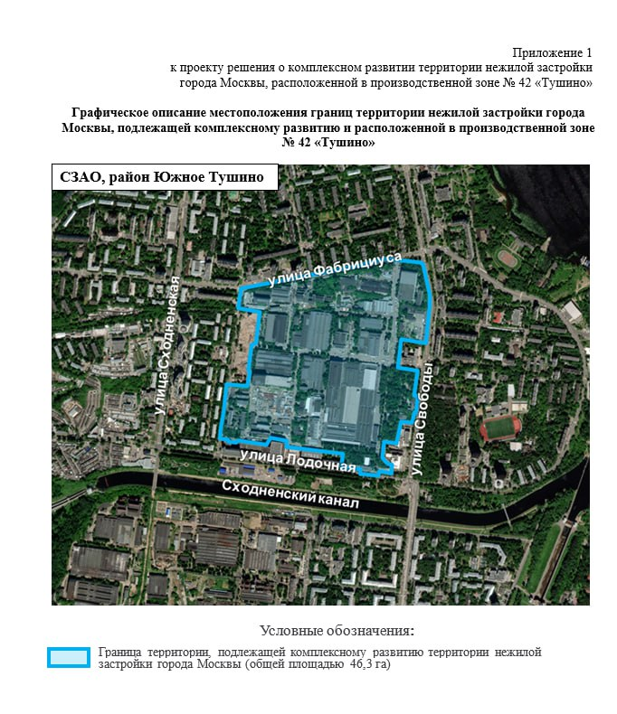

# КРТ на Свободы, 35: 550 тыс. м² жилья на месте Тушинского завода

Завод, который в 2018 году выставляли на «Авито», теперь превращают в город внутри города: 46,3 га в Южном Тушине, 550 тыс. м² жилья и столько же нежилой застройки. Договор о комплексном развитии территории (КРТ) город заключил с Level Group, а на площадке пока котлован.

## Коротко

- Участок: бывшая производственная зона «Тушино» (Тушинский машиностроительный завод, Свободы, 35), 46,3 га в районе Южное Тушино.
- Параметры: около 1,1 млн м², из них 550 тыс. м² жилья и около 550 тыс. м² производственной и общественно-деловой застройки.
- Реновация: не менее 175,5 тыс. м² жилья выделено под программу реновации и другие городские нужды.
- Договор о КРТ сроком на 14 лет, инвестиции — свыше 200 млрд ₽ (Мэрия Москвы, 16 мая 2024 года).

## Что такое КРТ на Свободы, 35

О параметрах проекта заговорили ещё в мае 2023 года. Тогда они выглядели как цифры из проекта решения: 550 тыс. м² жилья, из них не менее 175,5 тыс. м² под реновацию, и 550 тыс. м² нежилья. Соотношение один к одному: на каждый квадратный метр жилья в проекте приходится квадратный метр рабочих мест и сервисов. Предельные [ТЭП](/slovar/tep/) тогда лежали на столе, а застройщика официально не называли.

16 мая 2024 года вице-мэр Владимир Ефимов объявил, что город заключил договор о [комплексном развитии территории](/slovar/krt/) на 46,3 га в Южном Тушине. Инвестиции превысят 200 млрд ₽, бюджетный эффект — около 6,4 млрд ₽ в год, рабочих мест — около 15 тыс. Права получило ООО «Адмаер», входящее в [Level Group](/zastroyshchiki/level-group/). Срок договора — 14 лет.

*Приложение 1 к проекту решения о комплексном развитии территории: границы участка 46,3 га между улицами Фабрициуса, Свободы и Лодочной. Документ Правительства Москвы.*

## Кто и как дошёл до этого участка

Завод основан в 1931 году, в разные годы выпускал истребители, автобусы и космический корабль «Буран». В 2013 году предприятие обанкротилось с долгом около 7 млрд ₽. В июле 2018 года его выставили на «Авито» за 10,3 млрд ₽, а 9 августа снизили цену до 8 млрд ₽. Покупателя тогда не нашлось.

Через несколько лет участок получил девелопер. Полная хронология — в [досье «Тушинский машиностроительный завод»](/obekty/tushinskiy-mashinostroitelnyy-zavod/).

## Что с проектом сейчас

По состоянию на 15 октября 2026 года на участке работает коммерческая очередь. Level Group продаёт нежилые лоты в бизнес-центре Level Work Свободы по адресу ул. Свободы, 35. Формат — light industrial (лёгкое производство и склады с офисной частью), потолки от 4,5 до 8 м, проектировало бюро ABOVE. По каталогу «Новострой-М», корпус Г1 находится на стадии «котлован/фундамент», срок — IV квартал 2028 года.

Квартиры на странице проекта не продаются, сроки жилых очередей застройщик там не называет.

## Что это значит для покупателя и инвестора

Первая вывеска на участке — не квартиры, а индустриальные лоты. Так девелопер сначала «сажает» на землю то, что проще продать и построить, а жильё откладывает на потом. Для покупателя квартиры это значит одно: ждать жилых корпусов на Свободы, 35 придётся долго, а сроки зависят от того, как пойдёт нежилая часть.

Три вещи стоит отслеживать:

- проектные декларации на [наш.дом.рф](https://xn--80az8a.xn--d1aqf.xn--p1ai/) по жилым корпусам, когда они появятся;
- разрешения на строительство и график переселения по реновации: как будет строиться и заселяться реновационная часть (не менее 175,5 тыс. м²);
- обеспеченность соцобъектами (в проекте решения заложены школа, детские сады, медицинский центр и физкультурно-оздоровительный комплекс).

Если вы присматриваетесь к лотам Level Work, сверяйте срок IV квартал 2028 года со стройкой, а не с презентацией. Подробнее о других проектах КРТ — в [теме «КРТ»](/temy/krt/), а соседние объекты района — в подборке [новостроек Южного Тушина](/novostroyki/yuzhnoe-tushino/).

## Карточка объекта

- Адрес участка: Свободы, 35, Южное Тушино, СЗАО, Москва
- Название: Тушинский машиностроительный завод (КРТ производственной зоны «Тушино»)
- Застройщик: Level Group (ООО «Адмаер»)
- Площадь территории: 46,3 га
- Жильё: 550 тыс. м², в том числе не менее 175,5 тыс. м² реновации
- Нежилая застройка: около 550 тыс. м²
- Срок договора КРТ: 14 лет
- Стадия: Level Work Свободы, корпус Г1 — котлован/фундамент, срок IV квартал 2028 года (по каталогу)

## Вопросы и ответы

**Что строят на месте Тушинского машиностроительного завода?**
Комплексную застройку на 46,3 га в Южном Тушине: около 1,1 млн м², из них 550 тыс. м² жилья и около 550 тыс. м² производственной и общественно-деловой застройки.

**Кто застройщик на Свободы, 35?**
Права на КРТ получило ООО «Адмаер» из Level Group; договор с городом рассчитан на 14 лет.

**Сколько жилья пойдёт под реновацию?**
Не менее 175,5 тыс. м² из 550 тыс. м² жилья предназначены для программы реновации и других городских нужд.

**Что продают на Свободы, 35 сейчас?**
По каталогу «Новострой-М» на октябрь 2026 года — нежилые лоты в бизнес-центре Level Work Свободы формата light industrial, срок — IV квартал 2028 года.

## Источники

1. [Ефимов: город заключил договор о реорганизации участка бывшей промзоны «Тушино», «Вечерняя Москва», 16 мая 2024 года](https://vm.ru/news/1135491-efimov-gorod-zaklyuchil-dogovor-o-reorganizacii-uchastka-byvshej-promzony-tushino)
2. [Новый городской квартал на месте промзоны «Тушино», Новострой-М, 19 мая 2024 года](https://www.novostroy-m.ru/novosti/novyy_gorodskoy_kvartal_na)
3. [Производитель «Бурана» на «Авито», Inc. Russia, 9 августа 2018 года](https://incrussia.ru/news/proizvoditel-burana-na-avito/)
4. [Бизнес-центр Level Work Свободы, каталог Новострой-М](https://www.novostroy-m.ru/baza/biznestsentr_level_work_svobody)
5. Приложение 1 к проекту решения о комплексном развитии территории производственной зоны № 42 «Тушино» (скан, см. иллюстрацию)

Материал не является инвестиционной рекомендацией.
