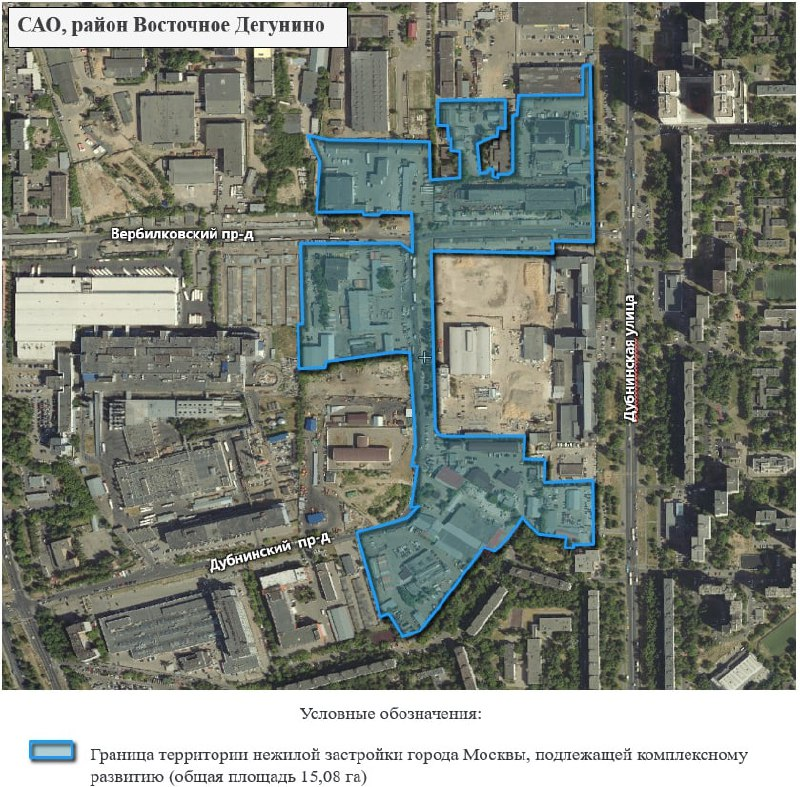

# КРТ «Вагоноремонт» в Дегунине: «Основа» выиграла 15 га, цену город не назвал

29 мая 2023 года Москва объявила: аукцион на право комплексного развития промзоны «Вагоноремонт» в Восточном Дегунине выиграл «Артстрой» из группы «Основа». Участок — больше 15 га, застройка — около 298 тыс. м², из них 165 тыс. м² жилья. Одна деталь в официальном сообщении отсутствует: сколько победитель заплатил.

## Коротко

- **Победитель:** ООО «СЗ «Артстрой» группы «Основа»; в торгах участвовали три компании (mos.ru, 29 мая 2023 года).
- **Площадь:** больше 15 га, по документам 15,08 га, Дубнинская улица, Восточное Дегунино.
- **Объём:** около 298 тыс. м² — 165 тыс. м² жилья и около 133 тыс. м² научно-производственных и деловых площадей.
- **Цена:** официально не раскрыта.

## Три участника, один победитель

Правительство Москвы 29 мая 2023 года подвело итоги аукциона на право заключить договор о [комплексном развитии территории (КРТ)](/slovar/krt/) участков №17 и №18 производственной зоны «Вагоноремонт». Торговались три компании, победил «Артстрой» из группы [«Основа»](/zastroyshchiki/osnova/).

Подписали договор быстро — на ПМЭФ, о чём 20 июня 2023 года написал Новострой-М. На всю застройку там же отвели примерно шесть лет.

## Жильё, наука и реновация

По данным mos.ru, проект потянет примерно на 25 млрд ₽ инвестиций, даст бюджету больше 1,2 млрд ₽ в год и больше 4 тыс. рабочих мест. Всего — около 298 тыс. м²: 165 тыс. м² жилья и около 133 тыс. м² научно-производственных и деловых площадей. Из жилья 16,5 тыс. м² город заберёт под реновацию.

Участок — в [Восточном Дегунине](/novostroyki/vostochnoe-degunino/), недалеко от станций МЦД-1 Бескудниково и Лианозово.

*(1) Граница территории нежилой застройки, подлежащей комплексному развитию, 15,08 га, САО, Восточное Дегунино. Схема из документации торгов. Источник: Правительство Москвы.*

## Цена вопроса — за кадром

Сумму, за которую «Основа» получила право на КРТ, город в сообщении об итогах торгов не назвал. Не раскрывали её и позже. Так что в этой истории известно, что и сколько построят, но не известно, во что обошёлся вход.

## Как менялся проект

Вся история площадки — в [досье «Вагоноремонт»](/obekty/vagonoremont/). Ключевые вехи:

- **29 мая 2023 года** — итоги аукциона, победитель «Артстрой» (mos.ru);
- **19 июня 2023 года** — банк ДОМ.РФ дал структуре «Основы» 31 млрд ₽ на проект на участке около 15 га. В этой публикации площадь застройки уже «более 235 тыс. м²», квартир 2450, финиш — II квартал 2029 года (Рамблер.Финансы). У города, напомним, 298 тыс. м²;
- **3 июня 2024 года** — в промзоне работают двое: «Артстрой» и ООО «Камотес», на участках 15 га и 2,71 га. Инвестиции по обоим — около 34 млрд ₽; на первом — 165 тыс. м² жилья, около 107 тыс. м² общественно-деловых и больше 25 тыс. м² производственных помещений (Новострой-М).

Дальше — тишина. На 15 октября 2026 года ни проектной декларации, ни старта продаж застройщик не объявлял; по досье проект на стадии проектирования. О [новом варианте посадки](/novosti/vagonoremont-osnova-variant-posadki-ne-podtverzhden/) — отдельный материал.

## Что это значит для покупателя и инвестора

Квартир в продаже нет, так что обсуждать цену метра рано. Важнее сроки. Договор КРТ подписали в 2023 году, девелопер называл ввод в 2029 году, а разрешения на строительство публично пока не было. Чем дольше проектирование, тем меньше остаётся от этого запаса.

Ещё один сигнал — сама площадь. 298 тыс. м² у города и 235 тыс. м² в банковской сделке: параметры проекта по ходу проектирования могут заметно поплыть. Следить стоит за проектной декларацией на наш.дом.рф и решениями о ГПЗУ (градостроительном плане земельного участка). Как устроен механизм — в теме [КРТ](/temy/krt/).

## Карточка объекта

- Адрес участка: Дубнинская, 77-83, промзона «Вагоноремонт», Восточное Дегунино, САО, Москва
- Застройщик: «Артстрой» (группа «Основа»)
- Площадь: более 15 га (15,08 га)
- Объём: около 298 тыс. м², в том числе 165 тыс. м² жилья
- Инвестиции: около 25 млрд ₽ (2023 год)
- Стадия: проектирование (по досье)
- Транспорт: МЦД-1, станции Бескудниково и Лианозово

## Вопросы и ответы

**Кто выиграл аукцион на КРТ «Вагоноремонт»?**
По сообщению мэра и Правительства Москвы от 29 мая 2023 года — ООО «СЗ «Артстрой» из группы «Основа». В торгах участвовали три компании.

**Сколько можно построить на «Вагоноремонте» в Дегунине?**
Около 298 тыс. м² застройки: 165 тыс. м² жилья (из них 16,5 тыс. м² по реновации) и около 133 тыс. м² научно-производственных и деловых площадей.

**Сколько «Основа» заплатила за право КРТ?**
Цену торгов Правительство Москвы официально не называло.

**Когда достроят проект?**
По сообщению от 19 июня 2023 года, завершить стройку планировали во II квартале 2029 года; позже говорили о сроке реализации в шесть лет (публикация от 3 июня 2024 года).

## Источники

1. [mos.ru: итоги аукциона на право КРТ промзоны «Вагоноремонт», 29 мая 2023 года](https://www.mos.ru/news/item/124293073/)
2. [Новострой-М: на территории «Вагоноремонта» будет построено, 20 июня 2023 года](https://www.novostroy-m.ru/novosti/na_territorii_vagonoremonta_budet)
3. [Рамблер.Финансы: «Основа» привлекла 31 млрд ₽ на редевелопмент промзоны, 19 июня 2023 года](https://finance.rambler.ru/realty/50944497-osnova-privlekla-31-mlrd-rubley-na-redevelopment-promzony-v-moskve)
4. [Новострой-М: на территории «Вагоноремонта» построят, 3 июня 2024 года](https://www.novostroy-m.ru/novosti/na_territorii_vagonoremonta_postroyat)

Материал не является инвестиционной рекомендацией.
