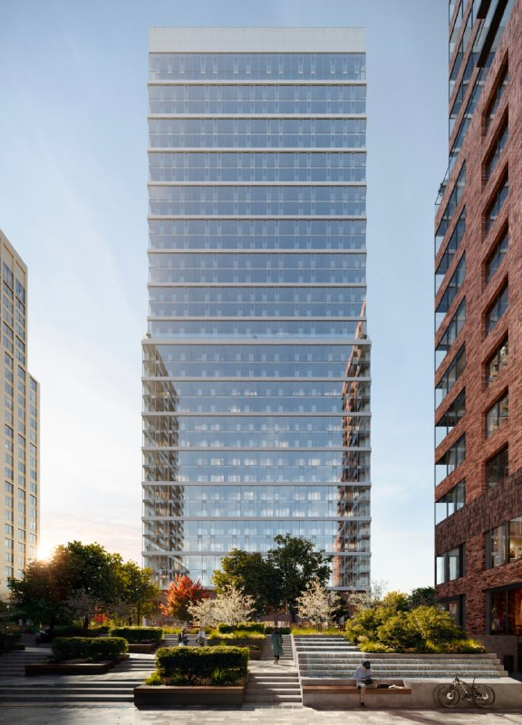

# Republic на Пресненском валу, 27: сменился застройщик, а ансамбль устоял

Квартал Republic (в досье — «Репаблик») на Пресненском валу, 27 запускали в 2022 году как архитектурный парад: шесть бюро, 10 жилых домов на 24–45 этажей, парк на 4 га и реставрация исторических мастерских. К лету 2026 года, по обзору с данными ЕИСЖС, у проекта сменился застройщик и поехали сроки первой очереди. А вот концепция осталась прежней — и это, пожалуй, главная новость.

## Коротко

- **Июль 2022 года:** запуск от Forma (структура ПИК) — 10 домов, 24–45 этажей, около 390 тыс. м², первая очередь на 2025 год.
- **Январь 2025 года:** проект переходит к «[Страна Девелопмент](/zastroyshchiki/strana/)».
- **Лето 2026 года:** в продаже четыре корпуса, 1 313 квартир по ЕИСЖС.
- **Сроки:** III квартал 2026 и IV квартал 2027 года вместо 2025-го.

Полная история проекта — в [досье «Репаблик»](/obekty/repablik/). Район — [Пресненский](/novostroyki/presnenskiy/).

## Запуск: шесть бюро на восьми гектарах

Forma появилась в 2021 году внутри технологической компании ПИК — под проекты бизнес-класса и выше. Республик стал её вторым проектом после «Форста», продажи открыли в начале июля 2022 года.

Продавали не просто дома, а «ансамбль». Концепции для разных корпусов нарисовали шесть бюро: Steve Brown Architecture, SimpsonHaugh, John McAslan + Partners (все — Великобритания), Meganom и Wall (Россия), Max Dudler (Швейцария). Сводил всё в единое целое, как сообщалось, Юрий Григорян. Благоустройство — британское бюро Gillespies.

Параметры на июль 2022 года:

- участок 8 га, общая площадь около 390 тыс. м², жилая — около 178 тыс. м²;
- 10 жилых домов от 24 до 45 этажей и офисный центр;
- около 2,5 тыс. квартир (в августовском материале — 2 651);
- частный ландшафтный парк 4 га, общественные пространства — 65 тыс. м²;
- четыре кирпичных здания бывших железнодорожных мастерских XIX–XX веков под реставрацию: гастрономический центр, торговая аллея, кинотеатр, спа и детский сад.

Первая очередь — два одинаковых дома на общем стилобате и здание SimpsonHaugh, около 96 тыс. м², срок — 2025 год. В конце июня 2022 года главный архитектор Москвы Сергей Кузнецов описал башню SimpsonHaugh: 34 этажа.

## Что поменялось: вывеска и календарь

Перемен, которые реально случились, две — и обе не про архитектуру.

**Застройщик.** В январе 2025 года проект ушёл от Forma к «Страна Девелопмент». По обзору novostroy-m.ru, Forma из проекта вышла, и он исчез из её портфеля. Кто сейчас отвечает за стройку, проверяйте по проектной декларации ([ЕИСЖС](/slovar/proektnaya-deklaratsiya/)) — это надёжнее любого обзора.

**Сроки.** В 2022 году первую очередь обещали в 2025 году. По ЕИСЖС в обзоре на лето 2026 года корпуса сдаются в III квартале 2026 и IV квартале 2027 года — обзор прямо пишет, что сроки первой очереди сдвигались. Почему, источник не объясняет.

## Каким Republic стал к 2026 году

По обзору novostroy-m.ru на лето 2026 года:

- в плане по-прежнему 10 домов, больше 2,6 тыс. квартир;
- в продаже четыре корпуса — Red, Platinum, Gold и Green, 1 313 квартир по ЕИСЖС;
- Green — 27 этажей, Gold — 33; этажность Red и Platinum в обзоре не названа;
- 4-гектарный парк и реставрируемые здания паровозного депо на месте;
- первая очередь готовится к вводу, вторая строится; предчистовая отделка — только в Gold, остальное без отделки;
- класс: ЕИСЖС пишет «бизнес», застройщик — «премиальный».

Обзор подчёркивает: концепция по сути не менялась. На наш взгляд, это лучший комплимент ансамблю. Застройщик сменился, сроки уехали, а пересобирать архитектуру под нового хозяина никто не стал.

Актуальную цену метра на октябрь 2026 года уточняйте в отделе продаж: датированных цифр в обзорах нет.

*Башня бюро SimpsonHaugh в квартале Republic. Визуализация: Forma, 2023*

## Было и стало

| Параметр | Июль 2022 года (запуск, Forma) | Лето 2026 года («Страна Девелопмент») |
|---|---|---|
| Застройщик | Forma (ПИК) | «Страна Девелопмент» (с января 2025 года) |
| Архитекторы | шесть бюро: Steve Brown, SimpsonHaugh, John McAslan + Partners, Meganom, Wall, Max Dudler | не названы; концепция, по обзору, прежняя |
| Домов | 10 жилых + офисный центр | 10 (план), 4 в продаже |
| Этажность | 24–45 | Green — 27, Gold — 33; остальные — «—» |
| Квартиры | около 2,5 тыс. (2 651 по другому материалу) | более 2,6 тыс. (план), 1 313 в продаже |
| Общая площадь | около 390 тыс. м² | — |
| Срок первой очереди | 2025 год | III квартал 2026 и IV квартал 2027 года (по ЕИСЖС) |
| Цена, ₽/м² | — | — |

## Карточка объекта

- **Название:** Republic («Репаблик»), ранее — проект на Пресненском валу, 27
- **Адрес участка:** Пресненский вал, 27, Москва, [Пресненский район](/novostroyki/presnenskiy/)
- **Застройщик:** [«Страна Девелопмент»](/zastroyshchiki/strana/) (с января 2025 года); ранее — Forma (ПИК)
- **Класс:** бизнес по ЕИСЖС, премиум по заявлению застройщика
- **Стадия:** продажи, строительство
- **Сроки:** III квартал 2026 и IV квартал 2027 года (по ЕИСЖС)

## Вопросы и ответы

**Кто архитектор Republic на Пресненском валу, 27?**
Шесть бюро: Steve Brown Architecture, SimpsonHaugh, John McAslan + Partners, Meganom, Wall и Max Dudler. Единый ансамбль свёл Юрий Григорян. Состав объявили при запуске проекта в июле 2022 года.

**Кто застройщик Republic сейчас?**
С января 2025 года — «Страна Девелопмент». Начинала проект Forma, структура ПИК.

**Сколько этажей в Republic?**
При запуске в 2022 году заявляли дома от 24 до 45 этажей. Из корпусов, которые продаются в 2026 году, по ЕИСЖС известны Gold на 33 этажа и Green на 27.

**Когда сдадут Republic?**
В 2022 году первую очередь обещали в 2025 году. По ЕИСЖС в обзоре на лето 2026 года сроки — III квартал 2026 и IV квартал 2027 года: первая очередь сдвинулась.

## Источники

1. [Республик от Forma — обзор novostroy-m.ru, 16 августа 2022 года](https://www.novostroy-m.ru/expertise/jk_republic_ot_forma)
2. [Квартал Репаблик — материал novostroy-m.ru, 8 июля 2022 года](https://www.novostroy-m.ru/statyi/kvartal_repablik)
3. [Репаблик своими глазами — обзор novostroy-m.ru, 10 июля (2026 год, по контексту), данные ЕИСЖС](https://www.novostroy-m.ru/expertise/jk_repablik_svoimi_glazami)

Материал не является инвестиционной рекомендацией.
