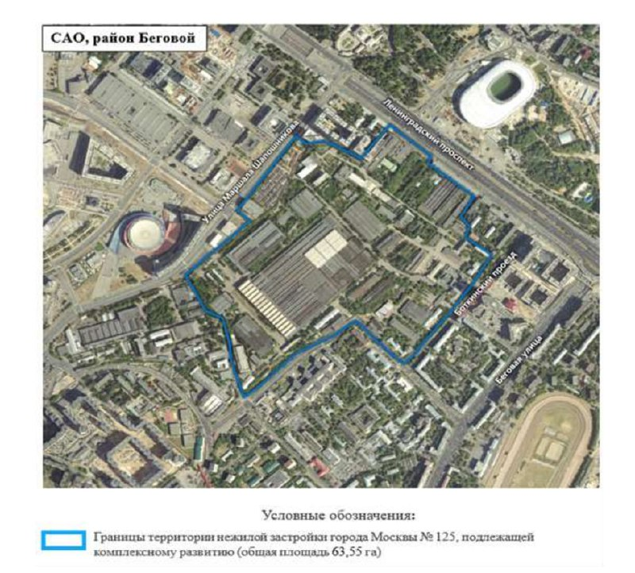
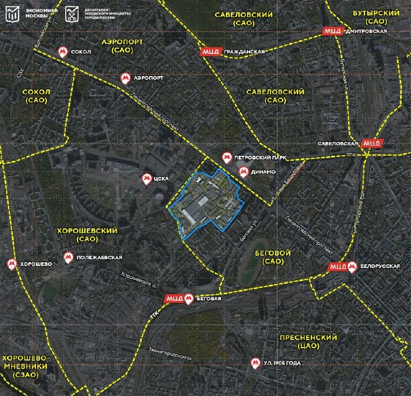

# МиГ на Ленинградке: КРТ № 125 на 63,55 га за 988 млн ₽ — дёшево лишь на бумаге

3 июля 2023 года Департамент городского имущества Москвы назначил электронный аукцион на право комплексного развития территории (КРТ) № 125 — бывшего завода МиГ в районе Беговой. Стартовая цена выглядит смешной для 63,55 га у «Динамо», но это не скидка: вместе с правом строить инвестор забирает и обязательства. Территорию в итоге получила структура Capital Group, и к октябрю 2026 года у проекта есть утверждённая планировка.

## Коротко

- **Площадь:** 63,55 га между Ленинградским проспектом, 1-м Боткинским проездом, ул. Бориса Петровского и ул. Маршала Шапошникова.
- **Старт торгов:** 987,9 млн ₽, задаток 197,6 млн ₽ (20%).
- **Что можно построить:** 2,35 млн м² поэтажной площади, из них 1,41 млн м² жилья и 0,94 млн м² общественно-деловых объектов.
- **Инвестор:** структура Capital Group, договор на 26 лет, вложения — не менее 300 млрд ₽.

## Город продаёт не землю, а обязательства

Распоряжение от 3 июля 2023 года № 40758 назначило торги на право заключить договор о [комплексном развитии территории (КРТ)](/slovar/krt/) нежилой застройки № 125. Под ним — постановление правительства Москвы от 19 июня 2023 года № 1105-ПП о КРТ и решение Градостроительно-земельной комиссии (ГЗК) от 8 июня 2023 года.

Начальная цена — 987 907 074,47 ₽, шаг — 2% (19,8 млн ₽), задаток — 20%. Дёшево это только на бумаге. До 2023 года город уже дважды пытался продать территорию МиГа целиком — сначала за 35,5 млрд ₽, потом за 40 млрд ₽, — и, по сообщениям СМИ, оба раза торги не состоялись. Третья попытка устроена иначе: на кону не участок, а право развивать его со всеми обязательствами инвестора.

*Границы территории нежилой застройки № 125 общей площадью 63,55 га у Ленинградского проспекта и 1-го Боткинского проезда. Источник: Правительство Москвы, Департамент городского имущества.*

## Вход только для тяжеловесов

Требования к участникам читаются как фейсконтроль. Нужен опыт строительства не менее 234 585 м² за последние пять лет, опыт «технически сложных и уникальных объектов» выше 350 м, а ещё не менее 500 тыс. м² жилья и 150 тыс. м² нежилых зданий за те же пять лет. Под такой набор, на наш взгляд, подходят только [мастер-девелоперы](/slovar/master-developer/) — региональным компаниям здесь делать нечего.

## 1,4 млн м² жилья и обязательная нагрузка

Решение о КРТ разрешает построить до 2 345 850 м² поэтажной площади: 1 407 510 м² жилья и 938 340 м² общественно-деловых и иных объектов. Нежилая часть — не меньше 703 755 м², и в неё входят детский сад на 750 мест, школа на 2 150 мест и поликлиника на 750 посещений в смену. Предельную плотность и высоту документ не фиксирует.

*Территория КРТ № 125 на карте районов Беговой, Хорошёвский и Савёловский. Источник: Правительство Москвы, Департамент городского имущества.*

## Планировка есть, домов пока нет

Положение дел на 15 октября 2026 года. 27 октября 2024 года мэрия сообщила об утверждении проекта планировки территории площадью 89,97 га, из которых 63,55 га занимает бывший завод. Договор о КРТ заключён с инвестором, «привлечённым по итогам торгов»: по данным РИАМО, это ООО «Энимерози» из группы [Capital Group](/zastroyshchiki/capital-group/), срок — 26 лет. В планах — более 2,3 млн м² недвижимости, из них жилья более 1,4 млн м², школы на 2,8 тыс. учеников и около 25 тыс. рабочих мест. Инвестиции — не менее 300 млрд ₽.

Когда прошли торги и за сколько в итоге ушёл лот, город публично не сообщал. Сроков строительства, цен и даты открытия продаж тоже пока нет. Полная история проекта — в [досье «МиГ»](/obekty/mig/).

## Что это значит для покупателя и инвестора

КРТ такого масштаба выходят на рынок очередями, и первые корпуса появляются через годы после торгов. Быстрого продукта здесь не будет: сначала снос, сети и согласование архитектуры.

Главная интрига — класс и цена. Локация у метро «Динамо» и «Петровский парк» (по данным мэрии) дорогая, а КРТ обязывает инвестора выстроить социалку и большую нежилую часть. На наш взгляд, именно разрыв между ценой продажи и качеством строительства станет главным риском для покупателя. Что построят и почём, покажут только проектные декларации. Следите за разрешениями на строительство и за [районом Беговой](/novostroyki/begovoy/), где новых проектов немного. Общий фон — в разделе [КРТ](/temy/krt/).

## Карточка объекта

- Адрес участка: 1-й Боткинский проезд, 7 (КРТ № 125)
- Названия: МиГ, территория завода МиГ
- Застройщик: Capital Group (ООО «Энимерози»)
- Район: Беговой, САО, Москва
- Площадь КРТ: 63,55 га
- Предельная площадь: 2,35 млн м², из них жилья 1,41 млн м²
- Стадия: проект планировки утверждён (октябрь 2024 года)

## Вопросы и ответы

**Что такое КРТ № 125 в районе Беговой?**
Это территория бывшего завода МиГ площадью 63,55 га у Ленинградского проспекта и 1-го Боткинского проезда, которую город отдал под комплексное развитие.

**Какая была стартовая цена аукциона на КРТ № 125?**
По распоряжению Департамента городского имущества от 3 июля 2023 года — 987 907 074,47 ₽. Это цена права на развитие территории, а не самой земли.

**Сколько жилья планируют построить на территории МиГа?**
Предельная площадь жилья — 1 407 510 м², общественно-деловых объектов — 938 340 м². В октябре 2024 года мэрия говорила о жилье более 1,4 млн м².

**Кто строит на территории МиГа?**
По сообщению мэрии, инвестор — ООО «Энимерози» из группы Capital Group. Договор о КРТ рассчитан на 26 лет.

## Источники

1. [Мэрия Москвы: утверждён проект планировки территории бывшего завода «МиГ», 27 октября 2024 года](https://www.mos.ru/news/item/145802073/)
2. [РИАМО: проект планировки территории бывшего завода «МиГ»](https://riamo.ru/news/nedvizhimost/efimov-utverzhden-proekt-planirovki-territorii-byvshego-zavoda-mig/)
3. [Москва 1: на территории завода «МиГ» появится новый городской квартал, 28 октября 2023 года](https://msk1.ru/text/gorod/2023/10/28/72857909/)
4. Распоряжение Департамента городского имущества города Москвы от 3 июля 2023 года № 40758 и приложения к нему (скан из архива редакции)

Материал не является инвестиционной рекомендацией.
