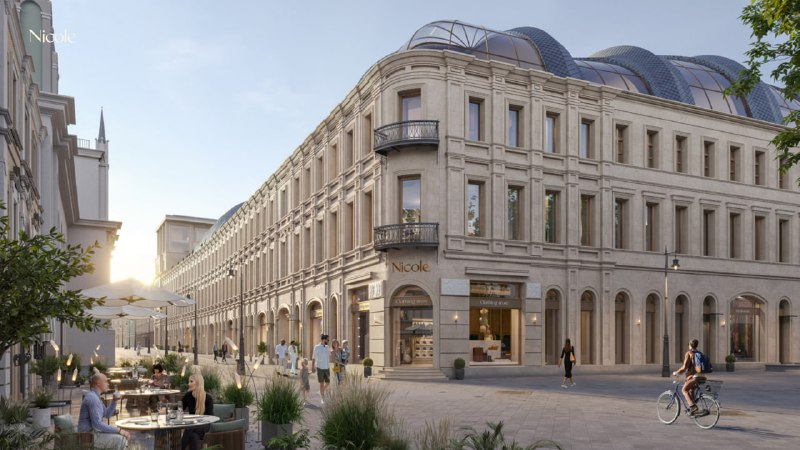
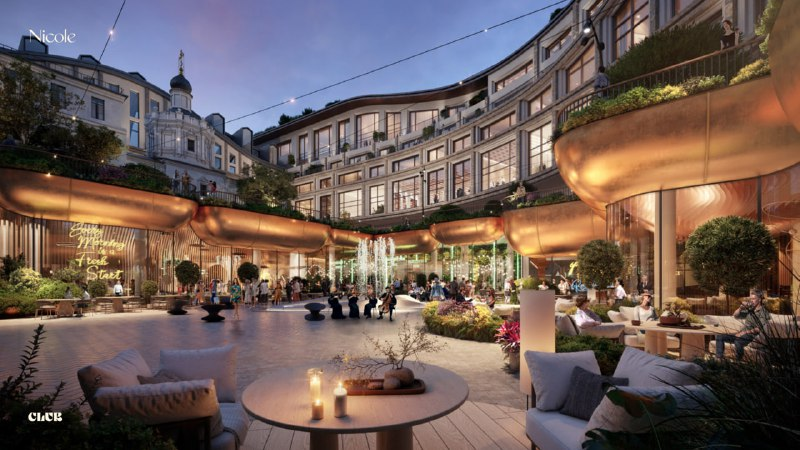
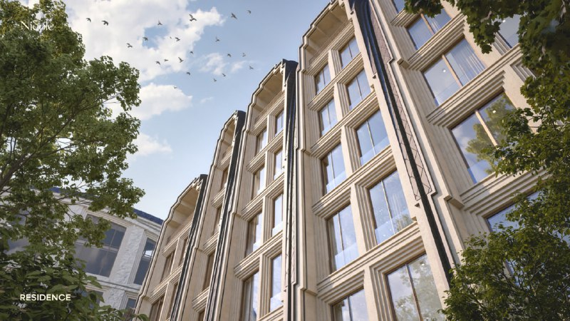

# Nicole на Никольской: от разрешения MR Group до цен от 192 млн ₽

MR Group получила разрешение на первую часть квартала Nicole на Никольской 21 сентября 2023 года. Три года спустя это 132 квартиры в продаже по ценам от 192 млн ₽ — и сроки, которые за это время подвинулись с «начала 2027-го» на 2027–2028 годы. Бюро Хезервика на общественной части, Кремль рядом, а входной билет стоит от 192 млн ₽.

## Коротко

- **Что:** многофункциональный комплекс Nicole у Кремля, больше 120 тыс. м², три части — Club, Residence и Collection.
- **Разрешение:** 21 сентября 2023 года на первую часть — Club и Residence.
- **Цены на октябрь 2026 года:** от 192 до 914 млн ₽, в продаже 132 квартиры.
- **Сдача:** Collection — III квартал 2027 года, Club и Residence — I квартал 2028 года.

## Что строит MR Group на Никольской

Квартал вырастет на месте Чижевского и Шереметьевского подворий — между Никольской улицей, Богоявленским и Большим Черкасским переулками. Участок — больше 3 га, пешком до Кремля. Здания здесь невысокие, от 3 до 8 этажей: реставрация объектов культурного наследия ([ОКН](/slovar/okn/)) идёт вперёд вместе с новой застройкой.

Проект делится на три части:

- **Nicole Club** — общественное ядро. Бутики, кафе и рестораны, коворкинг, площадки для мероприятий и «секретный пешеходный променад». Над этой частью работало бюро Томаса Хезервика.
- **Nicole Residence** — семейная часть, включая двух- и трёхэтажные таунхаусы с отдельным входом и патио.
- **Nicole Collection** — клубный дом.

Жителям положены детская зона, «клуб леди и джентльменов» и спа с бассейном. Весь чек-лист красивой Москвы на месте.

*Nicole Club: так застройщик рисует пешеходную улицу квартала. Визуализация: MR Group.*

## Что с проектом сейчас

Разрешение 2023 года охватывало Club и Residence. На 26 сентября 2026 года, по данным каталога, на площадке монтируют нижние этажи во всех трёх корпусах.

Что изменилось к октябрю 2026 года:

- **Сроки.** В 2023 году завершение стройки планировали в начале 2027 года. Теперь Collection обещают в III квартале 2027 года, а Club и Residence — в I квартале 2028 года. Для проекта с реставрацией сдвиг на год — почти норма, но это тот случай, когда «не раньше» надёжнее, чем «не позже».
- **Цены.** В каталоге квартиры стоят от 192 до 914 млн ₽. В марте 2025 года вход был от 171,36 млн ₽ — за полтора года подорожал примерно на 20 млн ₽. Однокомнатная квартира на 60,9 м² — 194,88 млн ₽, то есть около 3,2 млн ₽ за метр.
- **Предложение.** В продаже 132 квартиры площадью до 300 м², пентхаусы — до 686 м².

*Двор с ресторанными террасами: общественная часть проекта. Визуализация: MR Group.*

## Что это значит для покупателя

Здесь покупают не метры, а адрес: рядом Кремль, под окнами реставрированные подворья. Метры в этой логике вторичны, а значит, и торговаться по ним не с кем.

На наш взгляд, смотреть стоит на три вещи. Первая — сроки: к осени 2026-го дома по сути только поднимаются из-под земли, а срок уже сдвигался. Вторая — разрешения по частям: на первом этапе они выданы на Club и Residence, а по Collection проверьте документы до задатка. Третья — публичная часть: ритейл и рестораны с мероприятиями за окнами дорогих квартир — это не только бонус, но и шум. Сколько его будет на практике, станет понятно после открытия.

Другие проекты класса — в подборке [премиальных новостроек](/novostroyki/premium-klass/) и в разделе [«Премиум»](/temy/premium/).

*Nicole Residence: фасад частной части квартала. Визуализация: MR Group.*

## Карточка объекта

- **Названия:** Nicole, МФК Nicole.
- **Застройщик:** [MR Group](/zastroyshchiki/mr-group/).
- **Район:** [Тверской](/novostroyki/tverskoy/), Москва.
- **Территория:** более 3 га, больше 120 тыс. м² (по данным 2023 года).
- **Части:** Club, Residence, Collection; 3–8 этажей.
- **Архитектура:** Club — бюро Томаса Хезервика.
- **Стадия:** монтаж нижних этажей, на 26 сентября 2026 года.
- **Сдача:** Collection — III квартал 2027 года; Club и Residence — I квартал 2028 года.
- **Цены:** от 192 до 914 млн ₽, на октябрь 2026 года.

Полная история проекта — в [досье «Nicole»](/obekty/nicole/).

## Вопросы и ответы

**Кто застройщик Nicole на Никольской?**
MR Group. Проект ведёт девелопер сам, на октябрь 2026 года в каталоге указан именно он.

**Когда сдадут Nicole?**
По каталогу на октябрь 2026 года: Nicole Collection — в III квартале 2027 года, Nicole Club и Nicole Residence — в I квартале 2028 года. В 2023 году называли начало 2027 года.

**Сколько стоят квартиры в Nicole?**
Каталог показывает цены от 192 до 914 млн ₽. Однокомнатная квартира на 60,9 м² стоит 194,88 млн ₽, это около 3,2 млн ₽ за метр.

**Кто архитектор Nicole?**
Над общественной частью Nicole Club работало бюро Томаса Хезервика (Heatherwick Studio). Автор частных частей проекта в источниках не назван.

## Источники

1. Novostroy-M, 21 сентября 2023 года, о разрешении на первую часть Nicole: https://www.novostroy-m.ru/novosti/mr_group_postroit_vozle
2. «Москвич Mag», 24 сентября 2023 года, о составе проекта и архитекторе: https://moskvichmag.ru/?p=320677
3. Novostroy-M, каталог ЖК Nicole (цены, сроки, стадия, октябрь 2026 года): https://www.novostroy-m.ru/baza/zhk_st_nickolas

Материал не является инвестиционной рекомендацией.
