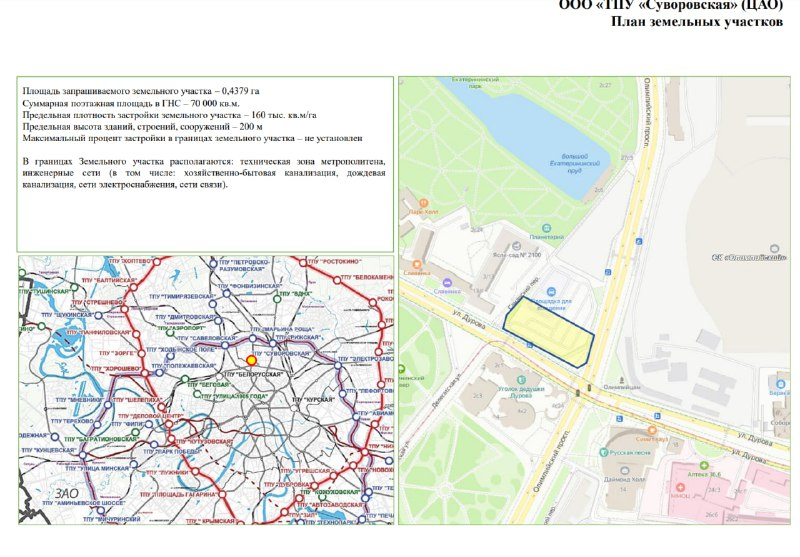
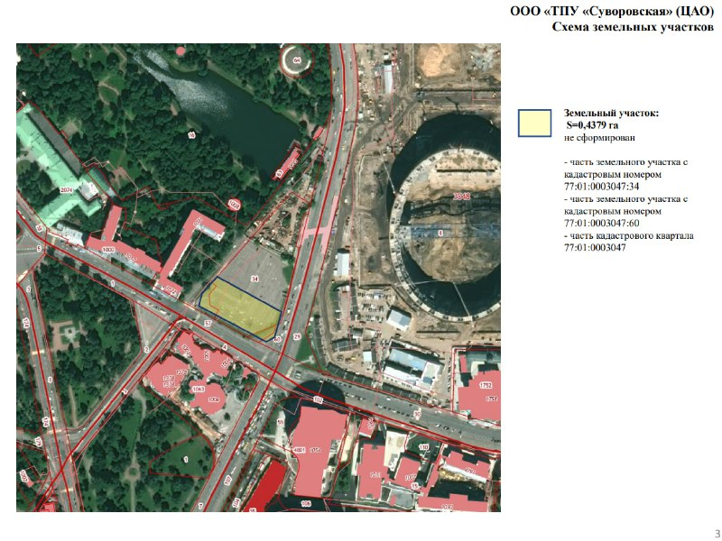

# ТПУ «Суворовская»: участок на Дурова выставили за 364 млн ₽ — жилья в планах нет

Осенью 2023 года на продажу выставили 99% доли в ООО «ТПУ «Суворовская». Покупатель получал не участок, а компанию, у которой есть право на 0,4379 га на углу Олимпийского проспекта и улицы Дурова в Мещанском районе. Старт — 364,32 млн ₽, разрешено до 70 тыс. кв. м общественной застройки. Жилья в параметрах нет.

## Коротко

- **Лот:** 99% доли в уставном капитале ООО «ТПУ «Суворовская», старт 364 320 000 ₽, обеспечение заявки — 72 864 000 ₽.
- **Участок:** 0,4379 га, 70 тыс. кв. м поэтажной площади, высота — до 200 м.
- **Покупатель:** по данным Moskvich Mag, АО «Гранард», за 364,3 млн ₽ — то есть без торга вверх.
- **Сейчас:** последние подробности датированы мартом 2024 года.

## Продают компанию, а не землю

Документация конкурса описывает не участок, а долю в компании, которой он предназначен. Самого участка как отдельного объекта ещё нет: это части кадастровых участков 77:01:0003047:34 и 77:01:0003047:60 и кусок кадастрового квартала 77:01:0003047.

Разрешено всё, что нужно деловому кварталу: деловое управление, магазины, общепит, банки. Жилья в списке нет. Предельная плотность — 160 тыс. кв. м на гектар, то есть строить можно очень плотно. На самой территории — техническая зона метрополитена и инженерные сети, так что строить придётся с оглядкой на метро.

*(1) План земельного участка из документации конкурса. Источник: документация конкурса на продажу доли ООО «ТПУ «Суворовская»*

## «Гранард» и 32 этажа офисов

По публикации Moskvich Mag от 24 марта 2024 года, документы по участку появились в ноябре 2023 года, а купил его, по данным издания, «Гранард» за 364,3 млн ₽. Маленькая деталь: в протоколе имя победителя заменили на «участника, подавшего заявку №784084». Так что покупатель известен со слов издания, а не из документа.

Там же описан и проект: 32-этажный офис на улице Дурова у будущей станции «Достоевская» — так переименовали «Суворовскую». Здесь будет пересадка на Люблинско-Дмитровскую линию, завершение офиса назначено на 2027 год. Представители «Стройкомплекса» называли общественно-деловой комплекс на 70 тыс. кв. м частью [транспортно-пересадочного узла](/slovar/tpu/).

*(2) Схема участка из той же документации. Источник: документация конкурса на продажу доли ООО «ТПУ «Суворовская»*

## После марта 2024-го — тишина

На 15 октября 2026 года публикация Moskvich Mag от 24 марта 2024 года остаётся последним подробным рассказом о проекте. Проектную документацию не показывали, о начале строительства не объявляли. В январе 2026 года обсуждали [третью концепцию застройки](/novosti/tpu-suvorovskaya-granard-koncepciya-soho/) участка, но официально она не подтвердилась. Полная история — в [досье «ТПУ Суворовская»](/obekty/tpu-suvorovskaya/).

## Что это значит для покупателя и инвестора

Квартир здесь нет и, судя по параметрам конкурса, не будет: это офисная площадка. Частному покупателю, на наш взгляд, смотреть тут не на что. Для офисного рынка это ставка на пересадочный узел у Олимпийского.

И не обманывайтесь ценой. 364 млн ₽ за 0,44 га в центре — это цена доли в компании, а не стоимость земли, так что сравнивать её с ценой участков напрямую нельзя.

Следить стоит за ГПЗУ и проектной документацией, стартом стройки и сроками самой станции. Обещанный 2027 год прозвучал ещё в 2024-м, и новых подтверждений ему пока не было.

## Карточка объекта

- Названия: ТПУ «Суворовская», участок у станции «Суворовская» (с 2024 года в источниках — «Достоевская»)
- Расположение: пересечение улицы Дурова и Олимпийского проспекта, Мещанский район (ЦАО), Москва
- Площадь участка: 0,4379 га
- Суммарная поэтажная площадь: 70 тыс. кв. м (по документации конкурса)
- Предельная высота: 200 м
- Стартовая цена конкурса: 364,32 млн ₽
- Покупатель: «Гранард» (по данным Moskvich Mag, 2024 год)

## Вопросы и ответы

**Сколько стоил участок ТПУ «Суворовская» на торгах?**
Стартовая цена конкурса — 364,32 млн ₽ за 99% доли в ООО «ТПУ «Суворовская». По данным Moskvich Mag, участок купил «Гранард» за 364,3 млн ₽.

**Какая площадь участка ТПУ «Суворовская»?**
0,4379 га. Суммарная поэтажная площадь по документации — 70 тыс. кв. м, предельная высота — 200 м.

**Будет ли жильё на ТПУ «Суворовская»?**
В параметрах конкурса жилья нет. Moskvich Mag в марте 2024 года писал о проекте 32-этажного офиса с завершением в 2027 году.

**Что с проектом сейчас?**
Последние подробности — из публикации Moskvich Mag от 24 марта 2024 года. О начале строительства с тех пор официально не сообщалось.

## Источники

1. [«Появился проект 32-этажного офиса на улице Дурова — возле будущей станции «Достоевская»», Moskvich Mag, 24 марта 2024 года](https://moskvichmag.ru/gorod/poyavilsya-proekt-32-etazhnogo-ofisa-na-ulitse-durova-vozle-budushhej-stantsii-dostoevskaya/)
2. Документация конкурса на продажу доли ООО «ТПУ «Суворовская» (скан в материалах редакции)

Материал не является инвестиционной рекомендацией.
