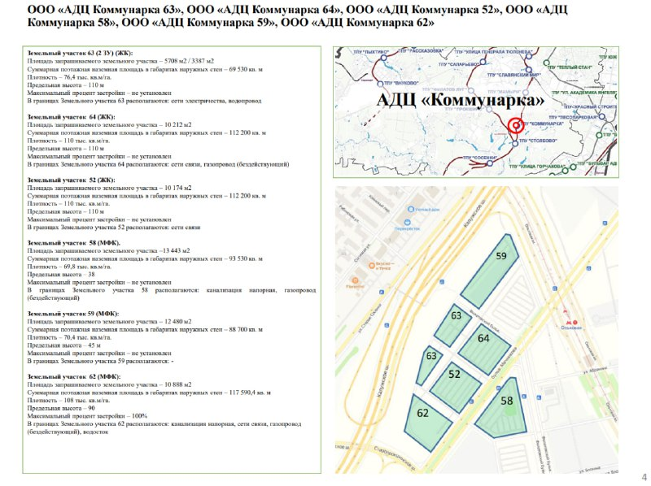

# АДЦ «Коммунарка»: участки выставили единым лотом за 3,5 млрд ₽

В декабре 2023 года на торги выставили семь участков административно-делового центра (АДЦ) «Коммунарка» в Новой Москве: около 294 тыс. м² жилья и около 300 тыс. м² торгово-офисных площадей. Начальная цена пакета — почти 3,5 млрд ₽, продавец — АО «Мосинжпроект».

## Коротко

- **Что продавали:** 99% уставного капитала шести обществ «АДЦ Коммунарка» (52, 58, 59, 62, 63 и 64), которым принадлежат семь участков площадью более 6,5 га.
- **Что можно построить:** около 294 тыс. м² жилья и около 300 тыс. м² торгово-офисной недвижимости.
- **Цена:** старт — почти 3,5 млрд ₽; торги планировались на конец января 2024 года.
- **Чем кончилось:** по обзору Moskvich Mag от 28 августа 2025 года, участок ушёл на аукционе за 3,5 млрд ₽. Покупателя в открытых источниках, которые мы смогли открыть, не нашли.

Полная история проекта — в [досье «АДЦ Коммунарка»](/obekty/adts-kommunarka/). Территория относится к [поселению Сосенское](/novostroyki/sosenskoe/).

## Что выставили на торги в АДЦ «Коммунарка»

По данным novostroy-m.ru от 20 декабря 2023 года, на инвестиционном портале города продавали не землю напрямую, а 99% долей в шести обществах. Так устроены многие городские лоты: покупатель получает компании вместе с правами на участки.

В лоте семь земельных участков (один из них — два контура) суммарной площадью свыше 6,5 га. По параметрам лота можно возвести около 294 тыс. м² жилья и около 300 тыс. м² торгово-офисной недвижимости. Эти цифры — допустимый объём застройки, а не проект: [технико-экономические показатели](/slovar/tep/) будущих зданий определят после конкурса и согласований.

*(4) Слайд конкурсной документации лота: семь участков в АДЦ «Коммунарка», декабрь 2023 года. Источник: конкурсная документация лота*

## Что за АДЦ «Коммунарка»

АДЦ — крупная территория Новой Москвы. По сообщению mos.ru от 13 октября 2016 года, её площадь около 550 га, а вице-мэр Марат Хуснуллин говорил, что там появится около 4,8 млн м² недвижимости. В 2023 году город продавал только часть этой территории: семь участков, которые в досье объединены в одну карточку.

На наш взгляд, лот интересен не ценой, а соотношением: офисов в нём почти столько же, сколько жилья. Для Москвы за пределами центра это нетипичная пропорция, и оценить её спрос можно будет только по продажам.

## Что с проектом сейчас

Положение на 15 октября 2026 года по открытым источникам.

- **Торги.** По обзору Moskvich Mag от 28 августа 2025 года, участок ушёл на аукционе за 3,5 млрд ₽. Победитель и дата торгов в этом обзоре не названы.
- **Конкурс и концепции.** Летом 2024 года был объявлен архитектурный конкурс; финалистами обозначены Steel, IND, GA и Lampa. В августе 2025 года бюро Steel опубликовало конкурсную концепцию почти на 600 тыс. м² — примерно половина жилья, половина офисов. Итог конкурса в источнике не назван.
- **Общий масштаб.** По РИАМО от 18 января 2025 года, под многофункциональные комплексы в АДЦ выделено свыше 3,6 га (около 300 тыс. м²), под жильё — почти 3 га (около 300 тыс. м²).
- **Стройка.** Разрешений на строительство и начала работ в найденных источниках нет; проверить их можно на наш.дом.рф.

## Что это значит для покупателя и инвестора

Квартир и офисов в продаже здесь пока нет: проект на стадии концепций. Для покупателя это «будущий проект» из [подборки](/novostroyki/budushchie-proekty/): сроков ввода и цен не существует.

Главный риск — спрос на офисы: заявленные около 300 тыс. м² коммерческих площадей нужно сначала арендовать или продать. Что отслеживать: имя владельца лота, итоги архитектурного конкурса, разрешения на строительство, первые проектные декларации. Общую картину помогает держать тема [«Рынок»](/temy/rynok/).

## Карточка объекта

- **Название:** АДЦ «Коммунарка» (также «Новый Сити», «Сити в Коммунарке»)
- **Расположение:** Коммунарка, [поселение Сосенское](/novostroyki/sosenskoe/), Москва
- **Участки:** семь участков, свыше 6,5 га (общества «АДЦ Коммунарка» 52, 58, 59, 62, 63, 64)
- **Допустимая застройка:** около 294 тыс. м² жилья, около 300 тыс. м² торгово-офисных площадей
- **Цена лота:** старт почти 3,5 млрд ₽
- **Стадия:** архитектурные концепции

## Вопросы и ответы

**Что выставили на торги в АДЦ «Коммунарка» в декабре 2023 года?**
Семь земельных участков общей площадью более 6,5 га. Через инвестпортал Москвы АО «Мосинжпроект» продавало 99% уставного капитала шести обществ «АДЦ Коммунарка», которым принадлежат участки.

**Сколько стоил лот в АДЦ «Коммунарка»?**
Начальная цена — почти 3,5 млрд ₽. По обзору Moskvich Mag от 28 августа 2025 года, участок ушёл на аукционе за 3,5 млрд ₽.

**Сколько жилья и офисов можно построить на участках лота?**
Около 294 тыс. м² жилья и около 300 тыс. м² торгово-офисной недвижимости.

**Что с проектом АДЦ «Коммунарка» сейчас?**
По открытым источникам, после торгов объявлялся архитектурный конкурс, а бюро Steel опубликовало концепцию почти на 600 тыс. м² — примерно половина жилья, половина офисов. Начало строительства в найденных источниках не подтверждено.

## Источники

1. [Мэрия Москвы выставила на торги участки АДЦ «Коммунарка» — novostroy-m.ru, 20 декабря 2023 года](https://www.novostroy-m.ru/novosti/meriya_moskvy_vystavila_na)
2. [Бюро Steel предложило застроить Коммунарку небоскрёбами — Moskvich Mag, 28 августа 2025 года](https://moskvichmag.ru/?p=449379)
3. [Определены инвесторы для 14 градостроительных проектов — РИАМО, 18 января 2025 года](https://riamo.ru/news/nedvizhimost/efimov-opredeleny-investory-dlja-realizatsii-14-gradostroitelnyh-proektov/)
4. [Больница в Коммунарке и проект планировки АДЦ — mos.ru, 13 октября 2016 года](https://www.mos.ru/news/item/16892073)

Материал не является инвестиционной рекомендацией.
