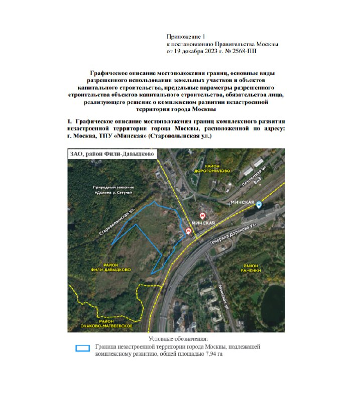

# ТПУ «Минская»: КРТ на 300 тыс. м² и предельная высота 170 м

Правительство Москвы постановлением № 2568-ПП от 19 декабря 2023 года отдало участок у станции «Минская» на Староволынской улице под комплексное развитие незастроенной территории. К октябрю 2026 года участок у [BMS Development](/zastroyshchiki/bms-development/), а проект выглядит выше, чем разрешал документ: 333 м против 170 м.

## Коротко

- Участок ТПУ «Минская» в районе Фили-Давыдково (ЗАО) — 7,94 га; до 300 тыс. м² застройки, поровну жилья и нежилья.
- Предельная высота по постановлению — 170 м; в нежилой части обязателен образовательный комплекс на 315 мест.
- В апреле 2024 года аукцион выиграла структура BMS Development: 26,67 млрд ₽ при 16 участниках.
- В июне 2026 года застройщик показал проект высотой 333 м; продажи квартир обещаны на осень 2026 года.

## Что решило правительство Москвы

Документ касается [транспортно-пересадочного узла (ТПУ)](/slovar/tpu/) «Минская» и относится к программе [комплексного развития территорий (КРТ)](/slovar/krt/), в его варианте для незастроенных земель. Приложения к постановлению задают параметры:

- границы территории — 7,94 га;
- суммарная площадь зданий — 300 тыс. м², из них 150 тыс. м² жилья и 150 тыс. м² нежилья;
- предельная высота — 170 м, плотность — 65,2 тыс. м²/га;
- в нежилой части — образовательный комплекс на 315 мест (детский сад на 105 и школа на 210 мест) площадью не менее 9 тыс. м², который инвестор передаёт городу безвозмездно.

*(1) Приложение 1 к постановлению правительства Москвы от 19 декабря 2023 года № 2568-ПП: границы территории 7,94 га. Источник: правительство Москвы (официальный документ).*

## Что было дальше

24 апреля 2024 года городской сайт mos.ru сообщил об итогах аукциона: победило ООО «Девелопмент энд ритейл груп», цена составила 26,67 млрд ₽, более чем в 3,5 раза выше стартовой. Заявленные инвестиции — около 100 млрд ₽. Договор подписали 9 июня 2024 года на ПМЭФ; срок реализации — около шести лет.

Полная история проекта — в [досье «ТПУ Минская»](/obekty/tpu-minskaya/).

## Что с проектом сейчас

По состоянию на 15 октября 2026 года:

- в апреле 2025 года BMS называла архитектором бюро APEX и сообщала, что проект планировки подан в Москомархитектуру, а выход на стройку запланирован на 2026 год;
- 9 июня 2026 года опубликован проект «Phenomenon of the City»: высота 333 м, две жилые башни на 1197 квартир, клубный дом на 66 квартир, 6 вилл и 18 пентхаусов;
- по тому же материалу, продажи квартир запланированы на осень 2026 года, частные продажи офисов уже идут; подтверждения старта продаж квартир мы не нашли.

Документа, который менял бы предельную высоту со 170 м, мы не обнаружили. Это не означает, что его нет: параметры могли уточнить проектом планировки или новым постановлением.

## Что это значит для покупателя и инвестора

На наш взгляд, главный вопрос для будущего покупателя — какая высота и какие объёмы будут утверждены окончательно: от них зависят состав проекта и сроки. Пока стройка не началась, цены и планировки — только намерения застройщика. Следить стоит за проектом планировки и разрешением на строительство. Другие проекты на рынке смотрите в разделе [новостройки Москвы](/novostroyki/moskva/) и в теме [КРТ](/temy/krt/).

## Карточка объекта

- Название: ТПУ «Минская» (прежнее название идеи — «Сетунь-Хиллс», проектное — «Phenomenon of the City»)
- Адрес: Староволынская улица, район Фили-Давыдково, ЗАО; кадастровый участок 77:07:0009007:1008 и неразмежёванные земли
- Застройщик: BMS Development
- Площадь территории: 7,94 га
- Застройка: до 300 тыс. м², из них 150 тыс. м² жилья
- Предельная высота по постановлению 2023 года: 170 м
- Стадия: проектирование

## Вопросы и ответы

**Что решили по ТПУ «Минская» в декабре 2023 года?** Постановлением правительства Москвы № 2568-ПП от 19 декабря 2023 года участок 7,94 га на Староволынской улице отдан под комплексное развитие незастроенной территории: до 300 тыс. м², из них 150 тыс. м² жилья.

**Какая предельная высота на ТПУ «Минская»?** В постановлении 2023 года — 170 м. В июне 2026 года застройщик показал проект высотой 333 м; документа об изменении предельных параметров мы не нашли.

**Кто застройщик на ТПУ «Минская»?** BMS Development: в апреле 2024 года её структура «Девелопмент энд ритейл груп» выиграла аукцион за 26,67 млрд ₽.

**Когда начнутся продажи квартир на ТПУ «Минская»?** Застройщик называл осень 2026 года; подтверждения старта продаж на 15 октября 2026 года мы не нашли.

## Источники

1. Постановление правительства Москвы от 19 декабря 2023 года № 2568-ПП, приложения 1 и 2 (скан документа, иллюстрация 1)
2. [Итоги аукциона на комплексное развитие территории в Филях-Давыдкове — mos.ru, 24 апреля 2024 года](https://www.mos.ru/news/item/137956073/)
3. [Договор о развитии территории на Староволынской подписан на ПМЭФ — Новострой-М, 9 июня 2024 года](https://www.novostroy-m.ru/novosti/150_tys_kv_m)
4. [Интервью BMS Development о проекте у ТПУ «Минская» — РБК Недвижимость, 22 апреля 2025 года](https://realty.rbc.ru/news/67d2859f9a794757f892e2dd)
5. [BMS Development представила проект на Минской — Whitewill, 9 июня 2026 года](https://whitewill.ru/en/news/novye-proekty/bms-development-prezentoval-proekt-na-minskoy)

Материал не является инвестиционной рекомендацией.
