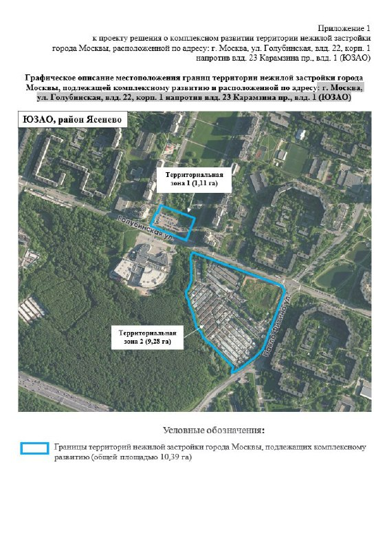
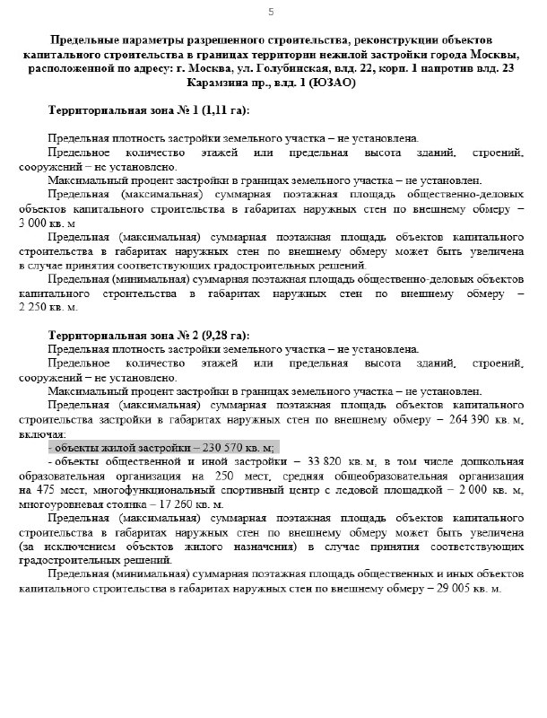

# КРТ в Ясенево на Голубинской, 22: 230 тыс. м² жилья вместо гаражей

В Ясенево на Голубинской, 22 и Карамзина, 1 решили строить по-крупному: проект комплексного развития территории (КРТ) даёт до 230,57 тыс. м² жилья на 10,39 га. Город утвердил его в марте 2024 года. Спустя два с половиной года на участке главная новость — снос гаражей, а вопрос «кто строит» стал запутаннее, чем был.

## Коротко

- **Территория:** две зоны, 1,11 га и 9,28 га, всего 10,39 га на Голубинской улице (ЮЗАО).
- **Объём:** в зоне 2 — до 230 570 м² жилья и 33 820 м² общественных объектов, всего до 264 390 м².
- **Деньги и застройщик:** инвестиции — более 80 млрд ₽, в марте 2024 года застройщиком называли ООО «Лиманос».
- **Сейчас:** с 2025 года сносят гаражи, сроков стройки нет.

## Квартал по чертежу

На сканах ниже — приложения к проекту решения. Первое показывает границы: зона 1 (1,11 га) на Голубинской улице, зона 2 (9,28 га) — у пересечения с проездом Карамзина.

*(1) Приложение к проекту решения о КРТ: границы двух территориальных зон. Документ: Правительство Москвы (проект решения о КРТ)*

Во втором — предельные параметры. Почти весь объём сосредоточен в зоне 2: до 230 570 м² жилья и 33 820 м² общественных и иных объектов. Среди них детский сад на 250 мест, школа на 475 мест, многофункциональный спортцентр с ледовой площадкой (2 тыс. м²) и многоуровневая стоянка (17,26 тыс. м²). Зоне 1 достались общественно-деловые объекты до 3 тыс. м².

*(2) Предельные параметры строительства для двух зон. Документ: Правительство Москвы (проект решения о КРТ)*

Обратите внимание: ни предельной этажности, ни плотности документ не устанавливает. Насколько высоким получится квартал, пока вопрос открытый.

## Город утвердил, застройщик — Capital Group

По данным Новострой-М, проект КРТ утвердили в марте 2024 года. 29 марта 2024 года заммэра Владимир Ефимов пообещал, что город заключит договор с правообладателем. Цифры тогда звучали так: инвестиции — более 80 млрд ₽, жилья — более 230 тыс. м², общественно-деловых объектов — около 37 тыс. м².

Застройщиком, по данным abnews.ru, выступает ООО «Лиманос»; его учредитель Павел Те — совладелец [Capital Group](/zastroyshchiki/capital-group/). Полная история — в [досье «Голубинская, 22»](/obekty/golubinskaya-22/).

## Гаражи уходят, ясности не прибавилось

На 15 октября 2026 года стройка не началась. По данным «Москва 1» от 9 марта 2026 года, в 2025 году начали сносить гаражный комплекс на углу Голубинской и Карамзина. Что будет с остальными гаражами, издание так и не выяснило.

Дальше — интереснее. Агрегатор Новострой-М на странице проекта на Голубинской, 28 (10,39 га — та же площадь) называет застройщиком ООО «А101»: продажи не начались, разрешительной документации, по ответу эксперта сайта в сентябре 2025 года, нет. С данными 2024 года это расходится, а официально о смене застройщика никто не объявлял.

## Что это значит для покупателя и инвестора

Купить здесь пока нечего — это перспектива, а не предложение. Но перспектива весомая: КРТ — механизм, при котором город и собственник перестраивают застроенную территорию целиком, и для Ясенево такой объём заметен. Другие новостройки района — в [подборке по Ясенево](/novostroyki/yasenevo/).

На наш взгляд, пока у проекта нет разрешения на строительство и однозначного застройщика, строить планы на сроки и цены рано. Следите за тремя документами: договором о КРТ, разрешением на строительство и проектной декларацией — именно в них появится настоящее имя застройщика.

Как устроен механизм — в словаре: [КРТ](/slovar/krt/); все материалы — в разделе [КРТ](/temy/krt/).

## Карточка объекта

- Участок: Голубинская, 22, корп. 1 / проезд Карамзина, 1, Ясенево, ЮЗАО
- Площадь территории: 10,39 га (1,11 + 9,28 га)
- Жильё по проекту: до 230 570 м²
- Застройщик: ООО «Лиманос» (по данным 2024 года)
- Стадия: проект утверждён, подготовка территории (снос гаражей)
- Сроки строительства и цены: не опубликованы

## Вопросы и ответы

**Что построят на Голубинской, 22 и Карамзина, 1 в Ясенево?**
По проекту КРТ — до 230,57 тыс. м² жилья, около 37 тыс. м² общественно-деловых объектов, школу на 475 мест, детский сад на 250 мест, спортцентр с ледовой площадкой и многоуровневую стоянку.

**Какая площадь у территории КРТ в Ясенево на Голубинской?**
Две территории общей площадью 10,39 га: 1,11 га и 9,28 га.

**Кто застройщик КРТ на Голубинской, 22 и Карамзина, 1?**
В марте 2024 года застройщиком называли ООО «Лиманос», учредитель — Павел Те, совладелец Capital Group. Агрегатор Новострой-М к октябрю 2026 года указывает ООО «А101»; официально о смене застройщика не сообщали.

**Когда начнут строить жильё на Голубинской, 22?**
Сроков пока никто не называл. На октябрь 2026 года на участке сносят гаражи, продажи не начались.

## Источники

1. «Вечерняя Москва», 29 марта 2024 года: https://vm.ru/news/1125502-gorod-zaklyuchit-s-pravoobladatelem-uchastkov-v-yaseneve-dogovor-ob-ih-kompleksnom-razvitii
2. abnews.ru, 29 марта 2024 года: https://abnews.ru/center/news/msk/2024/3/29/v-moskovskom-rajone-yasenevo-zastrojshhik-postroit-230-tysyach-kvadratov-zhilya
3. Новострой-М, «Проекты КРТ в Ясенево», 26 марта 2024 года: https://www.novostroy-m.ru/novosti/proekty_krt_v_yasenevo
4. «Москва 1», 9 марта 2026 года: https://msk1.ru/text/gorod/2026/03/09/76125528/
5. Новострой-М, страница проекта на Голубинской, 28: https://www.novostroy-m.ru/baza/arhitekturnyy_proekt_na_ul

Материал не является инвестиционной рекомендацией.
