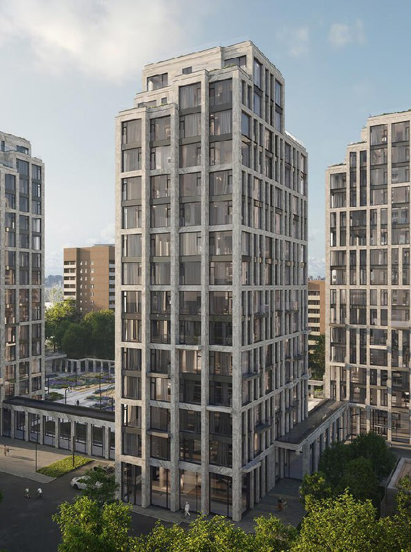
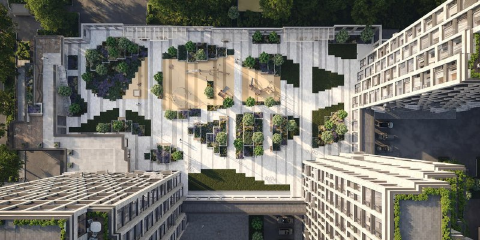

# Дом 7 Даниловский от Coldy: 207 квартир, сдача в 2027-м, вход от 39,3 млн ₽

Coldy строит на Серпуховском валу, 7 в Даниловском районе ЖК «Дом 7 Даниловский»: три корпуса по 15 этажей и 207 квартир. Дом уже одевают в фасады, до сдачи остаются месяцы, а самая доступная квартира стоит 39,3 млн ₽. Проект камерный, а вот цена — совсем нет.

## Коротко

- Застройщик — Coldy (Колди), юрлицо проекта — ООО СЗ «Каллисто».
- Продажи стартовали 29 мая 2024 года: три 15-этажных корпуса, 207 квартир, из них пять пентхаусов.
- Сдача — II квартал 2027 года, на доме идут фасадные и отделочные работы.
- На 13 октября в продаже 42 квартиры от 39,3 млн ₽.

*Визуализация корпусов «Дома 7 Даниловский» на Серпуховском валу, 7 в Даниловском районе Москвы. Визуализация: Coldy.*

## Три башни на одном гектаре

Адрес — Серпуховской вал, 7, [Даниловский район](/novostroyki/danilovskiy/) ЮАО. Весь участок — 1 га, и на нём уместили три монолитно-кирпичных корпуса, соединённых тёплой галереей. Квартиры — от 31 до 177 м², наверху пять пентхаусов.

С транспортом здесь всё в порядке: пешком доступны «Тульская» (около 7 минут) и «Шаболовская».

Coldy объявила о старте продаж 29 мая 2024 года. Вся история участка и проекта — в [досье «Дом 7 Даниловский»](/obekty/dom-7-danilovskiy/).

*Визуализация двора «Дома 7 Даниловский»: вид сверху на площадки между корпусами. Визуализация: Coldy.*

## Стройка на финишной прямой

Положение дел на 14 октября 2026 года — по базе «Новострой-М». Последняя датированная запись о ходе работ там от 26 сентября 2026 года; у обновления цен год не проставлен.

- **Стадия.** Фасады и отделка — коробки уже стоят.
- **Сроки.** Все три корпуса — во II квартале 2027 года.
- **Документы.** [Проектные декларации](/slovar/proektnaya-deklaratsiya/) выходили 21 мая 2024, 9 августа 2024, 10 января 2025 и 6 мая 2025 года; разрешение на строительство опубликовано.
- **Застройщик.** Тот же: проект ведёт Coldy.

## Метр по миллиону

На 13 октября в продаже 42 квартиры, вход — от 39,3 млн ₽. Чтобы почувствовать масштаб: трёхкомнатная на 123 м² на втором этаже без отделки выставлена за 129,16 млн ₽, это около 1,05 млн ₽/м². Это одно объявление, а не средняя по дому, — но планку оно задаёт.

Корректно сравнить с соседними проектами пока не на чем, поэтому оценок «дорого или дёшево относительно рынка» не даём. Как в целом ведут себя цены на московские новостройки — в разделе [цены](/temy/ceny/).

## Что это значит для покупателя

Главный плюс — срок. Дом строится, сдача близко, ждать годами не придётся. Главный минус — выбор: из 207 квартир в продаже осталось 42, и это не тот случай, когда можно долго перебирать планировки.

Если присматриваетесь, начните с последней проектной декларации: сверьте срок и состав очередей. А цену конкретного лота сравните с соседними домами сами — миллион за метр без отделки требует аргументов, а не только хорошего адреса.

## Карточка объекта

- **Адрес ЗУ:** Серпуховской вал, 7, Москва.
- **Название:** Дом 7 Даниловский.
- **Застройщик:** [Coldy](/zastroyshchiki/coldy/) (ООО СЗ «Каллисто»).
- **Район:** Даниловский, ЮАО.
- **Площадь участка:** 1 га.
- **Корпуса:** три, по 15 этажей.
- **Квартиры:** 207, включая пять пентхаусов; площадь от 31 до 177 м².
- **Стадия:** фасадные и отделочные работы.
- **Ввод:** II квартал 2027 года.
- **Цена:** от 39,3 млн ₽ (на 13 октября).

## Вопросы и ответы

**Кто застройщик ЖК «Дом 7 Даниловский»?**
Coldy (Колди). Юридически проект ведёт ООО СЗ «Каллисто».

**Когда сдадут «Дом 7 Даниловский»?**
По данным базы «Новострой-М», все три корпуса должны сдать во II квартале 2027 года. Сейчас на доме идут фасадные и отделочные работы.

**Сколько стоят квартиры в «Доме 7 Даниловский»?**
На 13 октября в продаже 42 квартиры от 39,3 млн ₽. Для ориентира: в одном из объявлений 123 м² без отделки стоят 129,16 млн ₽ — около 1,05 млн ₽/м².

**Где находится «Дом 7 Даниловский» и какое рядом метро?**
Серпуховской вал, 7, Даниловский район ЮАО Москвы. Пешком можно дойти до «Тульской» и «Шаболовской»; сколько именно идти, источники считают по-разному.

## Источники

1. «Новострой-М», «Старты продаж ЖК Дом 7 Даниловский и BeLuck Коломенское», 29 мая 2024 года: https://www.novostroy-m.ru/novosti/starty_prodaj_jk_dom
2. «Новострой-М», карточка комплекса «Дом 7 Даниловский» (застройщик, сроки, декларации, цены на 13 октября): https://www.novostroy-m.ru/baza/kompleks_apartamentov_coloft
3. «Новострой-М», объявление о продаже трёхкомнатной квартиры в ЖК «Дом 7 Даниловский»: https://www.novostroy-m.ru/kvartiry/trehkomnatnaya-kvartira-v-zhk-dom-7-danilovskii-db879aacf747c16c4e21bdc59e9168

Материал не является инвестиционной рекомендацией.
