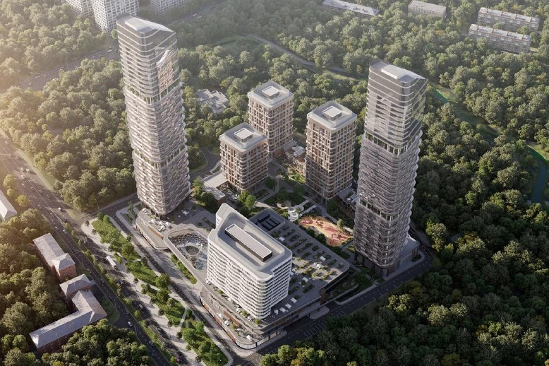
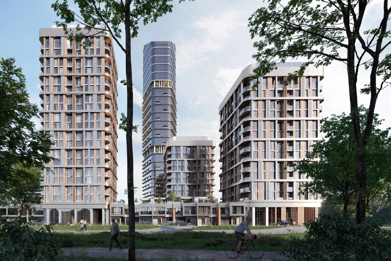
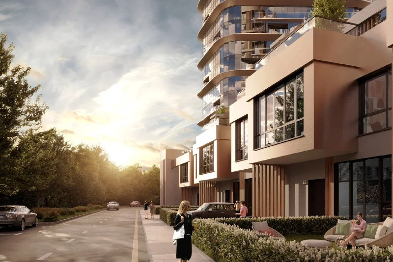

# Родина Парк на Верейской, 12: прогноз был 700 тыс. ₽/м², рынок дал 515

Группа «Родина» строит на Верейской улице, 12 в Можайском районе Москвы кластер «Родина Парк»: около 110 тыс. м², две башни в 34 и 35 этажей, клубные дома и 15 таунхаусов. В январе 2024 года звучал прогноз «не меньше 700 тыс.» за метр. В июне продажи открылись от 466,5 тыс. ₽/м² — амбиции пришлось подрезать на треть.

## Коротко

- Около 110 тыс. м² на участке 11 га: башни в 34 и 35 этажей, 15 таунхаусов, многофункциональный комплекс.
- Стройку начали в июне 2024 года — как и обещали, «во втором квартале».
- Старт — от 466,5 тыс. ₽/м²; на 9 октября 2026 года квартиры от 23,8 млн ₽, однокомнатные — от 515,4 тыс. ₽/м².
- Сроки ввода плавают: от декабря 2026 года до I квартала 2028 года.

*Визуализация жилого кластера «Родина Парк» на Верейской, 12: две башни, корпуса средней этажности и многофункциональный комплекс (1). Визуализация: Группа «Родина».*

## Не частокол, а перепад высот

Концепцию, по данным Архи.ру, делало бюро UNK. Набор такой: две жилые башни со скруглёнными фасадами (34 и 35 этажей), клубные дома средней этажности, 15 таунхаусов с приватными террасами, многофункциональный комплекс с медиакластером и детский сад.

Вторая очередь получила разрешение на строительство 27 декабря 2024 года. В ней два корпуса в 34 и 35 этажей, 25-этажный деловой центр, 525 квартир от 28 до 122 м² и подземный паркинг на 594 места.

*Визуализация «Родина Парка»: башня и корпуса разной высоты со стороны парка (2). Визуализация: Группа «Родина».*

Главное достоинство проекта видно на визуализациях: это не «частокол одинаковых башен». Разная этажность и таунхаусы у подножия башен заложены в сам проект, а не нарисованы для красоты.

## Прогноз — 700, старт — 466,5

Прогноз января 2024 года — «ниже 700 тыс. ₽/м² ожидать наивно» — не сбылся. По новости застройщика от 25 июня 2024 года, метр продавали от 466,5 тыс. ₽.

На 9 октября 2026 года, по базе «Новостроев», квартиры стоят от 23,8 млн ₽, однокомнатные — от 515,4 тыс. ₽/м², площади — от 29,7 до 174,5 м². За два с лишним года минимальная цена метра выросла примерно на 10%. Сравнение грубое: на старте и сейчас в продаже могли быть разные лоты. Наверху линейки, по той же базе, метр доходит до 1,3 млн ₽ — так что 700 тыс. в проекте всё-таки есть, просто не на входе.

## Три даты на одну сдачу

Сроки — слабое место. Архи.ру называет декабрь 2026 года для первой очереди и март 2027 года для всего проекта. Застройщик в новости от 5 августа 2024 года отнёс первую очередь к 2027 году. Разрешение на строительство второй очереди предусматривает ввод в I квартале 2028 года — этот же срок стоит в базе «Новостроев».

*Визуализация таунхаусов «Родина Парка» с приватными террасами у подножия башни (3). Визуализация: Группа «Родина».*

## Что с проектом сейчас

На 14 октября 2026 года, по базе «Новостроев» (данные от 9 октября), проект на стадии «возведение здания», класс — премиум, этажность — от 2 до 35. Застройщик прежний: Группа «Родина».

Вся история проекта и события по участку — в [досье «Родина Парк»](/obekty/rodina-park/).

## Что это значит для покупателя и инвестора

По-нашему, вывод простой: ценовой потолок, который проекту прочили в начале 2024 года, рынок не принял, и застройщик вышел скромнее — даже для [премиум-класса](/temy/premium/). Сейчас метр дороже, чем на старте, но не вдвое.

На что смотреть:

- сроки: в источниках три разные даты, поэтому верить стоит только сроку из [проектной декларации](/slovar/proektnaya-deklaratsiya/) и договора;
- масштаб: проект многофазный, кроме жилья в нём деловой центр и многофункциональный комплекс, а вторую очередь ждут лишь в I квартале 2028 года;
- метр метру рознь: таунхаусы и пентхаусы со стандартными квартирами по цене за метр сравнивать бессмысленно.

Дальше следим за двумя вещами: подтвердится ли срок первой очереди и как пойдёт стройка второй. Рынок вокруг — в подборке [новостроек Москвы](/novostroyki/moskva/), о застройщике — на странице [Группы «Родина»](/zastroyshchiki/rodina/).

## Карточка объекта

- Адрес участка: Верейская, 12, Можайский район, Москва
- Названия: «Родина Парк», «Родина парк»
- Застройщик: Группа «Родина»
- Архитектор (концепция): бюро UNK
- Класс: премиум
- Площадь проекта: около 110 тыс. м²; участок 11 га
- Этажность: от 2 до 35
- Стадия: строительство
- Ввод: от декабря 2026 до I квартала 2028 (источники расходятся)
- Цена: квартиры от 23,8 млн ₽, от 515,4 тыс. ₽/м² (9 октября 2026)

## Вопросы и ответы

**Кто застройщик «Родина Парка» на Верейской, 12?**
Группа «Родина». Архитектурную концепцию нарисовало бюро UNK.

**Сколько стоят квартиры в «Родина Парке»?**
По базе «Новостроев» на 9 октября 2026 года — от 23,8 млн ₽, однокомнатные от 515,4 тыс. ₽/м². На старте продаж в июне 2024 года метр стоил от 466,5 тыс. ₽.

**Когда сдадут «Родина Парк»?**
Вторую очередь по разрешению на строительство должны ввести в I квартале 2028 года. По первой очереди даты расходятся: у Архи.ру — декабрь 2026 года, у застройщика — 2027 год.

**Что построят на Верейской, 12?**
Около 110 тыс. м²: две жилые башни в 34 и 35 этажей, клубные дома, 15 таунхаусов и многофункциональный комплекс с медиакластером.

## Источники

1. [Архи.ру: ЖК «Родина Парк», Верейская улица, 12](https://archi.ru/projects/russia/19346/zhk-rodina-park)
2. [РБК Недвижимость: Группа «Родина» получила РНС второй очереди ЖК «Родина Парк», 27 декабря 2024](https://realty.rbc.ru/news/676a798f9a794716a7159aeb)
3. [Сайт Группы «Родина»: новости проекта (продажи от 25 июня 2024, сроки от 5 августа 2024)](https://rodinagroup.com/)
4. [«Новостроев»: ЖК «Родина Парк (Верейская 12)», данные на 9 октября 2026](https://novostroev.ru/novostroyki/moskva/zao/mozhayskiy-rayon/rodina-park-vereyskaya-12/)

Материал не является инвестиционной рекомендацией.
