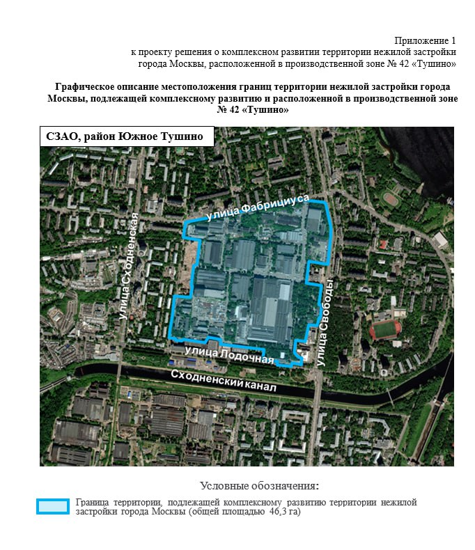

---
source:
  id: 21762
  date: '2024-02-09'
status: needs_review
skip_reason: null
type: object
region: moscow
title: 'Level Group на Свободы, 35: КРТ в Южном Тушине на 1,1 млн м²'
title_alts:
- 'ЖК «Левел Свободы» в Южном Тушине: КРТ на месте Тушинского машиностроительного завода'
- 'Тушинский машиностроительный завод: Level Group и КРТ на 46,3 га'
slug: level-svobody-35-tushino-krt
lead: 'Level Group получила право на комплексное развитие территории бывшего Тушинского машиностроительного завода (Свободы, 35): 46,3 га и около 1,1 млн м² недвижимости. Жилая часть на октябрь 2026 года ещё не в продаже, продаётся лайт-индастриал.'
developers:
- id: level-group
  name: Level Group
  role: main
objects:
- id: tushinskiy-mashinostroitelnyy-zavod
  names:
  - Тушинский машиностроительный завод
  - Левел Свободы
  zu: Свободы, 35
  main: true
  new: false
districts: []
topics:
- krt
images:
- file: media/21762_1.jpg
  alt: Границы территории КРТ в производственной зоне № 42 «Тушино», Южное Тушино, СЗАО, Москва
  caption: Границы территории КРТ (46,3 га) в Южном Тушине. Приложение 1 к проекту решения о КРТ
  credit: Проект решения о комплексном развитии территории (официальный документ)
factcheck:
- claim: Договор о КРТ на 46,3 га в Южном Тушине заключён с ООО «Адмаер», входящим в Level Group, по итогам открытого аукциона; заключён к 16.05.2024; срок 14 лет
  status: confirmed
  source: https://360.ru/tekst/moskva/efimov-moskva-zakljuchila-dogovor-o-kompleksnom-razvitii-uchastka-byvshej-promzony-tushino/
  checked: '2026-10-13'
- claim: Около 550 тыс. м² жилья (из них около 175,5 тыс. м² реновация и др. городские нужды), около 550 тыс. м² нежилья, всего около 1,1 млн м²
  status: confirmed
  source: https://360.ru/tekst/moskva/efimov-moskva-zakljuchila-dogovor-o-kompleksnom-razvitii-uchastka-byvshej-promzony-tushino/ ; https://vm.ru/news/1135491-efimov-gorod-zaklyuchil-dogovor-o-reorganizacii-uchastka-byvshej-promzony-tushino
  checked: '2026-10-13'
- claim: 'Границы: улицы Свободы, Лодочная, Новопоселковая, Фабрициуса; проект решения о КРТ опубликован в 2023 году (46,3 га, около 1,1 млн м²)'
  status: confirmed
  source: https://www.novostroy-m.ru/novosti/v_promzone_tushino_postroyat
  checked: '2026-10-13'
- claim: Адрес жилого проекта — ул. Свободы, 35; метро «Сходненская» 5 мин пешком (по данным застройщика); стадия «Скоро!», лист ожидания; цен, сроков и архитектора нет
  status: confirmed
  source: https://level.ru/projects/svobody/
  checked: '2026-10-13'
- claim: 'Level work Свободы: 189 тыс. м², лоты от 200 м², от 164,8 тыс. ₽/м², от 56,7 млн ₽, сдача II кв. 2028'
  status: confirmed
  source: https://business.level.ru/projects/work-svobody/
  checked: '2026-10-13'
- claim: Цена права на КРТ — 468 млн ₽ (начальная 433,5 млн ₽)
  status: unverified
  source: 'текстового источника не найдено: цифра видна только на скриншоте страницы торгов с пометками; в статье не используется'
  checked: '2026-10-13'
- claim: Конкурент «Флэт и Ко» отсеян на этапе заявки
  status: unverified
  source: видно только на скриншоте с пометками; в статье не используется
  checked: '2026-10-13'
- claim: Level станет мастер-девелопером и будет продавать участки другим застройщикам
  status: unverified
  source: прогноз без источника; в статье не используется
  checked: '2026-10-13'
- claim: Ранее площадку хотел забрать ПИК; завод продавали на «Авито» за 10 млрд ₽
  status: unverified
  source: СМИ 2020 года сообщали о планах ПИК, но современной связи с проектом не подтверждено; в статье не используется
  checked: '2026-10-13'
removed:
- Цена 468 млн ₽ и сведения об отсеянном конкуренте — есть только на скриншотах с пометками, текстового независимого источника нет.
- Прогноз о роли мастер-девелопера и продаже кусков проекта «залётным» — слух/оценка без источника.
- История с «Авито», ПИК и расчёты темпов продаж из ранних заметок — не подтверждены; жаргон и грубые выражения убраны.
- Фото 2–4 (скриншоты торгов и схемы связей с пометками) — не используются по правилам иллюстраций.
data_points:
- metric: krt_area_ha
  object: tushinskiy-mashinostroitelnyy-zavod
  value: 46.3
  date: '2026-10-13'
- metric: light_industrial_min_price_m2
  object: tushinskiy-mashinostroitelnyy-zavod
  value: 164800
  unit: RUB/m2
  date: '2026-10-13'
seo:
  main_query: левел свободы 35 тушино
  keywords:
  - жк левел свободы
  - тушинский машиностроительный завод крт
  - level group южное тушино
  - level work свободы
  - свободы 35 сходненская
  frequency_checked: false
  title: 'Левел Свободы, 35 в Южном Тушине: КРТ на 1,1 млн м²'
  description: 'Level Group получила КРТ на 46,3 га в Южном Тушине: около 550 тыс. м² жилья и 550 тыс. м² нежилья. Что с проектом на октябрь 2026 года и когда ждать продаж.'
  canonical: https://шахматка.москва/novosti/level-svobody-35-tushino-krt/
internal_links:
- anchor: досье «Тушинский машиностроительный завод»
  url: /obekty/tushinskiy-mashinostroitelnyy-zavod/
- anchor: Level Group
  url: /zastroyshchiki/level-group/
- anchor: новостройки Москвы
  url: /novostroyki/moskva/
- anchor: КРТ
  url: /slovar/krt/
- anchor: тема КРТ
  url: /temy/krt/
faq:
- q: Кто застройщик проекта на улице Свободы, 35 в Южном Тушине?
  a: Право на комплексное развитие территории получило ООО «Адмаер», которое входит в Level Group. Жилой проект на сайте компании называется «Левел Свободы».
- q: Сколько жилья и нежилья планируют построить на месте Тушинского машиностроительного завода?
  a: По данным города на май 2024 года, около 550 тыс. м² жилья (из них около 175,5 тыс. м² для программы реновации и других городских нужд) и около 550 тыс. м² производственной и общественно-деловой застройки. Всего — около 1,1 млн м² на 46,3 га.
- q: Когда начнутся продажи квартир в «Левел Свободы»?
  a: На 13 октября 2026 года на странице проекта на сайте Level стоит отметка «Скоро!» и предлагается записаться в лист ожидания. Сроков старта продаж, цен и сроков сдачи жилья там нет.
- q: Что уже продаётся на Свободы, 35?
  a: 'Лайт-индастриал комплекс Level work Свободы: по данным сайта Level, помещения от 56,7 млн ₽, от 164,8 тыс. ₽/м², сдача во II квартале 2028 года.'
date_published: '2024-02-09'
date_modified: '2026-10-13'
author: Редакция Шахматки
editor_notes: 'Цена права на КРТ (468 млн ₽ по скриншоту торгов) не подтверждена текстовым источником: найдите протокол на investmoscow.ru или torgi.gov.ru и добавьте. Не открыты наш.дом.рф и mos.ru по постановлению; проверьте ППТ (декабрь 2024) и визуализации (высота до 220 м) из досье. Договор КРТ подтверждён по СМИ (сообщение Ефимова). Права на карту из проекта решения — документ официальный.'
schema: "[\n {\n  \"@context\": \"https://schema.org\",\n  \"@type\": \"Article\",\n  \"headline\": \"Level Group на Свободы, 35: КРТ в Южном Тушине на 1,1 млн м²\",\n  \"description\": \"Level Group получила КРТ на 46,3 га в Южном Тушине: около 550 тыс. м² жилья и 550 тыс. м² нежилья. Что с проектом на октябрь 2026 года и когда ждать продаж.\",\n  \"datePublished\": \"2024-02-09\",\n  \"dateModified\": \"2026-10-13\",\n  \"author\": {\n   \"@type\": \"Organization\",\n   \"name\": \"Редакция Шахматки\"\n  },\n  \"publisher\": {\n   \"@type\": \"Organization\",\n   \"name\": \"Шахматка\"\n  },\n  \"about\": {\n   \"@type\": \"Place\",\n   \"name\": \"Тушинский машиностроительный завод, Свободы, 35\",\n   \"address\": \"Москва, Южное Тушино, ул. Свободы, 35\"\n  },\n  \"mainEntityOfPage\": \"https://шахматка.москва/novosti/level-svobody-35-tushino-krt/\"\n },\n {\n  \"@context\": \"https://schema.org\",\n  \"@type\": \"FAQPage\",\n  \"mainEntity\": [\n   {\n    \"@type\": \"Question\",\n\
  \    \"name\": \"Кто застройщик проекта на улице Свободы, 35 в Южном Тушине?\",\n    \"acceptedAnswer\": {\n     \"@type\": \"Answer\",\n     \"text\": \"Право на комплексное развитие территории получило ООО «Адмаер», которое входит в Level Group. Жилой проект на сайте компании называется «Левел Свободы».\"\n    }\n   },\n   {\n    \"@type\": \"Question\",\n    \"name\": \"Сколько жилья и нежилья планируют построить на месте Тушинского машиностроительного завода?\",\n    \"acceptedAnswer\": {\n     \"@type\": \"Answer\",\n     \"text\": \"По данным города на май 2024 года, около 550 тыс. м² жилья (из них около 175,5 тыс. м² для программы реновации и других городских нужд) и около 550 тыс. м² производственной и общественно-деловой застройки. Всего — около 1,1 млн м² на 46,3 га.\"\n    }\n   },\n   {\n    \"@type\": \"Question\",\n    \"name\": \"Когда начнутся продажи квартир в «Левел Свободы»?\",\n    \"acceptedAnswer\": {\n     \"@type\": \"Answer\",\n     \"text\": \"На 13 октября 2026\
  \ года на странице проекта на сайте Level стоит отметка «Скоро!» и предлагается записаться в лист ожидания. Сроков старта продаж, цен и сроков сдачи жилья там нет.\"\n    }\n   },\n   {\n    \"@type\": \"Question\",\n    \"name\": \"Что уже продаётся на Свободы, 35?\",\n    \"acceptedAnswer\": {\n     \"@type\": \"Answer\",\n     \"text\": \"Лайт-индастриал комплекс Level work Свободы: по данным сайта Level, помещения от 56,7 млн ₽, от 164,8 тыс. ₽/м², сдача во II квартале 2028 года.\"\n    }\n   }\n  ]\n }\n]"
---
# Level Group на Свободы, 35: КРТ в Южном Тушине на 1,1 млн м²

Level Group получила право на комплексное развитие территории бывшего Тушинского машиностроительного завода по адресу Свободы, 35 в Южном Тушине: около 1,1 млн м² недвижимости на 46,3 га. Это один из крупнейших проектов [КРТ](/slovar/krt/) в Москве, но жилая часть на октябрь 2026 года ещё не в продаже.

## Коротко

- Участок — 46,3 га в Южном Тушине (СЗАО), производственная зона № 42 «Тушино».
- По данным города (май 2024 года): около 550 тыс. м² жилья и около 550 тыс. м² производственной и общественно-деловой застройки.
- Договор с ООО «Адмаер» из Level Group рассчитан на 14 лет.
- На 13 октября 2026 года продаётся лайт-индастриал Level work Свободы (ввод — II квартал 2028 года), квартиры — «Скоро!», лист ожидания.

## Что произошло на Свободы, 35

Аукцион на право заключить договор о комплексном развитии территории выиграло ООО «Адмаер». Как сообщил заммэра Владимир Ефимов 16 мая 2024 года, город заключил с ним договор, а компания входит в Level Group. Срок договора — 14 лет.

Площадь территории — 46,3 га между улицами Свободы, Лодочной, Новопоселковой и Фабрициуса. По данным города, в проекте около 550 тыс. м² жилья, из которых около 175,5 тыс. м² пойдёт на программу реновации и другие городские нужды. Ещё около 550 тыс. м² — производственная и общественно-деловая застройка. Общий объём — около 1,1 млн м².

*Границы территории КРТ (46,3 га) в производственной зоне № 42 «Тушино», район Южное Тушино, СЗАО. Приложение 1 к проекту решения о КРТ.*

Для читателя важна пропорция: нежилья здесь столько же, сколько жилья. Это не «ещё один жилой квартал», а город в городе, и по рынку такой объём одним застройщиком обычно не осваивается быстро. Это наша оценка, она не следует из документов.

## Контекст: как участок дошёл до Level

Проект решения о КРТ в производственной зоне «Тушино» город опубликовал в 2023 году: тогда в нём фигурировали те же 46,3 га и около 1,1 млн м² недвижимости, включая около 550 тыс. м² жилья и свыше 175 тыс. м² под реновацию. После торгов в мае 2024 года договор был подписан.

Полная история проекта, включая сделки и градостроительные решения, — в [досье «Тушинский машиностроительный завод»](/obekty/tushinskiy-mashinostroitelnyy-zavod/).

## Что с проектом сейчас

По состоянию на 13 октября 2026 года у проекта два лица на сайте застройщика.

**Жилая часть.** Страница «Левел Свободы» (адрес — ул. Свободы, 35; до метро «Сходненская» 5 минут пешком, по данным застройщика) помечена «Скоро!». Продажи не начались, предлагают записаться в лист ожидания. Цен, площади, сроков строительства и архитектора на странице нет.

**Лайт-индастриал.** Комплекс Level work Свободы продаётся: общая площадь — 189 тыс. м², лоты от 200 м², цена от 164,8 тыс. ₽/м², помещения от 56,7 млн ₽, срок сдачи — II квартал 2028 года (данные сайта Level). Лайт-индастриал — это небольшие производственные, складские и офисные помещения в одном здании.

## Что это значит для покупателя и инвестора

Квартир с ценой и сроками пока нет, поэтому оценить проект как жильё нельзя. Лист ожидания — это не бронирование и не договор.

Риски и вопросы, которые стоит отслеживать: публикация проектной декларации на [наш.дом.рф](https://наш.дом.рф) и сроки первой очереди; график реновационных домов; очерёдность жилья и нежилья в 14-летнем договоре; транспортная нагрузка на район. Из подтверждённых данных ответов на них нет.

Если вы смотрите на коммерческую часть, сверяйте заявленные лоты с разрешением на строительство и проектной декларацией. Общий контекст — в разделе [новостройки Москвы](/novostroyki/moskva/) и на странице темы [КРТ](/temy/krt/).

## Карточка объекта

- **Адрес ЗУ:** Свободы, 35 (Южное Тушино, СЗАО, Москва)
- **Названия:** Тушинский машиностроительный завод; «Левел Свободы»; Level work Свободы
- **Застройщик:** [Level Group](/zastroyshchiki/level-group/) (ООО «Адмаер»)
- **Площадь территории:** 46,3 га
- **Объём:** около 1,1 млн м²: жильё около 550 тыс. м², нежилья около 550 тыс. м² (данные города, май 2024)
- **Стадия:** право на КРТ получено; продажи жилья не начались, продаётся лайт-индастриал
- **Срок договора КРТ:** 14 лет
- **Ввод:** Level work Свободы — II квартал 2028 года; жильё — сроки не объявлены

## Вопросы и ответы

**Кто застройщик проекта на улице Свободы, 35 в Южном Тушине?**

Право на комплексное развитие территории получило ООО «Адмаер», которое входит в Level Group. Жилой проект на сайте компании называется «Левел Свободы».

**Сколько жилья и нежилья планируют построить на месте Тушинского машиностроительного завода?**

По данным города на май 2024 года, около 550 тыс. м² жилья (из них около 175,5 тыс. м² для программы реновации и других городских нужд) и около 550 тыс. м² производственной и общественно-деловой застройки. Всего — около 1,1 млн м² на 46,3 га.

**Когда начнутся продажи квартир в «Левел Свободы»?**

На 13 октября 2026 года на странице проекта на сайте Level стоит отметка «Скоро!» и предлагается записаться в лист ожидания. Сроков старта продаж, цен и сроков сдачи жилья там нет.

**Что уже продаётся на Свободы, 35?**

Лайт-индастриал комплекс Level work Свободы: по данным сайта Level, помещения от 56,7 млн ₽, от 164,8 тыс. ₽/м², сдача во II квартале 2028 года.

## Источники

1. [Ефимов: Москва заключила договор о комплексном развитии участка бывшей промзоны «Тушино», 360.ru, 16.05.2024](https://360.ru/tekst/moskva/efimov-moskva-zakljuchila-dogovor-o-kompleksnom-razvitii-uchastka-byvshej-promzony-tushino/)
2. [Ефимов: город заключил договор о реорганизации участка бывшей промзоны «Тушино», «Вечерняя Москва», 16.05.2024](https://vm.ru/news/1135491-efimov-gorod-zaklyuchil-dogovor-o-reorganizacii-uchastka-byvshej-promzony-tushino)
3. [В промзоне «Тушино» построят…, Novostroy-M, 29.05.2023](https://www.novostroy-m.ru/novosti/v_promzone_tushino_postroyat)
4. [«Левел Свободы», сайт Level Group](https://level.ru/projects/svobody/)
5. [Level work Свободы, сайт Level Group](https://business.level.ru/projects/work-svobody/)

Материал не является инвестиционной рекомендацией.
