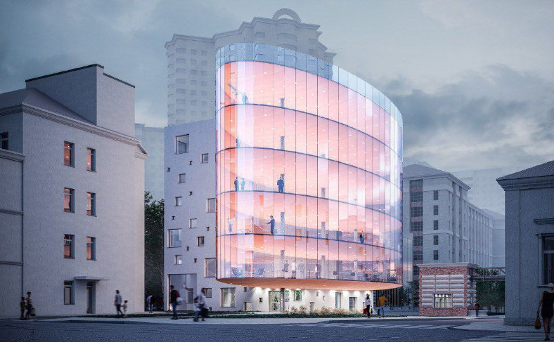

# Радио, 16с4: офис-«дирижабль» на участке, купленном за 16,2 млн ₽

В феврале 2024 года показали шестиэтажный стеклянный офис на участке Радио, 16с4. К июню 2025 года проект вырос до 12-этажного бизнес-центра Sound площадью более 9,5 тыс. м², но о строительстве к октябрю 2026 года мы подтверждённых сведений не нашли.

## Коротко

- Февраль 2024 года: опубликована концепция офисного здания на шесть этажей, автор — архитектурная мастерская Михаила Дмитриева.
- Участок на торгах за 16,2 млн ₽ купила компания «Река Резорт» (июль 2023 года).
- Июнь 2025 года: новый вариант — бизнес-центр Sound на 12 этажей, более 9,5 тыс. м², торговые площади внизу и офисы наверху.
- На 13 октября 2026 года сведений о начале стройки в проверенных источниках нет.

*Концепция офисного здания на Радио, 16с4, показанная в феврале 2024 года. Визуализация: архитектурная мастерская Михаила Дмитриева*

## Что показали в феврале 2024 года

Концепцию разработала архитектурная мастерская Михаила Дмитриева. Здание шестиэтажное и состоит из двух частей: прозрачного офисного объёма и глухого служебного блока с инженерией, сервисной зоной и механизированной парковкой. Участок находится на пересечении улиц Радио и Бауманской, напротив здания Следственного комитета.

Публикация называла вариант «дирижаблем» из-за формы стеклянного объёма. Этот вариант в итоге не утвердили.

## Кто купил участок

Участок купила компания «Река Резорт» в июле 2023 года за 16,2 млн ₽. До этого его выставляли на продажу через Дом.РФ. Для городского участка в таком месте цена невысокая; на наш взгляд, это объясняется его размером.

Для офисного проекта на таком участке ключевое значение имеет [вид разрешённого использования (ВРИ)](/slovar/vri/). Полная история проекта — в [досье «Радио, 16с4»](/obekty/radio-16s4/).

## Что с проектом сейчас

Вариант 2024 года сменился другим. По публикации от 5 июня 2025 года на этом перекрёстке планируют 12-этажный бизнес-центр Sound площадью более 9,5 тыс. м²: торговые площади в нижнем блоке и офисы выше. Фактически площадь выросла по сравнению с первоначальной концепцией, а число этажей удвоилось — с шести до двенадцати.

На наш взгляд, так участок небольшого размера «дотягивают» до нужных [ТЭП](/slovar/tep/) — технико-экономических показателей, поэтому финальный облик ещё может измениться. Сведений о разрешении на строительство, старте работ или сделке по участку в проверенных нами источниках на 13 октября 2026 года нет.

## Что это значит для читателя

- Это проект-претендент, а не стройка: ни сроков ввода, ни цен, ни арендных ставок нет.
- Следить стоит за градостроительной документацией на участок, разрешением на строительство и сведениями о собственнике. Другие проекты района — в подборке [Басманного района](/novostroyki/basmannyy/).
- Для оценки офисного рынка важнее не картинка, а то, кто будет владельцем и инвестором на момент строительства: пока источники называют лишь покупателя участка.

## Карточка объекта

- **Адрес ЗУ:** Радио, 16с4 (перекрёсток улиц Радио и Бауманской)
- **Собственник участка:** «Река Резорт» (купила в июле 2023 года)
- **Цена участка:** 16,2 млн ₽
- **Тип:** офисное здание, затем бизнес-центр Sound
- **Параметры:** февраль 2024 года — шесть этажей; июнь 2025 года — 12 этажей, более 9,5 тыс. м²
- **Архитектор (2024):** АМ Михаила Дмитриева
- **Стадия:** концепция

## Вопросы и ответы

**Что построят на участке Радио, 16с4?**
Показывали офисное здание: в феврале 2024 года — шестиэтажный стеклянный объём, в июне 2025 года — 12-этажный бизнес-центр Sound площадью более 9,5 тыс. м². Строительство на 13 октября 2026 года мы не подтвердили.

**Кто владеет участком на улице Радио, 16с4?**
По данным публикации Moskvich Mag, участок в июле 2023 года купила компания «Река Резорт».

**Сколько стоил участок на Радио, 16с4?**
Участок купили на торгах за 16,2 млн ₽.

**Кто архитектор офиса на Радио, 16с4?**
Концепцию февраля 2024 года разработала архитектурная мастерская Михаила Дмитриева. Автора варианта июня 2025 года источник не называет.

## Источники

1. [Moskvich Mag: «На улице Радио предложили построить офис-дирижабль», 21 февраля 2024 года](https://moskvichmag.ru/?p=346559)
2. [Moskvich Mag: «На улице Радио напротив здания СК построят 12-этажный бизнес-центр Sound», 5 июня 2025 года](https://moskvichmag.ru/?p=432457)

Материал не является инвестиционной рекомендацией.
