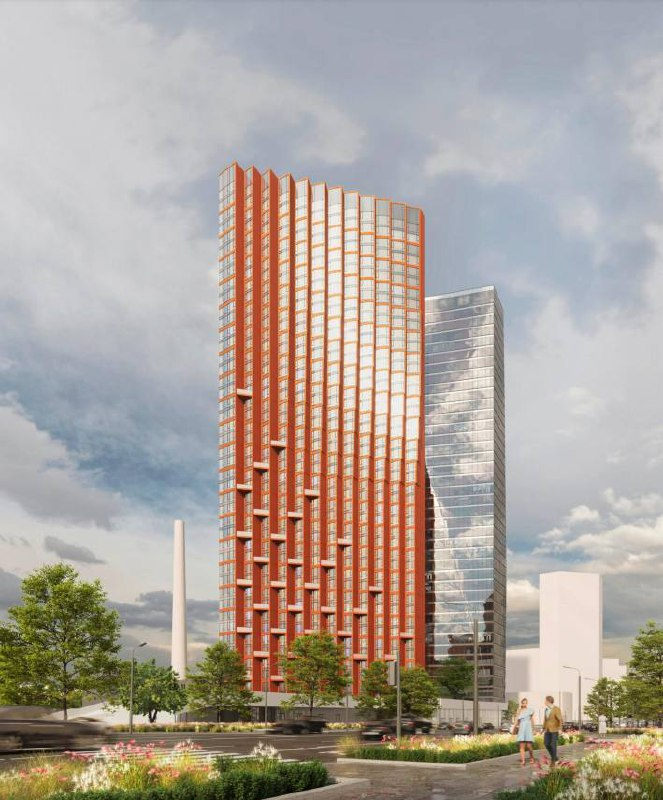
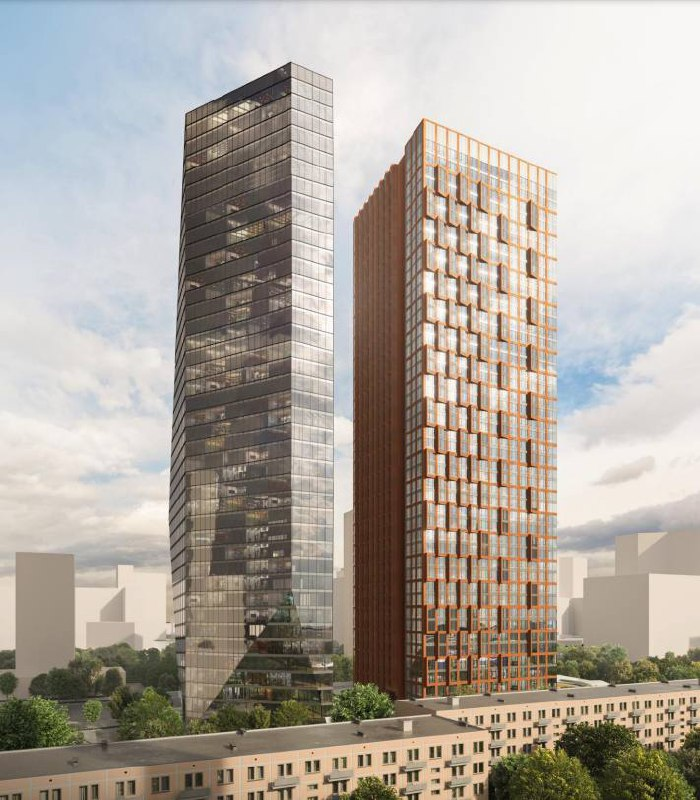

# Nexus от «Аквилона» у «Молодёжной»: вместо офисного узла — жилая башня в 46 этажей

На месте кинотеатра «Брест» у «Молодёжной» собирались строить офисный небоскрёб — получилась жилая башня. «Аквилон» ведёт ЖК Nexus на Ярцевской, 21/1 в Кунцево: 46 этажей, сдача заявлена на 3 квартал 2029 года. На октябрь 2026 года квартиры уже продают, а дом пока в котловане.

*Визуализация жилой башни Nexus на Ярцевской, 21/1. Визуализация: «Аквилон»*

## Коротко

- **Маршрут участка:** офисно-деловой проект Capital Group → жилой комплекс «Аквилона».
- **Поворот:** в сентябре 2022 года Москомархитектура разрешила жильё на участке 1,2 га; по данным «Ведомостей», проект — около 90 тыс. м², половина жилая.
- **Смена хозяина:** к августу 2023 года владелец проекта, ООО «Титул», перешёл под контроль структур «Аквилона».
- **Сейчас:** 46 этажей, 3 квартал 2029 года, один из лотов — около 585 тыс. ₽/м² (13 октября 2026 года).

## Офисы не взлетели, пришёл «Аквилон»

До 2023 года проект на месте кинотеатра «Брест» принадлежал ООО «Титул», которое связывали с Capital Group и предпринимателями Германом и Павлом Те. В апреле 2022 года здесь планировали офисно-деловой центр в 50 этажей, а всю территорию готовили как [транспортно-пересадочный узел](/slovar/tpu/) у метро.

Офисный сценарий продержался недолго. В сентябре 2022 года Москомархитектура издала распоряжение о подготовке изменений в правила землепользования, чтобы рядом с офисами можно было построить жильё. Тогда же сообщалось, что проект займёт около 90 тыс. м², и половина придётся на квартиры.

К августу 2023 года, как писал «Москвич Mag», единственными учредителями «Титула» стали компании «Брик» и «Норд-Строй», связанные с группой «Аквилон». Точную дату и цену сделки стороны публично не называли.

Вся история участка — в [досье «Nexus»](/obekty/nexus/). Сегодня проект ведёт [группа «Аквилон»](/zastroyshchiki/akvilon/); по каталогу novostroy-m.ru, застройщик — ООО «СЗ «ТИТУЛ».

## Продажи есть, этажей пока нет

В марте 2024 года «Аквилон» только показывал новые изображения башни и готовил проект к выходу на рынок. Теперь Nexus в продаже, а в каталоге значится стадия «котлован/фундамент». Классическая московская картина: квартиры продают раньше, чем дом поднимается над забором.

- Этажность: 46 этажей.
- Срок сдачи: 3 квартал 2029 года.
- Расположение: Ярцевская, 21/1, Кунцево, до метро «Молодёжная» около пяти минут пешком.

Данные — по каталогу novostroy-m.ru на 13 октября 2026 года; сверять их стоит с проектной декларацией на наш.дом.рф.

*Визуализация двух башен проекта на Ярцевской, 21/1. Визуализация: «Аквилон»*

## Сколько стоят квартиры в Nexus

Лот на 17 этаже площадью 54,8 м² стоит 32 046 395 ₽, то есть 584 788 ₽/м². Это одна квартира, а не средняя по проекту: среднюю цену ни застройщик, ни каталог не публиковали.

Диапазоны по каталогу на 13 октября 2026 года:

- студии: около 19,1–20,3 млн ₽;
- однокомнатные: 27,0–27,7 млн ₽;
- двухкомнатные: 32,5–34,8 млн ₽;
- трёхкомнатные: 39,6–43,1 млн ₽;
- четырёхкомнатные: 53,5–55,4 млн ₽.

Любопытная деталь: на странице того же лота указана прежняя цена — 42 728 527 ₽, заметно выше нынешней. Когда и почему цену пересмотрели, не объясняется.

## Что это значит для покупателя и инвестора

Плюсы понятны: метро в пяти минутах пешком, понятный застройщик и ясный срок. Минусы тоже: башня на 46 этажей строится до 2029 года, ключей ждать почти три года, а условия [ипотеки и ключевая ставка](/novosti/klyuchevaya-stavka-semeynaya-ipoteka-oktyabr-2026/) к тому времени могут стать другими.

На наш взгляд, главный вопрос — окружение. Площадка выросла из транспортного узла и офисного проекта, и как в итоге будут выглядеть соседние кварталы и транспортная нагрузка, публично пока не расписано. Распроданность застройщик тоже не раскрывает, так что о спросе судить рано.

Что отслеживать: проектную декларацию на наш.дом.рф, ход работ на площадке и движение [цен](/temy/ceny/) в проекте — особенно если «прежние» цены на лотах продолжат отличаться от нынешних.

## Карточка объекта

- Адрес участка: Москва, Ярцевская, 21/1 (Кунцево, ЗАО)
- Названия: Nexus, Nexus by Akvilon; прежние — «ТПУ Молодёжная», «кинотеатр Брест»
- Застройщик: «Аквилон» (ООО «СЗ «ТИТУЛ»)
- Прежний владелец проекта: Capital Group
- Этажность: 46
- Стадия: котлован/фундамент (на октябрь 2026 года)
- Срок: 3 квартал 2029 года
- Цены: лот 584 788 ₽/м²; студии от 19,1 млн ₽
- Метро: «Молодёжная», около 5 минут пешком

## Вопросы и ответы

**Кто застройщик ЖК Nexus на Ярцевской, 21/1?**
Проект ведёт группа «Аквилон», застройщик по каталогу novostroy-m.ru — ООО «СЗ «ТИТУЛ». Раньше проект принадлежал структурам Capital Group.

**Сколько стоят квартиры в Nexus?**
По каталогу novostroy-m.ru на 13 октября 2026 года: студии — около 19,1–20,3 млн ₽, однокомнатные — 27,0–27,7 млн ₽, двухкомнатные — 32,5–34,8 млн ₽. Лот в 54,8 м² на 17 этаже стоит 584,8 тыс. ₽/м².

**Когда сдадут Nexus у метро «Молодёжная»?**
Срок в каталоге — 3 квартал 2029 года. Сейчас на площадке котлован и фундамент.

**Сколько этажей в Nexus?**
46 этажей. Башня стоит на Ярцевской улице в Кунцево, до метро «Молодёжная» около пяти минут пешком.

## Источники

1. [Кто застраивает транспортно-пересадочный узел на «Молодёжной» в Кунцеве, МСК1, 18 апреля 2022 года](https://msk1.ru/text/gorod/2022/04/18/71264591/)
2. [Capital Group сможет построить жильё на месте кинотеатра «Брест», Рамблер/«Ведомости», 1 сентября 2022 года](https://finance.rambler.ru/realty/49266998-capital-group-smozhet-postroit-zhile-na-meste-kinoteatra-brest-v-moskve/)
3. [Появился проект ТПУ «Молодёжная» на месте кинотеатра «Брест», «Москвич Mag», 8 августа 2023 года](https://moskvichmag.ru/gorod/poyavilsya-proekt-tpu-molodezhnaya-v-kuntsevo-na-meste-modernistskogo-kinoteatra-brest/)
4. [Каталог novostroy-m.ru: ЖК Nexus by Akvilon, страница лота, на 13 октября 2026 года](https://www.novostroy-m.ru/kvartiry/odnokomnatnaya-kvartira-v-zhk-nexus-by-akvilon-neksus-ot-akvilon-53e1ef32c1236b4a322df9f013b0bd)

Материал не является инвестиционной рекомендацией.
