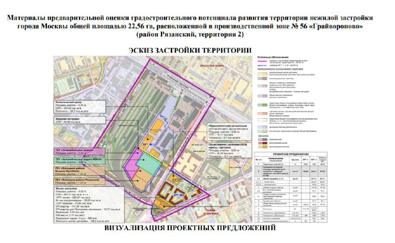

# КРТ «Грайвороново»: Гранель выиграла аукцион за 2 млрд ₽

Структура группы «Гранель» выиграла аукцион на право комплексного развития территории (КРТ) бывшей промзоны «Грайвороново» в Рязанском районе Москвы. Итоговая цена превысила 2 млрд ₽, и это почти в восемь раз выше стартовой.

## Коротко

- Победитель — ООО «Стройкапитал» (СЗ «Стройкапитал») из ГК «Гранель»; итог аукциона опубликован 22 марта 2024 года.
- Участок — 22,56 га вдоль Окской улицы, недалеко от Рязанского проспекта и станций метро «Стахановская», «Окская» и «Кузьминки».
- Цена права выросла почти в восемь раз до суммы более 2 млрд ₽; заявки на участие подали семь компаний.
- Проект — около 450 тыс. м² недвижимости, в том числе более 241 тыс. м² жилья, инвестиции выше 112 млрд ₽.

## Кто выиграл аукцион на КРТ «Грайвороново»

Как сообщил портал мэра и правительства Москвы, право на комплексное развитие территории получило ООО «Стройкапитал», входящее в группу компаний «Гранель». Это специализированный застройщик, который затем фигурирует в материалах по проекту как застройщик участка.

В торгах участвовали семь компаний, их названия mos.ru не приводит. [КРТ](/slovar/krt/) — механизм, при котором инвестор по договору с городом расселяет и застраивает бывшую промзону или ветхий жилой фонд, а взамен получает право на новую застройку.

*Схема застройки территории площадью 22,56 га (территория 2) из материалов предварительной оценки градостроительного потенциала.*

## Что построят на участке

По данным mos.ru и портала «Новостройки Москвы», на участке 22,56 га застройщик должен построить около 450 тыс. м² недвижимости примерно за восемь лет. Из них более 241 тыс. м² жилья. В проекте также заявлены жилой квартал с общественно-деловыми и промышленными объектами, школа и детский сад. Инвестиции оцениваются выше 112 млрд ₽.

На всю бывшую промзону «Грайвороново», по сообщению мэра Москвы от 3 мая 2024 года, приходится более 750 тыс. м² недвижимости и более 430 тыс. м² жилья, а аукцион касается лишь её части.

## Контекст: ажиотаж вокруг участка

Рост цены почти в восемь раз за один аукцион — заметный сигнал спроса. На наш взгляд, участники закладывали в цену не только сам участок, но и возможность получить большой земельный банк в Москве, где такие территории встречаются всё реже. Это оценка, а не установленный факт: мотивы участников торгов официально не раскрываются.

Полная история проекта — в [досье «КРТ Грайвороново»](/obekty/krt-grayvoronovo/). Тема подробнее — в разделе про [КРТ](/temy/krt/).

## Что с проектом сейчас

Положение дел на 14 октября 2026 года: подтверждённых данных о ходе проекта мы не нашли. В открытых источниках, которые мы смогли проверить, нет сведений о разрешениях на строительство, проектах планировки территории, старте продаж и сроках ввода по участку «Стройкапитала». Дату начала работ и цены на квартиры мы не приводим.

Известно только, что в июне 2024 года «Новостройки Москвы» писали о планах жилых домов и школы на участках вдоль Окской улицы. Названия проекта и цен на тот момент не было.

## Что это значит для покупателя и инвестора

- **Квартир в продаже пока нет** — по крайней мере, мы такого предложения не нашли. Покупать сегодня здесь нечего, а сроки сдачи остаются неизвестными.
- **Стоимость участка.** Более 2 млрд ₽ за право на КРТ — это нагрузка на экономику проекта; она, скорее всего, отразится на ценах квартир, но это наше предположение.
- **Что отслеживать.** Утверждение проекта планировки территории, разрешение на строительство, проектную декларацию на наш.дом.рф и сроки расселения. Общий фон — в подборке [будущих проектов](/novostroyki/budushchie-proekty/).

## Карточка объекта

- **Название:** КРТ «Грайвороново» (территория 2).
- **Участок:** бывшая промзона № 56 «Грайвороново», Окская улица, Рязанский район, ЮВАО.
- **Площадь участка:** 22,56 га.
- **Застройщик:** ООО «Стройкапитал» (ГК «Гранель»).
- **Параметры проекта:** около 450 тыс. м² недвижимости, более 241 тыс. м² жилья.
- **Срок реализации:** около восьми лет по условиям проекта.
- **Стадия:** земля (право на КРТ получено на аукционе).

## Вопросы и ответы

**Кто выиграл аукцион на КРТ «Грайвороново»?**
По сообщению портала мэра и правительства Москвы от 22 марта 2024 года, победителем стало ООО «Стройкапитал» из группы компаний «Гранель».

**Сколько заплатили за право развивать территорию «Грайвороново»?**
Итоговая цена превысила 2 млрд ₽; по данным mos.ru, она выросла почти в восемь раз. В торгах участвовали семь компаний.

**Что построят на участке «Грайвороново»?**
По данным mos.ru и портала «Новостройки Москвы», на участке 22,56 га можно построить около 450 тыс. м² недвижимости, из них более 241 тыс. м² жилья; вложения оцениваются выше 112 млрд ₽.

**Когда начнётся строительство в «Грайвороново»?**
Сроков начала строительства и ввода жилья мы не нашли. Известно только, что застройщик должен реализовать проект примерно за восемь лет.

## Источники

1. [Портал мэра и правительства Москвы: итоги аукциона на КРТ «Грайвороново», 22 марта 2024 года](https://www.mos.ru/news/item/136700073/)
2. [«Новостройки Москвы»: жилые дома и школа в промзоне «Грайвороново», 19 июня 2024 года](https://www.novostroy-m.ru/novosti/jilye_doma_i_shkolu)
3. [360.ru: Ефимов о трёх проектах КРТ в «Грайвороново», 3 мая 2024 года](https://360.ru/tekst/obschestvo/efimov-na-chasti-byvshej-promzony-grajvoronovo-realizujut-tri-proekta-krt/)

Материал не является инвестиционной рекомендацией.
