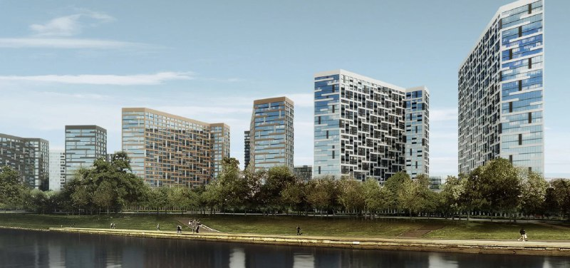
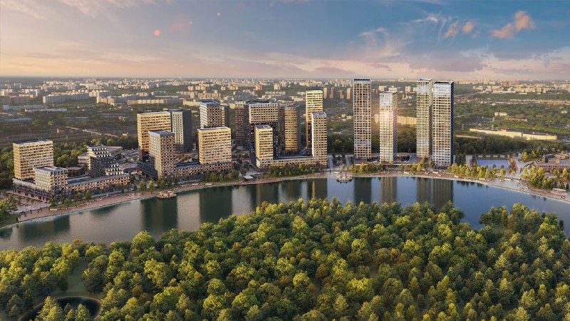

---
source:
  id: 22629
  date: 2024-03-28
status: needs_review
skip_reason: null
type: architecture
series: evolution
region: moscow
title: 'Заречье на Шоссейной, 90: сменили владельца и вывеску, вода осталась'
title_alts:
- '«Графика на воде» стала «Кварталом на воде»: Шоссейная, 90 при МИЦ и Самолёте'
- 'Квартал на воде в Печатниках: МИЦ начал, Самолёт достраивает'
slug: zareche-kak-menyalsya-proekt
lead: 'В апреле 2023 года МИЦ вывел на Шоссейной, 90 в Печатниках «Графику на воде», а в октябре 2023-го проект достался «Самолёту» вместе со всей группой и стал «Кварталом на воде». Хозяин, название и цены поменялись, а идея — дома у реки и вторая линия за ними — пережила все пересадки.'
developers:
- id: samolet
  name: Самолёт
  role: main
- id: mits
  name: МИЦ
  role: previous
objects:
- id: zareche
  names:
  - Заречье
  - Графика на воде
  - Квартал на воде
  zu: Шоссейная, 90
  main: true
  new: false
districts:
- pechatniki
topics:
- arhitektura
ownership_changes:
- object: zareche
  from: МИЦ
  to: Самолёт
  to_slug: samolet
  date: октябрь 2023
  how: Самолёт купил 100% группы компаний МИЦ; по карточке проекта на агрегаторе, проект перешёл к Самолёту в октябре 2023 года
  source: https://finance.rambler.ru/business/51598803-gruppa-samolet-kupila-developera-mits/
images:
- file: media/3370_1.jpg
  alt: Жилые корпуса на набережной Москвы-реки, ранняя визуализация проекта МИЦ на Шоссейной, 90 в Печатниках
  caption: 'Визуализация: МИЦ, 2020'
  credit: МИЦ
- file: media/17043_1.jpg
  alt: Квартал «Графика на воде» на набережной в Печатниках, визуализация МИЦ, Шоссейная, 90
  caption: 'Визуализация: МИЦ, 2023'
  credit: МИЦ
factcheck:
- claim: '13 апреля 2023 года: старт продаж «Графики на воде», ГК МИЦ, архитектор Kleinewelt Architekten, семь корпусов от 4 до 24 этажей (четыре с выходом к воде, три на второй линии), от 284,4 тыс. ₽/м² без отделки'
  status: confirmed
  source: https://www.novostroy-m.ru/novosti/start_jk_grafika_na
  checked: 2026-10-14
- claim: '16 октября 2023 года: Самолёт купил 100% ГК МИЦ (11 проектов; конкретные проекты в сообщении не названы)'
  status: confirmed
  source: https://finance.rambler.ru/business/51598803-gruppa-samolet-kupila-developera-mits/
  checked: 2026-10-14
- claim: Проект переименован из «Графики на воде» в «Квартал на воде»; по комментарию эксперта на агрегаторе, Самолёт принял проект в октябре 2023 года; юрлицо — АО СЗ «Заречье»
  status: changed
  source: https://www.novostroy-m.ru/baza/jk_shosseynaya_90
  checked: 2026-10-14
- claim: 'Апрель 2025 года: квартал из четырёх башен на общем подиуме, 10–26 этажей, около 64,7 тыс. м², 625 квартир'
  status: confirmed
  source: https://moskvichmag.ru/?p=422156
  checked: 2026-10-14
- claim: 'Октябрь 2026 года: корпус 1 сдан, во 2-м идёт выдача ключей, в 3-м — отделка, корпус 5 — фундамент, сдача IV квартал 2028 года; лот 29,47 м² — 14 594 315 ₽'
  status: confirmed
  source: https://www.novostroy-m.ru/baza/jk_shosseynaya_90
  checked: 2026-10-14
- claim: Рост ТЭП на 11 тыс. м² при Самолёте (март 2024 года), решение Архсовета по реновационным корпусам (ноябрь 2023 года), разрешение МИЦ от 20 февраля 2023 года
  status: unverified
  source: https://www.novostroy-m.ru/baza/jk_shosseynaya_90
  checked: 2026-10-14
removed:
- 'Рост ТЭП проекта на 11 тыс. м² (март 2024 года, повод заметки): ни в открытых источниках, ни в карточке проекта не подтверждён — убран.'
- 'Проект Заречье на 298 тыс. м² (2021 год) и рендеры Олимпроекта и GAFA (2020 год): не подтверждены.'
- 'Реновационные дома на Шоссейной, 90 (47,8 тыс. м², 2022 год) и согласование Архсоветом архитектуры Kleinewelt для корпусов на 90/2 (ноябрь 2023 года): независимо не подтверждены.'
- 'Экспертиза проекта (февраль 2023 года) и разрешение на строительство от 20 февраля 2023 года: не проверялись, в ЕИСЖС не заходили.'
- 'Цена 445 тыс. ₽/м² и «новый корпус» (сентябрь 2025 года): не подтверждены.'
- Оценки заметок о «вент-фасадах МИЦ» и «раздраконит проект» — мнения автора заметки.
data_points:
- metric: kvartal_na_vode_lot_price_rub
  value: 14594315
  date: '2026-10-07'
seo:
  main_query: квартал на воде самолёт шоссейная 90 как менялся проект
  keywords:
  - графика на воде мик шоссейная 90
  - заречье печатники самолет
  - квартал на воде печатники архитектор
  - шоссейная 90 kleinewelt
  frequency_checked: false
  title: 'Квартал на воде в Печатниках: от МИЦ до Самолёта'
  description: 'Шоссейная, 90: «Графика на воде» от МИЦ в 2023 году стала «Кварталом на воде» Самолёта. Что сменилось, что осталось, цены и сроки сдачи корпусов.'
  canonical: https://шахматка.москва/novosti/zareche-kak-menyalsya-proekt/
internal_links:
- anchor: досье «Заречье»
  url: /obekty/zareche/
- anchor: застройщик МИЦ
  url: /zastroyshchiki/mits/
- anchor: Печатники
  url: /novostroyki/pechatniki/
- anchor: ТЭП
  url: /slovar/tep/
- anchor: архитектура
  url: /temy/arhitektura/
faq:
- q: Как раньше назывался «Квартал на воде» в Печатниках?
  a: В апреле 2023 года проект на Шоссейной, 90 вышел в продажу как «Графика на воде» от ГК МИЦ; после перехода к Самолёту он называется «Кварталом на воде».
- q: Кто застройщик «Квартала на воде»?
  a: С октября 2023 года проект принадлежит группе «Самолёт», которая купила ГК МИЦ; по документам застройщик — АО СЗ «Заречье».
- q: Кто архитектор «Графики на воде»?
  a: В апреле 2023 года автором проекта называли бюро Kleinewelt Architekten; о смене архитектора официально не сообщали.
- q: Когда сдадут «Квартал на воде»?
  a: По данным агрегатора на октябрь 2026 года, корпус 1 сдан, во втором выдают ключи, корпус 5 — в фундаменте, ввод запланирован на IV квартал 2028 года.
date_published: 2024-03-28
date_modified: 2026-10-14
author: Редакция Шахматки
editor_notes: Повод заметки (Самолёт увеличивает ТЭП на 11 тыс. м² в марте 2024 года) подтвердить не удалось и из текста убран. Опорные источники — «Новострой-М» (старт продаж 2023 года и карточка проекта на октябрь 2026 года), сообщение о покупке МИЦ Самолётом (Rambler) и «Москвич Mag» (апрель 2025 года); ЕИСЖС и сайт застройщика не открывались, лимит WebFetch исчерпан. Цифры 2025 года (4 башни, 625 квартир, 64,7 тыс. м²) — вероятно, один квартал, а не весь проект; данные агрегатора по этажности внутренне противоречивы (7–17 и лоты на 24–26 этажах), поэтому в таблице «—». Развитие архитектурной концепции после 2023 года (автор, фасады) не подтверждено. Годы у фото (2020, 2023) — по датам заметок архива.
schema: |-
  [
    {
      "@context": "https://schema.org",
      "@type": "Article",
      "headline": "Заречье: как менялся проект на Шоссейной, 90 с 2023 по 2026",
      "description": "Шоссейная, 90: «Графика на воде» от МИЦ в 2023 году, покупка МИЦ Самолётом и «Квартал на воде» в 2026-м. Архитектура Kleinewelt, корпуса, цены и сроки сдачи.",
      "datePublished": "2024-03-28",
      "dateModified": "2026-10-14",
      "author": {
        "@type": "Organization",
        "name": "Редакция Шахматки"
      },
      "publisher": {
        "@type": "Organization",
        "name": "Шахматка"
      },
      "about": [
        {
          "@type": "Residence",
          "name": "Квартал на воде (Заречье)",
          "address": "Москва, Шоссейная, 90"
        },
        {
          "@type": "Organization",
          "name": "Самолёт"
        }
      ],
      "mainEntityOfPage": "https://шахматка.москва/novosti/zareche-kak-menyalsya-proekt/"
    },
    {
      "@context": "https://schema.org",
      "@type": "FAQPage",
      "mainEntity": [
        {
          "@type": "Question",
          "name": "Как раньше назывался «Квартал на воде» в Печатниках?",
          "acceptedAnswer": {
            "@type": "Answer",
            "text": "Проект на Шоссейной, 90 вышел в продажу в апреле 2023 года как «Графика на воде» от ГК МИЦ; позднее его называют «Кварталом на воде»."
          }
        },
        {
          "@type": "Question",
          "name": "Кто застройщик «Квартала на воде»?",
          "acceptedAnswer": {
            "@type": "Answer",
            "text": "С октября 2023 года проект принадлежит группе «Самолёт», купившей ГК МИЦ; по документам застройщик — АО СЗ «Заречье»."
          }
        },
        {
          "@type": "Question",
          "name": "Кто архитектор «Графики на воде»?",
          "acceptedAnswer": {
            "@type": "Answer",
            "text": "В апреле 2023 года автором проекта называли бюро Kleinewelt Architekten; сведений о смене архитектора мы не нашли."
          }
        },
        {
          "@type": "Question",
          "name": "Когда сдадут «Квартал на воде»?",
          "acceptedAnswer": {
            "@type": "Answer",
            "text": "По данным агрегатора на октябрь 2026 года, корпус 1 сдан, во втором идёт выдача ключей, корпус 5 — на стадии фундамента с вводом в IV квартале 2028 года."
          }
        }
      ]
    }
  ]
---

# Заречье на Шоссейной, 90: сменили владельца и вывеску, вода осталась

В апреле 2023 года МИЦ вывел на Шоссейной, 90 в [Печатниках](/novostroyki/pechatniki/) «Графику на воде», а уже в октябре 2023-го проект достался «Самолёту» вместе со всей группой и стал «Кварталом на воде». За три года поменялись хозяин, название и цены, а сама идея — дома у реки и вторая линия за ними — пережила все пересадки.

**Коротко**

- Апрель 2023 года: «Графика на воде» от МИЦ — семь корпусов от 4 до 24 этажей, архитектор Kleinewelt, от 284,4 тыс. ₽/м² без отделки.
- Октябрь 2023 года: «Самолёт» покупает МИЦ целиком, проект переезжает под вывеску «Квартал на воде».
- Апрель 2025 года: четыре башни 10–26 этажей на общем подиуме, около 64,7 тыс. м², 625 квартир.
- Октябрь 2026 года: корпус 1 сдан, корпус 5 ещё в фундаменте, ввод — IV квартал 2028 года.

## МИЦ начинал у воды

Площадка на Шоссейной, 90 принадлежала [МИЦ](/zastroyshchiki/mits/). Картинки проекта показывали ещё в январе 2020 года, но цифры того этапа так и остались за кадром.

*Визуализация: МИЦ, 2020*

Конкретика появилась весной 2023-го. 13 апреля 2023 года «Новострой-М» сообщил о старте продаж «Графики на воде»: ГК МИЦ, бизнес-класс, архитектор — Kleinewelt Architekten. Семь корпусов от 4 до 24 этажей: четыре с закрытой территорией стоят у самой воды, три — на второй линии. Метр стартовал от 284,4 тыс. ₽ без отделки, однокомнатная на 32,7 м² — от 9,5 млн ₽. В нагрузку — учебно-воспитательный комплекс на 925 мест и собственная набережная.

*Визуализация: МИЦ, 2023*

## Полгода спустя — уже «Самолёт»

**Октябрь 2023 года: проект сменил хозяина оптом.** 16 октября 2023 года «Самолёт» объявил о покупке 100% ГК МИЦ — сразу 11 проектов, поимённо их в сообщении не перечисляли. По комментарию эксперта в карточке проекта на «Новострой-М», Шоссейная, 90 перешла к «Самолёту» в том же октябре 2023 года, а «Графика на воде» превратилась в «Квартал на воде». Юридически стройку ведёт АО СЗ «Заречье».

**Апрель 2025 года: крепость на подиуме.** «Москвич Mag» описал «Квартал на воде» как четыре башни от 10 до 26 этажей на общем подиуме вокруг внутреннего двора. [ТЭП](/slovar/tep/) (технико-экономические показатели) квартала — около 64,7 тыс. м² и 625 квартир. Издание сравнило композицию с крепостью — образ говорит сам за себя. По масштабу, на наш взгляд, это один квартал, а не весь комплекс: четыре квартала у воды плюс три корпуса на второй линии хорошо ложатся на схему 2023 года. Кто автор архитектуры в версии 2025 года, источник не уточняет.

## Что на площадке сейчас

По данным агрегатора на октябрь 2026 года: корпус 1 сдан, во втором выдают ключи, в третьем идут фасадные и внутренние работы, корпус 5 — в фундаменте, сдача — IV квартал 2028 года. Проектные декларации на корпуса 1, 2 и 3 датированы декабрём 2023 года. Прежние ориентиры — III квартал 2024 и IV квартал 2025 года — на странице уже помечены как устаревшие.

Теперь деньги. Однокомнатная на 29,47 м² 7 октября 2026 года стоила 14 594 315 ₽ — по нашему расчёту, около 495 тыс. ₽/м². В 2023-м метр начинался от 284,4 тыс. ₽, но лоты разные, так что точный рост цены по ним не посчитать: разница видна на глаз, процент — нет. Эксперт на той же странице оценивает жилую площадь всего проекта примерно в 350 тыс. м².

С этажностью на агрегаторе путаница: в описании — три корпуса от 7 до 17 этажей, а в лотах попадаются 24-й и 26-й этажи. Эти цифры мы в таблицу не несём. Полная история площадки — в [досье «Заречье»](/obekty/zareche/).

## Было и стало

| Параметр | Апрель 2023 | Апрель 2025 | Октябрь 2026 |
|---|---|---|---|
| Название | «Графика на воде» | «Квартал на воде» | «Квартал на воде» |
| Застройщик | МИЦ | «Самолёт» (с октября 2023 года) | «Самолёт», АО СЗ «Заречье» |
| Архитектор | Kleinewelt Architekten | — | — |
| Корпуса и этажность | 7 корпусов, 4–24 этажа | 4 башни на подиуме, 10–26 этажей | — |
| Площадь | — | около 64,7 тыс. м² (квартал) | около 350 тыс. м² жилья (оценка эксперта, весь проект) |
| Квартиры | — | 625 (квартал) | — |
| Цена | от 284,4 тыс. ₽/м², 1-комнатная от 9,5 млн ₽ | — | 1-комнатная 29,47 м² — 14,6 млн ₽ |

Прочерк — цифру для этапа официально не называли. И помните про масштаб: в апреле 2025 года описан отдельный квартал, а не весь проект.

## Что это значит для покупателя

На наш взгляд, проект пережил смену владельца на удивление спокойно: вывеска новая, а схема прежняя — квартал вдоль воды и корпуса на второй линии за ним. Поэтому смотреть стоит не на бренд, а на конкретный корпус. Корпус 1 сдан, корпус 5 только вышел из земли — это две разные покупки с разными рисками, хотя адрес один.

Что отслеживать: проектные декларации корпусов, срок корпуса 5 (IV квартал 2028 года) и этажность с площадью по ЕИСЖС — агрегатор тут сам себе противоречит.

## Карточка объекта

- **Адрес участка:** Шоссейная, 90, Москва
- **Названия:** Заречье, «Графика на воде», «Квартал на воде»
- **Застройщик:** группа «Самолёт» (АО СЗ «Заречье»); прежний владелец — ГК МИЦ
- **Район:** Печатники, ЮВАО
- **Архитектор (2023 год):** Kleinewelt Architekten
- **Стадия:** корпус 1 сдан, корпуса 2 и 3 в завершении, корпус 5 — фундамент
- **Ввод корпуса 5:** IV квартал 2028 года
- **Цена:** 1-комнатная 29,47 м² — 14,6 млн ₽ (7 октября 2026 года)

## Вопросы и ответы

**Как раньше назывался «Квартал на воде» в Печатниках?**
В апреле 2023 года проект на Шоссейной, 90 вышел в продажу как «Графика на воде» от ГК МИЦ; после перехода к «Самолёту» он называется «Кварталом на воде».

**Кто застройщик «Квартала на воде»?**
С октября 2023 года проект принадлежит группе «Самолёт», которая купила ГК МИЦ; по документам застройщик — АО СЗ «Заречье».

**Кто архитектор «Графики на воде»?**
В апреле 2023 года автором проекта называли бюро Kleinewelt Architekten; о смене архитектора официально не сообщали.

**Когда сдадут «Квартал на воде»?**
По данным агрегатора на октябрь 2026 года, корпус 1 сдан, во втором выдают ключи, корпус 5 — в фундаменте, ввод запланирован на IV квартал 2028 года.

## Источники

1. [Новострой-М: старт продаж ЖК «Графика на воде», 13 апреля 2023 года](https://www.novostroy-m.ru/novosti/start_jk_grafika_na)
2. [Rambler: группа «Самолёт» купила девелопера МИЦ, 16 октября 2023 года](https://finance.rambler.ru/business/51598803-gruppa-samolet-kupila-developera-mits/)
3. [Москвич Mag: ЖК «Квартал на воде» в Печатниках, апрель 2025 года](https://moskvichmag.ru/?p=422156)
4. [Новострой-М: карточка ЖК «Квартал на воде», октябрь 2026 года](https://www.novostroy-m.ru/baza/jk_shosseynaya_90)

Материал не является инвестиционной рекомендацией.
