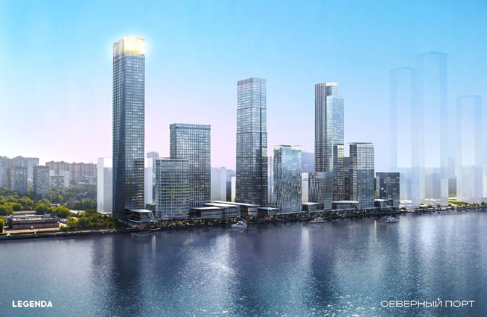

# «Северный порт» от LEGENDA: старт продаж первой очереди, цены и сроки

LEGENDA открыла продажи в ЖК «Северный порт» на Ленинградском шоссе, вл. 57: в первую очередь вошли три корпуса и 1172 квартиры. Для компании это первый московский проект, и за два с половиной года его цены заметно выросли.

*Визуализация корпусов «Северного порта» вдоль набережной канала имени Москвы. Визуализация: LEGENDA*

## Коротко

- Продажи первой очереди стартовали 2 апреля 2024 года: корпуса в 34, 19 и 58 этажей, 1172 квартиры, 65 планировок.
- На старте квартиры стоили от 13,7 млн ₽. К началу октября 2025 года средняя цена предложения выросла до 524,9 тыс. ₽/м².
- К середине октября 2025 года продано 816 квартир первой очереди, около 70%.
- По объявлениям на октябрь 2026 года, корпуса сдаются с 2028 года, а корпус 6.4 — в 2030 году.

## Что произошло: старт «Северного порта»

В начале апреля 2024 года LEGENDA вывела на рынок первую очередь комплекса у Северного речного вокзала. Строительство ведёт ООО СЗ «Северный порт 7».

Площадь участка — 7,8 га, общая площадь проекта — 330 тыс. м², из них жилая около 188,9 тыс. м². Всего в проекте 3021 квартира. В первую очередь вошли три корпуса переменной этажности — 34, 19 и 58 этажей — с двухуровневым паркингом более чем на 500 машино-мест.

Застройщик заявляет набережную протяжённостью 3,2 км, которая соединится с парком Северного речного вокзала. Это заявление девелопера, сроки создания набережной в источниках не названы.

## История проекта

LEGENDA — петербургский девелопер: «Северный порт» стал её первым проектом в Москве, на рынок столицы компания вышла весной 2024 года. Историю земли и смену партнёров по проекту мы независимо подтвердить не смогли, поэтому здесь её не пересказываем.

Полная история проекта — в [досье «Северный порт»](/obekty/severnyy-port/).

## Что с проектом сейчас

По состоянию на 13 октября 2026 года картина такая.

- **Продажи.** По данным девелопера на ноябрь 2025 года, к середине октября было продано 816 из 1172 квартир первой очереди. Студии разошлись на 87%, однокомнатные — на 76%.
- **Цены.** Средняя цена предложения на начало октября 2025 года — 524 955 ₽/м². В объявлениях на октябрь 2026 года цена в разных корпусах — от 555 до 692 тыс. ₽/м². Корпус 6.4 предлагается от 662 тыс. ₽/м², студия 29,6 м² — 19,6 млн ₽.
- **Сроки.** Корпус 7.1 в объявлениях сдаётся в I квартале 2028 года, корпус 7.3 — в III квартале 2028 года. У корпуса 6.4 начало строительства — I квартал 2026 года, сдача — II квартал 2030 года.

Новая очередь описана отдельно: [лот 6 в продаже](/novosti/legenda-severnyy-port-lot-6-ceny/).

## Что это значит для покупателя и инвестора

Первая очередь распродана на значительную долю, а цены выросли заметно быстрее, чем стартовые 13,7 млн ₽ за квартиру. На наш взгляд, дальнейший рост зависит от темпа строительства и ипотечных условий, а не от самого факта набережной.

Риски: проект большой и растянутый по очередям, а корпус 6.4 сдаётся только в 2030 году. [LEGENDA](/zastroyshchiki/legenda/) вышла в Москву в 2024 году, опыт сдачи столичных домов у компании пока ограничен. Следите за [проектной декларацией](/slovar/proektnaya-deklaratsiya/) и сроками ввода корпуса 7.1 в 2028 году.

Данных о судебных спорах по проекту мы не проверяли.

## Карточка объекта

- **Адрес участка:** Москва, Ленинградское шоссе, вл. 57
- **Название:** Северный порт
- **Застройщик:** [LEGENDA](/zastroyshchiki/legenda/) (ООО СЗ «Северный порт 7»)
- **Район:** [Левобережный](/novostroyki/levoberezhnyy/)
- **Площадь проекта:** 330 тыс. м², участок 7,8 га
- **Квартиры:** 3021 в проекте, 1172 в первой очереди
- **Стадия:** строительство и продажи
- **Ввод:** корпус 7.1 — I квартал 2028 года, корпус 7.3 — III квартал 2028 года, корпус 6.4 — II квартал 2030 года (по объявлениям)

## Вопросы и ответы

**Когда начались продажи в ЖК «Северный порт»?**
LEGENDA открыла продажи первой очереди 2 апреля 2024 года: три корпуса в 34, 19 и 58 этажей и 1172 квартиры.

**Сколько стоили квартиры в «Северном порту» на старте?**
На старте цена начиналась от 13,7 млн ₽ за квартиру. К началу октября 2025 года средняя цена предложения достигла 524 955 ₽/м².

**Когда сдадут «Северный порт»?**
По объявлениям на октябрь 2026 года, корпус 7.1 — в I квартале 2028 года, корпус 7.3 — в III квартале 2028 года, корпус 6.4 — во II квартале 2030 года.

**Кто застройщик ЖК «Северный порт»?**
LEGENDA, строительство ведёт ООО СЗ «Северный порт 7». Для компании это первый проект в Москве.

## Источники

1. [РБК Недвижимость: в Москве начали реализацию ЖК «Северный порт», 21 мая 2024 года](https://realty.rbc.ru/news/664343289a7947c66eaa5e70)
2. [Каталог новостроек: Legenda начала продажи в «Северном порту», 5 апреля 2024 года](https://www.novostroy-m.ru/novosti/jk_severnyy_port_i)
3. [Каталог новостроек: в «Северном порту» продано около 70% квартир первой очереди, 11 ноября 2025 года](https://www.novostroy-m.ru/kompanii/legenda_intelligent_development_legenda/news/v_proekte_severnyy_port)
4. [ЦИАН: объявления в ЖК «Северный порт», корпус 6.4](https://www.cian.ru/kupit-kvartiru-studiu-semejnaya-ipoteka-ot-zastroishchika-legenda-intelligent-development-8075-RLTM/)
5. [ЦИАН: объявления в ЖК «Северный порт. Береговые кварталы», корпуса 7.1 и 7.3](https://www.cian.ru/kupit-1-komnatnuyu-kvartiru-moskva-leningradskoe-shosse-021349)

Материал не является инвестиционной рекомендацией.
