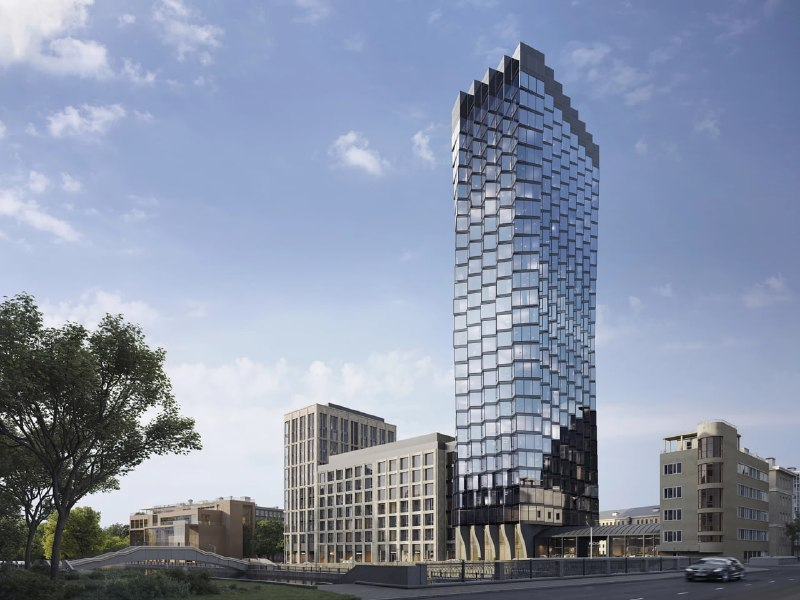
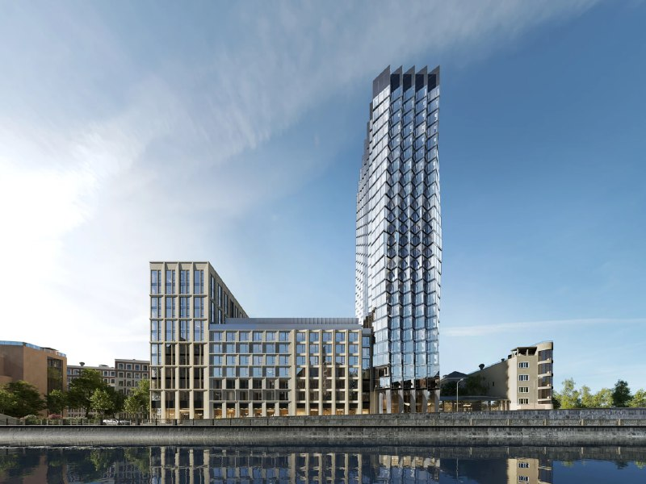
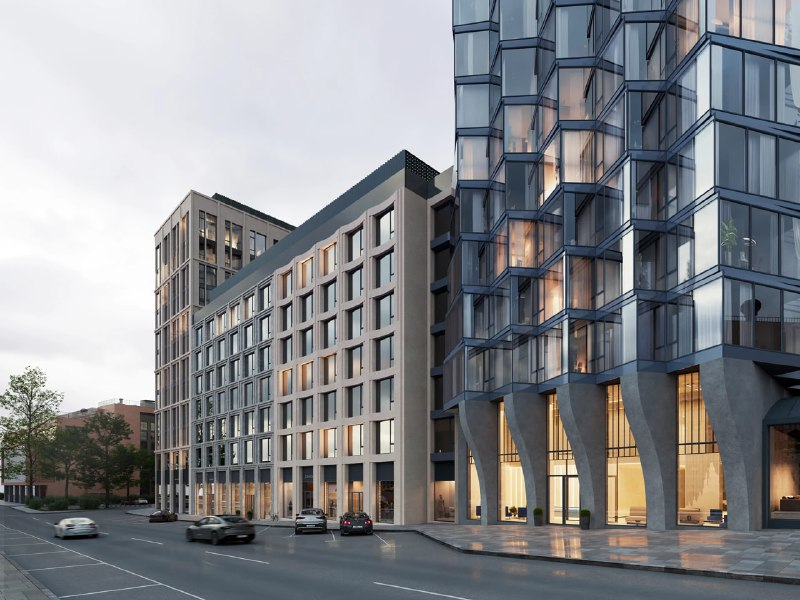

# ЖК «Монблан» от Галса на Шлюзовой, 2: башня на Садовом, сдача 2028

Галс-Девелопмент вывел на рынок жилой комплекс «Монблан» на Шлюзовой набережной, 2 в Замоскворечье: там строят жильё, а историческое здание конторы автобазы Наркомтяжпрома сохраняют. К октябрю 2026 года срок ввода сдвинулся с 2027 на первый квартал 2028 года.

## Коротко

- Проект: около 49 тыс. м², 341 квартира, шесть корпусов по 7–12 этажей и 27-этажная башня высотой 99 м.
- Продажи начались в мае 2024 года; по данным застройщика, за четыре месяца продано более 17% лотов.
- Срок ввода: в мае 2024 года называли 2027 год, на октябрь 2026 года — первый квартал 2028 года.
- Цена: официальной средней цены в открытых источниках нет; на 14 октября 2026 года на агрегаторе двухкомнатная квартира 73,3 м² стоила 123,98 млн ₽.

## Что такое ЖК «Монблан» на Шлюзовой, 2

Проект Галса на участке «Шлюзовая, 2» в досье объекта значится также под названием «Эволюция». В июле 2023 года застройщик опубликовал рендер, на котором здание бывшей конторы автобазы Наркомтяжпрома СССР (советский конструктивизм) сохранено; ранее градозащитники опасались его сноса. Продажи стартовали в мае 2024 года, архитектурно-градостроительное решение ([АГР](/slovar/agr/)) утверждено в апреле 2024 года.

*Башня ЖК «Монблан» со стороны набережной. Визуализация: Галс-Девелопмент*

Архитектурную концепцию разработало бюро СПИЧ, благоустройство двора — ландшафтное бюро Scape, общественные пространства — T+T Architects. В комплексе шесть корпусов высотой 7–12 этажей и 27-этажная башня высотой 99 м. Под двором площадью около 7 тыс. м² — двухуровневый паркинг на 267 машино-мест, ещё 49 гостевых мест устроят на поверхности. На первых этажах заложено около 2 тыс. м² коммерческих помещений.

*Низкие корпуса комплекса и башня. Визуализация: Галс-Девелопмент*

## Сколько квартир и какие они

Всего в проекте 341 квартира: от 47,4 м² (одна спальня) до 174,2 м² (четыре спальни). Пять пентхаусов имеют площадь 171–228 м² и потолки 4,3 м. Издания называют проект элитным; в нашей навигации он относится к сегменту [премиум-класса](/novostroyki/premium-klass/). Покупка квартиры оформляется по [ДДУ](/slovar/ddu/) — договору долевого участия.

## Что с проектом сейчас

Состояние на 14 октября 2026 года.

**Срок.** При старте продаж называли ввод в 2027 году. В феврале 2025 года застройщик указывал первый квартал 2028 года, тот же срок значится в объявлениях на октябрь 2026 года. Сдвиг — примерно на год.

**Цена.** Среднюю цену старта продаж в открытых источниках мы подтвердить не смогли и в статью не включаем. Ориентир на сегодня: на агрегаторе двухкомнатная квартира 73,3 м² предлагается за 123,98 млн ₽, то есть около 1,69 млн ₽/м². Это цена одного лота, а не средняя по проекту; на наш взгляд, она показывает уровень «верхней полки» с видом на башню, а не стоимость типового метра.

**Продажи.** По данным застройщика на февраль 2025 года, за первые четыре месяца продано более 17% лотов. Актуальную распроданность на наш.дом.рф проверить не удалось.

**Застройщик.** Проект ведёт [Галс-Девелопмент](/zastroyshchiki/gals/), проектная компания — ООО СЗ «Галс-Шлюзовая». Смены собственника не зафиксировано.

Полная история проекта — в [досье «Шлюзовая, 2»](/obekty/shlyuzovaya-2/).

## Что это значит для покупателя и инвестора

Плюсы: метро «Павелецкая» в пяти минутах пешком, сохраняемое историческое здание, небольшое число квартир (341) и закрытый двор. Для [новостроек Москвы](/novostroyki/moskva/) такая камерность — не частое явление.

Риски: срок уже сдвигался, цена метра высока, а ликвидность лотов за 100 млн ₽ и больше, на наш взгляд, ограничена: круг покупателей узок. Покупателю стоит смотреть проектную декларацию и условия договора, а не рендеры.

*Входная группа башни. Визуализация: Галс-Девелопмент*

## Карточка объекта

- Название: «Монблан» (также «Эволюция»)
- Адрес участка: Шлюзовая, 2 (Шлюзовая набережная), Замоскворечье, Москва
- Застройщик: Галс-Девелопмент (ООО СЗ «Галс-Шлюзовая»)
- Площадь: около 49 тыс. м²
- Квартиры: 341, из них 5 пентхаусов
- Этажность: корпуса 7–12 этажей, башня 27 этажей (99 м)
- Паркинг: 267 машино-мест под землёй
- Стадия: продажи
- Ввод: I квартал 2028 года
- Метро: «Павелецкая», около 5 минут пешком

## Вопросы и ответы

**Кто строит ЖК «Монблан» на Шлюзовой, 2?**
Застройщик — группа «Галс-Девелопмент», проектная компания — ООО СЗ «Галс-Шлюзовая». Архитектурную концепцию разработало бюро СПИЧ.

**Когда сдадут ЖК «Монблан»?**
Срок ввода в эксплуатацию — первый квартал 2028 года. При старте продаж в мае 2024 года называли 2027 год.

**Сколько квартир в ЖК «Монблан»?**
Всего 341 квартира, в том числе пять пентхаусов площадью 171–228 м². Квартиры — от 47,4 м² (одна спальня) до 174,2 м² (четыре спальни).

**Сколько стоят квартиры в «Монблане»?**
Официальной средней цены в открытых источниках мы не нашли. На 14 октября 2026 года на агрегаторе двухкомнатная квартира 73,3 м² предлагалась за 123,98 млн ₽.

## Источники

1. [«Галс-Девелопмент» построит элитный жилой комплекс «Монблан» в Замоскворечье — «Сноб», 20 мая 2024](https://snob.ru/news/gals-development-postroit-elitnyi-zhiloi-kompleks-monblan-v-zamoskvoreche/)
2. [РБК Недвижимость, 24 февраля 2025 (материал с рекламной маркировкой, данные застройщика)](https://realty.rbc.ru/news/67b70a309a7947fd89152b1a)
3. [На Садовом у Павелецкого вокзала построят «гармошку на ножках» — «Москвич Mag», 13 июля 2023](https://moskvichmag.ru/?p=307338)
4. [Карточка квартиры в ЖК «Монблан», Новострой-М, данные на 14 октября 2026](https://www.novostroy-m.ru/kvartiry/dvuhkomnatnaya-kvartira-v-zhk-monblan-4105778b1f82c72c225204e6b73ceb)

Материал не является инвестиционной рекомендацией.
