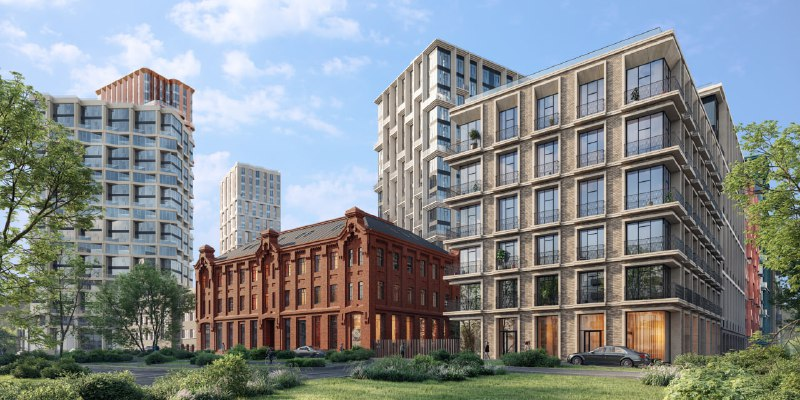
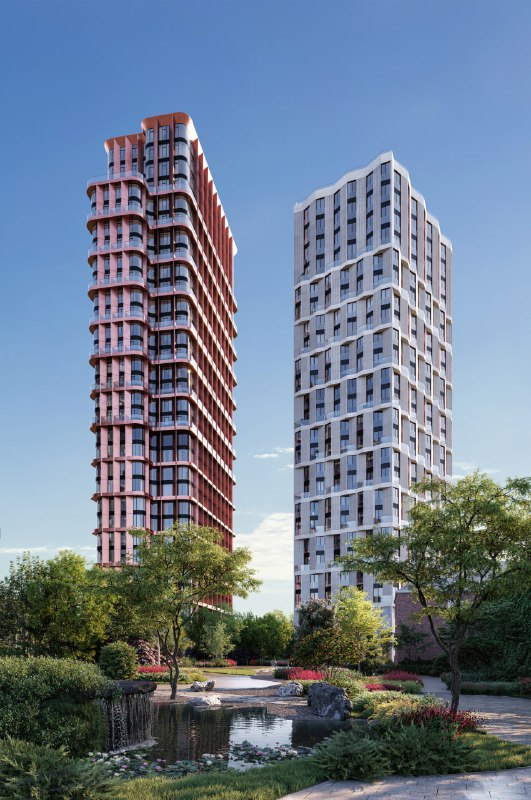
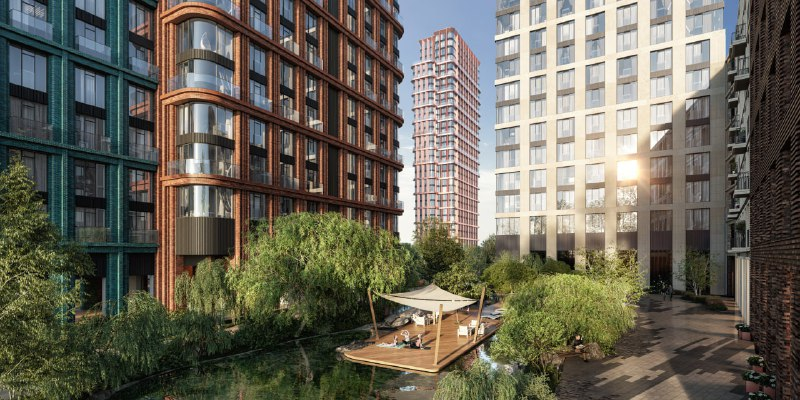

---
source:
  id: 23052
  date: '2024-04-22'
status: needs_review
skip_reason: null
type: object
region: moscow
title: "«Тишинский бульвар» от Sminex: от 69 млн ₽ за вход, ключи в 2027–2028 годах"
title_alts:
- "«Тишинский бульвар» в Пресненском районе: 14 корпусов и парк вместо «Фазотрона»"
- "Квартал «Тишинский бульвар» у Белорусской: что изменилось с 2024 года"
slug: tishinskiy-bulvar-sminex-ceny-sroki
lead: "Sminex вывел «Тишинский бульвар» в продажу весной 2024 года — и за два с половиной года квартал из презентации превратился в стройку. Первые корпуса обещают сдать в третьем квартале 2027 года, а билет на вход стоит 69,2 млн ₽: столько просят за однокомнатную квартиру."
developers:
- id: sminex
  name: Sminex
  role: main
objects:
- id: tishinskiy-bulvar
  names:
  - Тишинский бульвар
  - Электрический переулок, 1
  - Квартал Тишинский бульвар
  zu: Электрический, 1
  main: true
  new: false
districts:
- presnenskiy
topics:
- premium
- ceny
images:
- file: media/23052_1.jpg
  alt: 'Визуализация квартала «Тишинский бульвар»: жилые корпуса и кирпичное здание, Пресненский район Москвы'
  caption: 'Квартал «Тишинский бульвар»: новые корпуса рядом с кирпичным зданием. Визуализация: Sminex'
  credit: 'Визуализация: Sminex'
- file: media/23052_3.jpg
  alt: 'Визуализация двора «Тишинского бульвара»: пруд с деревянным настилом между жилыми корпусами, Пресненский район'
  caption: 'Пруд во дворе квартала. Визуализация: Sminex'
  credit: 'Визуализация: Sminex'
- file: media/23052_4.jpg
  alt: Визуализация двух жилых башен квартала «Тишинский бульвар» на фоне парка с прудом, Пресненский район
  caption: 'Две башни — доминанты квартала. Визуализация: Sminex'
  credit: 'Визуализация: Sminex'
factcheck:
- claim: Застройщик квартала «Тишинский бульвар» — Sminex; адрес — Электрический пер., корп. 3–9, вл. 1, Пресненский район, ЦАО
  status: confirmed
  source: https://www.novostroy-m.ru/baza/elektricheskiy_per_vl1
  checked: '2026-10-13'
- claim: В квартале 14 корпусов; строительство начато по первым 11 корпусам (данные на 30 марта 2024 года); высотность — от 3 до 24 этажей
  status: confirmed
  source: https://www.novostroy-m.ru/novosti/start_prodaj_kvartala_tishinskiy
  checked: '2026-10-13'
- claim: Старт продаж отражён в каталоге 30 марта 2024 года; средняя цена на старте — 1,1 млн ₽/м²
  status: confirmed
  source: https://www.novostroy-m.ru/novosti/start_prodaj_kvartala_tishinskiy
  checked: '2026-10-13'
- claim: 'Сроки сдачи: 3 кв. 2027 — корпуса 8С1, 8С2, К3, К7; 4 кв. 2027 — К4С1, К4С2, К5С1–К5С4; 2 кв. 2028 — К6'
  status: changed
  source: https://www.novostroy-m.ru/baza/elektricheskiy_per_vl1
  checked: '2026-10-13'
- claim: Минимальная цена лота — 69,17 млн ₽ за однокомнатную квартиру 45,6 м² (по данным на начало октября 2026 года); класс — элит
  status: changed
  source: https://www.novostroy-m.ru/baza/elektricheskiy_per_vl1
  checked: '2026-10-13'
- claim: 'Стадия на 7 октября 2026 года: монтаж средних этажей на 8С1, 8С2, К3, К7 и К5С2; нижних этажей на К4С1, К4С2, К5С1, К5С3, К5С4; котлован и фундамент на К6'
  status: changed
  source: https://www.novostroy-m.ru/baza/elektricheskiy_per_vl1
  checked: '2026-10-13'
- claim: Ближайшее метро — «Белорусская», 14 минут пешком (по данным каталога)
  status: confirmed
  source: https://www.novostroy-m.ru/baza/elektricheskiy_per_vl1
  checked: '2026-10-13'
- claim: Парк-двор занимает около 2 га (1,9 га и 70% территории по одной публикации, 2,1 га по другой); в квартале 59 офисных помещений от 33 м² и 27 торговых от 29 до 320 м²
  status: confirmed
  source: https://ad-c.org/?p=19251
  checked: '2026-10-13'
- claim: Архитектор/дизайнер проекта — бюро Speech (СПИЧ)
  status: confirmed
  source: https://ad-c.org/?p=19251
  checked: '2026-10-13'
- claim: Участок расположен между Малой Грузинской, Пресненским Валом и Электрическим переулком, на месте бывшего завода «Фазотрон»; в квартале 14 корпусов
  status: confirmed
  source: https://moskvichmag.ru/?p=342495
  checked: '2026-10-13'
- claim: Бассейн 25 м и детский бассейн
  status: unverified
  source: каталог пишет о бассейнах без размеров; размер 25 м не подтверждён
  checked: '2026-10-13'
- claim: Парк размером в четыре футбольных поля
  status: unverified
  source: источники называют 1,9–2,1 га; сравнение с полями не подтверждено
  checked: '2026-10-13'
- claim: Сотни планировок, пентхаусы с каминами, двухэтажные квартиры; реставрация и реконструкция старых зданий; детский сад
  status: unverified
  source: в открытых источниках не найдено
  checked: '2026-10-13'
removed:
- 'Бассейн 25 м: подтверждены бассейны без указания размера.'
- 'Парк «в четыре футбольных поля»: заменено проверенной площадью около 2 га.'
- 'Планировки «сотнями», пентхаусы с каминами, двухэтажные квартиры, балконы и террасы «в избытке»: маркетинговые обещания, не проверены.'
- 'Реставрация старых зданий и детский сад: не подтверждены (на визуализациях виден кирпичный дом, но решения о его судьбе источник не называет).'
- 'Ивы, клёны, гейзеры, видеопрезентация с участием Бондарчук и вице-президента по продажам: оформление и промо, фактов нет.'
- 'Прикупленная Sminex площадка и индекс элитной недвижимости: другие события, в статью не входят.'
- 'Выбор «нашей редакции» и спор о лучшем корпусе из ранней заметки: мнение, ссылка на Telegram.'
- Фото 2, 5, 6 не использованы как лишние для статьи (рендеры двора и вид сверху); 1, 3, 4 взяты.
data_points:
- metric: min_price_mln_rub
  value: 69.2
  date: '2026-10-07'
seo:
  main_query: тишинский бульвар sminex цены
  keywords:
  - жк тишинский бульвар
  - квартал тишинский бульвар sminex
  - электрический переулок 1
  - тишинский бульвар сроки сдачи
  - новостройка у метро белорусская элит
  frequency_checked: false
  title: "Тишинский бульвар Sminex: от 69 млн ₽, сдача с 2027 года"
  description: "ЖК «Тишинский бульвар» от Sminex в Пресненском районе: 14 корпусов, квартиры от 69,2 млн ₽, сдача с 3 кв. 2027. Что построено к осени 2026 года и где риски."
  canonical: https://шахматка.москва/novosti/tishinskiy-bulvar-sminex-ceny-sroki/
internal_links:
- anchor: полная история проекта — в досье «Тишинский бульвар»
  url: /obekty/tishinskiy-bulvar/
- anchor: Sminex
  url: /zastroyshchiki/sminex/
- anchor: Пресненский район
  url: /novostroyki/presnenskiy/
- anchor: новостройки премиум-класса
  url: /novostroyki/premium-klass/
- anchor: другой проект Sminex — Лужнецкая, 10А
  url: /novosti/luzhnetskaya-10a-sminex-kvartal-koncepciya/
- anchor: премиум
  url: /temy/premium/
faq:
- q: "Кто застройщик ЖК «Тишинский бульвар»?"
  a: "Sminex — за ним проект числится и в каталогах, и на сайте архитектурной премии. Автор проекта — бюро Speech (СПИЧ)."
- q: "Когда сдадут «Тишинский бульвар»?"
  a: "По каталогу на начало октября 2026 года: первые корпуса (8С1, 8С2, К3, К7) — в третьем квартале 2027 года, ещё шесть — в четвёртом квартале 2027 года, корпус К6 — во втором квартале 2028 года."
- q: "Сколько стоят квартиры в «Тишинском бульваре»?"
  a: "На начало октября 2026 года самый доступный лот по каталогу — 45,6 м² за 69,17 млн ₽. На старте продаж в марте 2024 года средняя цена была 1,1 млн ₽ за м²."
- q: "Где находится «Тишинский бульвар» и какое рядом метро?"
  a: "В Пресненском районе ЦАО, между Малой Грузинской, Пресненским Валом и Электрическим переулком. До «Белорусской» — 14 минут пешком, по данным каталога."
date_published: '2024-04-22'
date_modified: '2026-10-13'
author: Редакция Шахматки
editor_notes: 'Статус needs_review: ключевые данные (сроки, цены, стадия, 14 корпусов) подтверждены только отраслевым каталогом novostroy-m.ru и публикациями СМИ; сайты Sminex и наш.дом.рф в лимите запросов открыть не удалось (ошибки загрузки). Проверьте проектную декларацию и сроки по корпусам на наш.дом.рф, число корпусов и этажность (источники называют 24 и 25 этажей), площадь парка (1,9 и 2,1 га). Роль СПИЧ — по подписи на странице премии: «Architect/Designer: Speech». Старт продаж по каталогу — 30.03.2024, презентация в заметке — 22.04.2024. Ценовая динамика не считалась: на старте была средняя цена за м², сейчас минимальная цена лота. Ownership_changes не заполнено: сделок по участку источники не подтвердили.'
schema: '[{"@context": "https://schema.org", "@type": "NewsArticle", "headline": "Тишинский бульвар от Sminex: цены от 69 млн ₽, сдача в 2027–2028 годах", "description": "ЖК «Тишинский бульвар» от Sminex в Пресненском районе: 14 корпусов, цены от 69,2 млн ₽, сдача с 3 кв. 2027. Что изменилось с 2024 года и на что смотреть.", "datePublished": "2024-04-22", "dateModified": "2026-10-13", "author": {"@type": "Organization", "name": "Редакция Шахматки"}, "publisher": {"@type": "Organization", "name": "Шахматка"}, "about": [{"@type": "Place", "name": "Электрический переулок, Пресненский район, Москва"}, {"@type": "Organization", "name": "Sminex"}], "mainEntityOfPage": "https://шахматка.москва/novosti/tishinskiy-bulvar-sminex-ceny-sroki/"}, {"@context": "https://schema.org", "@type": "FAQPage", "mainEntity": [{"@type": "Question", "name": "Кто застройщик ЖК «Тишинский бульвар»?", "acceptedAnswer": {"@type": "Answer", "text": "Квартал строит Sminex; в каталогах и на сайте архитектурной премии проект указан за этим девелопером. Автором проекта названо бюро Speech (СПИЧ)."}}, {"@type": "Question", "name": "Когда сдадут «Тишинский бульвар»?", "acceptedAnswer": {"@type": "Answer", "text": "По данным каталога на начало октября 2026 года, первые корпуса (8С1, 8С2, К3, К7) — в третьем квартале 2027 года, шесть корпусов — в четвёртом квартале 2027 года, корпус К6 — во втором квартале 2028 года."}}, {"@type": "Question", "name": "Сколько стоят квартиры в «Тишинском бульваре»?", "acceptedAnswer": {"@type": "Answer", "text": "Минимальная цена по каталогу на начало октября 2026 года — 69,17 млн ₽ за 45,6 м². На старте продаж в марте 2024 года средняя цена составляла 1,1 млн ₽ за м²."}}, {"@type": "Question", "name": "Где находится «Тишинский бульвар» и какое рядом метро?", "acceptedAnswer": {"@type": "Answer", "text": "Квартал расположен в Пресненском районе ЦАО между Малой Грузинской, Пресненским Валом и Электрическим переулком. Ближайшая станция — «Белорусская», 14 минут пешком по данным каталога."}}]}]'
---

# «Тишинский бульвар» от Sminex: от 69 млн ₽ за вход, ключи в 2027–2028 годах

Sminex вывел «Тишинский бульвар» на Электрическом переулке в продажу весной 2024 года. Два с половиной года спустя квартал уже не картинка: к октябрю 2026-го все корпуса, кроме К6, растут вверх, а самая доступная квартира стоит 69,2 млн ₽. Элитный Пресненский район в своём репертуаре.

## Коротко

- **Проект:** 14 корпусов от 3 до 24 этажей, автор — бюро Speech (СПИЧ).
- **Старт:** по каталогу — 30 марта 2024 года, средняя цена тогда — 1,1 млн ₽/м².
- **Сейчас:** от 69,2 млн ₽ за 45,6 м² (начало октября 2026 года).
- **Ключи:** первые четыре корпуса — в третьем квартале 2027 года, последний, К6, — во втором квартале 2028-го.

*Квартал «Тишинский бульвар»: новые корпуса рядом с кирпичным зданием. Визуализация: Sminex*

## Парк на месте завода

Квартал встаёт на месте бывшего завода «Фазотрон» — между Малой Грузинской улицей, Пресненским Валом и Электрическим переулком. Застройщик — [Sminex](/zastroyshchiki/sminex/), адрес — Электрический пер., вл. 1. До «Белорусской», по данным каталога, 14 минут пешком.

Главный козырь — не корпуса, а то, что между ними. Внутри 14 домов — парк-двор около 2 га (публикации называют то 1,9, то 2,1 га), пруды и бульвар. На странице архитектурной премии проект описывает себя как «тихий, зелёный, элитный». Это самопрезентация, а не вердикт рынка, но парк такого размера в этой части центра — аргумент весомый.

Внизу — коммерция: 59 офисных помещений от 33 м² и 27 торговых от 29 до 320 м². Автором проекта премия называет бюро Speech (СПИЧ).

*Две башни — доминанты квартала. Визуализация: Sminex*

## От презентации до котлована — за пару месяцев

Первые публикации о проекте вышли в январе 2024 года: 14 корпусов от 3 до 25 этажей и закрытая территория. Уже 30 марта 2024 года каталог отметил старт продаж — к тому моменту стройка шла по первым 11 корпусам.

Полная история проекта — в [досье «Тишинский бульвар»](/obekty/tishinskiy-bulvar/).

## Стройка разогналась, К6 отстаёт

Картина на 13 октября 2026 года (данные каталога на 7 октября 2026 года):

- 8С1, 8С2, К3, К7 и К5С2 — монтируют средние этажи;
- К4С1, К4С2, К5С1, К5С3, К5С4 — нижние этажи;
- К6 — пока котлован и фундамент.

Сдавать будут волнами: третий квартал 2027 года — 8С1, 8С2, К3, К7; четвёртый квартал 2027 года — К4С1, К4С2 и К5С1–К5С4; второй квартал 2028 года — К6. Класс — элитный, без скидок на формулировки.

## Сколько стоит вход

На старте, в марте 2024 года, средний метр стоил 1,1 млн ₽. На начало октября 2026 года самый доступный лот — однокомнатная квартира 45,6 м² за 69,17 млн ₽. Делить одно на другое и выводить рост не стоит: там средняя цена метра, тут цена самого дешёвого лота. Сравнение получится красивое, но нечестное.

По-нашему, ценник здесь задаёт не метраж, а адрес и двухгектарный парк за забором. Как выглядит весь сегмент — в подборке [новостроек премиум-класса](/novostroyki/premium-klass/).

*Пруд во дворе квартала. Визуализация: Sminex*

## Что это значит для покупателя и инвестора

Хорошая новость: проект строится, а не только продаётся. Первые сдачи назначены на 2027 год, вокруг — центр и [Пресненский район](/novostroyki/presnenskiy/).

Где подвох: К6 всё ещё в котловане, а между первой и последней сдачей — почти год. Покупая в последней очереди, вы покупаете ещё и соседство со стройкой. Обещания из презентаций 2024 года про бассейны и планировки сверяйте с документами, а не с роликами. Для сравнения у Sminex есть и другие проекты в центре — например, [квартал на Лужнецкой, 10А](/novosti/luzhnetskaya-10a-sminex-kvartal-koncepciya/).

Что отслеживать: [проектную декларацию](/slovar/proektnaya-deklaratsiya/) на наш.дом.рф, разрешения на строительство по корпусам и условия [ДДУ](/slovar/ddu/).

## Карточка объекта

- Название: ЖК «Тишинский бульвар» (квартал «Тишинский бульвар»)
- Адрес ЗУ: Электрический пер., вл. 1 (корп. 3–9), Пресненский район, ЦАО, Москва
- Застройщик: Sminex
- Архитектор: бюро Speech (СПИЧ)
- Класс: элитный
- Корпуса: 14, от 3 до 24 этажей
- Стадия: строительство (на 7 октября 2026 года)
- Сдача: 3 кв. 2027 — 2 кв. 2028
- Цена: от 69,2 млн ₽ (на начало октября 2026 года)

## Вопросы и ответы

**Кто застройщик ЖК «Тишинский бульвар»?**
Sminex — за ним проект числится и в каталогах, и на сайте архитектурной премии. Автор проекта — бюро Speech (СПИЧ).

**Когда сдадут «Тишинский бульвар»?**
По каталогу на начало октября 2026 года: первые корпуса (8С1, 8С2, К3, К7) — в третьем квартале 2027 года, ещё шесть — в четвёртом квартале 2027 года, корпус К6 — во втором квартале 2028 года.

**Сколько стоят квартиры в «Тишинском бульваре»?**
На начало октября 2026 года самый доступный лот по каталогу — 45,6 м² за 69,17 млн ₽. На старте продаж в марте 2024 года средняя цена была 1,1 млн ₽ за м².

**Где находится «Тишинский бульвар» и какое рядом метро?**
В Пресненском районе ЦАО, между Малой Грузинской, Пресненским Валом и Электрическим переулком. До «Белорусской» — 14 минут пешком, по данным каталога.

Тема: [премиум](/temy/premium/).

## Источники

1. [Новостройки Москвы: элитный квартал «Тишинский бульвар», данные на октябрь 2026 года](https://www.novostroy-m.ru/baza/elektricheskiy_per_vl1)
2. [Новостройки Москвы: старт продаж квартала «Тишинский», 30.03.2024](https://www.novostroy-m.ru/novosti/start_prodaj_kvartala_tishinskiy)
3. [International Architecture & Design Awards: Tishinskiy bulvar](https://ad-c.org/?p=19251)
4. [Москвич Mag: показали новый проект ЖК «Тишинский бульвар», 28.01.2024](https://moskvichmag.ru/?p=342495)

Материал не является инвестиционной рекомендацией.
