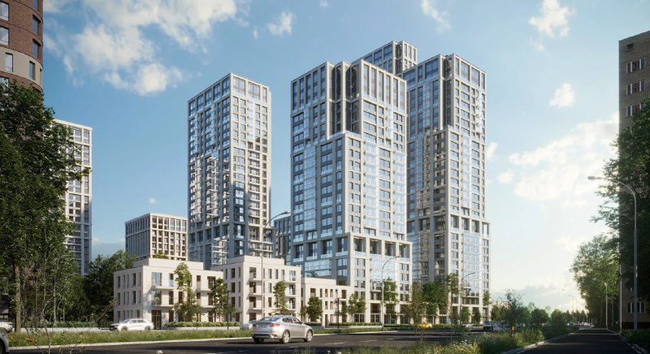
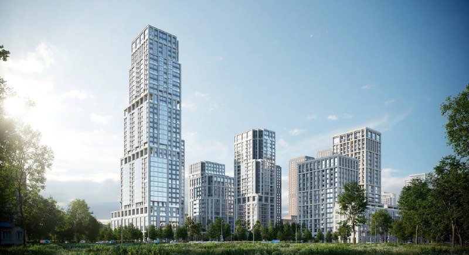

---
source:
  id: 23105
  date: 2024-04-24
status: needs_review
skip_reason: null
type: object
region: moscow
title: "Квартал «Издание» Брусники на Перовском шоссе: цены и сроки сдачи"
title_alts:
- "«Издание» на Перовском шоссе: Брусника открыла второй дом, студии от 16,4 млн ₽"
- "Брусника на участке бывшего «Фрезера»: что известно о квартале «Издание»"
slug: izdanie-brusnika-perovskoe-shosse-ceny-sroki
lead: "Брусника вывела на рынок квартал «Издание» на Перовском шоссе, 21 в апреле 2024 года; к октябрю 2026 года первый дом строится со сдачей в III квартале 2027 года, а в августе 2026-го открылись продажи во втором — 45-этажном — доме со студиями от 16,4 млн ₽."
developers:
- id: brusnika
  name: Брусника
  role: main
- id: level-group
  name: Level Group
  role: previous
objects:
- id: nizhegorodskaya
  names:
  - Нижегородская
  - Квартал «Издание»
  - Издание
  - Станкоагрегат
  - Фрезер
  zu: Перовское, 21
  main: true
  new: false
districts:
- perovo
topics:
- ceny
- rynok
images:
- file: media/23105_1.jpg
  alt: Башни квартала «Издание» от Брусники на Перовском шоссе, визуализация со стороны проезда
  caption: "Визуализация: Брусника"
  credit: "Брусника"
- file: media/23105_2.jpg
  alt: Квартал «Издание» на Перовском шоссе, 21 с высотной доминантой, визуализация
  caption: "Визуализация: Брусника"
  credit: "Брусника"
ownership_changes:
- object: nizhegorodskaya
  from: "Level Group"
  to: "Брусника"
  to_slug: brusnika
  date: "июль 2023"
  how: "Брусника договорилась с Level Group о покупке половины проекта на Перовском шоссе (участок около 4 га), цена официально не называлась"
  source: "https://www.novostroy-m.ru/novosti/brusnika_pokupaet_u_level"
factcheck:
- claim: "Брусника договорилась с Level Group о покупке половины проекта на Перовском шоссе рядом с метро «Нижегородская»: участок около 4 га, цена официально не названа (сообщение июля 2023 года со ссылкой на «Коммерсантъ»)"
  status: confirmed
  source: "https://www.novostroy-m.ru/novosti/brusnika_pokupaet_u_level"
  checked: 2026-10-13
- claim: "Level Group владеет почти 8 га на территории бывшего завода «Фрезер» (согласовано 345 тыс. м² жилья); Брусника сможет построить на своей части около 198 тыс. м²"
  status: confirmed
  source: "https://www.novostroy-m.ru/novosti/brusnika_pokupaet_u_level"
  checked: 2026-10-13
- claim: "Участок квартала «Издание» ранее принадлежал заводу «Станкоагрегат»"
  status: confirmed
  source: "https://www.novostroy-m.ru/expertise/kvartal_izdanie_2026"
  checked: 2026-10-13
- claim: "Продажи квартала «Издание» стартовали в апреле 2024 года (точная дата и стартовая цена 300,5 тыс. ₽/м² не подтверждены)"
  status: confirmed
  source: "https://www.novostroy-m.ru/expertise/kvartal_izdanie_2026"
  checked: 2026-10-13
- claim: "Разрешение на строительство Дома 1 опубликовано на сайте Брусники 01.03.2024; проектная декларация Дома 1 — 12.01.2026; Дом 2: разрешение — 04.08.2026, декларация — 30.07.2026"
  status: confirmed
  source: "https://moskva.brusnika.ru/projects/izdanie/"
  checked: 2026-10-13
- claim: "Дом 1 должен быть введён в III квартале 2027 года"
  status: confirmed
  source: "https://moskva.brusnika.ru/"
  checked: 2026-10-13
- claim: "На декабрь 2025 года первая очередь строилась на уровне около 25-го этажа, продано около 75% квартир по данным ЕИСЖС (пересказ агрегатора)"
  status: confirmed
  source: "https://www.novostroy-m.ru/expertise/kvartal_izdanie_2026"
  checked: 2026-10-13
- claim: "В августе 2026 года открыты продажи во втором доме: 45 этажей, 150 м, студия 31,3 м² от 16,4 млн ₽, предчистовая отделка, сдача в IV квартале 2030 года; первые пять этажей займут инфраструктура"
  status: confirmed
  source: "https://www.novostroy-m.ru/analitika/prodaji_kvartir_v_avguste"
  checked: 2026-10-13
- claim: "Студия 31,3 м² от 16,35 млн ₽, сдача IV квартал 2030 года (стартовая новость августа 2026 года)"
  status: confirmed
  source: "https://www.novostroy-m.ru/novosti/starty_prodaj_izdanie_i"
  checked: 2026-10-13
- claim: "ЖК «Бестселлер» (застройщик ООО «BAZA Development») на Перовском шоссе, 21: сдача корпуса 1 в I квартале 2028 года, студия 32,8 м² от 19,1 млн ₽ на 13 октября 2026 года"
  status: confirmed
  source: "https://www.novostroy-m.ru/baza/jk_bestseller"
  checked: 2026-10-13
- claim: "Стартовая цена Брусники 300,5 тыс. ₽/м² и сравнение с Level («дороже на 8%»)"
  status: unverified
  source: "—"
  checked: 2026-10-13
removed: 
- "Цена старта 300,5 тыс. ₽/м² и утверждение, что соседний проект Level дороже на 8%: независимого подтверждения не найдено."
- "Рассуждения о бренде «Квартал» и названии «Издание», оценки качества рекламных материалов: мнение автора заметки, читателю новых фактов не даёт."
- "Список планируемых проектов района («Перовское, 9/10», «Фрезер, 19», «1-я Фрезерная, 2/1», «Перовское, 7», «Фрезер, 17»): не проверялся."
- "Сравнение с «Перовское, 2» от ПИК и данные по «Нижегородской» Level (311 тыс. ₽/м², 8,4 млн ₽): события 2023 года, сегодня потеряли актуальность и не проверялись."
- "Заявление, что визуализации озеленения «нечестные»: оценка без проверки; оставлено только наше наблюдение о возрасте деревьев на картинках."
data_points: []
seo:
  main_query: "квартал издание брусника цены"
  keywords:
  - "жк издание брусника перовское шоссе"
  - "квартал издание сроки сдачи"
  - "перовское шоссе 21 новостройка"
  - "жк издание нижегородская"
  - "брусника издание второй дом"
  frequency_checked: false
  title: "Квартал «Издание» Брусники: цены, сроки сдачи, второй дом"
  description: "Квартал «Издание» на Перовском шоссе, 21: первый дом сдают в III квартале 2027 года, студии во втором доме — от 16,4 млн ₽. Что изменилось с 2024 года."
  canonical: "https://шахматка.москва/novosti/izdanie-brusnika-perovskoe-shosse-ceny-sroki/"
internal_links:
- anchor: "карточка проекта «Нижегородская» (Квартал «Издание»)"
  url: /obekty/nizhegorodskaya/
- anchor: "Level Group"
  url: /zastroyshchiki/level-group/
- anchor: "новостройки района Перово"
  url: /novostroyki/perovo/
- anchor: "проектная декларация"
  url: /slovar/proektnaya-deklaratsiya/
- anchor: "бизнес-класс"
  url: /novostroyki/biznes-klass/
faq:
- q: "Когда сдадут квартал «Издание» на Перовском шоссе?"
  a: "По данным сайта Брусники, первый дом должен быть введён в эксплуатацию в III квартале 2027 года. Для второго дома, продажи которого открылись в августе 2026 года, заявлена сдача в IV квартале 2030 года."
- q: "Сколько стоят квартиры во втором доме «Издания»?"
  a: "В августе 2026 года студия площадью 31,3 м² продавалась от 16,4 млн ₽, что составляет около 520 тыс. ₽/м² (расчёт редакции). Квартиры предлагаются с предчистовой отделкой."
- q: "Кто застройщик квартала «Издание»?"
  a: "Квартал строит Брусника. Участок на Перовском шоссе, 21 раньше принадлежал Level Group: в июле 2023 года Брусника договорилась о покупке половины проекта."
- q: "Какие ещё проекты строятся на Перовском шоссе, 21?"
  a: "На том же адресе значится ЖК «Бестселлер» от BAZA Development: сдача первого корпуса — I квартал 2028 года, студии на 13 октября 2026 года — от 19,1 млн ₽."
date_published: 2024-04-24
date_modified: 2026-10-13
author: "Редакция Шахматки"
schema: |-
  [
    {
      "@context": "https://schema.org",
      "@type": "Article",
      "headline": "Квартал «Издание» Брусники на Перовском шоссе: цены и сроки сдачи",
      "description": "Квартал «Издание» на Перовском шоссе, 21: первый дом сдают в III квартале 2027 года, студии во втором доме — от 16,4 млн ₽. Что изменилось с 2024 года.",
      "datePublished": "2024-04-24",
      "dateModified": "2026-10-13",
      "inLanguage": "ru",
      "author": {"@type": "Organization", "name": "Редакция Шахматки"},
      "publisher": {"@type": "Organization", "name": "Шахматка", "url": "https://шахматка.москва/"},
      "mainEntityOfPage": {"@type": "WebPage", "@id": "https://шахматка.москва/novosti/izdanie-brusnika-perovskoe-shosse-ceny-sroki/"},
      "image": ["https://шахматка.москва/media/23105_1.jpg", "https://шахматка.москва/media/23105_2.jpg"],
      "about": [
        {"@type": "Residence", "name": "Квартал «Издание»", "address": {"@type": "PostalAddress", "addressLocality": "Москва", "streetAddress": "Перовское шоссе, 21"}},
        {"@type": "Organization", "name": "Брусника"}
      ]
    },
    {
      "@context": "https://schema.org",
      "@type": "FAQPage",
      "mainEntity": [
        {"@type": "Question", "name": "Когда сдадут квартал «Издание» на Перовском шоссе?", "acceptedAnswer": {"@type": "Answer", "text": "По данным сайта Брусники, первый дом должен быть введён в эксплуатацию в III квартале 2027 года. Для второго дома, продажи которого открылись в августе 2026 года, заявлена сдача в IV квартале 2030 года."}},
        {"@type": "Question", "name": "Сколько стоят квартиры во втором доме «Издания»?", "acceptedAnswer": {"@type": "Answer", "text": "В августе 2026 года студия площадью 31,3 м² продавалась от 16,4 млн ₽, что составляет около 520 тыс. ₽/м² (расчёт редакции). Квартиры предлагаются с предчистовой отделкой."}},
        {"@type": "Question", "name": "Кто застройщик квартала «Издание»?", "acceptedAnswer": {"@type": "Answer", "text": "Квартал строит Брусника. Участок на Перовском шоссе, 21 раньше принадлежал Level Group: в июле 2023 года Брусника договорилась о покупке половины проекта."}},
        {"@type": "Question", "name": "Какие ещё проекты строятся на Перовском шоссе, 21?", "acceptedAnswer": {"@type": "Answer", "text": "На том же адресе значится ЖК «Бестселлер» от BAZA Development: сдача первого корпуса — I квартал 2028 года, студии на 13 октября 2026 года — от 19,1 млн ₽."}}
      ]
    }
  ]
editor_notes: "Статус needs_review: старт продаж в апреле 2024 года подтверждён только агрегатором «Новострой-М» и косвенно документами на сайте Брусники (разрешение на Дом 1 — 01.03.2024); данные по Дому 2 и «Бестселлеру» тоже из СМИ/агрегатора, в ЕИСЖС и на страницах застройщиков цены не открываются. Не подтверждены и убраны: стартовая цена 300,5 тыс. ₽/м² и сравнение с Level. Из досье не использована сделка «BAZA купила проект у Level (декабрь 2024)»: подтвердилось лишь, что BAZA Development сейчас застройщик «Бестселлера» на Перовском шоссе, 21, поэтому в ownership_changes только сделка Level → Брусника (июль 2023, «договорилась о покупке»); дата передачи участка по досье — 28.08.2023. Расхождения: агрегаторы называют район Нижегородским, в досье — Перово (/novostroyki/perovo/); цена 369 тыс. ₽/м² из хронологии досье не подтвердилась, из расчёта по студии выходит около 520 тыс. ₽/м², возможно, 369 — средняя по дому. Брусника и застройщик «Бестселлера» не в пакете: слаги brusnika и baza-development — придуманные, ссылок на них нет. Бюджет: 5 запросов WebSearch и 9 вызовов WebFetch (два из них без содержимого: редирект и ошибка), то есть на один вызов больше лимита в 8 — человеку стоит знать."
---

# Квартал «Издание» Брусники на Перовском шоссе: цены и сроки сдачи

Брусника вывела на рынок квартал «Издание» на участке бывшего завода «Станкоагрегат» в апреле 2024 года. К октябрю 2026 года первый дом строится со сдачей в III квартале 2027 года, а в августе 2026-го открылись продажи во втором — 45-этажном — с ценой от 16,4 млн ₽ за студию.

**Коротко**

- Квартал «Издание» на Перовском шоссе, 21 — проект Брусники; продажи стартовали в апреле 2024 года.
- Первый дом сдают в III квартале 2027 года; по данным ЕИСЖС, на декабрь 2025 года в нём было продано около 75% квартир.
- Второй дом — 45 этажей и 150 м, продажи открыты в августе 2026 года, сдача заявлена в IV квартале 2030 года.
- Студия 31,3 м² во втором доме — от 16,4 млн ₽, то есть около 520 тыс. ₽/м² (расчёт редакции).

## Кто застройщик квартала «Издание» и откуда взялся участок

Участок на Перовском шоссе, 21 раньше занимал завод «Станкоагрегат», а рынок знал его и как площадку бывшего «Фрезера». Проектом сначала занималась [Level Group](/zastroyshchiki/level-group/): по данным СМИ, ей принадлежало почти 8 га на территории бывшего завода, где согласовано 345 тыс. м² жилья.

В июле 2023 года Брусника договорилась с Level о покупке половины проекта — участка около 4 га. Цена официально не называлась; на свою часть Брусника получила возможность построить около 198 тыс. м² жилья. Так на одной площадке стало два девелопера. Полная история участка и проекта — в [досье «Нижегородская» (Квартал «Издание»)](/obekty/nizhegorodskaya/).

*Визуализация: Брусника*

## Что произошло в апреле 2024 года

В апреле 2024 года Брусника открыла продажи первого дома квартала. На сайте компании к этому времени уже висело разрешение на строительство Дома 1: оно опубликовано 1 марта 2024 года. Стартовую цену за метр в те дни называли около 300 тыс. ₽, но подтвердить её независимыми источниками не удалось, поэтому мы её не приводим.

Агрегаторы относят проект к бизнес-классу. На визуализациях застройщика двор выглядит как зрелый сквер с высокими деревьями. На наш взгляд, такого озеленения в первые годы после сдачи ждать не стоит: деревьям нужно время, поэтому сравнивать лучше с готовым двором, а не с рендером.

## Что с проектом сейчас

Все данные ниже — по состоянию на 13 октября 2026 года.

**Первый дом.** Сдача заявлена на III квартал 2027 года. По пересказу данных ЕИСЖС в обзоре агрегатора «Новострой-М», в декабре 2025 года строительство шло примерно на уровне 25-го этажа, а продано было около 75% квартир. Версия [проектной декларации](/slovar/proektnaya-deklaratsiya/) опубликована 12 января 2026 года; перед сделкой её стоит читать целиком.

**Второй дом.** Проектная декларация опубликована 30 июля 2026 года, разрешение на строительство — 4 августа 2026 года. В августе 2026 года стартовали продажи: 45-этажная башня высотой 150 м, на первых пяти этажах — инфраструктура, в том числе детский клуб и соседский центр. Студия 31,3 м² стоит от 16,4 млн ₽, отделка предчистовая, сдача — IV квартал 2030 года. До сдачи, таким образом, почти четыре года.

*Визуализация: Брусника*

## Что это значит для покупателя и инвестора

Первый дом уже в высокой стадии готовности и почти распродан: выбор там ограничен, зато срок сдачи ближе. Во втором доме срок до ключей — более четырёх лет, а значит, дольше заморожены деньги и выше риск пересмотра условий. Эскроу-счета по [договору долевого участия](/slovar/ddu/) защищают средства покупателя, но не дают гарантии срока.

Для оценки цены полезен сосед на том же адресе: ЖК «Бестселлер» от BAZA Development. По данным агрегатора на 13 октября 2026 года, первый корпус сдают в I квартале 2028 года, а студия 32,8 м² стоит от 19,1 млн ₽, то есть около 580 тыс. ₽/м² (расчёт редакции). Сравнивать цены напрямую нельзя: сроки, отделка и этажи у проектов разные, а данные агрегатора расходятся в деталях. На наш взгляд, это лишь грубый ориентир: на участке студии сейчас предлагают примерно за 520–580 тыс. ₽/м².

Что отслеживать: темпы строительства первого дома, динамику продаж во втором и условия в проектных декларациях. Ещё один фактор — транспорт: проект находится рядом с ТПУ «Нижегородская», но, по данным агрегатора, до МЦД «Перово» около 12 минут пешком, до станции «Нижегородская» — около 20. Соседние проекты и другие предложения района — в подборке [новостроек Перова](/novostroyki/perovo/), а вся линейка по классу — в разделе [бизнес-класса](/novostroyki/biznes-klass/).

## Карточка объекта

- **Адрес участка:** Москва, Перовское шоссе, 21 (Нижегородский район, ЮВАО)
- **Названия:** Квартал «Издание», «Издание»; ранее — «Нижегородская», «Станкоагрегат», «Фрезер»
- **Застройщик:** Брусника (участок получен от Level Group)
- **Класс:** бизнес
- **Дом 1:** сдача — III квартал 2027 года
- **Дом 2:** 45 этажей, 150 м; сдача — IV квартал 2030 года; отделка предчистовая
- **Цена:** во втором доме студия 31,3 м² — от 16,4 млн ₽ (август 2026 года)

## Вопросы и ответы

**Когда сдадут квартал «Издание» на Перовском шоссе?**
По данным сайта Брусники, первый дом должен быть введён в эксплуатацию в III квартале 2027 года. Для второго дома, продажи которого открылись в августе 2026 года, заявлена сдача в IV квартале 2030 года.

**Сколько стоят квартиры во втором доме «Издания»?**
В августе 2026 года студия площадью 31,3 м² продавалась от 16,4 млн ₽, что составляет около 520 тыс. ₽/м² (расчёт редакции). Квартиры предлагаются с предчистовой отделкой.

**Кто застройщик квартала «Издание»?**
Квартал строит Брусника. Участок на Перовском шоссе, 21 раньше принадлежал Level Group: в июле 2023 года Брусника договорилась о покупке половины проекта.

**Какие ещё проекты строятся на Перовском шоссе, 21?**
На том же адресе значится ЖК «Бестселлер» от BAZA Development: сдача первого корпуса — I квартал 2028 года, студии на 13 октября 2026 года — от 19,1 млн ₽.

## Источники

1. [Страница проекта «Издание» на сайте Брусники](https://moskva.brusnika.ru/projects/izdanie/) — даты публикации разрешений и проектных деклараций.
2. [Главная страница Брусники в Москве](https://moskva.brusnika.ru/) — срок ввода Дома 1.
3. [«Новострой-М»: «Брусника покупает у Level»](https://www.novostroy-m.ru/novosti/brusnika_pokupaet_u_level) — сделка 2023 года, площадь участка и объёмы.
4. [«Новострой-М»: обзор «Квартал Издание»](https://www.novostroy-m.ru/expertise/kvartal_izdanie_2026) — старт продаж, готовность и распроданность по данным ЕИСЖС.
5. [«Новострой-М»: старты продаж в августе](https://www.novostroy-m.ru/analitika/prodaji_kvartir_v_avguste) — второй дом, цена и срок.
6. [«Новострой-М»: старт продаж «Издание»](https://www.novostroy-m.ru/novosti/starty_prodaj_izdanie_i) — цена студии, этажность, срок.
7. [«Новострой-М»: ЖК «Бестселлер»](https://www.novostroy-m.ru/baza/jk_bestseller) — застройщик BAZA Development, цены и сроки на 13 октября 2026 года.

Материал не является инвестиционной рекомендацией.
