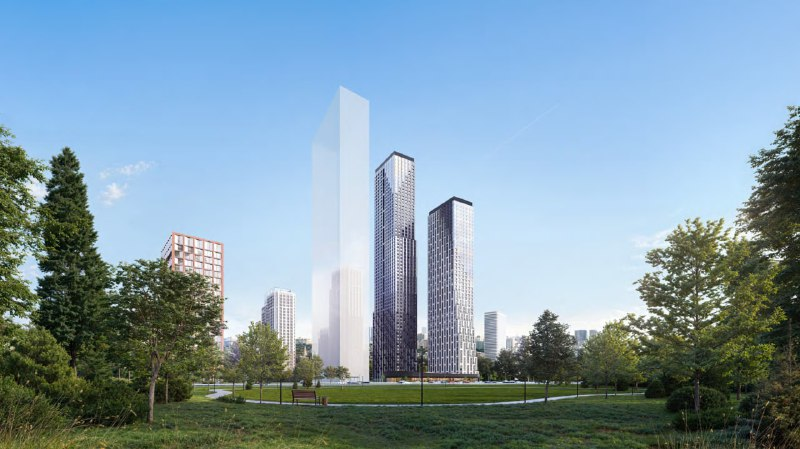

# Level Звенигородская: старт продаж, цены и сдача в 2028 году

Level Group открыла продажи первого этапа ЖК «Level Звенигородская» на 3-м Силикатном проезде в мае 2024 года. К 14 октября 2026 года башни строятся, сдача намечена на I и II кварталы 2028 года, а в продаже, по данным каталога, остаётся 112 квартир из 1114.

## Коротко

- Старт продаж первого этапа: май 2024 года (сообщение от 6 мая 2024 года). Застройщик — ООО СЗ «Звенигородская Инвест», проект ведёт [Level Group](/zastroyshchiki/level-group/).
- Две башни от 48 до 64 этажей, 1114 квартир, 350 машино-мест; класс — комфорт+.
- На старте самая дешёвая квартира (17,3 кв. м) стоила от 9,8 млн ₽.
- По состоянию на 14 октября 2026 года: стадия — отделка фасадов, сдача — I и II кварталы 2028 года, в продаже 112 квартир.

## Что известно о старте продаж Level Звенигородская

Проект находится на 3-м Силикатном проезде, вл. 6, в районе Хорошёво-Мнёвники (СЗАО). Ближайшая станция метро — «Звенигородская».

В сообщении о старте продаж говорилось: первый этап включает 1114 квартир площадью от 17,3 кв. м и 350 машино-мест, высота зданий — от 48 до 64 этажей, ключи — во II квартале 2028 года. Продажи по [ДДУ](/slovar/ddu/) идут через [эскроу-счета](/slovar/eskrou-schet/).

Цену за квадратный метр на старте мы подтвердить не смогли: в сообщении о запуске указана только цена от 9,8 млн ₽ за самый маленький лот. Цифру 402 тыс. ₽/м² из исходной заметки в статью мы не включаем.

*Визуализация: Level Group. Жилые башни проекта (1).*

## Что с проектом сейчас

По данным каталога Новострой-М на 14 октября 2026 года:

- **Стадия.** Отделка фасадов у обоих корпусов и паркинга.
- **Сроки.** Корпус 1 — II квартал 2028 года, корпус 2 и подземный паркинг — I квартал 2028 года.
- **Продажи.** В продаже 112 квартир из 1114. Актуальная проектная декларация первого этапа датирована 8 июня 2026 года (предыдущие — 3 мая и 10 июня 2024 года).
- **Цены.** Новострой-М указывает квартиры от 15,4 до 58,4 млн ₽, на Яндекс Недвижимости минимальные цены по типам квартир выше: студии от 24,3 млн ₽. Данные площадок обновляются независимо, цены нужно сверять у застройщика.

Полная история проекта — в [досье «Звенигородская»](/obekty/zvenigorodskaya/).

## Что это значит для покупателя и инвестора

Проект уже на стадии фасадов, а остаток квартир невелик: это снижает риск «стройки с нуля», но выбор на 14 октября 2026 года ограничен. Срок сдачи на 2028 год остаётся сроком по документам, а не фактом: перед сделкой его стоит сверить с проектной декларацией на наш.дом.рф.

На наш взгляд, локация рядом с метро «Звенигородская» и башни высотой до 64 этажей — главные плюсы и главный вопрос проекта: плотность застройки и качество среды вокруг каждый покупатель должен оценить на месте. Данных об истории цен и темпе продаж в открытых источниках немного, поэтому прогноз роста цены мы не даём. Другие проекты девелопера — например, [Level Войковская](/novosti/level-voykovskaya-staropetrovskiy-ceny-sroki/); общий фон — в разделе [цены на новостройки](/temy/ceny/) и в подборке [новостроек Москвы](/novostroyki/moskva/).

## Карточка объекта

- **Название:** Level Звенигородская.
- **Адрес участка:** Москва, 3-й Силикатный проезд, вл. 6 (район Хорошёво-Мнёвники, СЗАО).
- **Застройщик:** ООО СЗ «Звенигородская Инвест» (Level Group).
- **Класс:** комфорт+.
- **Корпуса:** две жилые башни 48–64 этажа и подземный паркинг на 350 машино-мест (первый этап).
- **Квартиры:** 1114 в первом этапе, в продаже 112.
- **Стадия:** отделка фасадов.
- **Срок сдачи:** I–II кварталы 2028 года.
- **Цена:** по данным площадок — от 15,4 млн ₽ (Новострой-М); единой цены за метр нет.

## Вопросы и ответы

**Кто застройщик ЖК Level Звенигородская?**
Проект ведёт Level Group; в сообщении о старте продаж застройщиком названо ООО СЗ «Звенигородская Инвест». Адрес: 3-й Силикатный проезд, вл. 6, район Хорошёво-Мнёвники.

**Когда сдадут Level Звенигородская?**
По данным Новострой-М на 14 октября 2026 года, корпус 2 и паркинг сдают в I квартале 2028 года, корпус 1 — во II квартале 2028 года. При старте продаж в мае 2024 года заявляли II квартал 2028 года.

**Сколько квартир в первом этапе?**
В сообщении о старте продаж в мае 2024 года названо 1114 квартир и 350 машино-мест в двух башнях высотой от 48 до 64 этажей.

**Сколько стоят квартиры в Level Звенигородская?**
Данные площадок расходятся: Новострой-М на 14 октября 2026 года указывает цены от 15,4 до 58,4 млн ₽, Яндекс Недвижимость — студии от 24,3 млн ₽. На старте в мае 2024 года самая дешёвая квартира площадью 17,3 кв. м стоила от 9,8 млн ₽.

## Источники

1. [Level Group открыла продажи Level Звенигородская — РБК Недвижимость, 6 мая 2024 года](https://realty.rbc.ru/amp/news/662294129a794729e788142f) — застройщик, адрес, квартиры, машино-места, этажность, цена от 9,8 млн ₽, срок.
2. [ЖК «Level Звенигородская» — каталог Новострой-М](https://www.novostroy-m.ru/baza/jk_3y_silikatnyy_proezd) — класс, сроки, стадия, остаток квартир, проектные декларации, цены.
3. [Продажи в «Level Звенигородская» открыты — Новострой-М, 6 мая 2024 года](https://www.novostroy-m.ru/novosti/jk_level_zvenigorodskaya_i) — подтверждение старта продаж и параметров первого этапа.
4. [ЖК «Левел Звенигородская» — Яндекс Недвижимость](https://realty.yandex.ru/moskva_i_moskovskaya_oblast/kupit/novostrojka/dvuhkomnatnaya/z-level-group-521490/) — минимальные цены по типам квартир.
5. [Карточка квартиры в Level Звенигородская — Новострой-М](https://www.novostroy-m.ru/kvartiry/studiya-v-level-zvenigorodskaya-a9905993b96b23faec08c3d475e850) — адрес, район и транспорт.

Материал не является инвестиционной рекомендацией.
