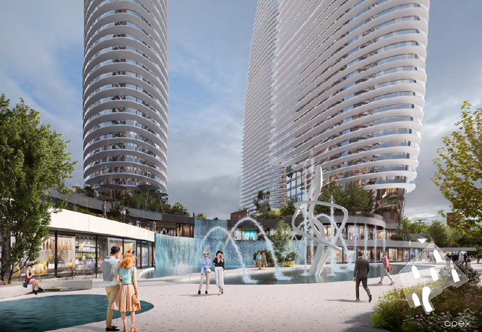

---
source:
  id: 23395
  date: 2024-05-13
status: needs_review
skip_reason: null
type: architecture
region: moscow
title: 'Кутузовский, 12, 14А: «Киевская площадь» показала башни-паруса до 250 м'
title_alts:
- 'Небоскрёбы на набережной Тараса Шевченко: что известно о проекте «Киевской площади»'
- 'Проект «Киевской площади» на Кутузовском, 12, 14А: башни до 250 м, 335–370 тыс. м²'
slug: kutuzovskiy-12-14a-kievskaya-ploshchad-bashni
lead: 'Группа «Киевская площадь» показала проект комплекса на бывшей карандашной фабрике у Кутузовского проспекта: башни до 250 м и около 370 тыс. м². Согласованная в 2023 году площадь меньше — 335 тыс. м².'
developers:
- id: kievskaya-ploshchad
  name: Киевская площадь
  role: main
objects:
- id: kutuzovskiy-12-14a
  names:
  - Кутузовский, 12, 14А
  zu: Кутузовский, 12, 14А
  main: true
  new: false
- id: badaevskiy
  names:
  - Бадаевский
  main: false
  new: false
districts: []
topics:
- regulirovanie
images:
- file: media/23395_4.jpg
  alt: Визуализация площади с фонтаном между двумя башнями-парусами комплекса на Кутузовском, 12, 14А, Москва
  caption: 'Визуализация общественного пространства между башнями: фонтан и торговые павильоны. На изображении знак бюро APEX'
  credit: 'Визуализация: «Киевская площадь», APEX'
factcheck:
- claim: 'В сентябре 2023 года городские власти (ГЗК) одобрили документы на комплекс на территории бывшей карандашной фабрики «Сакко и Ванцетти»: предельная высота 250 м, 335 тыс. м² недвижимости; девелопер — структуры «Киевской площади»'
  status: confirmed
  source: https://moskvichmag.ru/?p=319976
  checked: 2026-10-13
- claim: «Согласовано 358 тыс. м² жилья и 12 тыс. м² нежилья» (заметка) → согласованные в 2023 году 335 тыс. м², а ~370 тыс. м² (в том числе ~12 тыс. м² нежилых) — показанный в 2024 году проект
  status: changed
  source: https://moskvichmag.ru/?p=360854
  checked: 2026-10-13
- claim: 'Май 2024: проект из пяти башен-парусов, у зданий площадь с фонтаном, апартаменты с открытыми террасами'
  status: confirmed
  source: https://moskvichmag.ru/?p=360854
  checked: 2026-10-13
- claim: Рядом расположены «Бадаевский» и ЖК от «Абсолюта»
  status: confirmed
  source: https://moskvichmag.ru/?p=319976
  checked: 2026-10-13
- claim: 'Высота башен «от 180 до 250 м»: подтверждено только «до 250 м»'
  status: changed
  source: https://moskvichmag.ru/?p=319976
  checked: 2026-10-13
removed:
- 'Высота «от 180 м»: нижняя граница не подтверждена'
- 'Версия, что «Апекс — адаптант» и сравнения с Дубаем: догадка и оценка заметки'
- 'Вывод, что к Кутузовскому проспекту башни стоят «попой»: мнение'
- 'Рассуждения о том, кто будет продавать проект и о партнёрстве с «фи-девелопером»: слухи'
- 'Сопоставления с «Бадаевским» Capital и с проектом Vesper, ожидания по продажам и покупки «10–20 квартир»: не подтверждены'
- 'Одобрение Москомархитектуры в апреле 2025 года и изменения 2026 года по досье: источник — только телеграм-канал, независимо не подтверждено'
- 'Сведения о текущей стадии проекта (разрешение на строительство, продажи): в открытых источниках не найдены'
data_points: []
seo:
  main_query: кутузовский 12 14а киевская площадь проект
  keywords:
  - небоскребы набережная тараса шевченко
  - киевская площадь башни 250 метров
  - карандашная фабрика сакко и ванцетти проект
  - бадаевский соседний проект
  frequency_checked: false
  title: 'Кутузовский, 12, 14А: проект «Киевской площади», башни 250 м'
  description: 'Проект «Киевской площади» на Кутузовском, 12, 14А: пять башен до 250 м, согласованные в 2023 году 335 тыс. м² и показанные в 2024 году около 370 тыс. м².'
  canonical: https://шахматка.москва/novosti/kutuzovskiy-12-14a-kievskaya-ploshchad-bashni/
internal_links:
- anchor: история участка и соседнего проекта — в досье «Бадаевский»
  url: /obekty/badaevskiy/
- anchor: «Абсолюта»
  url: /zastroyshchiki/absolyut/
- anchor: Градостроительно-земельная комиссия (ГЗК)
  url: /slovar/gzk/
- anchor: ТЭП
  url: /slovar/tep/
- anchor: новостройки Москвы
  url: /novostroyki/moskva/
faq:
- q: Что планируют построить на Кутузовском, 12, 14А?
  a: Группа «Киевская площадь» готовит комплекс на территории бывшей карандашной фабрики «Сакко и Ванцетти». В 2024 году показан проект из пяти башен-парусов высотой до 250 м.
- q: Какая площадь согласована для проекта?
  a: В сентябре 2023 года городские власти одобрили документы на 335 тыс. м² при предельной высоте 250 м. Около 370 тыс. м², из них около 12 тыс. м² нежилых, — параметры показанного в 2024 году проекта.
- q: Кто девелопер проекта на Кутузовском, 12, 14А?
  a: Девелопер — структуры группы «Киевская площадь», которым принадлежат торговые центры «Депо» и «Европейский».
- q: Можно ли сейчас купить квартиру в этом проекте?
  a: Подтверждений того, что продажи начались или получено разрешение на строительство, мы не нашли.
date_published: 2024-05-13
date_modified: 2026-10-13
author: Редакция Шахматки
schema: |
  [{"@context": "https://schema.org", "@type": "Article", "headline": "Кутузовский, 12, 14А: «Киевская площадь» показала башни-паруса до 250 м", "description": "Проект «Киевской площади» на Кутузовском, 12, 14А: пять башен до 250 м, согласованные в 2023 году 335 тыс. м² и показанные в 2024 году около 370 тыс. м².", "datePublished": "2024-05-13", "dateModified": "2026-10-13", "author": {"@type": "Organization", "name": "Редакция Шахматки"}, "publisher": {"@type": "Organization", "name": "Шахматка", "url": "https://шахматка.москва"}, "about": {"@type": "Place", "name": "Участок Кутузовский, 12, 14А", "address": {"@type": "PostalAddress", "streetAddress": "Кутузовский проспект, 12, 14А", "addressLocality": "Москва"}}, "mainEntityOfPage": {"@type": "WebPage", "@id": "https://шахматка.москва/novosti/kutuzovskiy-12-14a-kievskaya-ploshchad-bashni/"}}, {"@context": "https://schema.org", "@type": "FAQPage", "mainEntity": [{"@type": "Question", "name": "Что планируют построить на Кутузовском, 12, 14А?", "acceptedAnswer": {"@type": "Answer", "text": "Группа «Киевская площадь» готовит комплекс на территории бывшей карандашной фабрики «Сакко и Ванцетти». В 2024 году показан проект из пяти башен-парусов высотой до 250 м."}}, {"@type": "Question", "name": "Какая площадь согласована для проекта?", "acceptedAnswer": {"@type": "Answer", "text": "В сентябре 2023 года городские власти одобрили документы на 335 тыс. м² при предельной высоте 250 м. Около 370 тыс. м², из них около 12 тыс. м² нежилых, — параметры показанного в 2024 году проекта."}}, {"@type": "Question", "name": "Кто девелопер проекта на Кутузовском, 12, 14А?", "acceptedAnswer": {"@type": "Answer", "text": "Девелопер — структуры группы «Киевская площадь», которым принадлежат торговые центры «Депо» и «Европейский»."}}, {"@type": "Question", "name": "Можно ли сейчас купить квартиру в этом проекте?", "acceptedAnswer": {"@type": "Answer", "text": "Подтверждений того, что продажи начались или получено разрешение на строительство, мы не нашли."}}]}]
editor_notes: 'Проект выделен из досье «Бадаевский» в отдельное досье kutuzovskiy-12-14a (13.10.2026). Статус needs_review: ключевые параметры (370 тыс. м², пять башен) известны из СМИ, опиравшихся на материалы телеграм-канала; актуальные данные 2026 года (рост площади до 369 тыс. м², ГЗК, разрешение) найти не удалось. Права на визуализацию подтверждает пресс-служба: на изображении знак APEX, но авторство материалов не подтверждено. Другие 6 фото заметки не взяты: водяной знак канала, красные стрелки, слайд-схема с пометками.'
---
# Кутузовский, 12, 14А: «Киевская площадь» показала башни-паруса до 250 м

Группа «Киевская площадь» показала проект комплекса на участке «Кутузовский, 12, 14А»: пять башен-парусов высотой до 250 м. Показанная площадь — около 370 тыс. м² — больше, чем одобрили в 2023 году.

*Визуализация общественного пространства между башнями: фонтан и торговые павильоны. На изображении знак бюро APEX. Визуализация: «Киевская площадь», APEX*

## Коротко

- Участок — территория бывшей карандашной фабрики «Сакко и Ванцетти» между Кутузовским проспектом и набережной Тараса Шевченко.
- В сентябре 2023 года городские власти одобрили документы: предельная высота 250 м, 335 тыс. м² недвижимости.
- Проект, показанный в мае 2024 года, — пять башен и около 370 тыс. м², из них около 12 тыс. м² нежилых.
- Стадию проекта на 13 октября 2026 года подтвердить не удалось.

## Что показали и что согласовано

В сентябре 2023 года [Градостроительно-земельная комиссия (ГЗК)](/slovar/gzk/) одобрила документы на комплекс. Предельная высота — 250 м, это выше гостиницы «Украина»; площадь — 335 тыс. м². Девелопер — структуры «Киевской площади», которым принадлежат торговые центры «Депо» и «Европейский».

В мае 2024 года появились визуализации. Башни имеют вид парусов, у зданий — площадь с фонтаном, апартаменты показаны с открытыми террасами. Параметры такого проекта — около 370 тыс. м², из них около 12 тыс. м² не под жильё.

Важная оговорка. В исходной заметке цифры 358 тыс. м² жилья и 12 тыс. м² нежилья названы согласованными. По нашей проверке, подтверждена другая цифра: 335 тыс. м² в 2023 году. Большая площадь — параметры показанного проекта, а не решение комиссии. На наш взгляд, разницу в [ТЭП](/slovar/tep/) придётся согласовывать отдельно.

## Контекст: соседи и история участка

Рядом находятся [«Бадаевский»](/obekty/badaevskiy/) Capital Group и [oda gallery](/obekty/oda-gallery/) «Абсолюта». На участке раньше планировали штаб-квартиру «Роснефти», но речь шла об офисах меньшей площади, а фабрика к 2023 году была снесена.

Участок и соседние проекты в базе «Шахматки» объединены в одно досье: история участка и соседнего проекта — в [досье участка «Кутузовский, 12, 14А»](/obekty/kutuzovskiy-12-14a/).

## Что с проектом сейчас

По состоянию на 13 октября 2026 года мы не нашли в проверенных источниках подтверждений, что на участке получено разрешение на строительство, начаты работы или открыты продажи. Сообщения о более поздних согласованиях опираются на материалы телеграм-каналов, поэтому в статью не вошли.

## Что это значит для покупателя и инвестора

Подтверждённых продаж в этом проекте нет, поэтому оценивать цену и сроки пока не на чем. На наш взгляд, главные вопросы — согласует ли город рост площади с 335 до 370 тыс. м² и кто выведет проект на рынок.

Следить стоит за новыми решениями городских комиссий, разрешением на строительство и проектной декларацией. Любые цены до этого — предположения.

## Вопросы и ответы

**Что планируют построить на Кутузовском, 12, 14А?**
Комплекс на территории бывшей карандашной фабрики «Сакко и Ванцетти». В 2024 году показан проект из пяти башен-парусов высотой до 250 м.

**Какая площадь согласована для проекта?**
В сентябре 2023 года одобрено 335 тыс. м² при предельной высоте 250 м. Около 370 тыс. м² — параметры проекта, показанного в 2024 году.

**Кто девелопер проекта?**
Структуры группы «Киевская площадь», которым принадлежат торговые центры «Депо» и «Европейский».

**Можно ли сейчас купить квартиру в проекте?**
Подтверждений начала продаж или разрешения на строительство мы не нашли.

## Источники

1. [«Москвич Mag»: на Кутузовском одобрили строительство высоток до 250 метров, 19 сентября 2023 года](https://moskvichmag.ru/?p=319976)
2. [«Москвич Mag»: проект небоскрёбов-парусников на набережной Тараса Шевченко, 14 мая 2024 года](https://moskvichmag.ru/?p=360854)

Материал не является инвестиционной рекомендацией.
