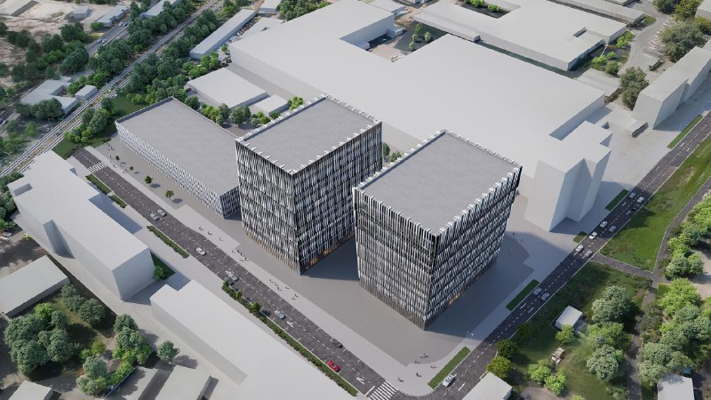

# Glorax Business Римская: офисы B+ на Перовском проезде, сдача 2028

В июне 2024 года [GloraX](/zastroyshchiki/glorax/) вывела на рынок офисный проект «Glorax Business Римская» на Перовском проезде в Лефортове. К 14 октября 2026 года на сайте застройщика он называется «Бизнес на Римской», в нём 12 этажей, класс B+, срок — второй квартал 2028 года, а старт продаж по-прежнему «скоро».

## Коротко

- Адрес по данным застройщика: Москва, Перовский проезд, владение 54, [Лефортово](/novostroyki/lefortovo/).
- Класс B+, 12 этажей (в июне 2024 года проект выходил на 13 этажей).
- Офисы — от 51 до 2065 м², благоустроенная территория — 10 488 м².
- Срок завершения — второй квартал 2028 года; цены на сайте не опубликованы.

## Что представила GloraX

В июне 2024 года застройщик показал офисный центр на участке «Перовский, 54»: тогда речь шла о здании на 13 этажей класса B+. Название в проекте сменилось: теперь на сайте GloraX это «Бизнес на Римской», а адрес остался прежним.

*(1) Визуализация офисных корпусов проекта, вид сверху. Версия 2024 года, параметры могли измениться. Визуализация: GloraX*

## Что с проектом сейчас

По состоянию на 14 октября 2026 года страница проекта на сайте GloraX описывает его как современный бизнес-центр класса B+ на 12 этажей. Было → стало: 13 этажей в июне 2024 года, 12 этажей в октябре 2026 года.

Срок завершения — второй квартал 2028 года. Статус — «Скоро старт продаж», на главной странице — «Скоро в продаже». Прошло больше двух лет после показа проекта, но продажи офисов, судя по сайту, не открыты, а цены не названы.

Общую площадь здания застройщик на странице не приводит: указаны только размеры офисов и площадь благоустройства. Поэтому цифры 53, 60 и 42 тыс. м², которые встречались в источниках раньше, мы не используем. Разрешение на строительство и положительное заключение экспертизы мы подтвердить не смогли.

Полная история проекта — в [досье «Перовский, 54»](/obekty/perovskiy-54/).

## Что это значит для покупателя и инвестора

Для покупателя офиса пока нет главного: цены, договора и подтверждённой стадии стройки. На наш взгляд, до публикации проектной декларации и цен оценивать доходность рано, а любые сравнения с соседними офисными центрами будут догадками.

Что отслеживать: старт продаж и цену за м², разрешение на строительство, фактическую площадь здания, срок второго квартала 2028 года. Общий фон по офисным проектам — в теме [рынок](/temy/rynok/).

## Карточка объекта

- Название: «Бизнес на Римской» (Glorax Business Римская, «Перовский, 54»).
- Адрес: Москва, Перовский проезд, вл. 54, Лефортово.
- Застройщик: [GloraX](/zastroyshchiki/glorax/).
- Класс: B+, 12 этажей.
- Офисы: от 51 до 2065 м².
- Срок: второй квартал 2028 года.
- Стадия: «скоро старт продаж».

## Вопросы и ответы

**Где находится Glorax Business Римская?**
По данным сайта застройщика, проект расположен в Москве, на Перовском проезде, владение 54, в районе Лефортово.

**Какой класс и этажность у бизнес-центра GloraX на Римской?**
Застройщик называет проект бизнес-центром класса B+ высотой 12 этажей. В июне 2024 года проект выходил на 13 этажей.

**Когда сдадут «Бизнес на Римской»?**
На сайте GloraX указан второй квартал 2028 года.

**Можно ли сейчас купить офис в «Бизнесе на Римской»?**
На 14 октября 2026 года статус на сайте застройщика — «Скоро старт продаж», цены не опубликованы.

## Источники

1. [Бизнес на Римской (GloraX) — страница проекта на сайте застройщика](https://glorax.com/projects/glorax-business-rimskaia)
2. [GloraX — главная страница застройщика](https://glorax.com)

Материал не является инвестиционной рекомендацией.
