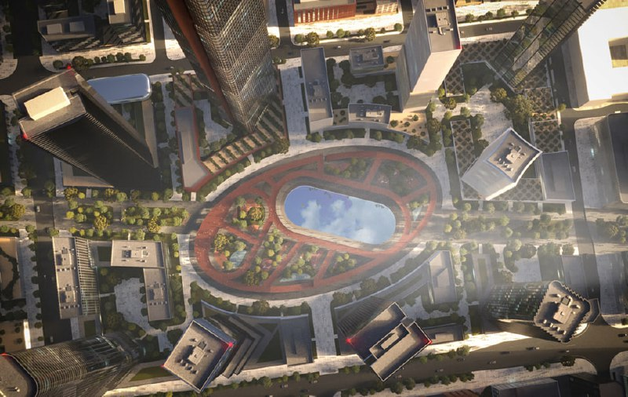
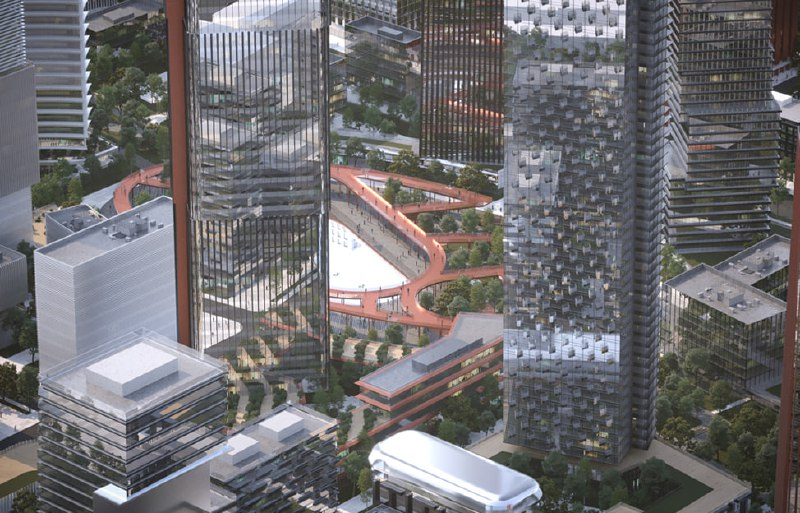

# МИГ на Динамо: Capital Group получила КРТ на 1,4 млн м² жилья

На месте авиазавода МиГ у метро «Динамо» строят не квартал, а целый район. Город утвердил проект планировки территории: [Capital Group](/zastroyshchiki/capital-group/) возведёт здесь более 2,3 млн м² недвижимости, из них 1,4 млн м² — жильё. Первый мастерплан показали ещё в июне 2024 года. А вот цен и даты старта продаж на 13 октября 2026 года официально так и нет.

## Коротко

- **Решение:** проект планировки на 89,97 га (из них 63,55 га — завод «МиГ») утвердили в октябре 2024 года в рамках [комплексного развития территории (КРТ)](/slovar/krt/).
- **Масштаб:** свыше 2,3 млн м² застройки, жилой квартал — более 1,4 млн м², вложения — не менее 300 млрд ₽.
- **Социалка:** детсады на 750 мест, школы на 2,8 тыс. учеников, поликлиника на 750 посещений в смену.
- **Чего нет:** цен, даты старта продаж и сроков сдачи.

## Город расчертил авиазавод

Участок лежит в Беговом районе, на пересечении Ленинградского проспекта, 1-го Боткинского проезда и улицы Маршала Шапошникова. Рядом — станции метро «Динамо» и «Петровский парк».

Город утвердил проект планировки на 89,97 га. По данным мэрии, инвестор построит свыше 2,3 млн м² недвижимости. Больше 1,4 млн м² займёт жилой квартал — сюда входит и жильё для программы реновации и других нужд города. Ещё около 940 тыс. м² отдадут под социальные и общественно-деловые объекты.

Социальный набор такой: детские сады на 750 мест, школы на 2,8 тыс. учеников, детско-взрослая поликлиника на 750 посещений в смену и многофункциональный комплекс с бассейном. Инвестор, по данным мэрии, вложит не менее 300 млрд ₽, а бюджет будет получать от проекта около 12 млрд ₽ в год.

*Центральный парк с водоёмом в мастерплане МИГ, вариант июня 2024 года (1). Визуализация: Capital Group*

В мастерплане июня 2024 года сердце квартала — овальный парк с водоёмом, вокруг него — кольцо высотных башен. Картинка эффектная, но держать её за обещание не стоит: проект планировки задаёт объёмы, а не фасады. Как дома будут выглядеть на самом деле, покажут проекты отдельных корпусов.

*Башни вокруг центрального парка в мастерплане МИГ, вариант июня 2024 года (2). Визуализация: Capital Group*

## За штурвалом — Capital Group

Реорганизацией территории занимается ООО «Энимерози» из группы Capital Group. Договор о КРТ подписан на 26 лет. О том, что площадка достанется этой структуре, стало известно в августе 2023 года — об этом писал городской портал msk1.ru.

Capital Group — основной девелопер проекта. Есть ли у неё партнёры и какие у них доли, официально не раскрывали.

## Один МИГ против полугодия КРТ

Бывший завод «МиГ» на Ленинградском проспекте включили в программу КРТ, договор с инвестором заключили на 26 лет. Полная история площадки, включая ранние варианты застройки, — в [досье «МИГ»](/obekty/mig/).

Для масштаба: в первом полугодии 2024 года, по данным департамента городского имущества, инвесторы взялись за 11 площадок на бывших промзонах, где появится более 2,2 млн м² жилья. На наш взгляд, один МИГ с его 1,4 млн м² жилья по масштабу сопоставим со всей этой программой.

## Что с проектом сейчас

На 13 октября 2026 года:

- **Стадия.** Проект планировки утверждён (октябрь 2024 года), договор с Capital Group — на 26 лет; срок ввода первых корпусов не назван.
- **Застройщик.** Capital Group через ООО «Энимерози».
- **Продажи, цены, сроки.** Официально не объявлены, проектной декларации пока нет.

## Что это значит для покупателя и инвестора

Проект такого размера строят десятилетиями. Поэтому покупать здесь будут не мастерплан, а конкретную очередь — с её сроками, разрешением на строительство и условиями [проектной декларации](/slovar/proektnaya-deklaratsiya/). Пока их нет, сравнивать цены с соседними новостройками у «Динамо» не с чем.

На наш взгляд, главный плюс и главный риск проекта — одно и то же слово: масштаб. Он даёт школы, сады, парк и инфраструктуру, но и складываться район будет очень долго. Жители Бегового района уже беспокоятся из-за новой дороги и нагрузки на округу — об этом писала городская пресса в марте 2025 года.

Что отслеживать:

- проектную декларацию по первой очереди;
- состав и сроки социальных объектов;
- партнёров Capital Group по проекту.

Другие [проекты КРТ](/temy/krt/) и [новостройки Москвы](/novostroyki/moskva/) — в тематических подборках.

## Карточка объекта

- **Название:** МИГ (территория бывшего завода МиГ).
- **Участок:** 1-й Боткинский проезд, 7; пересечение Ленинградского проспекта, 1-го Боткинского проезда и улицы Маршала Шапошникова.
- **Район:** Беговой, Москва; рядом метро «Динамо» и «Петровский парк».
- **Застройщик:** Capital Group (ООО «Энимерози»).
- **Территория:** 89,97 га, из них 63,55 га — завод.
- **Площадь застройки:** свыше 2,3 млн м², из них жильё — более 1,4 млн м².
- **Социальные объекты:** детсады на 750 мест, школы на 2,8 тыс. учеников, поликлиника на 750 посещений в смену.
- **Стадия:** проект планировки утверждён (октябрь 2024 года).

## Вопросы и ответы

**Кто застройщик МИГ на Динамо?**
Территорию бывшего завода МиГ по программе КРТ реорганизует ООО «Энимерози» из группы Capital Group. Договор с ней заключён на 26 лет.

**Сколько жилья построят на территории МИГ?**
По проекту планировки, утверждённому в октябре 2024 года, — более 1,4 млн м² жилого квартала из общих 2,3 млн м² застройки. Сюда входит и жильё для реновации и других нужд города.

**Какая социальная инфраструктура запланирована в проекте МИГ?**
Детские сады на 750 мест, школы на 2,8 тыс. учеников, детско-взрослая поликлиника на 750 посещений в смену и многофункциональный комплекс с бассейном.

**Когда начнутся продажи квартир в МИГ?**
На 13 октября 2026 года дату старта продаж, цены и сроки сдачи официально не объявляли. Первыми они появятся в проектной декларации на наш.дом.рф.

## Источники

1. [Мэрия Москвы: проект планировки территории завода «МиГ» утверждён, 27 октября 2024 года](https://www.mos.ru/news/item/145802073/) — параметры застройки, социальные объекты, инвестиции.
2. [РИАМО: Ефимов — утверждён проект планировки территории бывшего завода МиГ, 27 октября 2024 года](https://riamo.ru/news/nedvizhimost/efimov-utverzhden-proekt-planirovki-territorii-byvshego-zavoda-mig/) — инвестор ООО «Энимерози», договор на 26 лет, около 940 тыс. м² нежилья.
3. [msk1.ru: стройка на территории бывшего авиазавода МиГ и «Сухой», 27 марта 2025 года](https://msk1.ru/text/realty/2025/03/27/75257138/) — застройщик, сроки договора, позиция жителей.
4. [РБК Недвижимость: переустройство 11 площадок на бывших промзонах, 4 июля 2024 года](https://realty.rbc.ru/news/6686bd2e9a7947d43ae5a759) — общий фон по КРТ в Москве.

Материал не является инвестиционной рекомендацией.
