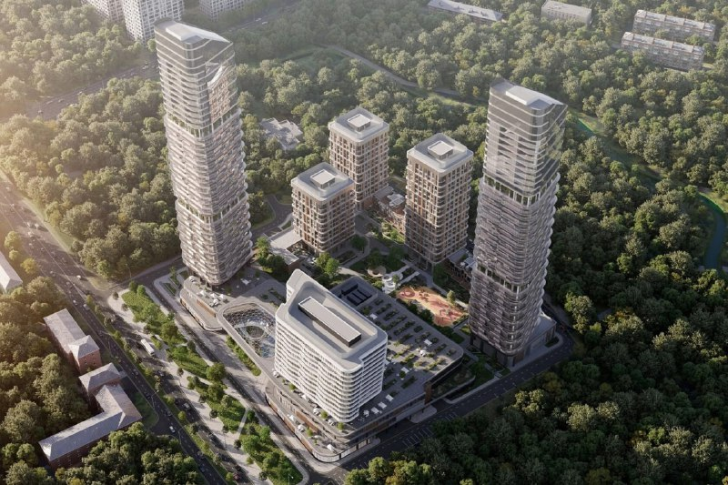
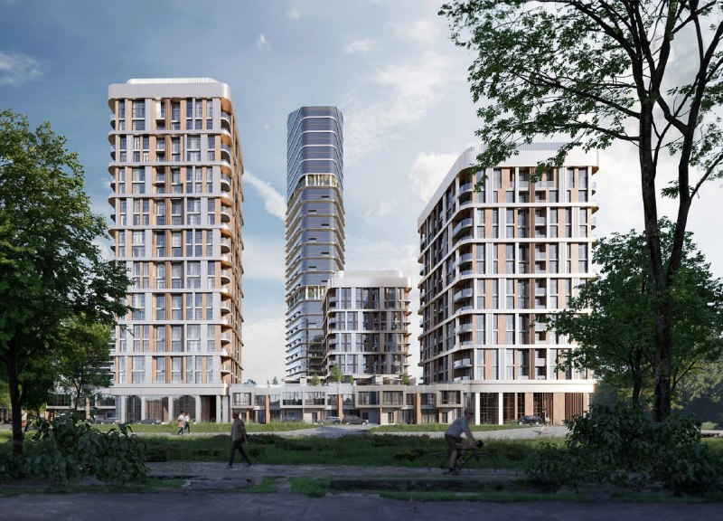
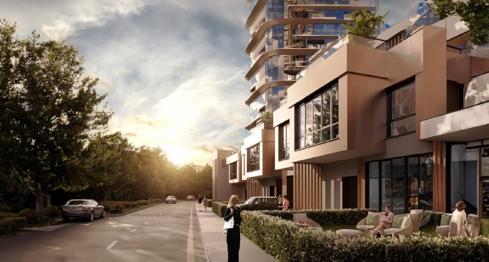

# «Родина Парк» на Верейской, 12: метр уже от 515,4 тыс. ₽, сдача уехала в 2028

Группа «Родина» вышла на рынок с «Родина Парком» на Верейской, 12 в Москве 25 июня 2024 года — и сразу записала проект в премиум. Метр тогда стоил от 466,5 тыс. ₽. К октябрю 2026 года нижняя планка поднялась до 515,4 тыс. ₽, а обещанный срок сдачи успел отъехать на год с лишним.

## Коротко

- **Старт:** 25 июня 2024 года, от 466,5 тыс. ₽/м².
- **Сейчас:** на 9 октября 2026 года — квартиры от 23,8 млн ₽, от 515,4 тыс. ₽/м² (однокомнатные). Минимум «от» прибавил примерно 10%.
- **Проект:** около 110 тыс. м² на 11 га, башни в 34 и 35 этажей, корпуса средней этажности и 15 таунхаусов; архитектор — UNK architects.
- **Сроки:** в 2024 году первую очередь обещали к декабрю 2026 года, теперь ввод — I квартал 2028 года.

## Премиум у заказника

«Родина Парк» строит [Группа «Родина»](/zastroyshchiki/rodina/). Участок — в Можайском районе Западного округа Москвы. По данным застройщика, до станции «Давыдково» Большой кольцевой линии около 10 минут пешком, а с трёх сторон квартал окружает природный заказник «Долина реки Сетунь». Метро плюс лес за забором — на этом сочетании проект и строит свою премиальность.

Проект разработало бюро UNK architects. По данным Архи.ру, это порядка 110 тыс. м² на участке 11 га: две башни в 34 и 35 этажей, клубные дома средней этажности, 15 таунхаусов с приватными террасами и многофункциональный комплекс. Стройка, по тем же данным, идёт с июня 2024 года.

Полная история проекта — в [досье «Родина Парк»](/obekty/rodina-park/). Здесь — о том, что случилось после старта.

## Плюс 48,9 тыс. за метр

На сайте застройщика старт продаж датирован 25 июня 2024 года: квартиры от 466,5 тыс. ₽ за квадратный метр, класс — премиум. Для ориентира: квартира в 50 м² по этой цене обошлась бы примерно в 23 млн ₽. Это наша арифметика, а не прайс застройщика.

На 9 октября 2026 года, по данным агрегатора novostroev.ru, самая дешёвая квартира стоит 23,8 млн ₽ (студии и однокомнатные), минимальная цена метра — 515,4 тыс. ₽ у однокомнатных. Этажность проекта указана как 2–35.

Вот где подвох в сравнении. Обе цифры — минимум «от», но на старте это был минимум по всему проекту, а сейчас — по однокомнатным. Разница в 48,9 тыс. ₽/м², или около 10%, показывает направление, но не точную динамику по всем лотам.

## Что с проектом сейчас

На 9 октября 2026 года стадия — «возведение здания». Продажи идут по новым корпусам: 30 июля 2025 года застройщик открыл продажи в пятом корпусе жилого квартала.

Вторая очередь уже с документами: Группа «Родина» получила на неё разрешение на строительство (новость РБК Недвижимость от 27 декабря 2024 года). Туда вошли две башни в 34 и 35 этажей, 25-этажный бизнес-центр, многофункциональный комплекс, 525 квартир от 28 до 122 м² и подземный паркинг на 594 места. Ввод второй очереди — I квартал 2028 года.

А вот со сроками в целом — разнобой:

| Источник | Срок |
|---|---|
| Архи.ру, 2024 год | первая очередь — декабрь 2026 года, весь проект — март 2027 года |
| Сайт застройщика, 2024 год | 2027 год |
| Агрегатор, октябрь 2026 года | I квартал 2028 года |

Какая дата к какой очереди относится, застройщик публично не разводил. Сверяйте по [проектной декларации](/slovar/proektnaya-deklaratsiya/) — там это видно по каждому корпусу.

*Визуализация «Родина Парка»: две башни, жилые корпуса средней этажности и многофункциональный комплекс среди зелени. Визуализация: Группа «Родина».*

## Что это значит для покупателя и инвестора

Проект продаётся как [премиальный](/novostroyki/premium-klass/), и уже на старте цена от 466,5 тыс. ₽/м² отрывала его от ближайших массовых [новостроек Москвы](/novostroyki/moskva/). На наш взгляд, главный аргумент «за» — метро и заказник под боком. Главный риск — сроки: за два года ориентир сдвинулся с декабря 2026 года на I квартал 2028 года. Возможно, речь о разных очередях, но если вы выбираете корпус, обещание «в срок» проверяйте по декларации и стройке, а не по рендерам.

Что отслеживать:

- проектную декларацию и сроки по каждому корпусу;
- как растут две башни второй очереди;
- минимальную цену по однокомнатным и общую по проекту;
- условия оплаты — их стоит уточнять в офисе продаж.

*Визуализация «Родина Парка»: корпуса средней этажности и башня со стороны зелёной зоны. Визуализация: Группа «Родина».*

*Визуализация таунхаусов «Родина Парка» с приватными террасами у подножия башни. Визуализация: Группа «Родина».*

## Карточка объекта

- Название: «Родина Парк» (также «Родина парк»).
- Адрес участка: Верейская, 12, Можайский район ЗАО, Москва.
- Застройщик: Группа «Родина».
- Автор проекта: UNK architects.
- Класс: премиум.
- Площадь проекта: около 110 тыс. м² на участке 11 га ([ТЭП](/slovar/tep/) по данным Архи.ру).
- Этажность: 2–35.
- Стадия: возведение здания (на 9 октября 2026 года).
- Ввод: I квартал 2028 года по данным агрегатора; у застройщика в 2024 году — 2027 год.
- Цена: от 23,8 млн ₽ и от 515,4 тыс. ₽/м² (9 октября 2026 года).

## Вопросы и ответы

**Когда начались продажи в ЖК «Родина Парк» на Верейской, 12?**
Группа «Родина» объявила о старте продаж 25 июня 2024 года, квадратный метр стоил от 466,5 тыс. ₽.

**Сколько стоят квартиры в «Родина Парке» сейчас?**
По данным агрегатора на 9 октября 2026 года — от 23,8 млн ₽ за квартиру и от 515,4 тыс. ₽ за метр (однокомнатные).

**Когда сдадут «Родина Парк»?**
В 2024 году первую очередь обещали к декабрю 2026 года, весь проект — в 2027 году. По разрешению на вторую очередь и данным агрегатора, ввод — I квартал 2028 года.

**Кто застройщик «Родина Парка» и кто автор проекта?**
Строит Группа «Родина», проект разработало бюро UNK architects.

**Где находится «Родина Парк» и какое метро рядом?**
На Верейской, 12, в Можайском районе Западного округа Москвы. По данным застройщика, до станции «Давыдково» БКЛ — около 10 минут пешком.

## Источники

1. [Группа «Родина»: новости о старте продаж и корпусах](https://rodinagroup.com/)
2. [Группа «Родина»: страница проекта «Родина Парк»](https://rodinagroup.com/projects/rodina-park/)
3. [Архи.ру: ЖК «Родина Парк», UNK architects](https://archi.ru/projects/russia/19346/zhk-rodina-park)
4. [РБК Недвижимость: разрешение на строительство второй очереди, 27 декабря 2024 года](https://realty.rbc.ru/news/676a798f9a794716a7159aeb)
5. [Novostroev.ru: ЖК «Родина Парк (Верейская 12)», данные на 9 октября 2026 года](https://novostroev.ru/novostroyki/moskva/zao/mozhayskiy-rayon/rodina-park-vereyskaya-12/)

Материал не является инвестиционной рекомендацией.
