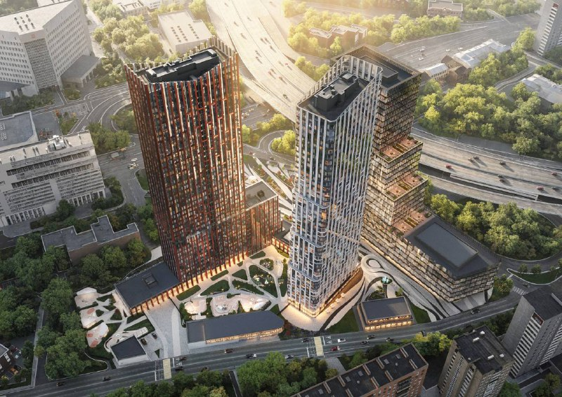
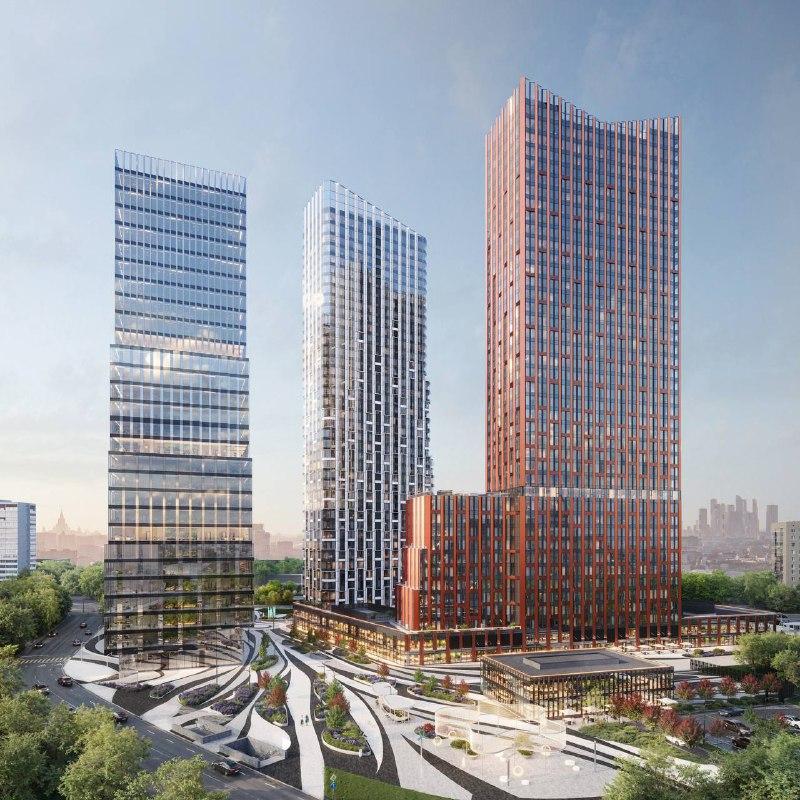

# ЖК «Мангазея на Тульской», ныне АУРА: цены, сроки, башни

Летом 2024 года девелопер «Мангазея» вывел в продажу жилой комплекс на Большой Тульской, 10 в Даниловском районе: две башни в 41 и 42 этажа и 916 квартир. К октябрю 2026 года проект продаётся как АУРА, перешёл из бизнес-класса в премиум и заметно подорожал.

## Коротко

- Старт продаж: лето 2024 года; по данным РБК, средняя цена на старте — 457 тыс. ₽/м².
- Цена к сентябрю 2025 года: 683 тыс. ₽/м² (по данным РБК). Сейчас студия 28,1 м² в каталоге — от 23,8 млн ₽.
- В проекте 916 квартир: 409 в Серебряной и 507 в Бронзовой башне.
- Срок ввода по каталогу — IV квартал 2027 года, ключи — во II квартале 2028 года.

## Что такое проект на Большой Тульской, 10

Комплекс стоит у метро «Тульская» (около 250 м по данным каталога). В него входят две жилые башни, Серебряная и Бронзовая, 27-этажный бизнес-центр, частный детский сад для жителей и фитнес-клуб с бассейном. Квартиры продаёт специализированный застройщик СЗ МДТ, бренд — «Мангазея» ([застройщик «Мангазея»](/zastroyshchiki/mangazeya/)).

*Вид на комплекс сверху: красная и светлая жилые башни и бизнес-центр со ступенчатыми террасами. Визуализация: Мангазея*

В продаже представлены студии (около 28–34 м²), одно-, двух- и трёхкомнатные квартиры (до 95 м² в лотах каталога) и двухуровневые пентхаусы на верхних этажах.

## Сколько стоили квартиры на старте и сколько стоят сейчас

На старте в 2024 году средняя цена составляла 457 тыс. ₽/м². К сентябрю 2025 года она выросла до 683 тыс. ₽/м²; сама компания говорила о росте на 51% с начала продаж. Аналитики на этом фоне допускали, что к 2027 году метр может подойти к 1 млн ₽ — это прогноз, не факт.

По состоянию на октябрь 2026 года каталоги показывают студию 28,1 м² от 23,8 млн ₽ (около 847 тыс. ₽/м²), однокомнатные — от 24,8 млн ₽, двухкомнатные — от 36,7 млн ₽, трёхкомнатные — от 51,9 млн ₽. Данные каталогов не датированы и расходятся между площадками, поэтому перед сделкой цены стоит сверять с застройщиком.

## Что с проектом сейчас

Главное изменение — позиционирование. В октябре 2025 года девелопер объявил, что переводит проект из бизнес-класса в [премиум-класс](/novostroyki/premium-klass/); по данным РБК, это означает «совершенно другой уровень продукта, сервиса и, конечно, цен» (слова аналитика Артёма Цогоева). Сегодня проект продаётся под названием АУРА.

Сроки по состоянию на октябрь 2026 года: IV квартал 2027 года для обеих башен по каталогу, ключи — во II квартале 2028 года. Это больше года до ввода, поэтому ориентир стоит проверять по [проектной декларации](/slovar/proektnaya-deklaratsiya/) и сроку в договоре [ДДУ](/slovar/ddu/) (договор долевого участия).

Контекст коротко: квартиры в проекте продаются с лета 2024 года, с октября 2025 года он позиционируется как премиальный. Полная история проекта — в [досье «Большая Тульская, 10»](/obekty/bolshaya-tulskaya-10/).

*Башни и двор проекта. Визуализация: Мангазея*

## Что это значит для покупателя и инвестора

Рост цены почти в полтора раза за 14 месяцев показывает, что рынок принял продукт, но для нового покупателя это означает вход уже на высокой базе. На наш взгляд, ставка идёт на ограниченное предложение в центральной части ЮАО и на метро в шаговой доступности.

Риски стандартные для стройки на ранней стадии: срок ввода может сдвинуться, цена в каталоге не равна цене сделки, а прогнозы аналитиков о миллионе за метр остаются прогнозами. Что отслеживать: изменения срока в проектной декларации, динамику цены лотов одного типа, готовность башен.

## Карточка объекта

- Адрес участка: Большая Тульская, 10 (Даниловский район, Москва)
- Названия: «Мангазея на Тульской», АУРА
- Застройщик: «Мангазея» (СЗ МДТ)
- Класс: премиум (ранее бизнес-класс)
- Состав: две жилые башни (41 и 42 этажа), бизнес-центр на 27 этажей
- Квартиры: 916
- Стадия: строительство, продажи
- Срок ввода: IV квартал 2027 года (по каталогу), ключи — II квартал 2028 года
- Цена: студия 28,1 м² от 23,8 млн ₽ (каталог, октябрь 2026 года)

## Вопросы и ответы

**Кто застройщик ЖК «Мангазея на Тульской» (АУРА)?**
Проект ведёт девелопер «Мангазея»; квартиры продаёт специализированный застройщик СЗ МДТ.

**Когда сдадут ЖК на Большой Тульской, 10?**
В каталоге на октябрь 2026 года указан IV квартал 2027 года, ключи — во II квартале 2028 года. Сверяйте срок с проектной декларацией.

**Сколько стоят квартиры в АУРЕ?**
Студия 28,1 м² — от 23,8 млн ₽ по данным каталога; диапазон по проекту — примерно от 22,8 до 68,8 млн ₽. На старте продаж средняя цена была 457 тыс. ₽/м², в сентябре 2025 года — 683 тыс. ₽/м².

**Сколько квартир в проекте?**
916: 409 в Серебряной и 507 в Бронзовой башне.

**Где находится проект?**
Большая Тульская улица, 10, Даниловский район; метро «Тульская» — около 250 м.

## Источники

1. [ЖК «АУРА», Большая Тульская, 10: планировки и цены — novostroy.ru](https://www.novostroy.ru/buildings/bolshaya-tulskaya-10/prices/)
2. [ЖК «АУРА» (Большая Тульская, вл. 10): данные о проекте — novostroy-m.ru](https://www.novostroy-m.ru/baza/jk_ul_bolshaya_tulskaya)
3. [«Три года до выгоды: как узнать инвестиционный потенциал новостроек», РБК Недвижимость, 13 ноября 2025 года](https://realty.rbc.ru/news/691483779a7947f45ab2e4f2)

Материал не является инвестиционной рекомендацией.
