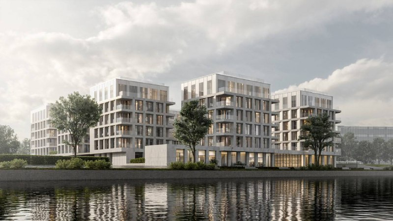
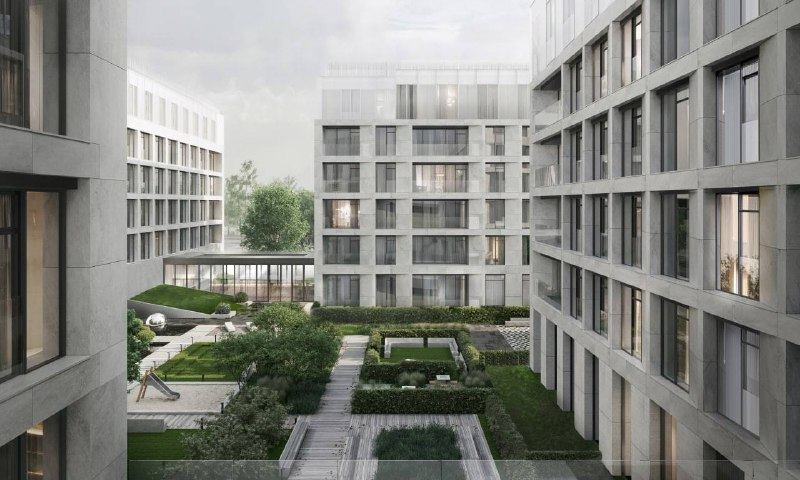

# Foriver Residence: как менялся проект на Симоновской, 1 с 2022 по 2025

Малоэтажный квартал Foriver Residence в Даниловском районе в апреле 2022 года описывали как шесть домов «треугольником» от бюро WALL. В публикациях 2023–2024 годов это пять корпусов вокруг двора, 81 квартира и более 22,5 тыс. м². В июне 2025 года проект перешёл от Sminex к структуре «[Сибпромстроя](/zastroyshchiki/sibpromstroy/)».

## Коротко

- **Апрель 2022 года:** к ЖК Foriver добавляют шесть невысоких жилых домов «треугольником», архитектор — бюро WALL.
- **2023–2024 годы:** пять корпусов вокруг закрытого двора, 81 квартира (11 пентхаусов), более 22,5 тыс. м², ввод — 2026 год.
- **Июнь 2025 года:** Sminex продал проект; владельцем застройщика стала ССК, связанная с «Сибпромстроем».
- **Что не подтвердилось:** нереализованный вариант бюро Semrén&Månsson, цены и срок сдачи на октябрь 2026 года.

Полная история проекта — в [досье «Foriver»](/obekty/foriver/). Район — [Даниловский](/novostroyki/danilovskiy/).

## С чего начинали

Foriver Residence — малоэтажная часть квартала Foriver на Симоновской набережной. Проект долго назывался «Скандинавским кварталом»: так его именовали при проектировании. Основная часть Foriver, по материалу «Сноб» от июля 2024 года, — работа шведского бюро Semrén & Månsson и российского APEX; этот проект уже строился и к тому моменту готовился к сдаче.

В апреле 2022 года «Москвич» сообщил, что ЖК Foriver решили дополнить шестью жилыми домами, которые образуют «треугольник». Автор — бюро WALL, руководитель Рубен Аракелян. Дома задуманы не высотными, их пропорции и этажность, по описанию издания, напоминают итальянские палаццо. Застройщик, площади и число квартир в публикации не названы.

## Что меняли

К июлю 2023 года проект выглядел иначе. По данным novostroy-m.ru, Foriver Residence — это пять корпусов вокруг закрытого двора, 81 квартира с лоджиями и пентхаусы с террасами. Застройщик, ГК «Инград», уже получил разрешение на строительство, а ввод назывался на 2026 год.

В мае 2024 года БФМ подтвердил состав: пять среднеэтажных корпусов, более 22,5 тыс. м², 81 квартира, архитектор — архбюро Wall. В июле 2024 года «Сноб» уточнил, что 11 из 81 квартир — пентхаусы: двухкомнатные начинаются от 66 м², пентхаусы доходят до 235 м², потолки от 3,3 до 4,3 м.

Число домов между апрелем 2022 и июлем 2023 года сократилось с шести до пяти, а архитектор остался прежним. Объяснения в источниках нет, и мы не можем исключить, что в апреле 2022 года речь шла о более раннем или более широком составе. Подтверждён сам факт: цифры в публикациях разные.

*Корпуса Foriver Residence со стороны реки в варианте бюро WALL. Визуализация: Инград, бюро WALL, 2022*

Главное изменение произошло не в архитектуре, а у владельца. Осенью 2024 года Sminex купил ГК «Инград». В июне 2025 года, по данным СПАРК-Интерфакса, Sminex закрыл сделку по продаже Foriver Residence: владельцем «Симоновской коллекшн», застройщика проекта, стала Строительно-спортивная компания (ССК), связанная с ГК «Сибпромстрой». Она же будет достраивать комплекс. Президент Sminex Алексей Тулупов объяснил продажу тем, что актив не соответствует стратегии компании, которая развивает камерные проекты в центре Москвы.

## Каким проект стал

Проект не высотный и камерный: по описаниям, два десятка тысяч квадратных метров, пять корпусов, 81 квартира. На наш взгляд, это ставка на малый масштаб и дорогой продукт: пентхаусы до 235 м² и потолки до 4,3 м.

Срок и цены на октябрь 2026 года по проверенным источникам мы не подтвердили. Последние найденные сроки — 2026 год (публикации 2023 и 2024 годов). Статус, цены и срок ввода нужно сверять с [проектной декларацией](/slovar/proektnaya-deklaratsiya/) на наш.дом.рф.

Мы также не смогли подтвердить, что в архиве называли нереализованным вариантом квартала с террасами от Semrén&Månsson: в открытых источниках это бюро связано только с основной частью Foriver. Поэтому в разбор такой этап не вошёл.

*Двор квартала Foriver Residence. Визуализация: Инград, бюро WALL, 2022*

## Было и стало

| Параметр | Апрель 2022 года | 2023–2024 годы | Июнь 2025 года |
|---|---|---|---|
| Домов | шесть, «треугольником» | пять, вокруг закрытого двора | — |
| Этажность | не высотные (по описанию издания) | среднеэтажные | — |
| Площадь | — | более 22,5 тыс. м² | — |
| Квартиры | — | 81, из них 11 пентхаусов | — |
| Архитектор | WALL | WALL | — |
| Застройщик | — | ГК «Инград» | СЗ «Симоновская коллекшн» под контролем ССК («Сибпромстрой») |
| Срок ввода | — | 2026 год | — |

## Карточка объекта

- **Название:** Foriver Residence («Скандинавский квартал»)
- **Адрес участка:** Симоновская, 1, Москва, [Даниловский район](/novostroyki/danilovskiy/)
- **Застройщик:** [«Сибпромстрой»](/zastroyshchiki/sibpromstroy/) (через ССК, с июня 2025 года); ранее — ГК «Инград», Sminex
- **Архитектор:** WALL
- **Класс:** премиум
- **Состав:** пять корпусов, 81 квартира, более 22,5 тыс. м²
- **Срок:** 2026 год (по публикациям 2023–2024 годов)

## Вопросы и ответы

**Кто архитектор Foriver Residence?**
Малоэтажный квартал на Симоновской набережной проектировало бюро WALL: в апреле 2022 года «Москвич» называл руководителя бюро Рубена Аракеляна, а в мае 2024 года БФМ — архбюро Wall.

**Сколько квартир в Foriver Residence?**
По публикациям 2023–2024 годов, 81 квартира в пяти корпусах, включая 11 пентхаусов; общая площадь — более 22,5 тыс. м².

**Кто сейчас владеет Foriver Residence?**
В июне 2025 года Sminex продал проект: по данным СПАРК-Интерфакса, сделка закрыта 24 июня, владельцем застройщика «Симоновская коллекшн» стала ССК, связанная с ГК «Сибпромстрой».

**Когда сдадут Foriver Residence?**
В публикациях 2023 и 2024 годов называли 2026 год. Актуальный срок на октябрь 2026 года по проверенным источникам мы не подтвердили.

## Источники

1. [На Симоновской набережной к ЖК Foriver добавят шесть домов — «Москвич», 14 апреля 2022 года](https://moskvichmag.ru/?p=226766)
2. [На Симоновской набережной построят — novostroy-m.ru, 13 июля 2023 года](https://www.novostroy-m.ru/novosti/na_simonovskoy_naberejnoy_postroyat)
3. [Foriver Residence — БФМ, 16 мая 2024 года](https://www.bfm.ru/news/549099)
4. [Жизнь у реки. Как девелоперы меняют привычный облик Москвы с помощью архитектуры — «Сноб», 2 июля 2024 года](https://snob.ru/nedvizhimost/zhizn-u-reki-kak-developery-meniaiut-privychnyi-oblik-moskvy-s-pomoshchiu-arkhitektury/)
5. [Sminex продал ещё один проект — novostroy-m.ru, 30 июня 2025 года](https://www.novostroy-m.ru/novosti/sminex_prodal_esche_odin)

Материал не является инвестиционной рекомендацией.
