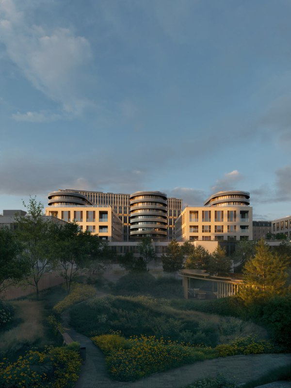
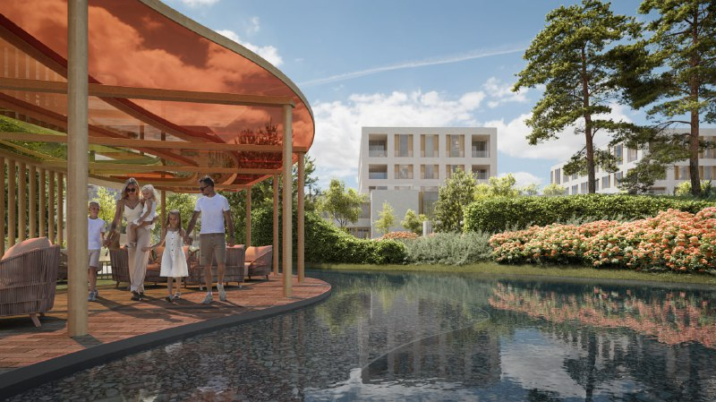

---
source:
  id: 25025
  date: 2024-08-12
status: needs_review
skip_reason: null
type: object
region: moscow
title: "«Фрунзенский» от Sminex: вход от 159,2 млн ₽ и ключи с разницей в два года"
title_alts: ["Клубный квартал «Фрунзенский» от Sminex в Хамовниках: что с ценами и сроками", "Фрунзенская, 30: Sminex продаёт элитный квартал рядом с Домом-самолётом, цены от 159 млн ₽"]
slug: frunzenskaya-30-sminex-ceny-ocheredi-sroki
lead: "На месте «Стройэкспо» Sminex строит «Фрунзенский» — клубный квартал, где сосновый парк во дворе, а вход начинается с 159,2 млн ₽. Продажи открыли в августе 2024 года: 216 квартир первой очереди, в среднем 2,85 млн ₽ за м². На октябрь 2026 года дома растут, а ключи разнесены на 2027 и 2029 годы."
developers:
- id: sminex
  name: Sminex
  role: main
objects:
- id: frunzenskaya-30
  names:
  - Фрунзенская, 30
  - Фрунзенская набережная
  - Фрунзенский
  - Стройэкспо
  zu: Фрунзенская, 30
  main: true
  new: false
districts:
- khamovniki
topics:
- ceny
- premium
images:
- file: media/25025_1.jpg
  alt: Дома клубного квартала «Фрунзенский» с круглыми башнями и садом, Хамовники, визуализация
  caption: 'Визуализация: Sminex'
  credit: Sminex
- file: media/25025_5.jpg
  alt: Пруд и беседка во дворе-парке «Фрунзенского» на Фрунзенской набережной, визуализация
  caption: 'Визуализация: Sminex'
  credit: Sminex
- file: media/25025_10.jpg
  alt: Фасад «Фрунзенского» со стороны Москвы-реки, Фрунзенская набережная, Хамовники, визуализация
  caption: 'Визуализация: Sminex'
  credit: Sminex
factcheck:
- claim: Sminex открыл продажи клубного квартала «Фрунзенская набережная» в августе 2024 года; всего 11 корпусов, в первой очереди четыре (один монументальный дом и три клубных)
  status: confirmed
  source: https://www.novostroy-m.ru/novosti/frunzenskaya_naberejnaya_i_novye
  checked: 2026-10-13
- claim: В первой очереди 216 квартир площадью 58–443 м², средняя цена около 2,85 млн ₽/м²
  status: confirmed
  source: https://www.novostroy-m.ru/novosti/frunzenskaya_naberejnaya_i_novye
  checked: 2026-10-13
- claim: Двор-парк 3,1 га, архитектурное бюро «Цимайло Ляшенко и партнёры», 216 квартир в первой очереди
  status: confirmed
  source: https://moskvichmag.ru/?p=380232
  checked: 2026-10-13
- claim: Минимальная цена в октябре 2026 года — 159,2 млн ₽; элитный класс; застройщик Sminex
  status: changed
  source: https://www.novostroy-m.ru/baza/jk_na_frunzenskoy_30
  checked: 2026-10-13
- claim: 'Срок сдачи: корпуса C1–C3, D, D2, D3 — III квартал 2027, корпуса A1–A3, B1–B4 — III квартал 2029; у A и B — котлован/фундамент'
  status: confirmed
  source: https://www.novostroy-m.ru/baza/jk_na_frunzenskoy_30
  checked: 2026-10-13
- claim: Проектные декларации от 13.03.2024, 08.11.2024, 13.05.2025, 09.09.2025
  status: confirmed
  source: https://www.novostroy-m.ru/baza/jk_na_frunzenskoy_30
  checked: 2026-10-13
- claim: Сбербанк подтвердил финансирование проекта на 55 млрд ₽; разрешение на строительство получено в 2024 году; сдача первых четырёх корпусов — 2027 год
  status: confirmed
  source: https://investfuture.ru/articles/sberbank-investiruet-55-mlrd-rubley-v-elitniy-kvartal-na-frunzenskoy-naberezhnoy-1168111431
  checked: 2026-10-13
removed:
- Минимальная цена 1,85 млн ₽/м² и самый дорогой лот 1,827 млрд ₽ (пентхаус) — не подтверждены независимым источником.
- 216 квартир — «практически весь объём по РНС первого этапа» и «ходят любые лоты» — не подтверждено.
- Старт продаж участникам Sminex Club и листа ожидания — не подтверждено.
- Интерес покупателей к ситихаусам — слух («нам шепчут»), убран.
- Тезис, что «без пруда это не элитка», — мнение редакции канала, убран.
- Продажа новой очереди «Фрунзенского» 7 октября 2026 (семь клубных домов, 14 вилл, 59 ДДУ, средняя цена около 3,4 млн ₽/м²) — из хронологии досье, независимого подтверждения найти не удалось, в статью не включено.
- Данные досье о том, что застройщик — Интеко, и о сделке по портфелю Интеко с участием Sminex — не подтверждены; в текстах источников застройщик — Sminex.
data_points:
- metric: min_price_frunzenskiy_mln_rub
  value: 159.2
  date: 2026-10-13
seo:
  main_query: жк фрунзенский sminex цены
  keywords:
  - фрунзенская набережная sminex
  - клубный квартал фрунзенский хамовники
  - фрунзенская 30 новостройка
  - фрунзенский сроки сдачи
  - дом-самолёт фрунзенская набережная
  frequency_checked: false
  title: "ЖК «Фрунзенский» от Sminex: цены от 159 млн ₽, сроки"
  description: "Квартал «Фрунзенский» от Sminex на Фрунзенской набережной: 216 квартир первой очереди, цены от 159,2 млн ₽, сдача в 2027 и 2029 годах. Что с ним на октябрь 2026."
  canonical: https://шахматка.москва/novosti/frunzenskaya-30-sminex-ceny-ocheredi-sroki/
internal_links:
- anchor: полная история проекта — в досье «Фрунзенская, 30»
  url: /obekty/frunzenskaya-30/
- anchor: Хамовники
  url: /novostroyki/khamovniki/
- anchor: проектной декларации
  url: /slovar/proektnaya-deklaratsiya/
- anchor: премиальные проекты Москвы
  url: /temy/premium/
- anchor: новостройки премиум-класса
  url: /novostroyki/premium-klass/
faq:
  - {q: "Кто застройщик «Фрунзенского» на Фрунзенской набережной?", a: "Проект строит и продаёт Sminex."}
  - {q: "Сколько стоят квартиры во «Фрунзенском»?", a: "На 13 октября 2026 года — от 159,2 млн ₽ за квартиру. В августе 2024 года средняя цена первой очереди была около 2,85 млн ₽ за м²."}
  - {q: "Когда сдадут «Фрунзенский»?", a: "По данным агрегатора, корпуса C1–C3 и D, D2, D3 — в III квартале 2027 года, корпуса A1–A3 и B1–B4 — в III квартале 2029 года."}
  - {q: "Сколько квартир было в первой очереди?", a: "На старте в августе 2024 года — 216 квартир площадью от 58 до 443 м²."}
date_published: 2024-08-12
date_modified: 2026-10-13
author: Редакция Шахматки
schema: |
  [
    {
      "@context": "https://schema.org",
      "@type": "Article",
      "headline": "«Фрунзенский» Sminex на Фрунзенской набережной: цены и сроки сдачи",
      "description": "Квартал «Фрунзенский» на Фрунзенской набережной: 216 квартир в первой очереди, цены от 159,2 млн ₽, сдача в 2027 и 2029 годах. Что известно на октябрь 2026.",
      "datePublished": "2024-08-12",
      "dateModified": "2026-10-13",
      "author": {"@type": "Organization", "name": "Редакция Шахматки"},
      "publisher": {"@type": "Organization", "name": "Шахматка"},
      "about": [
        {"@type": "Residence", "name": "Клубный квартал «Фрунзенский»", "address": "Москва, Фрунзенская набережная, 30"},
        {"@type": "Organization", "name": "Sminex"}
      ],
      "mainEntityOfPage": "https://шахматка.москва/novosti/frunzenskaya-30-sminex-ceny-ocheredi-sroki/"
    },
    {
      "@context": "https://schema.org",
      "@type": "FAQPage",
      "mainEntity": [
        {"@type": "Question", "name": "Кто застройщик «Фрунзенского» на Фрунзенской набережной?", "acceptedAnswer": {"@type": "Answer", "text": "Проект строит и продаёт Sminex."}},
        {"@type": "Question", "name": "Сколько стоят квартиры во «Фрунзенском»?", "acceptedAnswer": {"@type": "Answer", "text": "По состоянию на 13 октября 2026 года цены начинаются от 159,2 млн ₽. В августе 2024 года средняя цена первой очереди составляла около 2,85 млн ₽ за м²."}},
        {"@type": "Question", "name": "Когда сдадут «Фрунзенский»?", "acceptedAnswer": {"@type": "Answer", "text": "По данным агрегатора, корпуса C1–C3 и D, D2, D3 — в III квартале 2027 года, корпуса A1–A3 и B1–B4 — в III квартале 2029 года."}},
        {"@type": "Question", "name": "Сколько квартир было в первой очереди?", "acceptedAnswer": {"@type": "Answer", "text": "В августе 2024 года в первой очереди было 216 квартир площадью от 58 до 443 м²."}}
      ]
    }
  ]
editor_notes: В досье объект привязан к застройщику «Интеко», в источниках застройщик — Sminex; сделку Интеко → Sminex подтвердить не удалось, поэтому в тексте она не описана, а в developers указана запись из досье с пометкой. Ключевые цифры (цены, сроки по корпусам) взяты с агрегатора «Новострой-М», ЕИСЖС не открылся. Заметка 2026-10-07 о новой очереди (семь клубных домов, 14 вилл, 59 ДДУ) не подтверждена. Стоит сверить цену от 159,2 млн ₽ и срок 2027 с сайтом застройщика и декларацией.
---
# «Фрунзенский» от Sminex: вход от 159,2 млн ₽ и ключи с разницей в два года

Sminex открыл продажи клубного квартала «Фрунзенский» на Фрунзенской набережной в августе 2024 года: в первой очереди — 216 квартир со средней ценой около 2,85 млн ₽ за м². К октябрю 2026 года порог входа — 159,2 млн ₽, дома строятся, а ключи разнесены на два срока: 2027 и 2029 годы. Здесь выбирают не столько квартиру, сколько вид на Кремль.

**Коротко**

- **Старт:** в августе 2024 года в первой очереди — 216 квартир площадью 58–443 м², в среднем около 2,85 млн ₽/м².
- **Масштаб:** 11 корпусов, в первой очереди — четыре: один монументальный дом и три клубных.
- **Сейчас:** на 13 октября 2026 года цены — от 159,2 млн ₽, класс — элит.
- **Сдача:** корпуса C и D — III квартал 2027 года, A и B — III квартал 2029 года.

## Город-парк на месте «Стройэкспо»

Квартал строят в [Хамовниках](/novostroyki/khamovniki/), на участке «Фрунзенская, 30» — там, где стоял снесённый выставочный комплекс «Стройэкспо». Имя у проекта плавает: то «Фрунзенская набережная», то «Фрунзенский». Застройщик — Sminex, концепция — бюро «Цимайло Ляшенко и партнёры».

В продажах его называют «клубным городом-парком», и набор под это подобран: во дворе на 3,1 га — сосновый парк, пруд и детские площадки. Внизу — ситихаусы с патио, наверху — пентхаусы с террасами и видом на Кремль, Москву-реку и парк Горького. Весь чек-лист элитной Москвы на месте.

*Визуализация: Sminex*

## Считать метры здесь бессмысленно

В августе 2024 года средняя цена первой очереди была около 2,85 млн ₽/м². Сейчас на сайте застройщика — «от 159,2 млн ₽», и это минимальный чек, а не цена метра. Напрямую цифры не сравнить: свежую цену метра Sminex не публикует. Для ориентира: квартира 58 м² по средней цене 2024 года стоила бы около 165 млн ₽ (наш расчёт). То есть минимальный чек остался примерно там же, где и был.

На наш взгляд, в этом сегменте цену делают вид, этаж и формат квартиры. Поэтому сравнивать имеет смысл только конкретные лоты.

*Визуализация: Sminex*

## Два квартала в одном: 2027 и 2029

По данным агрегатора «Новострой-М» на 13 октября 2026 года:

- корпуса C1–C3, D, D2, D3 — III квартал 2027 года, идёт монтаж верхних этажей;
- корпуса A1–A3, B1–B4 — III квартал 2029 года, на площадке котлован и фундамент.

Разрешение на строительство Sminex получил в 2024 году, а в октябре 2025 года Сбербанк подтвердил финансирование проекта на 55 млрд ₽. Проектные декларации выходили 13 марта и 8 ноября 2024 года, 13 мая и 9 сентября 2025 года: сроки и параметры сверяйте по актуальной [проектной декларации](/slovar/proektnaya-deklaratsiya/).

## Что это значит для покупателя и инвестора

**Цена.** Элитный сегмент живёт по своим законам: чек определяют вид, этаж и формат, а не только метр. Сравнивайте конкретные лоты и корпуса. Для фона — [новостройки премиум-класса](/novostroyki/premium-klass/) и тема [премиум-сегмент](/temy/premium/).

**Сроки.** Первые корпуса — 2027 год, вторые — 2029-й. Покупатель корпусов A и B ждёт ключей на два года дольше, чем сосед из C и D. А тот, кто въедет первым, будет жить рядом со стройкой, пока не достроят весь квартал. За такие деньги — нюанс, о котором стоит помнить.

**Что отслеживать:** новые версии декларации, переносы сроков и цену по корпусам A и B.

## Что было на этом месте

Участок на Фрунзенской набережной — бывшая территория «Стройэкспо»: по данным Moskvich Mag, к апрелю 2022 года павильоны почти полностью снесли. Соседний Дом-самолёт в проект не входит и остался на месте. Полная история проекта — в [досье «Фрунзенская, 30»](/obekty/frunzenskaya-30/).

## Карточка объекта

- **Адрес участка:** Фрунзенская, 30 (Фрунзенская набережная), Москва
- **Названия:** «Фрунзенский», «Фрунзенская набережная», «Стройэкспо»
- **Застройщик:** Sminex
- **Район:** Хамовники, ЦАО
- **Класс:** элит
- **Корпуса:** 11, из них в первой очереди — 4
- **Квартиры первой очереди (август 2024):** 216, 58–443 м²
- **Стадия:** строительство, продажи
- **Ввод:** III квартал 2027 года (корпуса C, D), III квартал 2029 года (корпуса A, B)
- **Цена:** от 159,2 млн ₽ (13 октября 2026 года)

## Вопросы и ответы

**Кто застройщик «Фрунзенского» на Фрунзенской набережной?**
Проект строит и продаёт Sminex.

**Сколько стоят квартиры во «Фрунзенском»?**
На 13 октября 2026 года — от 159,2 млн ₽ за квартиру. В августе 2024 года средняя цена первой очереди была около 2,85 млн ₽ за м².

**Когда сдадут «Фрунзенский»?**
По данным агрегатора, корпуса C1–C3 и D, D2, D3 — в III квартале 2027 года, корпуса A1–A3 и B1–B4 — в III квартале 2029 года.

**Сколько квартир было в первой очереди?**
На старте в августе 2024 года — 216 квартир площадью от 58 до 443 м².

## Источники

1. [Фрунзенская набережная: первая очередь, Новострой-М, 24 августа 2024 года](https://www.novostroy-m.ru/novosti/frunzenskaya_naberejnaya_i_novye)
2. [Клубный квартал «Фрунзенский»: карточка проекта, Новострой-М](https://www.novostroy-m.ru/baza/jk_na_frunzenskoy_30)
3. [На Фрунзенской набережной появится город-парк, Moskvich Mag, 22 августа 2024 года](https://moskvichmag.ru/?p=380232)
4. [Грандиозная стройка в Хамовниках, Moskvich Mag, 6 апреля 2022 года](https://moskvichmag.ru/gorod/grandioznaya-strojka-v-hamovnikah-pokazali-radi-chego-snesli-strojekspo-na-frunzenskoj/)
5. [Сбербанк инвестирует 55 млрд рублей в элитный квартал на Фрунзенской набережной, Investfuture, 8 октября 2025 года](https://investfuture.ru/articles/sberbank-investiruet-55-mlrd-rubley-v-elitniy-kvartal-na-frunzenskoy-naberezhnoy-1168111431)

Материал не является инвестиционной рекомендацией.
