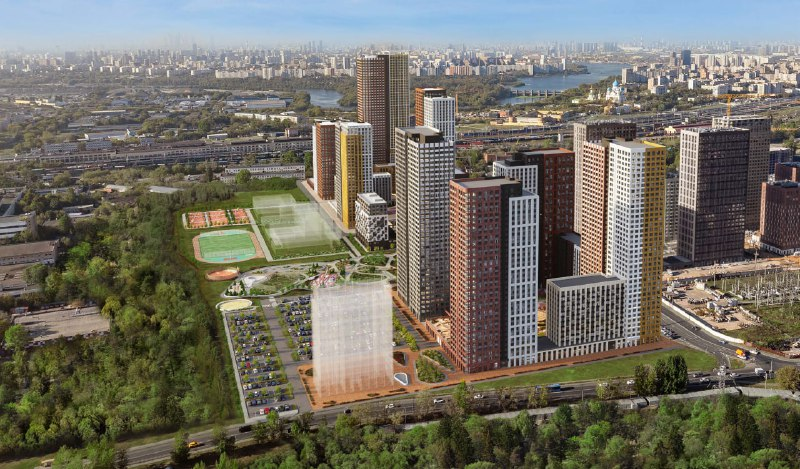
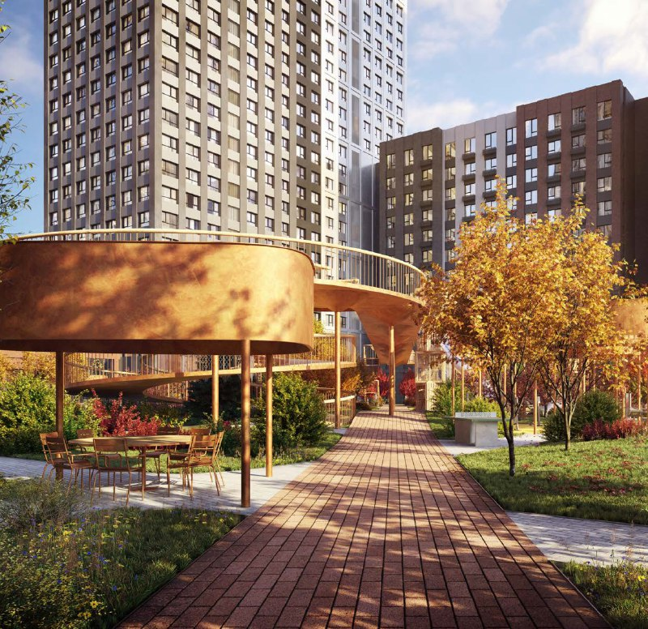

# ЖК «Страна.Заречная» на Иловайской, 3 в Марьино: цены и сроки

В Марьино на Иловайской улице «Страна Девелопмент» строит комфорт-класс «Страна.Заречная» на участке площадью 13,62 га. К октябрю 2026 года проект состоит из 10 домов от 12 до 38 этажей, а квартиры в каталоге стоят от 13,5 до 41,1 млн ₽.

## Коротко

- Проект: «Страна.Заречная», Иловайская улица, 3 (участки «Иловайская, 3» и «3А»), район Марьино, ЮВАО.
- Застройщик: ГК «Страна Девелопмент». Разрешение на строительство — от 16 августа 2024 года.
- По данным каталога на 13 октября 2026 года: 10 домов, 301 квартира в продаже, цены от 13,5 до 41,1 млн ₽, ближайший срок сдачи — I квартал 2028 года.
- Класс — комфорт; идёт монтаж средних этажей.

## Кто застройщик и как проект достался «Стране»

Площадка на Иловайской улице долго искала владельца. В феврале 2022 года ГК ФСК и инвесткомпания А1 объявили о сделке по 75% доли в проекте, но, по данным «Ведомостей», в мае она сорвалась из-за изменения условий кредитования. В октябре 2022 года «Ведомости» сообщили, что «Страна Девелопмент» одобрила покупку Центра фанерной торговли, чья структура владела участками 13,62 га и зданиями площадью 57 тыс. м². Цена за 100% компании, по решению покупателя, не должна была превышать 8,8 млрд ₽, сделка тогда ещё не была закрыта.

Сегодня застройщиком проекта указана «Страна Девелопмент», так что к осени 2026 года площадка в её руках. Подробнее о компании — на странице [застройщика «Страна»](/zastroyshchiki/strana/); полная история проекта — в [досье «Страна.Заречная»](/obekty/strana-zarechnaya/).

*Общий вид квартала с высоты. Визуализация: Страна Девелопмент*

## Сколько стоят квартиры в «Стране.Заречной»

По данным каталога на 13 октября 2026 года, цены в продаже такие:

- студии — 13,5–20,9 млн ₽;
- двухкомнатные — 18,1–27,4 млн ₽;
- трёхкомнатные — 19,8–32,3 млн ₽;
- четырёхкомнатные — 32,5–41,1 млн ₽.

Всего в продаже 301 квартира: 65 студий, 98 двухкомнатных, 127 трёхкомнатных и 11 четырёхкомнатных. Цены у отдельных лотов меняются быстро: в начале октября 2026 года, например, студия 18,7 м² подорожала на 800 тыс. ₽ и стоит 17,19 млн ₽. Средняя цена за м² на странице каталога не указана, а цена одной трёхкомнатной квартиры 48,5 м² в объявлении — около 503 тыс. ₽/м²; это один лот, а не средняя по проекту.

## Что с проектом сейчас

По состоянию на 13 октября 2026 года проект строится: идёт монтаж средних этажей, последняя [проектная декларация](/slovar/proektnaya-deklaratsiya/) обновлена 7 октября 2026 года. Срок сдачи для корпуса «Дом Стремление» — I квартал 2028 года. Сроки остальных домов каталог не раскрывает, их нужно смотреть в декларации.

Класс проекта — [комфорт](/novostroyki/komfort-klass/). Проект стоит сравнивать по цене за метр и транспортной доступности с другими новостройками в [Марьино](/novostroyki/marino/).

*Двор с круглой террасой-мостом. Визуализация: Страна Девелопмент*

## Что это значит для покупателя и инвестора

На наш взгляд, главное, что отличает проект, — масштаб: десять домов и участок в 13,6 га дают застройщику возможность выводить очереди по этапам и менять цену по мере продаж. Покупателю это означает, что стоимость одной и той же квартиры может заметно отличаться по месяцам.

Транспорт: по данным каталога, до метро «Алма-Атинская» около 13 минут на транспорте, до МЦД «Перерва» — 10 минут. Эти цифры стоит проверить на месте.

Риски обычные для стройки на раннем этапе: срок сдачи может сдвинуться, а каталожная цена не равна цене сделки. Что отслеживать: обновления проектной декларации, срок сдачи каждого дома отдельно, динамику цен по лотам одного типа. Данных о ходе строительства по остальным домам мало.

## Карточка объекта

- Адрес участка: Иловайская, 3/3А (ул. Иловайская, 3), Марьино, ЮВАО, Москва
- Названия: «Страна.Заречная», «Заречная»
- Застройщик: ГК «Страна Девелопмент»
- Класс: комфорт
- Площадь участка: 13,62 га (по данным «Ведомостей», 2022 год)
- Состав: 10 домов, 12–38 этажей
- Квартиры в продаже: 301
- Стадия: строительство, продажи; разрешение на строительство от 16 августа 2024 года
- Срок сдачи: I квартал 2028 года (корпус «Дом Стремление»)
- Цены: от 13,5 до 41,1 млн ₽ (каталог, 13 октября 2026 года)

## Вопросы и ответы

**Кто застройщик ЖК «Страна.Заречная»?**
ГК «Страна Девелопмент» — тюменский девелопер, который в 2022 году одобрил покупку площадки на Иловайской улице.

**Когда сдадут «Страну.Заречную»?**
В каталоге на октябрь 2026 года для корпуса «Дом Стремление» указан I квартал 2028 года. Сроки остальных домов проверяйте в проектной декларации.

**Сколько стоят квартиры в «Стране.Заречной»?**
По данным каталога на 13 октября 2026 года, от 13,5 до 41,1 млн ₽: студии — 13,5–20,9 млн ₽, двухкомнатные — 18,1–27,4 млн ₽, трёхкомнатные — 19,8–32,3 млн ₽.

**Где находится проект?**
Иловайская улица, 3, район Марьино, ЮВАО Москвы. Ближайшее МЦД — «Перерва», ближайшее метро по данным каталога — «Алма-Атинская».

## Источники

1. [ЖК «Страна. Заречная»: данные о проекте — novostroy-m.ru](https://www.novostroy-m.ru/baza/arhitekturnyy_proekt_ilovayskaya_3)
2. [Объявление в ЖК «Страна. Заречная» (трёхкомнатная квартира) — novostroy-m.ru](https://www.novostroy-m.ru/kvartiry/trehkomnatnaya-kvartira-v-zhk-strana-zarechnaya-b253a16193e489a180444ee2ae7352)
3. [«Инвесткомпания А1 и партнёры нашли нового претендента», «Ведомости», 25 октября 2022 года](https://www.vedomosti.ru/realty/articles/2022/10/25/947160-investkompaniya-a1-i-partneri-nashli-novogo-pretendenta)

Материал не является инвестиционной рекомендацией.
