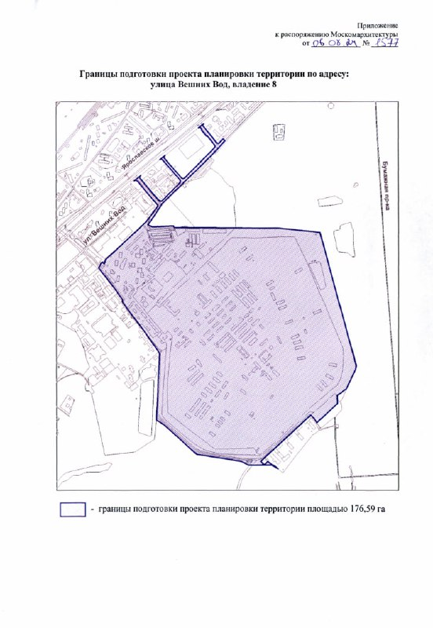

# Вешних Вод, 8: Capital Group готовит ППТ на 176,6 га у Лосиного острова

Бывший военный городок на Вешних Вод, 8 превращается в одну из самых крупных строек на северо-востоке Москвы. С августа 2024 года Capital Group за свой счёт готовит здесь проект планировки на 176,59 га. За два года у площадки появились партнёры, первый застройщик — «Град» — и метро, которое ещё недавно называли «мифическим».

## Коротко

- Распоряжение Москомархитектуры от 6 августа 2024 года № 1577 поручило ППТ ООО «Капитал Груп»; территория — 176,59 га.
- По данным распоряжения, которые приводят СМИ, на площадке заложено более 3 млн м² недвижимости.
- «Град» застроит 30,81 га: более 821 тыс. м² жилья.
- Метро: в июне 2026 года утвердили продление Сокольнической линии со станциями «МГСУ» и «Ярославская». Сроков пока нет.

## Город выдал Capital Group карандаш

Площадка на Вешних Вод — бывший военный городок по соседству с нацпарком «Лосиный остров». Распоряжение Москомархитектуры от 6 августа 2024 года № 1577 поручает ООО «Капитал Груп» в 2024–2025 годах подготовить проект планировки территории (ППТ) — за счёт самой компании. В основе — решение Градостроительно-земельной комиссии ([ГЗК](/slovar/gzk/)) от 8 мая 2024 года.

*Приложение к распоряжению Москомархитектуры от 6 августа 2024 года № 1577: границы подготовки проекта планировки территории площадью 176,59 га. Источник: Москомархитектура.*

В ноябре 2024 года рынок прочитал это как переход одного из крупнейших проектов города к Capital Group. Документально пока одно: компания рисует планировку за свои деньги. Перешли ли к ней права на землю, официально не сообщали — так что о сделке говорить рано.

## Земля с длинной историей

Площадку рынок знает давно. В августе 2017 года «Коммерсантъ» писал, что АО «Гарнизон», подведомственное Минобороны, готовит торги участком в 159 га на Вешних Вод с ориентиром около 30 млрд ₽. Часть территории тогда входила в природоохранную зону «Лосиного острова».

Как проект менялся после 2024 года — в [досье «Вешних вод, 8»](/obekty/veshnikh-vod-8/).

## Что с проектом сейчас

Картина на 14 октября 2026 года.

**Масштаб.** По данным распоряжения, которые в апреле 2026 года пересказал msk1.ru, на 176,5 га предусмотрено более 3 млн м² недвижимости. Масштаб — на целый район.

**Кто в деле.** Alias Group участвует через совместную с Capital Group компанию. С февраля 2025 года единственный учредитель СЗ «Ярославский» — ООО «Капитал Альянс». «Град» возьмёт 30,81 га: более 821 тыс. м² жилья и 35,4 тыс. м² нежилой части со школами и детскими садами. На каких условиях «Граду» досталась эта часть, стороны не раскрывали, а Capital Group проект не комментирует.

**Метро.** В 2024 году станцию у площадки называли «мифической». Теперь она в документах. В июне 2025 года Москомархитектура начала готовить ППТ продления Сокольнической линии на 8,5 км с двумя станциями — «МГСУ» и «Ярославская». В июне 2026 года проект утвердили, длина участка — 8,1 км. Когда построят и откроют станции, город пока не говорит.

**Стадия.** На апрель 2026 года территорию расчистили, документы планировки уточнили. О начале строительства жилья не объявляли.

## Что это значит для покупателя и инвестора

Квартир здесь не продают, ценников нет. Для покупателя это история на годы вперёд.

На наш взгляд, следить стоит за тремя вещами: когда у метро появятся сроки, как девелоперы поделят очереди и как многомиллионные метры уживутся с «Лосиным островом» по соседству. Пока всё это — планы на бумаге, и выбирать квартиру с оглядкой на них рано. Похожие истории — в подборке [будущих проектов Москвы](/novostroyki/budushchie-proekty/).

## Карточка объекта

- **Адрес ЗУ:** улица Вешних Вод, владение 8, Москва.
- **Проект:** Вешних вод, 8.
- **Подготовка ППТ:** [Capital Group](/zastroyshchiki/kapitalisty/) (ООО «Капитал Груп»).
- **Территория ППТ:** 176,59 га.
- **Объём:** более 3 млн м² недвижимости (по распоряжению, по данным СМИ).
- **Первая часть застройки:** «Град», 30,81 га, более 821 тыс. м² жилья.
- **Стадия:** планировка территории; основные [ТЭП](/slovar/tep/) приведены выше.

## Вопросы и ответы

**Кто застраивает участок на Вешних Вод, 8?**
Проект планировки по распоряжению Москомархитектуры от 6 августа 2024 года за свой счёт готовит ООО «Капитал Груп». Часть площадью 30,81 га, по данным СМИ, застроит «Град».

**Какая площадь проекта на Вешних Вод, 8?**
Границы ППТ — 176,59 га. По данным распоряжения, которые приводят СМИ, это более 3 млн м² недвижимости.

**Будет ли метро у проекта на Вешних Вод?**
Город продлевает Сокольническую линию на 8,1 км с двумя станциями — «МГСУ» и «Ярославская». Проект утвердили в июне 2026 года, сроки строительства пока не названы.

**Началось ли строительство жилья на Вешних Вод, 8?**
На 20 апреля 2026 года территорию расчистили и готовили к застройке, о начале строительства жилья не объявляли. С тех пор официальных новостей о старте не было.

См. также: [регулирование](/temy/regulirovanie/).

## Источники

1. msk1.ru, «Бывший военный городок рядом с Лосиным островом застроят жилыми домами», 20 апреля 2026 года: https://msk1.ru/text/gorod/2026/04/20/76369628/
2. Москвич Mag, схемы продления Сокольнической линии, 9 июня 2026 года: https://moskvichmag.ru/?p=504076
3. РБК Недвижимость, продление Сокольнической линии до «МГСУ» и «Ярославской», 6 июня 2025 года: https://realty.rbc.ru/news/6842ad6d9a794718ab40f670
4. Рамблер/«Коммерсантъ», о планах продать участок на Вешних Вод, 21 августа 2017 года: https://finance.rambler.ru/markets/37691858-smi-uznali-o-planah-prodat-chast-natsparka-losinyy-ostrov/amp/
5. Распоряжение Москомархитектуры от 6 августа 2024 года № 1577 с приложением (скан в статье).

Материал не является инвестиционной рекомендацией.
