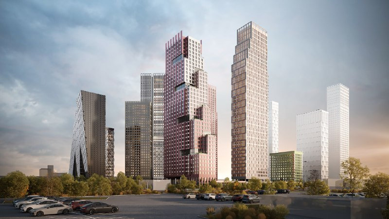
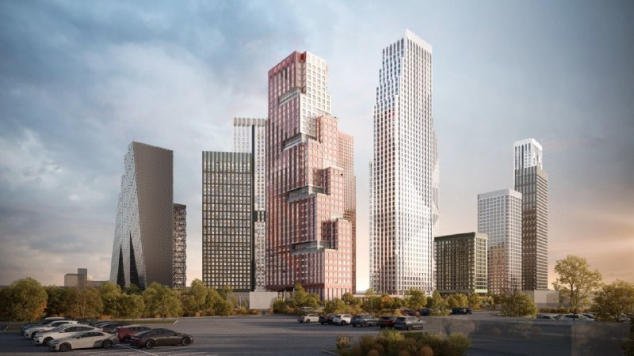

---
source:
  id: 26861
  date: 2024-11-28
status: needs_review
skip_reason: null
type: architecture
series: evolution
region: moscow
title: 'Ultima City на Южнопортовой, 21: девять корпусов в анонсе, две башни в продаже'
title_alts:
- 'Ultima City в Печатниках: как Кортрос менял проект с 2024 по 2026'
- 'Южнопортовая, 21: город согласовал два корпуса из девяти, остальные пока на рендерах'
slug: ultima-city-kak-menyalsya-proekt
lead: В феврале 2024 года Кортрос показал Ultima City как квартал из девяти корпусов до 56 этажей, а к маю 2025-го в продажу вышли две башни. Остальные семь пока живут на рендерах — и рендеры за это время успели поменяться.
developers:
- id: kortros
  name: Кортрос
  role: main
objects:
- id: yuzhnyy-port
  names:
  - Южный порт
  - Ultima City
  - UltimaCity
  zu: Южнопортовая, 21
  main: true
  new: false
districts:
- pechatniki
topics:
- arhitektura
images:
- file: media/16783_1.jpg
  alt: Башни квартала Ultima City на Южнопортовой, 21 в Печатниках, визуализация 2023 года
  caption: 'Визуализация: Кортрос, 2023'
  credit: Кортрос
- file: media/21768_1.jpg
  alt: Башни Ultima City на Южнопортовой, 21 в Печатниках, визуализация 2024 года
  caption: 'Визуализация: Кортрос, 2024'
  credit: Кортрос
factcheck:
- claim: '10 февраля 2024 года анонсирован проект UltimaCity ГК «Кортрос»: девять корпусов от 12 до 56 этажей на участке 8,4 га, «комфорт-класс с опциями бизнес-сегмента»'
  status: confirmed
  source: https://www.novostroy-m.ru/novosti/masshtabnyy_proekt_v_yujnom
  checked: 2026-10-14
- claim: 'Январь 2025 года: Москомархитектура согласовала только два корпуса из девяти (здание-«тетрис» и дом с остроконечной короной); бюро GAFA Architects названо в подписи к фото'
  status: confirmed
  source: https://moskvichmag.ru/?p=405906
  checked: 2026-10-14
- claim: 'Апрель 2026 года: девять корпусов от 7 до 56 этажей, центральная башня 220 м (рекламный материал; статья помечена как реклама)'
  status: changed
  source: https://www.bfm.ru/news/601653
  checked: 2026-10-14
- claim: Первая очередь — два корпуса на 52 и 45 этажей, 1 079 квартир, старт продаж в мае 2025 года, разрешение на строительство от 18 апреля 2025 года, цена от 19,1 млн ₽ на 13 октября 2026 года, ключи по сайту застройщика — 2029 год
  status: confirmed
  source: https://шахматка.москва/novosti/yuzhnyy-port-ultima-city-ceny-sroki/
  checked: 2026-10-14
- claim: Автор архитектуры — GAFA; смена застройщика на участке (Capital Group, затем Кортрос) — не подтверждены независимо
  status: unverified
  source: https://moskvichmag.ru/?p=405906
  checked: 2026-10-14
removed:
- 'Проекты Capital Group (2022) и сделка по участку Capital Group — Кортрос: независимого подтверждения не найдено, этап из текста убран.'
- 'Мастерплан зоны «Южный порт» от ABD, APEX, KAMEN и Nikken Sekkei (2020–2022): относится ко всей промзоне, а не к участку Южнопортовая, 21, и не подтверждён по источникам.'
- 'Автор архитектуры GAFA как факт: в открытых источниках найдена только подпись к фото в «Москвич Mag»; в таблице приведено с атрибуцией.'
- 'Транспортно-логистический центр в «Южном порту» (повод заметки 28 ноября 2024 года): не относится к участку Южнопортовая, 21, подтверждения не найдено.'
- 'Цены 380 тыс. ₽/м² и средняя площадь 55 м² из заметки 2025 года: не подтверждены.'
data_points:
- metric: ultima_city_min_price_mln_rub
  value: 19.1
  date: '2026-10-13'
seo:
  main_query: ultima city кортрос как менялся проект
  keywords:
  - ультима сити южнопортовая 21
  - ultima city печатники архитектура
  - кортрос южный порт проект
  - ультима сити этажность
  frequency_checked: false
  title: 'Ultima City в Печатниках: как Кортрос менял проект'
  description: 'Ultima City на Южнопортовой, 21: анонс на девять корпусов до 56 этажей в 2024 году, две башни в продаже с 2025-го. Как менялся проект к октябрю 2026.'
  canonical: https://шахматка.москва/novosti/ultima-city-kak-menyalsya-proekt/
internal_links:
- anchor: досье «Южный порт»
  url: /obekty/yuzhnyy-port/
- anchor: ГК «Кортрос»
  url: /zastroyshchiki/kortros/
- anchor: Печатники
  url: /novostroyki/pechatniki/
- anchor: цены, сроки и старт продаж Ultima City
  url: /novosti/yuzhnyy-port-ultima-city-ceny-sroki/
- anchor: архитектурно-градостроительное решение
  url: /slovar/agr/
- anchor: архитектура
  url: /temy/arhitektura/
faq:
- q: Кто автор архитектуры Ultima City?
  a: Бюро GAFA Architects названо в подписи к фото в журнале «Москвич Mag» (январь 2025 года). Официально застройщик авторство не объявлял.
- q: Сколько этажей в Ultima City?
  a: В феврале 2024 года анонсировали девять корпусов от 12 до 56 этажей. Первая очередь, вышедшая в продажу в мае 2025 года, — две башни на 52 и 45 этажей.
- q: Сколько корпусов согласовано в Ultima City?
  a: В январе 2025 года Москомархитектура, по данным «Москвич Mag», согласовала два корпуса из девяти. Разрешение на строительство корпусов 1 и 2 датировано 18 апреля 2025 года.
- q: Сколько стоят квартиры в Ultima City сейчас?
  a: На 13 октября 2026 года — от 19,1 млн ₽ за однокомнатную 28,34 м². Подробности — в материале о ценах и сроках.
date_published: 2024-11-28
date_modified: 2026-10-14
author: Редакция Шахматки
editor_notes: Пакет собран из заметок о мастерплане всей зоны «Южный порт» (ABD, APEX, KAMEN, Nikken Sekkei) и о проекте Кортроса на Южнопортовой, 21 (GAFA); сама заметка-юнит — про транспортно-логистический центр зоны, к участку не относится. Независимо подтверждены три этапа (февраль 2024, январь 2025, май 2025 и апрель 2026 — реклама). Автор GAFA — только подпись к фото. Данные первой очереди (52 и 45 этажей, 1 079 квартир, разрешение 18.04.2025, цена 19,1 млн ₽) взяты из опубликованного материала сайта от 13 октября 2026 года (проверен ранее по «Новострой-М»), в этой проверке источник заново не открывался. Годы подписей к фото (2023 и 2024) — по датам заметок архива; генплан участка в заметке датирован 3 февраля 2023 года. Лимит открытий WebFetch исчерпан, ЕИСЖС не открывался.
schema: |-
  [
    {
      "@context": "https://schema.org",
      "@type": "Article",
      "headline": "Ultima City: как менялся проект на Южнопортовой, 21 с 2024 по 2026",
      "description": "Ultima City на Южнопортовой, 21: девять корпусов до 56 этажей в 2024 году и первая очередь из двух башен в 2025-м. Что менялось и что известно на октябрь 2026.",
      "datePublished": "2024-11-28",
      "dateModified": "2026-10-14",
      "author": {
        "@type": "Organization",
        "name": "Редакция Шахматки"
      },
      "publisher": {
        "@type": "Organization",
        "name": "Шахматка"
      },
      "about": [
        {
          "@type": "Residence",
          "name": "Ultima City (Южный порт)",
          "address": "Москва, Южнопортовая, 21"
        },
        {
          "@type": "Organization",
          "name": "Кортрос"
        }
      ],
      "mainEntityOfPage": "https://шахматка.москва/novosti/ultima-city-kak-menyalsya-proekt/"
    },
    {
      "@context": "https://schema.org",
      "@type": "FAQPage",
      "mainEntity": [
        {
          "@type": "Question",
          "name": "Кто автор архитектуры Ultima City?",
          "acceptedAnswer": {
            "@type": "Answer",
            "text": "В открытых источниках бюро GAFA Architects названо в подписи к фото в журнале «Москвич Mag» (январь 2025 года); застройщик авторство официально не подтверждал в найденных нами материалах."
          }
        },
        {
          "@type": "Question",
          "name": "Сколько этажей в Ultima City?",
          "acceptedAnswer": {
            "@type": "Answer",
            "text": "В феврале 2024 года анонсировали девять корпусов от 12 до 56 этажей; первая очередь, вышедшая в продажу в мае 2025 года, — две башни на 52 и 45 этажей."
          }
        },
        {
          "@type": "Question",
          "name": "Сколько корпусов согласовано в Ultima City?",
          "acceptedAnswer": {
            "@type": "Answer",
            "text": "В январе 2025 года Москомархитектура, по данным «Москвич Mag», согласовала два корпуса из девяти; разрешение на строительство корпусов 1 и 2 датировано 18 апреля 2025 года."
          }
        },
        {
          "@type": "Question",
          "name": "Сколько стоят квартиры в Ultima City сейчас?",
          "acceptedAnswer": {
            "@type": "Answer",
            "text": "На 13 октября 2026 года минимальная цена — 19,1 млн ₽ (однокомнатная 28,34 м²); подробности — в материале о ценах и сроках."
          }
        }
      ]
    }
  ]
---

# Ultima City на Южнопортовой, 21: девять корпусов в анонсе, две башни в продаже

В феврале 2024 года Кортрос показал Ultima City как квартал из девяти корпусов до 56 этажей. К маю 2025-го в продажу вышли две башни. Остальные семь пока живут на рендерах — и рендеры, как видно по картинкам, успели поменяться.

**Коротко**

- Февраль 2024 года: девять корпусов от 12 до 56 этажей на 8,4 га, «комфорт-класс с опциями бизнес-сегмента».
- Январь 2025 года: Москомархитектура согласовала два корпуса из девяти.
- Май 2025 года: в продаже первая очередь — башни на 52 и 45 этажей, 1 079 квартир.
- Октябрь 2026 года: от 19,1 млн ₽, ключи по сайту застройщика — в 2029 году.

## Старт: девять башен на бывшей промзоне

Южнопортовая, 21 — кусок бывшей промзоны «Южный порт» в районе [Печатники](/novostroyki/pechatniki/). Громко о проекте заговорили 10 февраля 2024 года: [ГК «Кортрос»](/zastroyshchiki/kortros/) анонсировала UltimaCity на участке 8,4 га, на второй линии от Москвы-реки. По данным «Новострой-М», в планах девять корпусов от 12 до 56 этажей, а класс обозначили формулой, которую стоит процитировать целиком: «комфорт с опциями бизнес-сегмента».

Визуализации квартала появились ещё в 2023 году. Высокая башня справа там ступенчатая, с коричневатым фасадом — это видно по картинке. Параметров того варианта застройщик не публиковал.

*Визуализация: Кортрос, 2023*

## Город согласовал два из девяти

В январе 2025 года «Москвич Mag» сообщил: Москомархитектура «пока согласовала только два корпуса нового квартала». Это здание, которое журнал называет «тетрисом», и дом с остроконечной короной. Судьба самого замысловатого корпуса, по словам автора, ещё решалась. Бюро GAFA Architects журнал упоминает в подписи к фото, но прямо автором проекта не называет.

Вот где подвох для покупателя. Архитектурно-градостроительное решение ([АГР](/slovar/agr/)) согласуют по корпусам, и анонс девяти зданий ещё не значит, что все девять доживут до стройки в показанном виде.

К 2024 году высокая башня на визуализации посветлела и стала сужаться кверху — совсем не та ступенчатая форма, что в 2023 году. Почему — застройщик не объяснял.

*Визуализация: Кортрос, 2024*

В мае 2025 года стартовали продажи первой очереди: два корпуса на 52 и 45 этажей, 1 079 квартир. Разрешение на строительство корпусов 1 и 2 датировано 18 апреля 2025 года. Цены и сроки — в [отдельном материале](/novosti/yuzhnyy-port-ultima-city-ceny-sroki/).

## Две башни в бетоне, семь в презентации

На 14 октября 2026 года в продаже две башни первой очереди, а в проекте по-прежнему девять корпусов. В апреле 2026 года рекламный материал застройщика назвал другую этажность: от 7 до 56 этажей, центральная башня — 220 м. Статья в источнике помечена как реклама, так что эти цифры — заявка, а не проектная документация.

Цены на 13 октября 2026 года: от 19,1 млн ₽ за однокомнатную квартиру 28,34 м², ключи по сайту застройщика — в 2029 году. На старте минимальный чек был 11,3 млн ₽. Но лоты разные, и сравнивать эти числа в лоб не стоит.

Вся история участка и зоны — в [досье «Южный порт»](/obekty/yuzhnyy-port/).

## Было и стало

| Параметр | Февраль 2024 | Январь 2025 | Май 2025 | Апрель 2026 (реклама) |
|---|---|---|---|---|
| Корпусов в проекте | 9 | 9 (согласованы 2) | 9 (в продаже 2) | 9 |
| Этажность | 12–56 | — | 52 и 45 (первая очередь) | 7–56 |
| Высота | — | — | — | центральная башня 220 м |
| Участок | 8,4 га | — | — | 8,4 га |
| Квартиры | — | — | 1 079 (первая очередь) | — |
| Архитектор | — | GAFA Architects (по подписи к фото) | — | — |

Прочерк — для этого этапа цифру публично не называли.

## Что это значит для покупателя

На наш взгляд, главное здесь не этажи, а процесс. До продаж дошли два корпуса из девяти, остальные семь — пока заявленная концепция. Покупатель первой очереди берёт конкретные башни, а не весь квартал с рендеров.

Что отслеживать: согласование оставшихся корпусов, этажность в проектных декларациях, открытие метро «Южный порт» (по данным агрегатора, 2028 год) и сроки сдачи — у разных источников они расходятся.

## Карточка объекта

- **Адрес участка:** Южнопортовая, 21, Москва
- **Названия:** Ultima City, UltimaCity, проект «Южный порт»
- **Застройщик:** ГК «Кортрос»
- **Район:** Печатники, ЮВАО
- **Участок:** 8,4 га
- **Корпусов:** 9, в продаже — 2 (52 и 45 этажей)
- **Квартиры первой очереди:** 1 079
- **Стадия:** продажи, строительство первой очереди
- **Цена:** от 19,1 млн ₽ (13 октября 2026 года)

## Вопросы и ответы

**Кто автор архитектуры Ultima City?**
Бюро GAFA Architects названо в подписи к фото в журнале «Москвич Mag» (январь 2025 года). Официально застройщик авторство не объявлял.

**Сколько этажей в Ultima City?**
В феврале 2024 года анонсировали девять корпусов от 12 до 56 этажей. Первая очередь, вышедшая в продажу в мае 2025 года, — две башни на 52 и 45 этажей.

**Сколько корпусов согласовано в Ultima City?**
В январе 2025 года Москомархитектура, по данным «Москвич Mag», согласовала два корпуса из девяти. Разрешение на строительство корпусов 1 и 2 датировано 18 апреля 2025 года.

**Сколько стоят квартиры в Ultima City сейчас?**
На 13 октября 2026 года — от 19,1 млн ₽ за однокомнатную 28,34 м². Подробности — в материале о ценах и сроках.

## Источники

1. [Новострой-М: масштабный проект в Южном порту, 10 февраля 2024 года](https://www.novostroy-m.ru/novosti/masshtabnyy_proekt_v_yujnom)
2. [Москвич Mag: ЖК с небоскрёбом-«тетрисом» в Южном порту, 12 января 2025 года](https://moskvichmag.ru/?p=405906)
3. [БФМ: «УЛЬТИМА Сити» в рейтинге инвестпроектов, 20 апреля 2026 года (рекламный материал)](https://www.bfm.ru/news/601653)
4. [Шахматка: Ultima City от Кортроса — цены и сроки](https://шахматка.москва/novosti/yuzhnyy-port-ultima-city-ceny-sroki/)

Материал не является инвестиционной рекомендацией.
