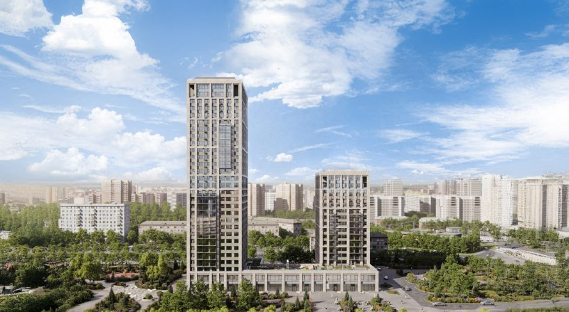
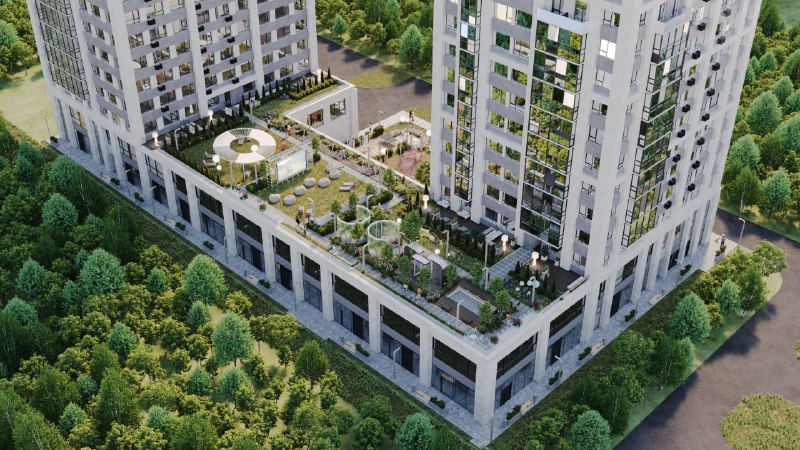

# ЖК «Бестселлер» от BAZA на Перовском шоссе, 21: студия подорожала до 19,1 млн ₽

Екатеринбургская BAZA Development зашла в Москву с «Бестселлером» на Перовском шоссе, 21 — и столица встретила её ростом цен. В апреле 2025 года квартиры начинались от 12,3 млн ₽, на 13 октября 2026 года студия стоит от 19,1 млн ₽. Дом строится, корпус 1 обещают сдать в I квартале 2028 года.

**Коротко**

- Застройщик — ООО «BAZA Development», основана в 2017 году в Екатеринбурге; «Бестселлер» — её первый московский проект.
- Две башни в 16 и 29 этажей, 391 квартира от 28 до 110 м², класс — комфорт-плюс.
- Корпус 1 — I квартал 2028 года; в сентябре 2026 года монтировали верхние этажи.
- На 13 октября 2026 года — от 19,1 млн ₽; двушка 54,7 м² — около 25,4 млн ₽ (463,6 тыс. ₽/м²).

## Уральский дебют на бывшем «Фрезере»

Площадка — Перовское шоссе, 21, Нижегородский район ЮВАО. До метро «Нижегородская» 12–15 минут пешком: разные страницы агрегатора считают по-разному. Эта часть бывшего завода «Фрезер» давно стала территорией сразу нескольких девелоперов. Вся история участка — в [досье «Нижегородская»](/obekty/nizhegorodskaya/), район — [Перово](/novostroyki/perovo/).

BAZA Development появилась в 2017 году в Екатеринбурге как агентство недвижимости, сейчас ведёт проекты на Урале и в Москве. «Бестселлер» — первый московский. Презентовали его 23 апреля 2025 года, продажи открыли в конце того же апреля.

*Две башни «Бестселлера» (16 и 29 этажей) на визуализации застройщика. Визуализация: BAZA Development*

## Две башни на общем стилобате

По данным застройщика, которые пересказывает агрегатор, общая площадь комплекса — около 35 тыс. м², из них около 20,3 тыс. м² — жильё. Башни стоят на стилобате (общем основании). Внутри 391 квартира и больше 30 планировок, от 28 до 110 м², есть квартиры с террасами. Из обещанного: коворкинг-терраса на стилобате, детские и спортивные площадки во дворе, коммерция на первом этаже и подземный паркинг на 110 машин.

*Благоустроенная кровля стилобата на визуализации застройщика. Визуализация: BAZA Development*

## Что с проектом сейчас

В декабре 2024 года было известно лишь одно: BAZA выходит на московский рынок. Дальше события шли так:

- **23 апреля 2025 года** — официальная презентация;
- **конец апреля 2025 года** — старт продаж, цены от 12,3 млн ₽;
- **сентябрь 2026 года** — на странице проекта монтаж верхних этажей корпуса 1;
- **13 октября 2026 года** — цены от 19,1 млн ₽ (студия) до 42,5 млн ₽; сдача корпуса 1 — I квартал 2028 года.

Для ориентира: двухкомнатная 54,7 м² на 13 октября 2026 года выставлена за 25 359 001 ₽, это 463,6 тыс. ₽/м². Цена из конкретного объявления на агрегаторе, а не средняя по проекту.

## Соседи по «Фрезеру»

На соседнем участке бывшего завода «Брусника» строит квартал «Издание» — подробнее в материале про [цены и сроки «Издания» Брусники](/novosti/izdanie-brusnika-perovskoe-shosse-ceny-sroki/). По сообщению «Коммерсанта», которое 4 июля 2023 года пересказал «Новострой-М», Level Group продала «Бруснике» около 4 га на Перовском шоссе — половину проекта на 350 тыс. м² жилья. Как участок достался BAZA и у кого она его купила, публично не раскрывали — так что о сделке говорить рано.

## Что это значит для покупателя и инвестора

**Цена.** За полтора года вход подорожал с 12,3 до 19,1 млн ₽. Оба числа — цена самого дешёвого лота, а не средняя. На наш взгляд, честнее сравнивать метр, а не «от»: по двушке выходит около 464 тыс. ₽/м².

**Застройщик.** Для BAZA это первый московский дом, своей столичной истории сдачи у компании нет. Перед покупкой откройте [проектную декларацию](/slovar/proektnaya-deklaratsiya/) в ЕИСЖС, проверьте эскроу-счета и разрешение на строительство.

**Окружение.** Вокруг строят другие девелоперы, так что благоустройство и транспорт оценивайте по факту, а не по визуализациям. Другие проекты этого класса — в подборке [комфорт-класса](/novostroyki/komfort-klass/).

## Карточка объекта

- **Адрес ЗУ:** Москва, Перовское шоссе, 21
- **Названия:** «Бестселлер»; участок в досье — «Перовское, 21»
- **Застройщик:** ООО «BAZA Development»
- **Район:** Нижегородский (ЮВАО), метро «Нижегородская»
- **Класс:** комфорт-плюс
- **Корпуса:** две башни, 16 и 29 этажей
- **Площадь:** около 35 тыс. м², жилая — около 20,3 тыс. м²
- **Квартиры:** 391, от 28 до 110 м²
- **Стадия:** строительство, монтаж верхних этажей (сентябрь 2026)
- **Сдача:** I квартал 2028 года (корпус 1)
- **Цены:** от 19,1 млн ₽ (13 октября 2026 года)

## Вопросы и ответы

**Кто застройщик ЖК «Бестселлер» на Перовском шоссе, 21?**

ООО «BAZA Development». Компанию основали в 2017 году в Екатеринбурге, и «Бестселлер» — её первый проект в Москве.

**Когда сдадут «Бестселлер» на Перовском шоссе?**

Корпус 1 — в I квартале 2028 года, по данным «Новострой-М» на 13 октября 2026 года. На площадке монтируют верхние этажи.

**Сколько стоят квартиры в «Бестселлере»?**

На 13 октября 2026 года — от 19,1 млн ₽ за студию 32,8 м². Двухкомнатная 54,7 м² стоит около 25,4 млн ₽, или 463,6 тыс. ₽/м².

**Какой класс и масштаб у ЖК «Бестселлер»?**

Комфорт-плюс: две башни в 16 и 29 этажей, 391 квартира от 28 до 110 м².

## Источники

1. «Новострой-М», «Компания BAZA Development презентовала ЖК «Бестселлер»», 23 апреля 2025: https://www.novostroy-m.ru/kompanii/ooo_baza_development/news/kompaniya_baza_development_prezentovala
2. «Новострой-М», новость о старте продаж ЖК «Бестселлер», 30 апреля 2025: https://www.novostroy-m.ru/novosti/jk_bestseller_i_buduschiy
3. «Новострой-М», страница ЖК «Бестселлер», данные на 13 октября 2026: https://www.novostroy-m.ru/baza/jk_bestseller
4. «Новострой-М», двухкомнатная квартира в ЖК «Бестселлер»: https://www.novostroy-m.ru/kvartiry/dvuhkomnatnaya-kvartira-v-zhk-bestseller-8039e1fe04056615c1dfe2f82eac46
5. «Новострой-М», страница застройщика BAZA Development: https://www.novostroy-m.ru/kompanii/ooo_baza_development
6. «Новострой-М», «Брусника покупает у Level», 4 июля 2023 (со ссылкой на «Коммерсантъ»): https://www.novostroy-m.ru/novosti/brusnika_pokupaet_u_level

Дата публикации: 4 декабря 2024 года. Факты проверены 13 октября 2026 года. Автор: Редакция Шахматки.

Материал не является инвестиционной рекомендацией.
