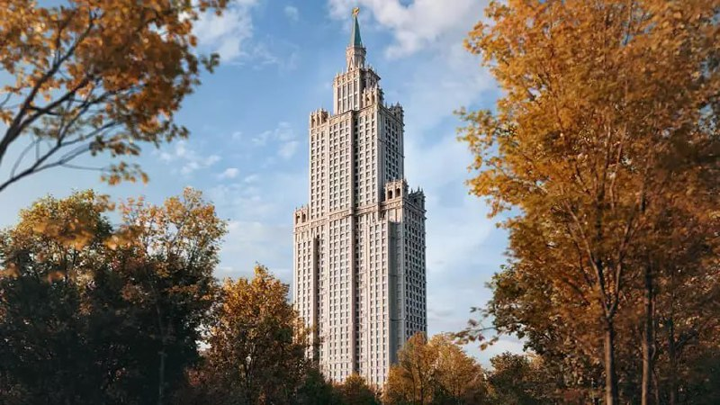
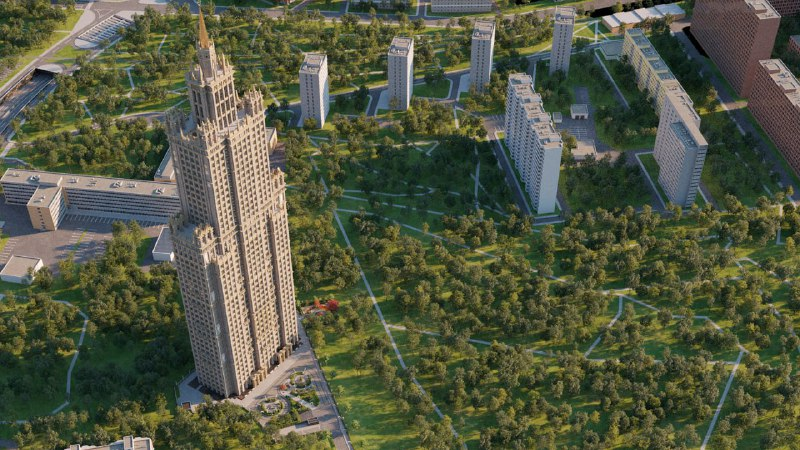

# «Высотка на Жукова» от Кроста: сталинский шпиль, цена выше, сдача — в 2029-м

6 декабря 2024 года «Крост» вывел в продажу «Высотку на Жукова» — неоклассическую башню на месте бывшей Октябрьской радиостанции в Хорошёво-Мнёвниках. За неполные два года выросло всё, кроме самой башни: однокомнатные подорожали с 31,4 до 36,7 млн ₽, а срок сдачи уехал с 2026 года на третий квартал 2029-го.

## Коротко

- ЖК «Высотка на Жукова»: ул. Демьяна Бедного, вл. 24, Хорошёво-Мнёвники (СЗАО), у метро «Народное ополчение».
- Старт в декабре 2024 года: однокомнатные от 31,4 млн ₽, двухкомнатные от 44 млн ₽, трёхкомнатные от 49,3 млн ₽.
- Сейчас — от 36,7 до 63,2 млн ₽, по объявлениям около 730–877 тыс. ₽/м² (данные агрегаторов на сентябрь–октябрь 2026 года).
- Срок: вместо 2026 года — третий квартал 2029-го.

## Сталинский силуэт в 233 метра

Башню рисовали с оглядкой на сталинские высотки: ступенчатый силуэт, наверху — шпиль. По данным городского издания, высота — 233 м, из них 45 м приходится на шпиль. Фасады разрабатывали под руководством почётного архитектора России Михаила Фельдмана.

*Визуализация башни «Высотки на Жукова» (1). Визуализация: Крост*

*Башня на фоне окружающей застройки (2). Визуализация: Крост*

## Сколько стоят квартиры в «Высотке на Жукова» сейчас

На старте прайс выглядел так: однокомнатные от 31,4 млн ₽, двухкомнатные от 44 млн ₽, трёхкомнатные от 49,3 млн ₽.

На 14 октября 2026 года самый дешёвый вход — 36,7 млн ₽ за однокомнатную площадью 44,7 м², потолок по сводке — 63,2 млн ₽. Метр по объявлениям стоит примерно от 730 до 877 тыс. ₽, средняя по сводке «Циан» — 770 тыс. ₽/м². Входной билет за 22 месяца подорожал примерно на 17%.

Оговорка: это цены агрегаторов, а не прайс застройщика. Перед сделкой сверяйте их с проектной декларацией и договором.

## Шпиль подождёт: сдача сдвинулась на 2029 год

В декабре 2024 года городское издание обещало дом в 2026 году. На октябрь 2026-го страницы проекта называют третий квартал 2029 года. Там же сказано, что идёт монтаж нижних этажей, последний фотоотчёт — от 19 августа 2026 года. Иными словами, в год, когда башня должна была быть готова, она только выходит из земли.

## Участок с радиоисторией

«Крост» строит на Демьяна Бедного, 24, на месте радиоцентра. ГПЗУ (градостроительный план земельного участка) и то, как потом менялся проект, разобраны в хронологии — в [досье «Высотка на Жукова»](/obekty/vysotka-na-zhukova/). Застройщик — [«Крост»](/zastroyshchiki/krost/), район — [Хорошёво-Мнёвники](/novostroyki/khoroshevo-mnevniki/).

## Что это значит для покупателя и инвестора

Это штучный продукт из сегмента [премиальных новостроек Москвы](/novostroyki/premium-klass/): метр дороже, чем у типового бизнес-класса, и платите вы прежде всего за архитектуру и высоту. На наш взгляд, главный риск здесь не цена, а срок. Он уже сдвинулся на три года от первой версии, а стройка пока на нижних этажах.

Что отслеживать: проектную декларацию на наш.дом.рф (срок ввода, разрешение на строительство) и темп, с которым по фотоотчётам растут этажи. Динамика рынка — в разделе [«Цены»](/temy/ceny/).

## Карточка объекта

- Название: «Высотка на Жукова»
- Адрес участка: Москва, ул. Демьяна Бедного, вл. 24
- Район: Хорошёво-Мнёвники, СЗАО
- Застройщик: «Крост» (продаёт ООО СЗ «Прогресс»)
- Высота: 233 м (по данным на декабрь 2024 года)
- Стадия: строительство, продажи
- Ввод: третий квартал 2029 года (по данным агрегаторов на октябрь 2026 года)
- Цены: от 36,7 до 63,2 млн ₽

## Вопросы и ответы

**Кто застройщик ЖК «Высотка на Жукова»?**
Концерн «Крост», квартиры продаёт ООО СЗ «Прогресс». Адрес — ул. Демьяна Бедного, вл. 24, Хорошёво-Мнёвники.

**Сколько стоят квартиры в «Высотке на Жукова»?**
В декабре 2024 года однокомнатные стоили от 31,4 млн ₽. На сентябрь–октябрь 2026 года, по данным агрегаторов, — от 36,7 до 63,2 млн ₽.

**Когда сдадут «Высотку на Жукова»?**
Обещали в 2026 году, теперь на страницах проекта — третий квартал 2029 года. По ходу строительства — монтаж нижних этажей.

**Какая высота у «Высотки на Жукова»?**
По данным городского издания, 233 м вместе с 45-метровым шпилем. Данные об этажности расходятся, так что ориентируйтесь на высоту.

## Источники

1. [МСК1: на месте первой московской радиостанции появится новая «сталинская» высотка, 6 декабря 2024](https://msk1.ru/text/realty/2024/12/06/74847545/)
2. [Страница ЖК «Высотка на Жукова» на novostroy-m.ru](https://www.novostroy-m.ru/baza/jk_na_ul_demyana)
3. [Ход строительства «Высотки на Жукова», novostroy-m.ru](https://www.novostroy-m.ru/baza/jk_na_ul_demyana/hod-stroitelstva)
4. [Новостройки на ул. Демьяна Бедного, Циан](https://www.cian.ru/kupit-kvartiru-novostroyki-moskva-ulica-demyana-bednogo-022525/)

Материал не является инвестиционной рекомендацией.
