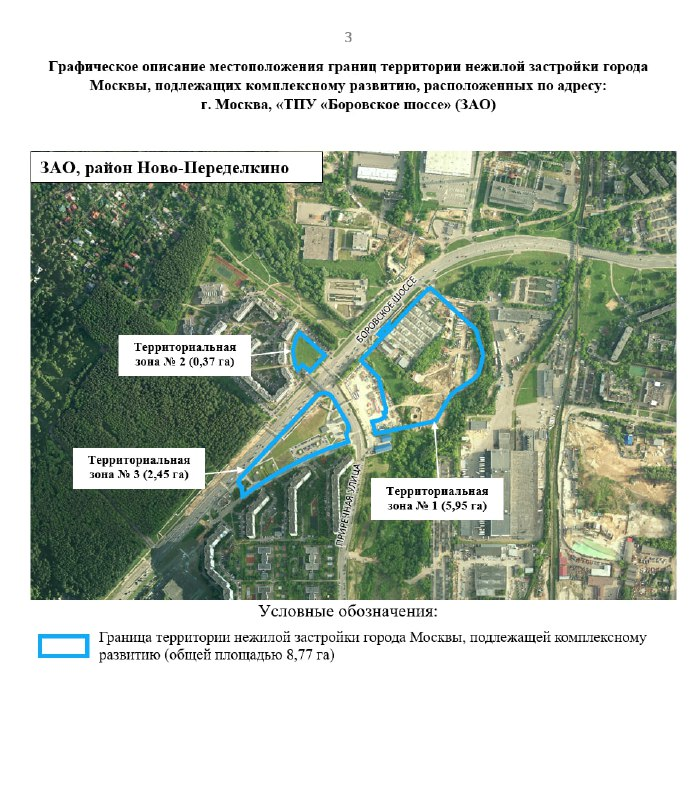

# КРТ у метро «Боровское шоссе»: 8,77 га и 138,5 тыс. м² в Ново-Переделкине

Правительство Москвы приняло решение о комплексном развитии территорий (КРТ) для трёх участков общей площадью 8,77 га у метро «Боровское шоссе» в Ново-Переделкине. Власти объявили об этом 26 мая 2025 года: предусмотрено до 138,5 тыс. м² недвижимости, в том числе жильё.

## Коротко

- Территория КРТ — три участка общей площадью 8,77 га на пересечении Боровского шоссе и Приречной улицы.
- Предусмотрено 138,5 тыс. м² недвижимости: жильё, офисы, магазины, кафе, банки и спортивно-развлекательный комплекс.
- По приложению к решению, в крупнейшей зоне (5,95 га) предельная площадь жилья — 92 тыс. м².
- Инвестиции оцениваются примерно в 27,13 млрд ₽, срок редевелопмента — пять лет.
- Оператор КРТ в проверенных источниках не назван, цен и старта продаж нет.

*Границы территории КРТ «ТПУ «Боровское шоссе» (ЗАО, Ново-Переделкино): зоны 5,95, 0,37 и 2,45 га, всего 8,77 га. Документ о комплексном развитии территории, Правительство Москвы*

## Что решил город

В решении речь идёт о трёх участках на пересечении Боровского шоссе и Приречной улицы рядом со станцией метро «Боровское шоссе». Рядом — Чоботовский лес и заказник «Долина реки Сетуни». Территорию отдают под [комплексное развитие (КРТ)](/slovar/krt/): оператор, которого определит город, проведёт редевелопмент за пять лет.

Всего предусмотрено 138,5 тыс. м². На участках планируют квартал с жильём и объектами общественно-делового назначения: офисами, магазинами, кафе и отделениями банков, а также спортивно-развлекательным комплексом. Вложения оцениваются примерно в 27,13 млрд ₽, бюджетный эффект — 654,6 млн ₽ в год, рабочих мест — более 1,5 тыс.

## Как поделена территория

Документ делит территорию на три зоны. Зона № 1 — 5,95 га: для неё предельная суммарная площадь жилой застройки — 92 тыс. м². Зона № 2 — 0,37 га: до 6,5 тыс. м² общественно-деловой застройки. Зона № 3 — 2,45 га: до 40 тыс. м² общественно-деловой застройки. Сумма этих значений совпадает с общей цифрой в 138,5 тыс. м².

Документ называет территорию «ТПУ «Боровское шоссе»», то есть транспортно-пересадочным узлом ([ТПУ](/slovar/tpu/)). Предельные площади указаны как максимум; этажность и плотность для зон не установлены.

## Что изменилось к октябрю 2026 года

В декабре 2024 года решение называли уже утверждённым. Публично о решении города сообщили 26 мая 2025 года; это дата сообщения, дата самого документа может отличаться. Общественно-деловая часть оказалась больше, чем «20+ тыс. м²», о которых говорили раньше: по документу до 46,5 тыс. м².

На 13 октября 2026 года мы не нашли в проверенных источниках названия оператора, сроков старта, цен и информации о регистрации ДДУ. Поэтому говорить о квартирах в этом КРТ как о предложении на рынке пока нельзя.

## Контекст: другие проекты у Боровского шоссе

На этом же шоссе в Ново-Переделкине находится отдельный проект «Родины» на участке Боровское, 51. Полная история проекта — в [досье «Родина Переделкино»](/obekty/rodina-peredelkino/). К КРТ у метро он не относится. Другие проекты района собраны в подборке [Ново-Переделкино](/novostroyki/novo-peredelkino/), все решения по теме — в разделе [КРТ](/temy/krt/).

## Что это значит для покупателя

- Это решение об освоении территории, а не старт продаж: до появления оператора, проектной декларации и разрешения на строительство покупать здесь нечего.
- На наш взгляд, 92 тыс. м² жилья на 5,95 га и пятилетний срок означают, что первые квартиры появятся не скоро.
- Следить стоит за названием оператора, градостроительным планом участков, проектной декларацией и ценами на соседние проекты.

## Вопросы и ответы

**Что такое КРТ на Боровском шоссе в Ново-Переделкине?**
Это программа комплексного развития трёх участков общей площадью 8,77 га на пересечении Боровского шоссе и Приречной улицы. Городские власти сообщили о ней 26 мая 2025 года.

**Сколько жилья построят по КРТ у метро «Боровское шоссе»?**
Всего на участках предусмотрено 138,5 тыс. м² недвижимости. По приложению к решению, в зоне 5,95 га предельная площадь жилья — 92 тыс. м².

**Когда начнут строить?**
Оператор проведёт редевелопмент за пять лет с начала реализации. Сроков старта и названия оператора в открытых источниках, которые мы проверили, нет.

**Можно ли уже купить квартиру в проекте КРТ?**
Подтверждённых данных о старте продаж, ценах и ДДУ по этому КРТ на 13 октября 2026 года мы не нашли.

## Источники

1. [mos.ru: решение о реорганизации трёх участков в Ново-Переделкине по программе КРТ, 26 мая 2025 года](https://www.mos.ru/news/item/154278073/)
2. [М24: «Три участка в Ново-Переделкине реорганизуют по программе КРТ», 26 мая 2025 года](https://www.m24.ru/news/26052025/800498)

Материал не является инвестиционной рекомендацией.
