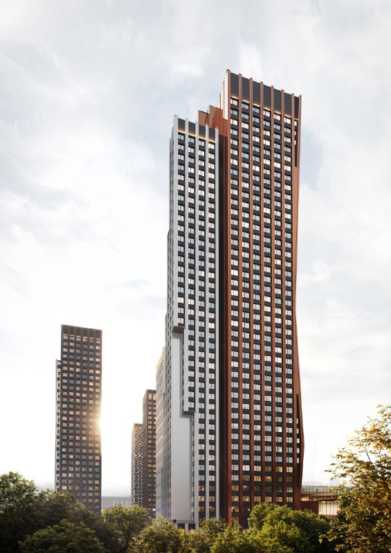
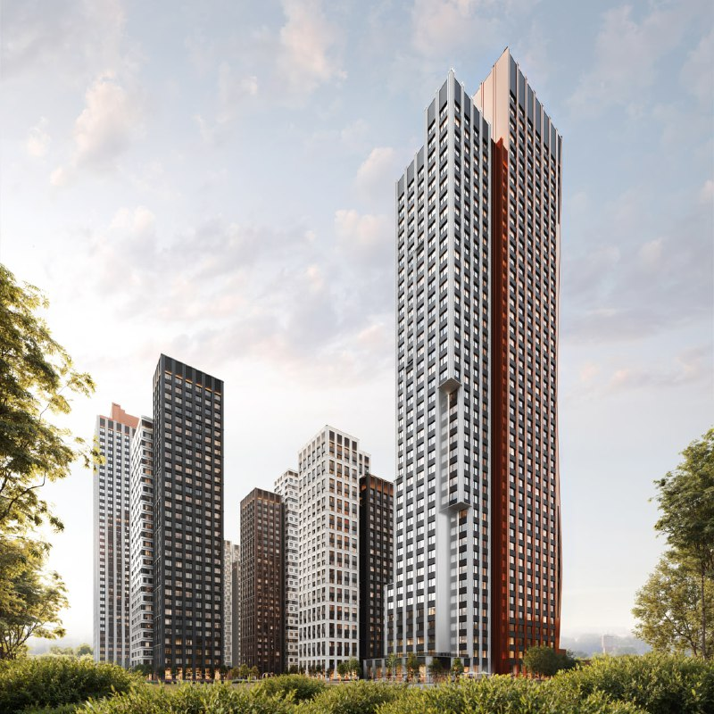
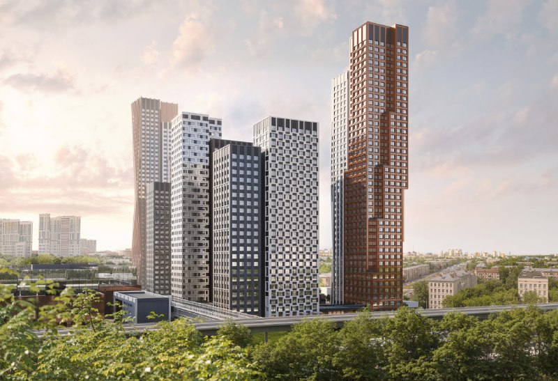

---
source:
  id: 27308
  date: '2024-12-27'
status: needs_review
skip_reason: null
type: object
region: moscow
title: '«Мангазея в Богородском», ныне «НАЗАРÉ»: вход подорожал с 8,9 до 15,2 млн ₽'
title_alts:
- 'ЖК «НАЗАРÉ» у метро «Бульвар Рокоссовского»: было от 8,9, стало от 15,2 млн ₽'
- 'Бывшая «Мангазея в Богородском»: новое имя, новые цены и стройка у земли'
slug: mangazeya-v-bogorodskom-nazare-ceny-sroki
lead: В декабре 2024 года «Мангазея в Богородском» стартовала с цены от 8,9 млн ₽. К октябрю 2026 года у проекта новое имя — «НАЗАРÉ» — и новый вход, от 15,2 млн ₽, а стройка только на нижних этажах при обещанной сдаче во II квартале 2028 года.
developers:
- id: mangazeya
  name: Мангазея
  role: main
objects:
- id: mangazeya-v-bogorodskom
  names:
  - Мангазея в Богородском
  - НАЗАРÉ
  - Открытое шоссе, 9
  zu: Открытое, 9
  main: true
  new: false
districts:
- bogorodskoe
topics:
- ceny
- rynok
images:
- file: media/27308_1.jpg
  alt: Высотная башня с медно-коричневой гранью в ЖК «Мангазея в Богородском», Открытое шоссе, 9, визуализация
  caption: 'Визуализация: Мангазея'
  credit: Мангазея
- file: media/27308_2.jpg
  alt: Башни комплекса «Мангазея в Богородском» разной высоты и фасадной отделки, Богородское, визуализация
  caption: 'Визуализация: Мангазея'
  credit: Мангазея
- file: media/27308_3.jpg
  alt: 'Жилой комплекс у Открытого шоссе в Богородском: группа башен и доминанта, вид сверху, визуализация'
  caption: 'Визуализация: Мангазея'
  credit: Мангазея
factcheck:
- claim: '«Мангазея» начала продажи ЖК «Мангазея в Богородском»: бизнес-класс, 6 башен, 24–43 этажа, цена от 8,9 млн ₽, в составе комплекса будет торговый центр (новость от 28 декабря 2024 года)'
  status: confirmed
  source: https://www.novostroy-m.ru/novosti/mangazeya_v_bogorodskom_i
  checked: '2026-10-13'
- claim: Мангазея выкупила у «Пионера» проект ТПУ «Открытое шоссе» (около 145 тыс. м²; сообщение «Ведомостей» от 17–18 августа 2023 года)
  status: confirmed
  source: https://www.vedomosti.ru/realty/articles/2023/08/18/990738-gruppa-mangazeya-postroit-zhiloi-kompleks
  checked: '2026-10-13'
- claim: 'Проект сейчас продаётся как «НАЗАРÉ» (Мангазея): бизнес-класс, шоссе Открытое, д. 9, метро и МЦК «Бульвар Рокоссовского» — 2 мин пешком'
  status: changed
  source: https://www.novostroy-m.ru/baza/jk_na_otkrytom_mangazeya
  checked: '2026-10-13'
- claim: Срок сдачи корпусов 1–6 — II квартал 2028 года; стадия — монтаж нижних этажей (на 26.09.2026)
  status: confirmed
  source: https://www.novostroy-m.ru/baza/jk_na_otkrytom_mangazeya
  checked: '2026-10-13'
- claim: 1833 квартиры по проекту, 258 в продаже; цены от 15,2 до 49,6 млн ₽; паркинг на 620 машино-мест; детский сад на 75 детей; ДДУ с эскроу
  status: confirmed
  source: https://www.novostroy-m.ru/baza/jk_na_otkrytom_mangazeya
  checked: '2026-10-13'
- claim: Студия 21,4 м², этаж 15, без отделки — 17,3 млн ₽ (808 тыс. ₽/м²) на 2 октября 2026 года
  status: confirmed
  source: https://www.novostroy-m.ru/kvartiry/studiya-v-zhk-nazar-50ca5463a729795492108569313a2f
  checked: '2026-10-13'
- claim: Начальная цена 8,9 млн ₽ → 15,2 млн ₽ в октябре 2026 года (минимальная цена входа)
  status: changed
  source: https://www.novostroy-m.ru/novosti/mangazeya_v_bogorodskom_i ; https://www.novostroy-m.ru/baza/jk_na_otkrytom_mangazeya
  checked: '2026-10-13'
- claim: Виды на Лосиный остров
  status: unverified
  source: в источниках не найдено
  checked: '2026-10-13'
- claim: Проект в 2022 году проектировал APEX на 34 этажа; Пионер вёл проект с 2021 года
  status: unverified
  source: первоисточников не найдено; в статью не вынесено
  checked: '2026-10-13'
- claim: Купили проект в конце 2022 года
  status: unverified
  source: «Ведомости» сообщили о сделке в августе 2023 года; точная дата сделки не подтверждена
  checked: '2026-10-13'
- claim: Акт ГИКЭ летом 2023 года и ПЗЗ; визуализации СПИЧ в конце 2023 года
  status: unverified
  source: первоисточников не найдено
  checked: '2026-10-13'
removed:
- 'Виды на Лосиный остров, «свой детский сад» — из обещаний продаж оставлены только проверенные: детский сад на 75 детей и торговый центр.'
- Хронология по Пионеру, APEX (до 34 этажей), акту ГИКЭ, ПЗЗ и СПИЧ — первоисточники не найдены; оставлена только сделка с Пионером по «Ведомостям».
- Дата покупки проекта «в конце 2022 года» — источник («Ведомости») датирует сообщение августом 2023 года.
- Ожидание «регистраций ДДУ и ждунов» и иронические оценки — мнение, не факт.
- Цена 300–400 тыс. ₽/м² и корпус с вайтбоксом (июнь 2025) из хронологии досье — не проверены.
data_points:
- metric: min_lot_price
  object: mangazeya-v-bogorodskom
  value: 15200000
  unit: RUB
  date: '2026-09-26'
- metric: completion_date
  object: mangazeya-v-bogorodskom
  value: 2028-Q2
  date: '2026-09-26'
- metric: flats_for_sale
  object: mangazeya-v-bogorodskom
  value: 258
  of: 1833
  date: '2026-09-26'
seo:
  main_query: мангазея в богородском цены
  keywords:
  - жк назаре богородское
  - мангазея открытое шоссе 9
  - новостройки бульвар рокоссовского
  - мангазея в богородском сроки сдачи
  - тпу открытое шоссе
  frequency_checked: false
  title: '«Мангазея в Богородском» (НАЗАРÉ): цены и сроки сдачи'
  description: 'ЖК «Мангазея в Богородском», теперь «НАЗАРÉ», на Открытом шоссе, 9: вход вырос с 8,9 до 15,2 млн ₽, сдача — II квартал 2028 года, в проекте 1833 квартиры.'
  canonical: https://шахматка.москва/novosti/mangazeya-v-bogorodskom-nazare-ceny-sroki/
internal_links:
- anchor: досье «Мангазея в Богородском»
  url: /obekty/mangazeya-v-bogorodskom/
- anchor: девелопер «Мангазея»
  url: /zastroyshchiki/mangazeya/
- anchor: новостройки Богородского района
  url: /novostroyki/bogorodskoe/
- anchor: новостройки бизнес-класса
  url: /novostroyki/biznes-klass/
- anchor: ДДУ
  url: /slovar/ddu/
- anchor: цены на новостройки
  url: /temy/ceny/
faq:
- q: Сколько стоят квартиры в «Мангазее в Богородском» (НАЗАРÉ)?
  a: На 26 сентября 2026 года — от 15,2 до 49,6 млн ₽, по данным агрегатора. Студия 21,4 м² без отделки на 15 этаже стоила 17,3 млн ₽, около 808 тыс. ₽/м².
- q: Когда сдадут ЖК «Мангазея в Богородском»?
  a: Все шесть корпусов обещают сдать во II квартале 2028 года. На 26 сентября 2026 года монтируют нижние этажи.
- q: Кто застройщик и где находится комплекс?
  a: Строит «Мангазея». Комплекс стоит на Открытом шоссе, 9 в Богородском районе — в 2 минутах пешком от метро и МЦК «Бульвар Рокоссовского».
- q: Что изменилось с декабря 2024 года?
  a: Проект сменил имя на «НАЗАРÉ», а вход подорожал с 8,9 до 15,2 млн ₽. В продаже 258 квартир из 1833.
date_published: '2024-12-27'
date_modified: '2026-10-13'
author: Редакция Шахматки
editor_notes: Данные взяты с агрегатора «Новострой-М» (наш.дом.рф и сайт застройщика не открывались). Сверить проектную декларацию, сроки по корпусам, дату и причину переименования в «НАЗАРÉ», а также рост цены 8,9 → 15,2 млн ₽ (возможно, сравниваются разные лоты). Права на визуализации подтвердить у пресс-службы «Мангазеи».
schema: |-
  [
    {
      "@context": "https://schema.org",
      "@type": "NewsArticle",
      "headline": "«Мангазея в Богородском», ныне «НАЗАРÉ»: цены от 15,2 млн ₽, сдача в 2028",
      "description": "ЖК «Мангазея в Богородском», ныне «НАЗАРÉ», на Открытом шоссе, 9: цены от 15,2 млн ₽ вместо 8,9 на старте, сдача во II квартале 2028 года, 1833 квартиры.",
      "datePublished": "2024-12-27",
      "dateModified": "2026-10-13",
      "inLanguage": "ru",
      "author": {
        "@type": "Organization",
        "name": "Редакция Шахматки"
      },
      "publisher": {
        "@type": "Organization",
        "name": "Шахматка",
        "url": "https://шахматка.москва/"
      },
      "mainEntityOfPage": {
        "@type": "WebPage",
        "@id": "https://шахматка.москва/novosti/mangazeya-v-bogorodskom-nazare-ceny-sroki/"
      },
      "about": [
        {
          "@type": "Residence",
          "name": "ЖК «Мангазея в Богородском» (НАЗАРÉ)",
          "address": {
            "@type": "PostalAddress",
            "addressLocality": "Москва",
            "streetAddress": "Открытое шоссе, д. 9"
          }
        },
        {
          "@type": "Organization",
          "name": "Мангазея"
        }
      ],
      "image": [
        "https://шахматка.москва/media/27308_1.jpg",
        "https://шахматка.москва/media/27308_2.jpg",
        "https://шахматка.москва/media/27308_3.jpg"
      ]
    },
    {
      "@context": "https://schema.org",
      "@type": "FAQPage",
      "mainEntity": [
        {
          "@type": "Question",
          "name": "Сколько стоят квартиры в «Мангазее в Богородском» (НАЗАРÉ)?",
          "acceptedAnswer": {
            "@type": "Answer",
            "text": "По данным агрегатора на 26 сентября 2026 года, цены — от 15,2 до 49,6 млн ₽. Студия 21,4 м² без отделки на 15 этаже стоила 17,3 млн ₽, или около 808 тыс. ₽/м²."
          }
        },
        {
          "@type": "Question",
          "name": "Когда сдадут ЖК «Мангазея в Богородском»?",
          "acceptedAnswer": {
            "@type": "Answer",
            "text": "Срок сдачи всех шести корпусов заявлен на II квартал 2028 года. По состоянию на 26 сентября 2026 года идёт монтаж нижних этажей."
          }
        },
        {
          "@type": "Question",
          "name": "Кто застройщик и где находится комплекс?",
          "acceptedAnswer": {
            "@type": "Answer",
            "text": "Застройщик — «Мангазея». Комплекс расположен на Открытом шоссе, 9 в Богородском районе, в 2 минутах пешком от метро и МЦК «Бульвар Рокоссовского»."
          }
        },
        {
          "@type": "Question",
          "name": "Что изменилось с декабря 2024 года?",
          "acceptedAnswer": {
            "@type": "Answer",
            "text": "Проект теперь продаётся как «НАЗАРÉ», а минимальная цена выросла с 8,9 до 15,2 млн ₽. В продаже 258 квартир из 1833."
          }
        }
      ]
    }
  ]
---

# «Мангазея в Богородском», ныне «НАЗАРÉ»: вход подорожал с 8,9 до 15,2 млн ₽

В конце декабря 2024 года «Мангазея в Богородском» вышла в продажу с ценой от 8,9 млн ₽. Прошло меньше двух лет — у проекта новое имя, «НАЗАРÉ», и новый порог входа: от 15,2 млн ₽. Стройка при этом только на нижних этажах, а сдачу обещают во II квартале 2028 года.

**Коротко**

- Продажи открыли 28 декабря 2024 года: шесть башен на 24–43 этажа, бизнес-класс, от 8,9 млн ₽.
- На 26 сентября 2026 года — от 15,2 до 49,6 млн ₽, в продаже 258 квартир из 1833.
- Все шесть корпусов обещают сдать во II квартале 2028 года; сейчас монтируют нижние этажи.
- До метро и МЦК «Бульвар Рокоссовского» — 2 минуты пешком.

## Старт за 8,9 млн

В конце декабря 2024 года «Мангазея» открыла продажи «Мангазеи в Богородском». Набор крупный: шесть башен от 24 до 43 этажей плюс торговый центр. Самый дешёвый лот стоил 8,9 млн ₽.

*Визуализация: Мангазея*

## Проект с пересадкой

Участок на Открытом шоссе, 9 — это транспортно-пересадочный узел (ТПУ) «Открытое шоссе», около 145 тыс. м² недвижимости. Начинал его «Пионер», а «Мангазея» проект выкупила: о сделке «Ведомости» писали 17–18 августа 2023 года.

Весь путь площадки — от «Пионера» до нового названия — в [досье «Мангазея в Богородском»](/obekty/mangazeya-v-bogorodskom/). О девелопере — в досье [«Мангазеи»](/zastroyshchiki/mangazeya/).

## Что с проектом сейчас (на 13 октября 2026 года)

Теперь комплекс продают как «НАЗАРÉ». По данным агрегатора «Новострой-М» на 26 сентября 2026 года:

- бизнес-класс, шесть башен на 24–43 этажа, монолит-кирпич;
- по проекту 1833 квартиры, в продаже 258, лоты — от 21,4 м²;
- цены — от 15,2 до 49,6 млн ₽: студия 21,4 м² на 15 этаже без отделки стоит 17,3 млн ₽, это около 808 тыс. ₽/м²;
- паркинг на 620 машино-мест, детский сад на 75 детей, торговый центр внутри комплекса;
- продажи по [ДДУ](/slovar/ddu/) с эскроу-счетами;
- во всех корпусах монтируют нижние этажи, срок — II квартал 2028 года.

*Визуализация: Мангазея*

## Было 8,9, стало 15,2

Минимальная цена выросла с 8,9 до 15,2 млн ₽ — по нашему расчёту, примерно на 71%. Но это сравнение на глаз: в декабре 2024-го не уточняли, какой лот и какой площади стоил те самые 8,9 млн.

Цена «от» в анонсе — это цена самой маленькой квартиры, а не уровень проекта. Считать стоит по конкретному лоту и квадратному метру. Для той самой студии — около 808 тыс. ₽ за метр, и это уже честный ориентир.

## Что это значит для покупателя и инвестора

**Локация — главный козырь.** Метро и МЦК в двух минутах пешком. На наш взгляд, это сильная сторона комплекса, особенно на фоне других проектов [Богородского района](/novostroyki/bogorodskoe/).

**Сроки — главный вопрос.** II квартал 2028 года обещан сразу для всех шести корпусов, а стройка пока у земли. Шесть башен, сданных одновременно, — график амбициозный. Сверяйте его с проектной декларацией и с тем, что происходит на площадке, а не с рендерами.

**Масштаб.** В продаже 258 квартир из 1833 — большая часть проекта ещё впереди, и цены в следующих очередях могут быть другими.

**Что отслеживать.** Новые версии декларации, темп стройки и цены у соседей по [бизнес-классу](/novostroyki/biznes-klass/).

*Визуализация: Мангазея*

## Карточка объекта

- **Адрес ЗУ:** Открытое шоссе, д. 9
- **Названия:** «Мангазея в Богородском», «НАЗАРÉ»
- **Застройщик:** «Мангазея»
- **Район:** Богородское, ВАО; метро и МЦК «Бульвар Рокоссовского» — 2 мин пешком
- **Класс:** бизнес
- **Этажность:** 24–43
- **Квартиры:** 1833, в продаже 258
- **Стадия:** монтаж нижних этажей
- **Ввод:** II квартал 2028 года
- **Цена:** от 15,2 млн ₽

## Вопросы и ответы

**Сколько стоят квартиры в «Мангазее в Богородском» (НАЗАРÉ)?**

На 26 сентября 2026 года — от 15,2 до 49,6 млн ₽, по данным агрегатора. Студия 21,4 м² без отделки на 15 этаже стоила 17,3 млн ₽, около 808 тыс. ₽/м².

**Когда сдадут ЖК «Мангазея в Богородском»?**

Все шесть корпусов обещают сдать во II квартале 2028 года. На 26 сентября 2026 года монтируют нижние этажи.

**Кто застройщик и где находится комплекс?**

Строит «Мангазея». Комплекс стоит на Открытом шоссе, 9 в Богородском районе — в 2 минутах пешком от метро и МЦК «Бульвар Рокоссовского».

**Что изменилось с декабря 2024 года?**

Проект сменил имя на «НАЗАРÉ», а вход подорожал с 8,9 до 15,2 млн ₽. В продаже 258 квартир из 1833.

## Источники

1. «Новострой-М», «Мангазея в Богородском» (28 декабря 2024): https://www.novostroy-m.ru/novosti/mangazeya_v_bogorodskom_i
2. «Новострой-М», ЖК «НАЗАРÉ» (Мангазея), данные на 26 сентября 2026 года: https://www.novostroy-m.ru/baza/jk_na_otkrytom_mangazeya
3. «Новострой-М», студия в ЖК «НАЗАРÉ» (обновлено 2 октября 2026): https://www.novostroy-m.ru/kvartiry/studiya-v-zhk-nazar-50ca5463a729795492108569313a2f
4. «Ведомости», «Группа „Мангазея“ построит жилой комплекс» (18 августа 2023): https://www.vedomosti.ru/realty/articles/2023/08/18/990738-gruppa-mangazeya-postroit-zhiloi-kompleks

Дата публикации: 27 декабря 2024 года. Факты проверены 13 октября 2026 года. Автор: Редакция Шахматки.

Материал не является инвестиционной рекомендацией.
